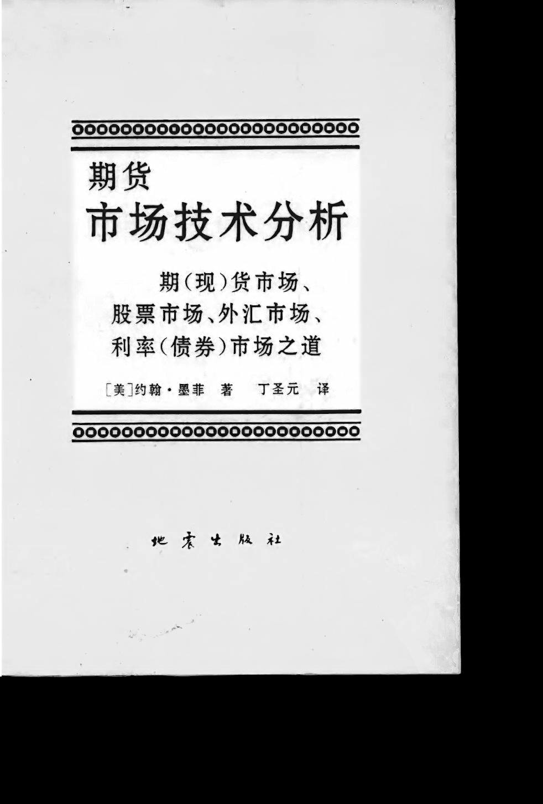

# 前言

> 原书 PDF 第 1–8 页。OCR 自扫描件，图表已截取到 `images/00/`。

<!-- pdf p1 -->

<!-- pdf p2 --> <!-- pdf p3 -->

## 书目信息

- 书名：期货市场技术分析——期（现）货市场、股票市场、外汇市场、利率（债券）市场之道
- 原书：Technical Analysis of the Futures Markets: A Comprehensive Guide to Trading Methods and Applications（New York Institute of Finance，1986）
- 作者：［美］约翰•墨菲（John J. Murphy）
- 译者：丁圣元
- 出版社：地震出版社（北京），责任编辑张崇山
- 版次：1994年5月第一版，1994年5月第一次印刷；787×1092 1/16，35印张，852千字
- ISBN：7-5028-0915-5/F•47；定价60.00元

<!-- pdf p4 -->

## 前言

本书是讲商品期货技术分析的，为什么要写它呢？话题要回到几年前我在纽约金融学院开的这门课去。

那是1981年春，学院邀请我讲授技术分析。当时我已经担任期货市场分析师 10多年了，也曾经主讲过几次类似内容的讲座，可是要主持一个15星期长的课程，却是大姑娘坐花轿，头一回。起初，我担心题材不够，充实不了这么多课时。随着课程构思的深入，我才终于意识到，要说清楚这样复杂的对象，这点时间其实还不足够。一下子，我豁然开朗。

技术分析的内涵远比用心拼凑的一组专业资料丰富。是不同的研究途径和专业领域的美妙结合才造就了技术分析。为了讲清楚它的来龙去脉，至少要把 10多种研究领域有机地组织起来，形成一个完整的理论体系。

就这样，我选定了主要内容，接着便要找一本合适的教材。我浏览了已出版的所有有关书籍，结果很失望，没有一本是现成的。书都不错，只是介绍的主要是股市分析知识。我不打算用关于股市的书来做商品期货的教材。

现有的期货研究书籍差不多统统假定其读者已经掌握了图表分析 <!-- pdf p5 --> 的基本概念，一上来就讲述一些高深的理论或者作者本人的独创。这对初学者没有太大的帮助。有些呢，往往潜心探讨技术分析的某个专门领域，比如线图或点数图、艾略特波浪理论或周期理论，而显得过窄。还有的呢，则研究计算机应用，讲如何设计复杂的信号和高级交易系统。当然，它们各有千秋，但要作技术分析教材却太专业太复杂。

我觉得这本教材应该入情入理、循序渐进地从入门知识讲到复杂应用，逐步引导读者学会把技术分析的各种技能应用到期货市场上去。这样的书可惜还不存在。这恰恰便是现有参考书阵容明显的美中不足之处。稍知技术分析的人都知道，这个漏洞非填补不可，如今又摊上我需要这种书，只好自己动手了。

本书名为《期货市场技术分析》，但不是要对技术分析作无所不包的最后说明。不论现在还是将来，没人写得出这样的书。技术分析的学问实在太博大精深、微妙绝伦，要想写一本最权威的大全只能吹吹牛罢了，注定不会成功。虽然如此，在本书中我仍竭尽所学，力图涉猎该课题的每个方面。

也不能把本书当成入门书。在前面部分，我从头来起，花了相当的篇幅讲述图表理论的基本知识。因为一方面我强烈地感觉到，绝大多数成功的技术分析归根结底是因为基础知识应用得法；另一方面，目前大部分复杂的信号系统只是这些基本概念的升华。接下来，水到渠成了，本书便进入到更高级的领域。如此安排无非是想让不太熟悉有关内容的朋友也跟得上趟儿。同时我也认为书中许多东西对有几年经验的中等分析人员大有裨益，高级分析师也不妨使用本书作一个很好全面回顾。

最后这句话可不是随便说的。在技术分析这门学问面前，我们不都是学生吗？W•D•江恩是一位著名的分析家，他曾指出：“在过去四十年里我年年研究和改进我的理论。我还在不断学习，但愿自己在未来有更大的发现。”（摘自《怎样从期货交易中获利》，1976年兰伯特•江恩出版社出版，第2页）。

不断学习、不断检讨的重要性怎样强调都不过分。因为要讲授技术分析理论，我需要经常重温许多过去学过的参考书，这使我获益匪浅。每次复习我都领悟出不少新见识，掘开许多过去忽略了的精妙之处。我觉得，即便是最有经验的交易老手也能从复习中得益。每当一个操此行当一年半年的新手声称自己经掌握了基本知识，可以升级去研究“更深的技术”的时候，我总忍不住感叹，“满瓶不动半瓶摇啊！”或许这其实是我嫉妒吧。我干了15年，现在还在尽力掌握呢。

第一章介绍技术分析的理论出发点，给出了其定义和前提。我始终觉得大部分围绕技术分析的争论，原因在于不理解究竟什么是技术分析以及什么是它赖以成立的基本原理或哲学基础。本章也介绍了技术 <!-- pdf p6 --> 分析与基础分析孰优孰劣的比较，谈了谈图表分析的几个长处。时常听到有人争辩技术分析在股市与在期货市场应用的种种异同，我也讲了讲自己的看法。还简要介绍了反对技术分析的主要的两大观点：随机行走理论和预言自我应验理论。

第二章讲述经典的道氏理论。这是绝大部分图表分析理论的源头。不少期货分析者看起来并不清楚他们的吃饭本钱在多大程度上可以追溯到本世纪初查尔斯•道的文章里。

第三章解释了最常见的日线图的画法，以及交易量和持仓兴趣两个概念。也提到了周线图和月线图，作为对日线图的补充。

第四章开始讲解基本概念——趋势，这是图表分析的基石。然后是诸如趋势、支撑和阻挡、趋势线和管道线、回撤百分比、价格跳空和关键反转日等等概念。

第五、六两章以上述概念为基础研究价格形态。主要的反转形态，如头肩形和双重顶（底）在第五章中处理。力求图文并茂，还一并介绍了测算技术同交易量，主要是后者在价格形态形成或瓦解中所担角色的问题。

第七章更深入地探讨交易量和持仓兴趣。说明如何用它们证实价格变化或者发现流行趋势将要转折的警讯。也没忽略其它采用交易量作信号的方法，比如 OBV法。

第八章提起了周线图和月线图。它们虽然重要却常常为人遗漏。这种长时间尺度的图表是帮我们鸟瞰市场的好手段，而单单靠日线图这是做不到的。也强调了跟踪一般商品指数的价值，比如商品研究局期货价格指数和其它各种一揽子商品的指数。

第九章讨论移动平均线。这个工具最流行，也是大多数计算机追随趋势系统的主要依据。

本章还介绍了另一种趋势追随方法，周价格管道，又称四周规则。

第十章讲解摆动指数以及怎样用它辨认市场超买或超卖的状态。比较了不同类型的摆动指数。怎样发现相互背离现象也是我们的重要课题之一。相反意见方法是侦查市场转折点的另一种选择，当然也要介绍。

第十一章暂且放下线图，另表点数图技术。尽管它不如线图出名，却具有更高的精确度，用来补充线图常常颇有价值。

第十二章说到在得不到每日价格变化的细节资料的情况下，怎样从点数图中获得一些助益。接着一并讨论三点反转方法和优化点数图。目前计算机的应用日益普及，更复杂的价格报告系统也不断推出，因而点数图看来在期货领域正东山再起。

第十三章讨论艾略特波浪理论和菲波纳奇数字。这个理论本来是应用在股市平均价上的，目前在期货市场正日益受人青睐。要是使用得 <!-- pdf p7 --> 当，艾略特理论能用一种独特的方法纵览整个市场的动向，使分析者视界大开，更有信心预测市场的转折点。

第十四章通过研究周期理论，为市场预测的难题引入时间维。对以年为周期的和季节性的形态也有所涉猎。除此之处，本章还讨论了经过与当前市场周期同步处理之后的移动平均线和摆动指数等技术分析工具。

第十五章对计算机在技术分析和实际交易中的日益活跃大唱赞歌，还讨论了使用计算机自动交易系统的利弊。我们也要看一看一些通过 Compu Trac 软件做出的技术分析的例子。不过值得强调，计算机只是工具，绝不能替代优秀、稳健的技术分析师。如果用户不理解从第一章到第十四章所介绍的技术工具，计算机就派不上太大用场。计算机可以帮一个好分析师更出色，却不能替一个差劲的分析员换付肚肠，有时甚至弄得更糟。

第十六章讨论资金管理。无独有偶，这是另一个被大大遗忘的的角落，而在成功的期货交易中却不可或缺。本章告诉您什么是资金管理，以及为什么要想在期货市场中“苦海余生”资金管理就非常重要。许多交易商都同意，这方面是期货交易最重要的一环。交易的三个步骤——预测、选择出入市时机以及资金管理——应协调进行。预测，帮助交易者决定入市时站在哪一边，买还是卖。出、入市时机的选择，确定具体的出入市点——何时行动、怎样行动。资金管理，决定买入或卖出的金额。接下来介绍了各种交易指令，也就是否应在交易策略中采纳保护性止损措施谈了我的看法。这个题目争议颇多。

最后是全书大汇串，把上面的所有内容串成一个丝丝入扣的理论体系，就好象一场大型的七巧板游戏，各部分拚在一起。这儿既强调了我们有必要熟悉所有各种技术分析手段，也讲解了怎样使它们各得其所相辅助成。不少分析者囿于技术分析的某一领域，总自以为他这一块才是成功的关键。我不敢苟同。没有哪个单独的领域包含全部答案，而是各自拥有一部分解答。换句话说，每种技术手段只是解出大谜团的一条线索，交易者把握的线索越多，解开迷团的胜算当然便越大。为了帮助读者在这个方面得到些启发，我开列了一份清单。

虽然本书主要研究的是技术分析在商品期货市场的应用，其实它在差价交易和期权交易中也大有用武之地。这两个市场也不容忽视，所以在附录一和附录二中我们也有简要介绍。另外，写任何技术分析书，如果不说说 W•D•江恩的传奇就不能算完。尽管本书篇幅所限，不能深入讨论江恩的技术，但在附录三中也概括了他的简化的交易工具。有些人对之推崇备至。

作者真诚地期望本书的确如愿以偿，填补本前言开头所指出的缺憾。也但愿本书已经囊括了技术分析的各方面知识，以便朋友们更好地 <!-- pdf p8 --> 理解和欣赏它。技术分析不是人人都有缘分的。实际上要是所有人都奉之为圭臬，也许它会失去许多魅力。所以我不奢望这本书人见人爱。这门学问有时是深奥艰涩的，令人望而生畏。平心而论，我写这本书不过想以一个技术分析者的身份同那些有心进一步了解该理论的同好分享自己的一点理解罢了。

有的人因为所知有限，就说技术分析是“算命打卦”，这当然是偏见。然而技术分析也不是令您一夜暴发的聚宝盆。它是基于历史资料、心理学和概率统计规律之上的、预测市场的一种途径，肯定不会“放之四海而皆准。”但这门技术成功明显地多过失误，经受住了交易实践的历史检验，因此值得任何有志于市场行为研究的朋友努力学习。

在写书的过程中，我的着眼点始终是简洁。有人总是不厌其烦地把简单概念折腾得深奥复杂。只要可能，我倒宁愿更简单些。我曾经尝试过从非常简单到非常复杂的大多数技术分析工具，结论是，在绝大部分情况下，更简单的往往是更有效的。所以贯穿全书，我始终忠告朋友们：“力求简明”。

约翰•墨菲
