# 第三章 图表简介

> 原书 PDF 第 45–61 页。OCR 自扫描件，图表已截取到 `images/03/`。

<!-- pdf p45 / 书页 30 -->

## 引言

本章主要是为不熟悉图表的朋友准备的。我们先讲解现有图表的各种不同类型，然后再集中研究其中使用得最广泛的日线图。我们也将介绍怎样理解价格数据，进而交代如何作图。此外还要讲述交易量和持仓兴趣两个概念。接下来再说说线图的其余种类，比如属于长期性质的周线图和月线图，还有以小于一天为时间单位的日内线图。有了上述预备知识后，在随后的几章将讨论分析线图的几种工具。熟悉图表的读者或许觉得本章过于基础，不妨直接跳到下一章。 <!-- pdf p46 / 书页 31 --> 

## 现有图表的类型

众所周知，日线图在期货交易中使用最广。不过技术分析师也使用其余类型的图表，这里要说两种，点数图和单线图。图3.1是一张标准的日线图。以“线图”为名是指这类图表以竖直的线段表示每一天的价格变化。从日线图的每一根竖直线段上，通常可以看出当天的最高价格、最低价格和收市价格。每根竖直线段上向右伸出的小横线标志着当日收市价位。一部分技术分析师也开始采纳开盘价，把它标在线段的左侧，如本图所示。

图3.2以单线图的形式重画了上面的日线图。在单线图上，我们只要逐日作出各个收市价格所在的点，然后简单地连线即可。因为收市价格是每个交易日最重要的价格，所以不少图表师觉得这种单线图能更有效地展示价格变化。根据分析者的不同需要，某些分析手段用在单线图上比用在相应的线图上更简明。

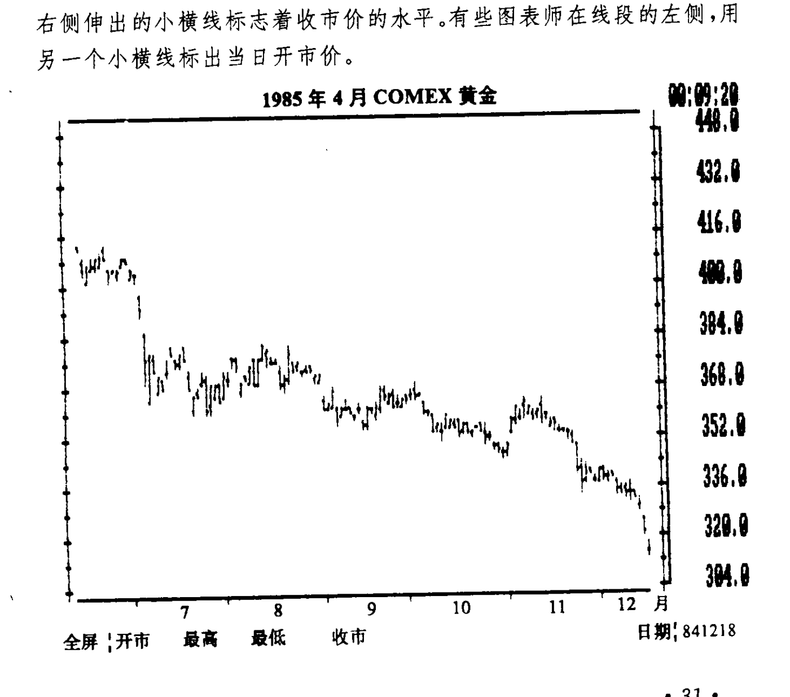
> 图3.1 黄金合约的日线图。其中每根竖直线段都表示一天的价格变化。最常用的价格资料是当日的最高价、最低价、和收市价。线段上向右侧伸出的小横线标志着收市价的水平。有些图表师在线段的左侧，用另一个小横线标出当日开市价。

<!-- pdf p47 / 书页 32 -->

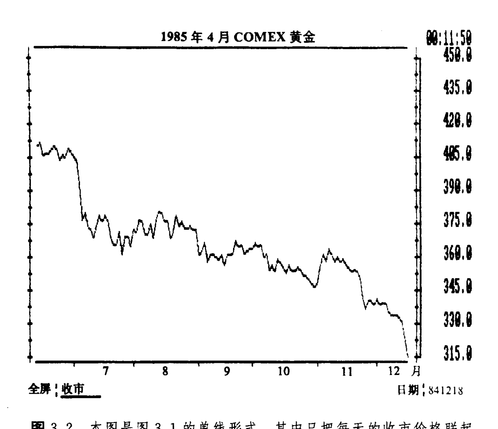
> 图3.2 本图是图3.1的单线形式。其中只把每天的收市价格联起来，形成了一条单的实线。

点数图是第三个类别，如图3.3所示。本书后面有两章专门深入讨论这种图表的分析方法。请注意，这张点数图显示的也是上面两图的价格内容，但是其形式更为简洁紧凑。图中“X”和“0”符号逐列交替出现。“X”组成的列表示价格上升，“O”组成的列代表价格下降。点数图能够比线图更清楚、准确地显示买、卖信号，同时也具有很大的灵活性。绘制图3.3只需要用到每日最高价、最低价的资料，而这我们从报纸上就很容易取得。

上面介绍了三种图表，主要通过当日最高价、最低价和收市价格来构图，偶尔也用到开市价格。但是每天在交易所场内，还有大量交易活动的细节资料，没法在这几种图表上显示出来。有机会使用高级图表系统，比如 ADP康川公司的可回馈视觉系统的交易商，可以通过以日内时间单位为基础绘制的线图、单线图和点数图，来获悉每日的市场活动细节。拿线图来说，这些时间单位可以是5分钟、15分钟以及1小时等，在做短线交易时，这些短线图表妙用无穷。在以后的各章中，还要介绍这类短线图表，当然也不会忽略单线图和点数图。不过此处，我们的讨论只限于日线图（见图3.4和3.5a和b）。 <!-- pdf p48 / 书页 33 -->

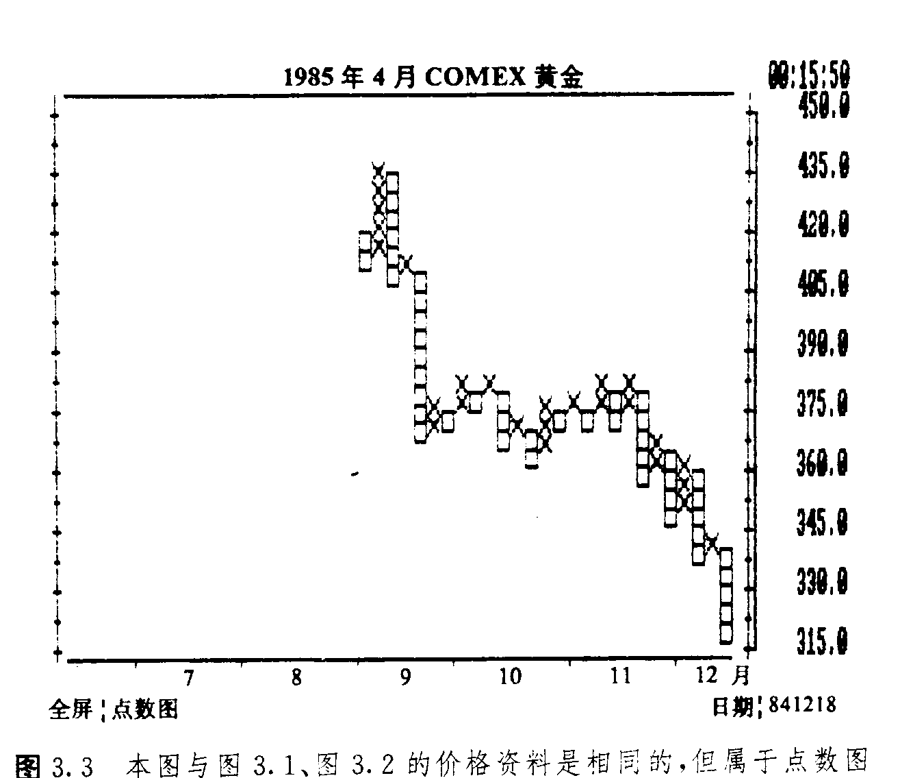
> 图3.3 本图与图3.1、图3.2的价格资料是相同的，但属于点数图的格式。请注意，其中“X”列和“O”列交替出现。X 列表示价格上升，O列代表价格下降。在这类图上，买卖信号较为精确。还请注意，在这里，价格资料被大大压缩了。

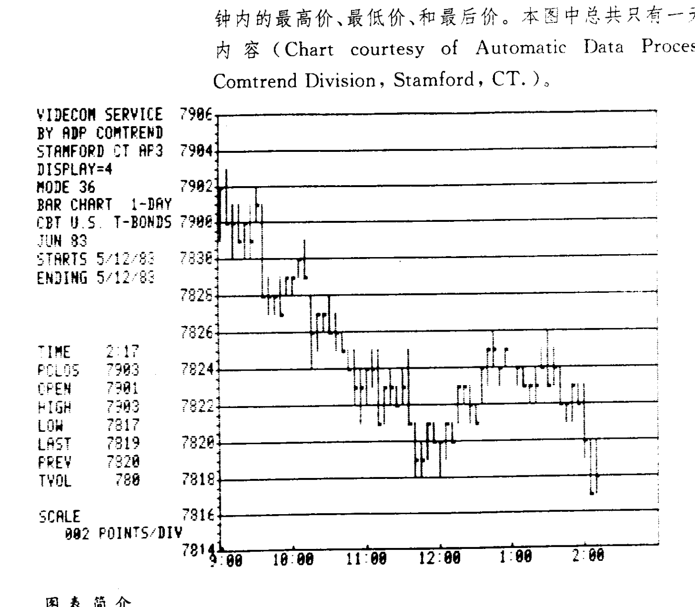
> 图3.4 长期国债合约的日内线图。其中每根竖直线段代表每5分钟内的最高价、最低价、和最后价。本图中总共只有一天的价格变化内容（Chart courtesy of Automatic Data Processing, Inc., Comtrend Division, Stamford, CT.）。

<!-- pdf p49 / 书页 34 -->

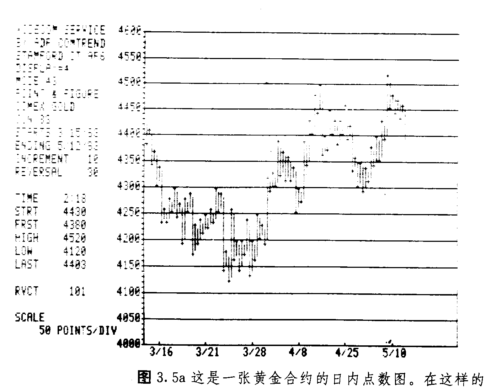
> 图3.5a 这是一张黄金合约的日内点数图。在这样的图表上，可以获得大量的价格资料，发现隐含的支撑和阻挡水平（Chart courtesy of Automatic Data Processing, Inc., Comtrend Division, Stamford, CT.）。

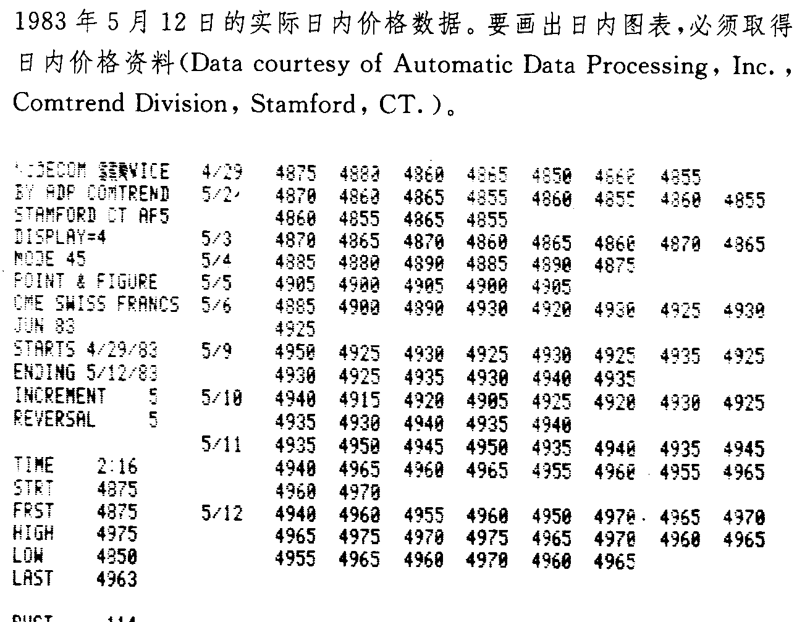
> 图3.5b 这是一张价格数据表，为瑞士法朗从1983年4月29日到1983年5月12日的实际日内价格数据。要画出日内图表，必须取得日内价格资料（Data courtesy of Automatic Data Processing, Inc., Comtrend Division, Stamford, CT.）。

<!-- pdf p50 / 书页 35 -->

## 算术刻度和对数刻度

在期货行业中，所有商业化图表的价格轴都是以算术刻度表示的，不过，在进行某些形式的分析，特别是在研究非常长期的趋势时，使用对数刻度图表可能更为便利（见图3.6和3.7）。图3.6分别是算术刻度和对数刻度的两个示例。在算术刻度上，每单位的价格变化都用相等的竖直距离表示。例如，从5单位到10单位的价格变化与从50单位到55单位的价格变化在图上所标出的竖直距离是相等的，虽然在前一种情况下价格翻了一番，后者只是上涨10%。而在对数刻度上，相等的距离表示相等的百分比例的价格变化，比如说从10单位到20单位（上涨100%）的价格变化，与从20单位到 40单位或者从 40单位到 80单位的价格变化在图表上的竖直距离都是相等的。请注意，在算术刻度尺上，刻度是均匀分布的。而在对数刻度上，随着价格读数的增大，由于每单位价格增量占其价格基数的百分比值递减，于是，从刻度1到2的距离与从刻度5到10的距离相等，因为它们同样表示价格翻了一番。尽管对数图表在长期趋势分析中也许有益，我们手头上却都没有此类图表，而且大部分读者除了传统的算术图表外别无选择，所以，本书今后仅使用此类图表。

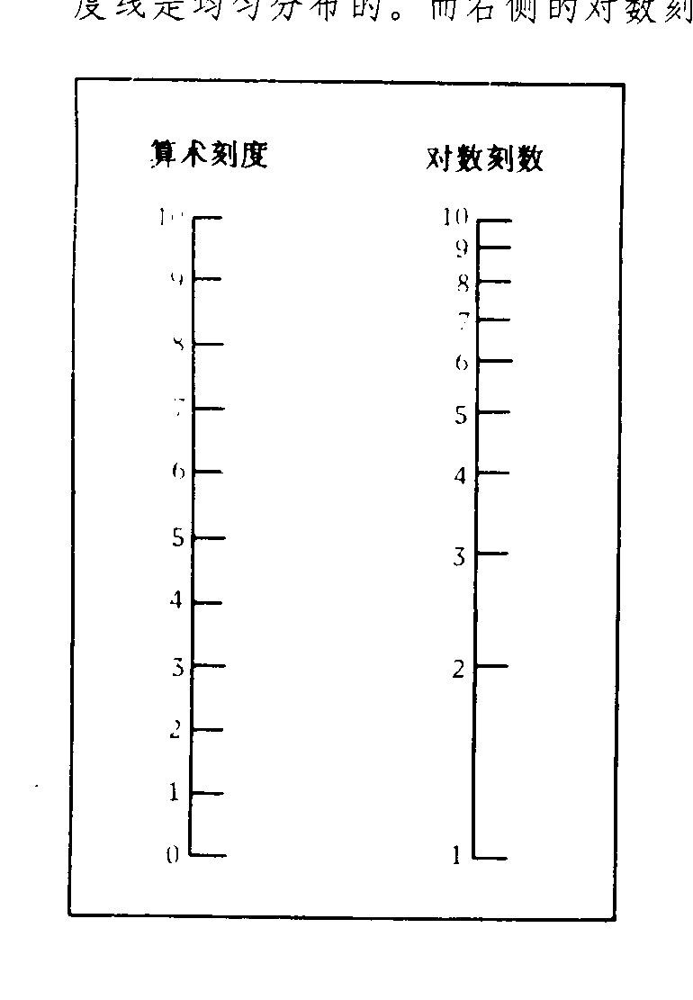
> 图3.6 算术刻度与对数刻度的对照图。请注意，在左侧的刻度上，刻度线是均匀分布的。而右侧的对数刻度，则表示百分比的变化。

<!-- pdf p51 / 书页 36 -->

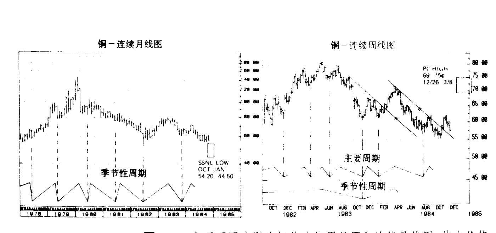
> 图3.7 上面两图分别为铜的连续周线图和连续月线图，其中价格轴采取对数刻度。请注意，当价格降低时，刻度放大；而价格升高时，刻度收密。在对数刻度的图表上，特别是在长期图表上，趋势线和管道的作法很受影响 （Charts courtesy of HAL Market Cycles,Tucson,AZ.）。

## 日线图作法：价格、交易量以及持仓兴趣

日线图的作法非常简易。在线图上既有价格因素，也有时间因素。竖直轴（Y轴）代表合约的价格，水平轴（X 轴）记录对应的时间项，日期标在图表的底部。我们只要在水平轴上的相应的日期位置，按照价格轴刻度点出当日最高价和最低价，然后用线段连接起来，就可得到一根竖直线段（称为区间），然后，在这根竖直线段上，从当日收市价格的位置向右引出一小截线头，日线图就画成了（见图3.8）。

收市价之所以标在线段右侧，是因为要留出左侧表示开市价格。传统上，我们只保存高、低和收市三种价格的资料，不过目前在短线操作者中，对开市价的记录和利用日益普遍。画好一天的价格后，次日的价格画在其右边邻近的对应日期上。大多数图表服务系统按每周五个工作日来标定时间轴，略去周六和周日。在每周的五个工作日里，不论哪一天市场休息，当天的位置上就留出空白。 <!-- pdf p52 / 书页 37 -->

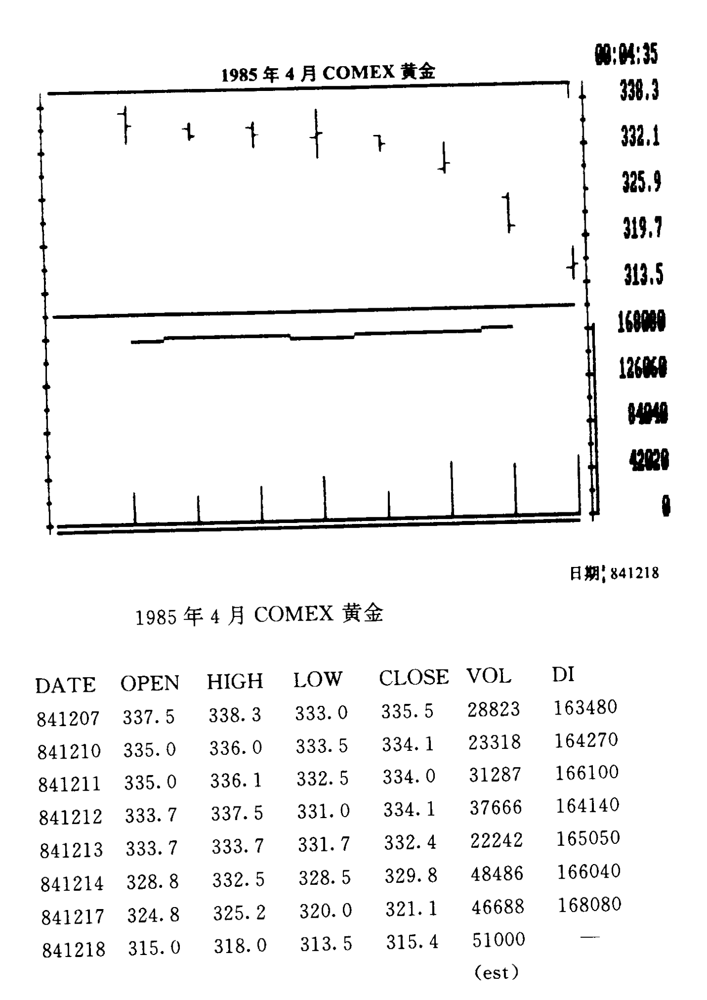
> 图3.8 上半图表示了8天的价格变化。在各个竖直线段上，右侧小横线为收市价，左侧小横线为开市价。下半图显示了总的交易量（以刷形图表示）以及总的持仓兴趣（以实线表示）。数据表格中包括了相应的各项数据。最后一天的交易量为估计值。这里也没有最后一天的持仓兴趣，因为迟一天才会公布。

<!-- pdf p53 / 书页 38 -->

## 交易量和持仓兴趣

线图上还包含另外两项重要信息——交易量和持仓兴趣。交易量为当日在某商品市场发生的交易总额，也就是该商品市场到期月份不同的各种合约，在这一天内参与买卖的总的张数。这个概念相当于股市上某日易手的普通股票总股数。在日线图的底部，对应于每一个交易日，有一根竖直线段，居于当日价格线段之下，代表当日的交易量。要是这根线段向上伸展得较高，就意味着当日交易量较重，相应地，短线就表示交易量较轻。为了便于描绘交易量的数据，图表下部也沿着竖直方向标出了交易量的刻度单位（见图3.9）。

持仓兴趣是所有交易商到当日收市为止累计的未平仓合约的总数目。持仓兴趣是买盘或卖盘单边的总数，而不是双方之和。请记住，我们讨论的是合约交易，有买则必定有卖，每一个买盘（多头头寸）都必定有一个卖盘（空头头寸）与之相对共存。这样，我们只要知道一边的情况就行了。我们沿着图表下部用一条实线表示持仓兴趣，它通常在交易量稍上方波动，但低于价格。此外，不少图表服务系统还添上了一条虚线，表示持仓兴趣的5年平均线，意在显示其季节性倾向。

### 交易量和持仓兴趣在全部合约下的总额和在单个合约下的小计

在大多数商业图表系统中，只采用某商品全体合约下的交易量和持仓兴趣的总额。大部分技术分析师也是这样选择的。但同一商品具有到期月份不同的数种交易合约，我们也能分别获得它们个别的交易量和持仓兴趣的资料。不过在预测市场的时候，一般实际使用的是同一商品的各个个别值的总和。下面谈谈这样做的原因。

在合约刚刚上市的时候，它的交易量和持仓兴趣一般相当小。随着其逐渐成熟，这两个数字也相应壮大。最后在临近到期的前几个月，交易量和持仓兴趣又逐步萎缩。显然，这是因为交易商在合约到期之前，必须把敞口头寸对冲掉。因此，具体合约在刚上市的时候交易量和持仓兴趣的增长，以及在临近到期的时候两者的减少，均与市场方向无关，而仅仅是商品期货合约的有效期限特点所导致的从生现象。为了保证交易量和持仓兴趣两者的连续性，也为了使之具备预测性意义，我们普遍采用上述总和。当然，“普遍”不等于“全部”。有些分析师认为，在合 <!-- pdf p54 / 书页 39 --> 约有效期的中间阶段，相应的个别交易量和持仓兴趣数据也确实有预测性价值。

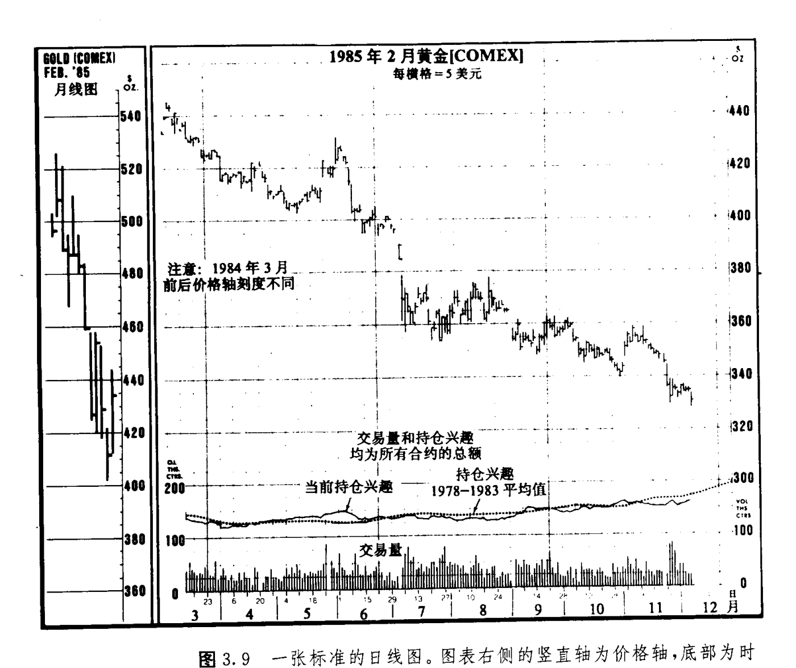
> 图3.9 一张标准的日线图。图表右侧的竖直轴为价格轴，底部为时间轴。交易量总额以图表底部的刷形图表示。持仓兴趣总额以实线表示，出现在交易量的上方。交易量和持仓兴趣的刻度分别标在图表下方的右侧和左侧。下方的虚线表示持仓兴趣的5年平均值，用来显示持仓兴趣的季节性形态 （Chart courtesy of Commodity Research Bureau, a Knight-Ridder Business Information Service.）。

### 当日的交易量和持仓兴趣次日公布

交易所是在第二日公布前一日的交易量和持仓兴趣的，所以图表师手中的资料比实际落后一天。这两类数字通常在次日的交易时间内发布，因此次日的金融报纸来不及登载。于是，每天早晨的报纸，只能刊 <!-- pdf p55 / 书页 40 --> 登前一天交易量和持仓兴趣的估计数字。这种估计数虽然不尽人意，但尚能为分析者就前一日交易的活跃程度，提供一点参考。从读者角度来看，每天早晨可以读到昨天的市场价格，和昨天的交易量、持仓兴趣估计数字，以及前天的交易量和持仓兴趣的所方正式报告。举例来说，在星期三早晨的报纸上，有星期二的价格和估计的交易量、持仓兴趣，还有星期一的交易量和持仓兴趣的所方正式报告。对重视市场逐日变化者而言，一天的耽搁会造成一些不便利，不过程度还不太严重（见图3.10）。

图3.10摘自华尔街日报的期货版。从中我们可以发现作日线图所需要的所有数据。请注意，在每种商品的小标题下面，各种到期月份合约的资料是按行排列的。到期月份排在每行的最左列，上一个交易日的开市价、最高价、最低价、结算价（收市价）从左往右顺序排开，最右列展示的是各个合约的个别持仓兴趣。每栏商品的最底下一行，先是昨天该商品的交易量和持仓兴趣的估计值，然后是前天所方公布的两者的正式数字。最底下这一行的交易量和持仓兴趣当然都是该商品所有合约下的总和。持仓兴趣前面的正负号，分别代表在相应的交易日里未平仓头寸的增加或减少。我们在第七章还要讲到，其增减方向具有预测价值。

### 个别交易量和持仓兴趣的意义

在研究市场方向时，个别交易量和持仓兴趣意义不太大，但它的信息还是很有价值的。在我们从同一商品的各种合约中选择具体的交易媒介时，它们能表明何者流动性最佳。一般来说，交易活动只宜限于那些持仓兴趣最高的合约，而那些持仓兴趣低的合约则应避开。名符其实，持仓兴趣越高，则表明围绕着该种到期月份合约的交易意向越浓厚。某些交易商更愿意用个别交易量来衡量各种具体市场的活跃程度，我相信持仓兴趣更可靠。具体合约的交易量数据每天发表在《商贸报》上。

## 怎样描绘谷物市场的交易量和持仓兴趣

在描绘谷物和大豆的交易量及持仓兴趣的图表时，有一点必须明确。某些报纸上的报告是以合约张数为单位的，但是图表服务系统则 <!-- pdf p56 / 书页 41 --> 使用千或百万蒲式耳为单位。每张合约相当于5000蒲式耳。所以，我们在由报纸资料绘图时，应当把相应的数字乘以5，折算出同常用图表相对应的数值（见图3.11）。

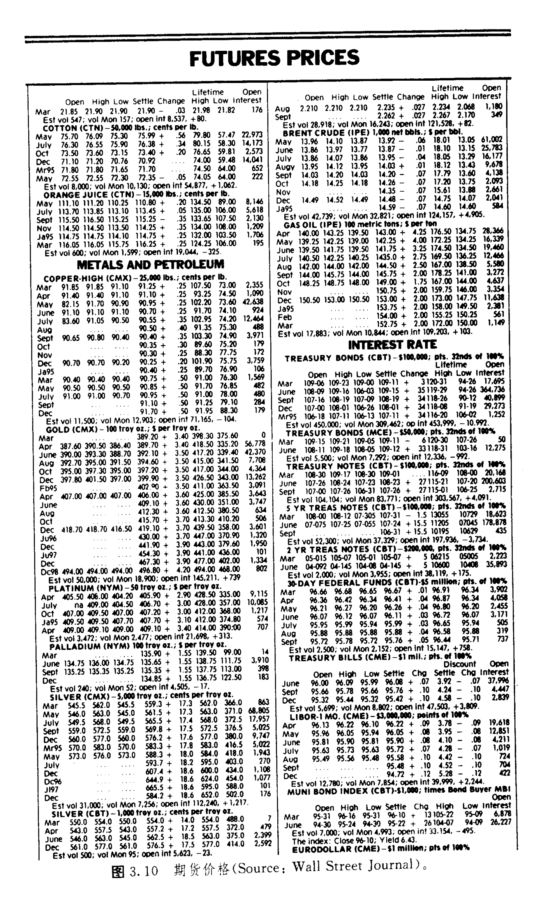
> 图3.10 期货价格（Source：Wall Street Journal）。

<!-- pdf p57 / 书页 42 -->

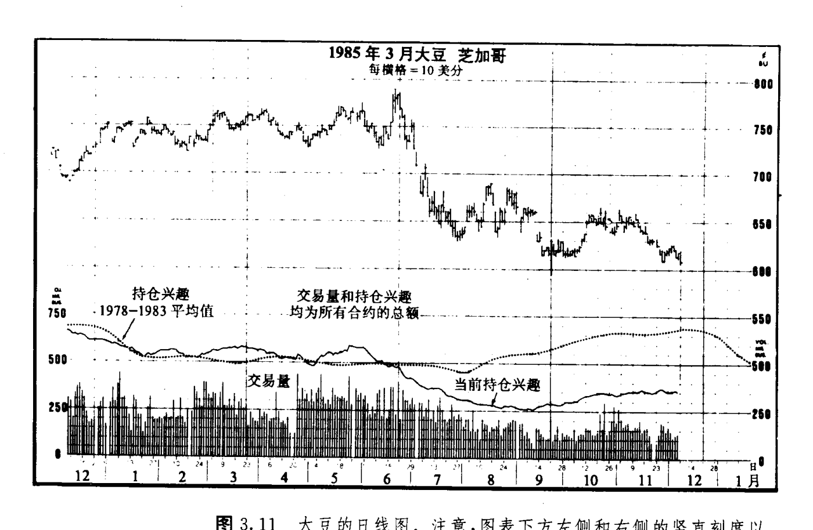
> 图3.11 大豆的日线图。注意，图表下方左侧和右侧的竖直刻度以百万蒲式耳为单位。当我们以《华尔街日报》和《纽约时报》上的交易量和持仓兴趣的数字作图时，必须把它们分别乘以5，使其单位从合约张数转换成蒲式耳（Chart courtesy of Commodity Research Bureau, a Knight-Ridder Business Information Service.）。

## 自己绘图和利用图表系统

我们还不打算在此详细讨论交易量和持仓兴趣，那是第七章的任务。这里的全部目的，是要讲清楚数据资料从何而来，以及如何把这些数据用图表表示出来。我不怂恿您自己绘画图表，那样做，费时费力，不如走捷径，订阅某种商业化的图表服务，其费用低廉，且大为便利准确。每周，您都可以收到用最新数据刷新过的新图表。其中还附有很多极具价值的技术性信息，对分析工作大有裨益。此外，在大多数图表服务中，还包括一些图表分析的内容，至少从及时的角度上说，肯定也是有帮助的。关键是，我们应当把时间花在研究图表上，而不是逐日刷新 <!-- pdf p58 / 书页 43 --> 图表上。当然，只要朋友们掌握了每个商品市场的价格结构，并在刷新图表上训练有素，那么，每天只要花上不到半小时，就可以把前一天的整个投资组合中的各种期货资料，统统补充到相应图表上去。

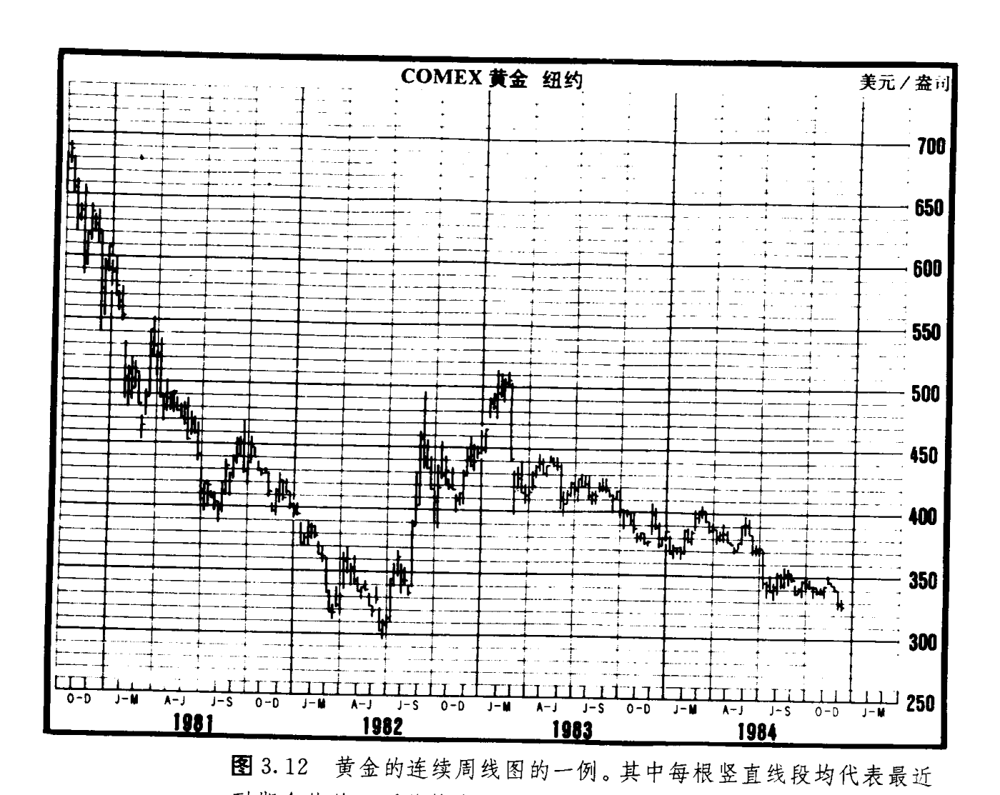
> 图3.12 黄金的连续周线图的一例。其中每根竖直线段均代表最近到期合约的一周价格变化。从这张图上，可以看到5年的价格信息（Chart courtesy of Commodity Research Bureau, a Knight-Ridder Business information service.）。

## 周线图与月线图

到这里，我们已经对日线图进行了集中的讨论。不过要清楚，我们其实可以以任何时间单位为基础来构造线图。前面已经提到一些所谓日内线图，如小时线图。此外，我们甚至还可以以5分钟为时间单位，选择每5分钟内的最高价、最低价和最后价格来作图，称为5分钟线图。另一方面，日线图上一般可以展示6个月到9个月的价格变化，然而如 <!-- pdf p59 / 书页 44 --> 果要做更长期的趋势分析，就必须使用周线图和月线图了。第八章将解说使用这种长线图表的益处。周线图和月线图的绘制方法与日线图一致（见图3.12 和图3.13）。

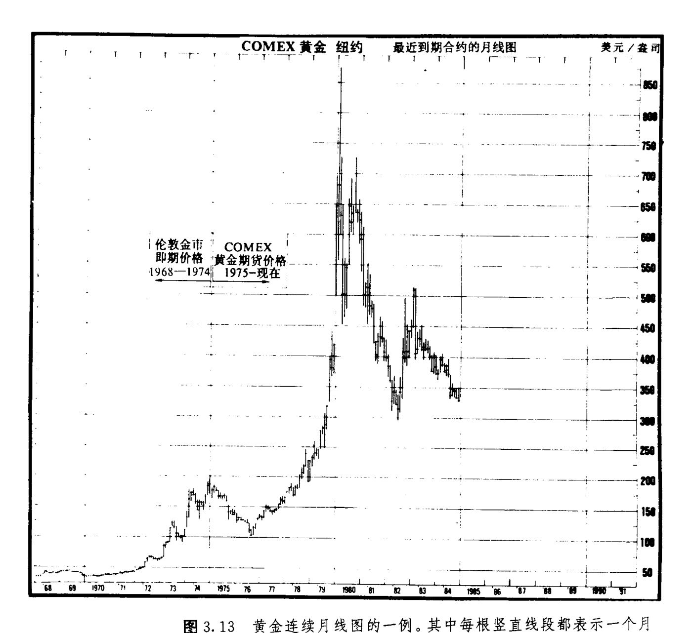
> 图3.13 黄金连续月线图的一例。其中每根竖直线段都表示一个月的价格资料。从这张图上，可以研究20年的价格历史（Chart courtesy of Commodity Research Bureau, a Knight-Ridder Business Information Service.）。

在周线图上，每根竖直线段代表对应一星期的全部价格活动。在月线图上，每根竖直线段表示对应一个月内的全部价格变化。显然，为了展示更长期的趋势，周线图和月线图把价格资料大加浓缩了。通过连续周线图，我们可以一直追溯到5年以前的市场情况，而连续月线图可以覆盖20年以上。这里所谓的连续图表，得来并不复杂，只要简单地上溯历史资料，挨次地把最近到期合约的价格图表中的相应片断接续在一 <!-- pdf p60 / 书页 45 --> <!-- pdf p61 / 书页 46 --> 起就可以了。这是个简易的技巧，但能够帮助技术分析师纵览较长时期的市场情况——这类长期透视在期货市场经常欠缺，因而弥足珍贵。

## 结语

现在我们已经学会了绘制日线图，也了解了三种基本的信息来源——价格、交易量和持仓兴趣，那么下一步就该介绍如何解释这些资料了。请记住，图表仅仅是数据资料的记载和展示，其自身并无特别的价值。它们就象画笔和画布，工具本身并不能决定一幅画的艺术水准，只不过在一个天才的画家的手中，就能物尽其用，创造出美好的形象。用手术刀做比喻或许更恰当。造诣不凡的外科医生能够使用手术刀来挽救生命，可它如果落在我们常人手里，不唯用处不大，甚至可能带来危险。在您掌握了图表分析的规则之后，在您施展这门预测艺术（或者说技巧）的时候，图表就极具价值。那么我们就开始吧，下一章，就来讲述趋势的一些基本概念。我认为这是图表分析的建筑基石。

本章最后，附录了一张“期货交易要目”，以备不熟悉各种期货合约详情的读者查阅（见图3.14）。其中，各种市场如何标价、最小和最大价格变化单位及其相应的以美元计算的出入、有关交易所、交易时间等，都是必备知识。本指南仅是个参考，以帮助读者熟悉不同的期货市场。必须声明，有关的具体情况会定期调整，朋友们在查阅各种指南时，请务必以最新出版者为准。

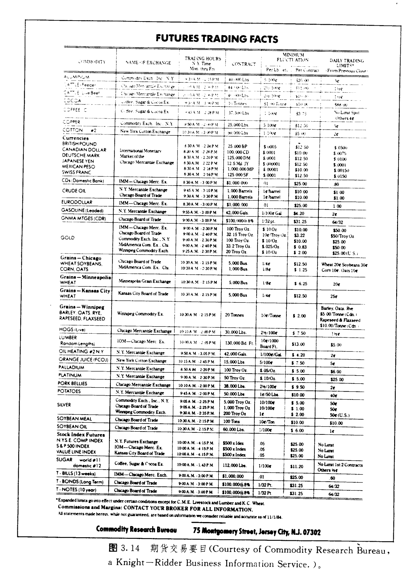
> 图3.14 期货交易要目（Courtesy of Commodity Research Bureau, a Knight-Ridder Business Information Service.）。
