# 第五章 主要反转形态

> 原书 PDF 第 108–137 页。OCR 自扫描件，图表已截取到 `images/05/`。

<!-- pdf p108 / 书页 93 -->

到这里，我们已经涉猎了道氏理论，这是目前实际应用的绝大多数趋势顺应机制的理论起点：也探讨了趋势的基本概念，诸如支撑、阻挡和趋势线等；对交易量和持仓兴趣也作了介绍。那么下一步，就该学习图表形态了。很快我们就会发现，这些形态就是建立在上述概念基础之上。

上一章，我们把趋势定义为一系列依次上升或下降的峰和谷。只要它们相对变化的方向向上，则趋势向上；如果其相对变化的方向向下，那么趋势就向下。我们还强调指出，在相当部分时间内，市场处于横向伸展的态势之中。而正是这种横向延伸的市场运动，构成了接下来两章的主要课题。

千万不要以为绝大部分趋势的变化突如其来，事实上，趋势在发生重要变异之前，通常需要一段酝酿的时间。问题就在于，这种酝酿时期 <!-- pdf p109 / 书页 94 --> 并不总意味着趋势将要逆转，有时候，这只是既存趋势的休整，随后原有的趋势仍将继续。

## 价格形态

研究这种酝酿时期及其预测性意义就是价格形态所要解决的问题。那么，什么是价格形态呢？价格形态是股票或期货价格图上的特定图案或花样，它们具有预测性价值，我们可以把它们分门别类。

## 形态具有两个类别：反转型和持续型

价格形态有两种最主要的分类——反转型形态和持续型形态。反转形态名符其实，意味着趋势正在发生重要反转；相反地，持续形态显示市场很可能仅仅是暂时作一段时间的休整，把近期的超买或超卖状况调整一番，过后，现存趋势仍将继续发展。关键是，必须在形态形成的过程中尽早判别出其所属类型。

本章将讨论五种最常用的主要反转形态：头肩形、三重顶（底）、双重顶（底）、V字顶（底）、以及圆形（盆形）顶（底）等形态。我们将考察价格本身的变化过程，及其变化在图表上的显示，还有判别它们的方法。然后，我们还要研究另外两方面重要因素——伴生的交易量的形态，以及价格形态的测算意义。

交易量在所有价格形态中，都起到重要的验证作用。在形势不明时（许多情况下都是这样的），研究一下与价格数据伴生的交易量形态，是判断当前价格形态是否可靠的决定性办法。

绝大多数价格形态各有其具体的测算技术，可以确定出最小价格目标。虽然这些目标仅仅是对下一步市场运动的大致估算，但仍有助于交易商确定其报偿—风险比。

下一章，我们将讨论形态的另一个大类——持续型形态，内容包括三角形、旗形和三角旗形、楔形、以及矩形。这类形态通常反映出现行趋势正处于休整状态，而不是趋势的反转，因此，通常被归纳为中等的或次要的形态，算不上主要形态。 <!-- pdf p110 / 书页 95 -->

## 反转形态所共有的基本要领

在单独地剖析各个主要反转形态之前，我们先交待所有反转形态所共有的几个基本要领。

1. 在市场上事先确有趋势存在，是所有反转形态存在的前提。
2. 现行趋势即将反转的第一个信号，经常是重要的趋势线被突破。
3. 形态的规模越大，则随之而来的市场动作越大。
4. 顶部形态所经历的时间通常短于底部形态，但其波动性较强。
5. 底部形态的价格范围通常较小，但其酝酿时间较长。
6. 交易量在验证向上突破信号的可靠性方面，更具参考价值。

### 事先存在趋势的必要性

市场上确有趋势存在是所有反转形态存在的先决条件。市场必需先有明确的目标，然后才谈得上反转。在图表上，偶尔会出现一些与反转形态相像的图形，但是如果事前并无趋势存在，那么它便无物可反，因而意义有限。在我们辩识形态的过程中，正确把握趋势的总体结构，有的放矢地对最可能出现一定形态的阶段提高警惕，是成功的关键。

正因为反转形态事先必须有趋势可反，所以它才具备了测算意义。前面曾强调，绝大多数测算技术仅仅给出最小价格目标，那么，最大目标就是事前趋势的起点。如果市场发生过一轮主要的牛市，并且主要反转形态已经完成，就预示着价格向下运动的最大余地便是100%地回撤整个牛市，从它的终点回到它的起点。

### 重要趋势线的突破

即将降临的反转过程，经常以突破重要的趋势线为其前兆。不过朋友们请记住，主要趋势线被突破，并不一定意味着趋势的反转。这个信号本身的意义是，原趋势正有所改变。主要向上趋势线被突破后，或许表示横向延伸的价格形态开始出场，以后，随着事态的进一步发展，我们才能够把该形态确认为反转型或连续型。在有些情况下，主要趋势线被突破同价格形态的完成恰好同步实现。

### 形态的规模越大，则随之而来的市场动作越大

这里所谓规模大小，是就价格形态的高度和宽度而言的。高度标志着形态的波动性的强弱，而宽度则代表着该形态从发展到完成所花费的时间的多寡。形态的规模越大—即价格在形态内摆动的范围（高度）越大、经历的时间（宽 <!-- pdf p111 / 书页 96 --> 度）越长—那么该形态就越重要，随之而来的价格运动的余地就越大。

实际上，这两章所介绍的所有的测算技术，均是以形态高度为基础的。这种方法主要适用于线图，这就是所谓垂直测算原则。而测量价格形态横向宽度的方法，通常应用在点数图分析中。在后面要讲的这种图表分析法中，采用了“横向数算”的技术，它认为顶或底部形态的宽度，同随之而来的价格运动的目标之间，存在着一一对应的关系。

### 顶和底差别

顶部形态与底部形态相比，它的持续时间短但波动性更强。在顶部形态中，价格波动不但幅度更大，而且更剧烈，它的形成时间也较短。底部形态通常具有较小的价格波动幅度，但耗费的时间较长。正因如此，辨别和捕捉市场底部比捕捉其顶部，通常来得容易些，损失也相应少些。不过对喜欢“压顶”的朋友来说，尚有一点可资安慰，即价格通常倾向于跌快而升慢，因而顶部形态尽管难于对付，却也自有其引人之处。通常，交易商在捕捉住熊市的卖出机会的时候比抓住牛市的买入机会的时候，盈利快得多。事实上，一切都是风险与回报之间的平衡。较高的风险从较高的回报中获得补偿，反之亦然。顶部形态虽然更难捕捉，却也更具盈利的潜力。

### 交易量在验证向上突破信号时更具重要性

交易量一般应该顺着市场趋势的方向相应地增长，这是验证所有价格形态完成与否的重要线索。任何形态在完成时，均应伴随着交易量的显著增加。但是，在趋势的顶部反转过程的早期，交易量并不如此重要。一旦熊市潜入，市场惯于“因自重而下降”。图表分析者当然希望看到，在价格下跌的同时，交易活动也更为活跃，不过，在顶部反转过程中，这不是关键。然而，在底部反转过程中，交易量的相应扩张，却是绝对必需的。如果当价格向上突破的时候，交易量形态并未呈现出显著增长的态势，那么，整个价格形态的可靠性，就值得怀疑了。在第七章中，我们将更深入地研究交易量。

## 头肩形反转形态

我们现在来细细地探讨一下头肩形反转形态。这种反转形态可能是最著名、最可靠的。我们将花费较多的篇幅来研究这类形态，因为一方面它本身颇为重要，另一方面，我们也需要通过它来讲解各种新概念。其它绝大多数反转形态仅仅是头肩形的变体，因此，等以后讲到它们的时候，我们就可以省却许多笔墨了。 <!-- pdf p112 / 书页 97 -->

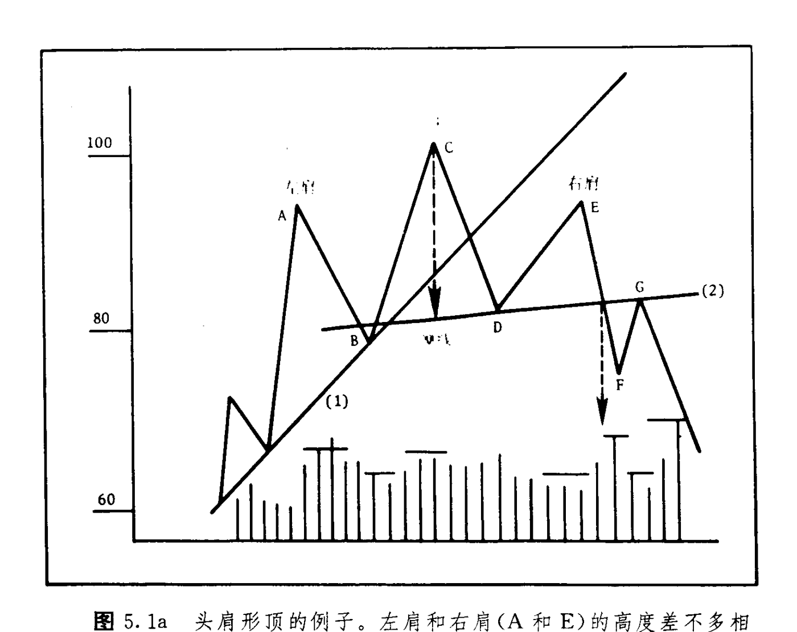

> 图5.1a 头肩形顶的例子。左肩和右肩（A和E）的高度差不多相同，头（C）比两肩高。请注意在每个峰处逐渐减轻的交易量。当收市价居于颈线（线2）之下时，形态完成。其最近目标的求法是，自颈线上的突破点起，向下投射从头部到颈线的竖直距离。突破颈线后，常常出现回向颈线的反扑现象，但它不应再返回颈线的另一边。

就如其余所有的反转形态一样，头肩形主要反转形态其实也是前一章中的趋势概念的进一步提炼。举例来说，在上升趋势中，一系列依次上升的波峰和波谷首先把上涨势头逐渐放缓，然后上升趋势开始停顿。此时，供求双方的力量对比处于相对平衡之中。一旦这个“消散阶段”完成，那么，上述调整的横向交易区间底边处的支撑就被打破了，从而，市场确立了新的下降趋势，反转形态大功告成。新的下降趋势具备依次降低的波峰和波谷。

我们来看看在头肩形顶中上述情况的具体表现（见图 5.1a和b）。在点A，上升趋势一如既往，毫无反转的迹象。交易量在价格上升到新高度的同时，也相应地扩张，表现正常。在B点调整性下降中，交易量见轻，也符合要求。然而到了点C，警觉的图表分析者或许注意到，当这一轮上涨向上突破点 A时，其交易量同前一轮上涨时的交易量相比，已经有所减少。虽然这个变化本身并不具有重大意义，但是这时候，分析者应该在脑海里亮起一盏黄色警告灯了。

后来，价格跌回到点D，出现了一些更令人困惑的问题。这一轮下 <!-- pdf p113 / 书页 98 --> 跌的低点衡于从前的高点 A。请记住，在上升趋势中，以前的高点一旦被向上穿越后就在随后的市场调整中起到支撑作用。而这次下跌明显地低于A点，几乎达到前一个向上反弹的低点B的水平，这就是个警讯，说明该上升趋势可能出了问题。

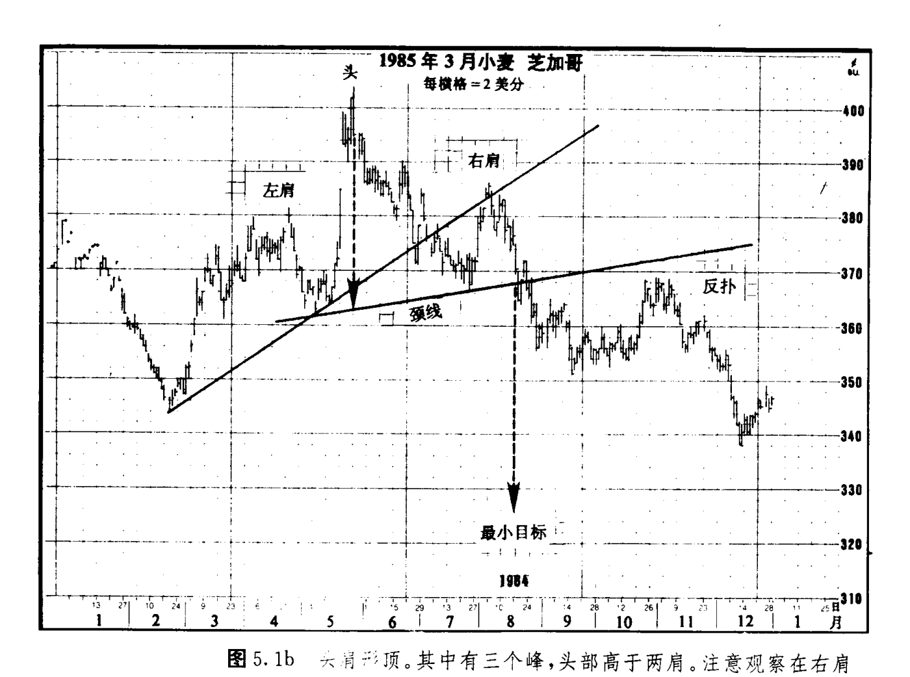

> 图5.1b 头肩形顶。其中有三个峰，头部高于两肩。注意观察在右肩形成前，主要上升趋势线是如何被突破的。也请注意向下突破颈线后的返回颈线的反扑现象。从颈线上的突破点起，向下投射头部到颈线的竖直距离，就得到最小价格目标（Chart courtesy of Commodity Research Bureau,a Knight-Ridder Business Information Service）。

然后，市场再次上冲到点E，这一次，交易量更轻，甚至不能达到冲击高点C时的水平（点E这轮最后的冲击，经常回撤到从点D到点C之间下降幅度的一半到三分之二之间）。我们知道，如果上升趋势要持续发展，则每一轮新高点都必须超过前一轮上冲的高点。点E处的上升无力达到前一轮高点C，满足了新的下降趋势所要求的一半条件——即依次下降的波峰。

到了这个时候，在点D，主要上升趋势线（线1）通常已经被跌破，从而构成了另一个危险信号。但是，尽管发生了上述许多警告讯号，此时我们唯一可以肯定的一点是：趋势已经从上升转化成横向延伸了。这 <!-- pdf p114 / 书页 99 --> 也许是了结多头头寸的充分根据，但还不足以构成卖出做空头的理由。

## 突破颈线，完成形态

至此，通过最后两个向上反弹的低点（点B和点D），我们可以作出一条较为平缓的趋势线，称为颈线（如线2所示）。在顶部，颈线一般轻微上斜（尽管有时也可能水平，或者在更少数情况下略倾斜向下）。头肩顶成立的决定性因素是，收市价格明确地突破到颈线之下。在这种情况下，市场终于突破了由底点B和D构成的趋势线，并跌破D点的支撑，从而完全满足了新趋势产生的前提条件——依次下降的峰和谷。于是，从依次下降的峰点和谷点C、D、E、F上，我们可以确定新的一轮下降趋势。顺便说明一下，在顶部形态完成后的初始阶段，当市场向下突破时交易量是否急剧扩张并不是至关重要的。

## 反扑

接下来，通常市场会出现反扑现象，即价格重新弹回颈线或者前一个向上反弹的低点D（如点G所示）。此时，这两者均已在市场上方构成了阻挡。反扑现象并不一定总能发生，有时或者只能形成一段极小的反弹。交易量也许有助于我们推测这种反弹的幅度大小。如果在突破颈线的初始阶段交易量极重，那么反扑的余地便大为减小，因为上述突然增加的交易活动反应出市场上较重的向下压力。反过来，如果初始突破时的交易量较轻，那么反扑的可能性便大为增加。无论如何，这种反弹应当以较少的交易量进行，并且随后，当新的下降趋势恢复下跌的时候，应该伴随着显著加重的交易活动。

## 小结

我们来归纳一下形成头肩顶的各个要素。

1. 事先的上升趋势。
2. 左肩（点 A）伴随着较重的交易量，且之后市场向下调整到点B。
3. 以较轻的交易量上冲到新高点（点C）。
4. 随后的下跌低于前一个峰（A 点处），且接近前一个向上反弹低点（点D）。
5. 第三轮上冲（点E）具有显著减轻的交易量，且无力达到头顶的高度 <!-- pdf p115 / 书页 100 --> （点C处）。
6. 收市价低于颈线。
7. 反扑回颈线（点G），然后下跌至新低点。

这里有三个显著的波峰，它们的界定颇为明确。中间的峰（头）稍高于双肩（点A和E）。然而，只有当市场以收市价格的形式，决定性地突破颈线之后，该形态才得以最后完成。同样地，我们也可以采用 3%穿越原则（或在前一章所介绍的其余价格过滤器）、或者双日原则（即市场连续两天收市于颈线之下），作为进一步的验证手段。另外，除非确实发生了向下突破，不然始终存在以下这种可能性：整个图形并不是真正的头肩顶，在未来某一时刻，上升趋势也许仍将恢复。

## 交易量的重要性

与价格变化相对应的交易量形态，在头肩顶形态的发展过程中担负着重要的角色。在其它的价格形态中，交易量的作用也都如此。一般来说，第二高峰（头）的伴随交易量比左肩为轻。这一点倒不是必要条件，而是市场在这种情况下通常具有的一种强烈的倾向性，也是说明市场上买进压力减轻的早期警讯。最重要的交易量信号，发生在第三高峰（右肩），此处的交易量应比前两个高峰处显著地减轻。在突破趋势线的时候，交易量应扩张；在价格反扑时，交易量应减少。然后，一旦反扑完结，交易量便再度扩张。

我们曾经交代，在市场顶部的形成过程中，交易量的关键性比底部过程要逊色些。但是在某些场合，如果新生的下降趋势能够持续的话，交易量依然应当开始增加。而在市场的底部过程中，交易量则担负着更为关键的角色，很快我们将讨论这个问题。现在我们先讨论一下头肩形的测算意义。

## 发现价格目标

形态高度是测算价格目标的基础。具体做法是，先测出从头（点C）到颈线的垂直距离，然后从颈线上被突破的点出发，向下投射相同的距离。举个例子。假定头顶位于 100，相应的颈线位置在 80，那么其垂直距离便是两者的差，20。如果颈线如图5.1a所示，那么我们就应该从颈 <!-- pdf p116 / 书页 101 --> 线上的突破点开始，向下量出20点。突破点位于 82，那么，向下突破的目标就被投射到62的水平（82-20=62）。

还有一种较简便的方法：先简单地量出下降运动中第一浪（从点C到D）的长度，然后往下翻出一番。这两种情况的道理都是一样的，形态高度越大（即波动性越大），那么其“前程”便越远大。第四章中所介绍的关于趋势线被穿越的测算技巧，同此处的头肩形测算方法类似。现在朋友们不妨比较比较。大略地说，价格在突破趋势线后所走出的距离，同它在趋势线之上曾经经历的距离相当。贯穿我们关于价格形态的讨论，你都将看到，线图上的绝大多数价格目标是建立在各种形态的高度（或者说，波动性）之上的。从突破点开始顺势投射与形态高度一致的距离，这是个老话题，我们将会一再地提起。

重要的是，上述价格目标仅仅是最近的目标，而实际上，价格运动经常越过上述目标。不过，如果我们对最近目标心中有数，那么对判断市场运动是否还有足够余地来开立头寸无疑是大有帮助的。即便市场越过了这个价格目标，那么剩下的也只是蛋糕上的那层奶油。当然，最大目标是原先趋势的整个范围。比如说，原先的牛市从 30涨到了 100，那么从顶反转形态得出的最大下跌目标便为 30，从哪里来，还回撤到哪里去。从反转形态上，我们仅能预期市场对原先趋势的反转或回撤。

## 价格目标的调整

在我们预计价格目标的时候，还应当考虑到其余许多因素。价格形态本身的测算技巧（如上面介绍的关于头肩形顶的相应情况），只是第一个步骤。其余技术性因素也应予以考虑。举例来说，由原先牛市中的向上反弹低点所形成的重要支撑水平在何处？熊市经常会在这些水平上被拒止住。百分比回撤的位置怎样？最大回撤目标是原先牛市的100%回撤。但50%和 66%回撤的水平又在哪里？它们同样常常成为市场下方的重要支撑。价格跳空的情况怎样？它们同样常常演变成支撑区域。另外，市场下方有无长期趋势线存在？

在从价格形态确定价格目标时，技术分析者必须考虑其余技术资料。比如说，如果向下的价格测算目标是30，而32是一个重要支撑水平，那么，明智的做法是，把向下测算目标放在32，而不是30。一般地，当测算目标同清晰的支撑或阻挡水平只有微小差别的时候，我们通常把价格目标调整到这些支撑或阻挡水平上，以求可靠。这种综合考虑其余技术信息来调整价格形态测算目标的做法，常常是很有必要的。我们都知道，有许多不同的工具可供分析者选择，那么，最巧妙的技术分析者正是那些懂得如何恰如其分地综合使用各种工具的人。 <!-- pdf p117 / 书页 102 -->

## 倒头肩形

头肩形底有时也被称为倒头肩形，它恰好与头肩形顶互为镜像。正如图 5.2a 所示，它具有三个清楚的底谷，其中头（中间的谷）稍低于两肩。收市价格决定性地向上突破颈线，也是该形态得以完成的必要条件，而且它的测算技术也与头肩形顶的一样。稍有差别的一点是，在底部，当颈线被向上突破后，市场更惯于反扑。

头肩顶和头肩底最重要的区别在与之配合的交易量序列上。在判别头肩底形态及其突破的时候，交易量起到更为关键的验证作用。前面我们讲过，市场具有“因自重而下跌”的倾向性，因此在底部，当市场力图发动一轮牛市的时候，必得具有较多的交易量才行，也就是说，必须具有显著增强的买进推力。

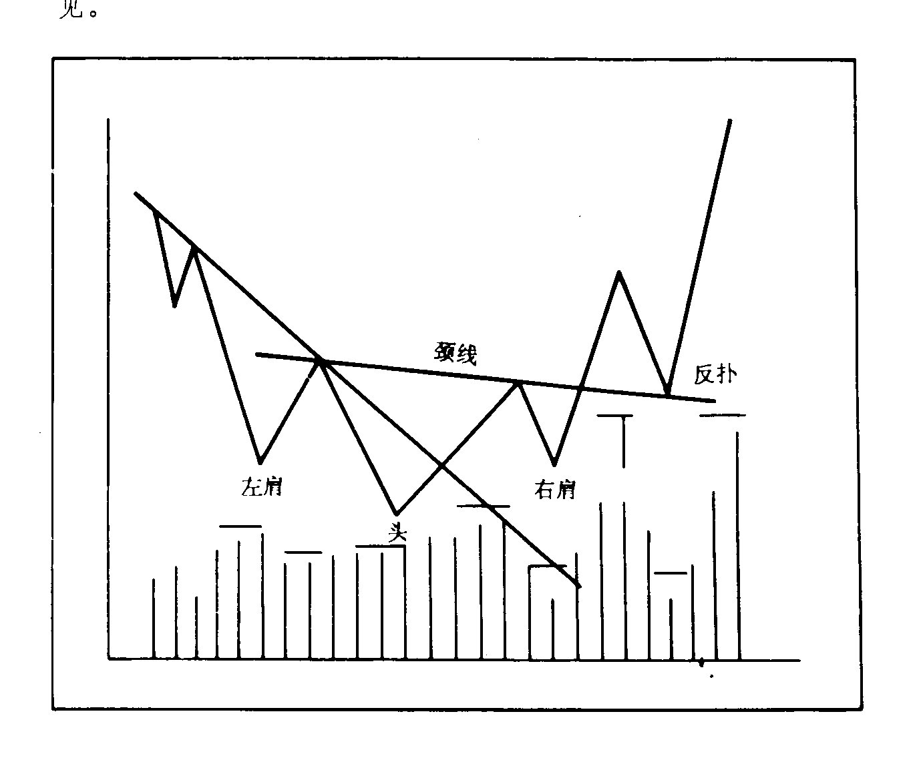

> 图5.2a 倒头肩形的例子。这种形态的底部形式是顶部形式的镜像。其中最重要的区别是在形态后半部分的交易量形态上。在底部过程中，自头部弹起的上冲，应当具有较重的交易量，而当颈线被突破时，交易活动应更是具有迸发性的扩张。回向颈线的反扑在底部过程中也更多见。

<!-- pdf p118 / 书页 103 -->

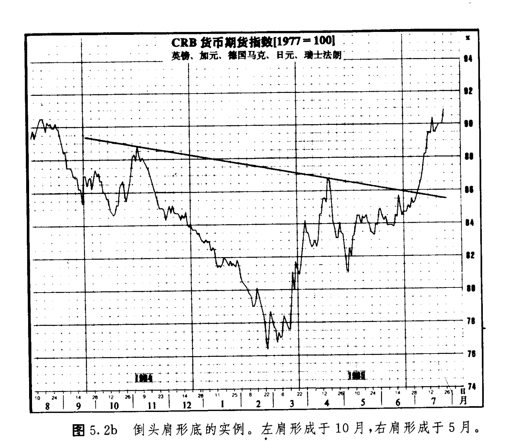

> 图5.2b 倒头肩形底的实例。左肩形成于10月，右肩形成于5月。头部形成于2月和3月，其外形与V形反转底相似。7月，本图的CRB外汇期货指数收市于为期8个月的颈线之上，从而构成了外汇市场的主要看涨信号（Chart courtesy of Commodity Research Bureau, a Knight-Ridder Business Information Service）。

我们不妨把这种市场特点同重力规律对照一下。我们都知道，当物体从手中释放后，无需我们再作努力，便很快地跌向地面。举起某物则是另一回事，我们必须付出劳动。要是朋友们对体育运动较有体验的话，请设想一下山路赛跑的情况。在下山时，我们一直会跑得很轻快。然而上山的赛程才是考验耐力的关键之处。“波士顿马拉松赛”的场地末端是块上坡地，人称“伤心坡”，要是它是下坡的话，可能就会以“快活坡”这样的名字而著称了。

我们用更带技术性的方式来理解这个区别。市场常常会仅仅因为惯性而下降，但市场却不因为惯性而上升。需求不足、或者交易商缺乏买进兴趣等原因，经常就足以把市场压低。但只有在需求超过供给，并且买方比卖方更积极时，价格才能上涨。

在本形态前半部分，交易量形态同头肩顶很相似。就是说，头部的交易量是比左肩的稍有减少。然而，在头部的上冲阶段，不但应该显示 <!-- pdf p119 / 书页 104 --> 出交易活动有所增加，而且其交易量水平经常要超过左肩的上冲对应的交易量水平。右肩下跌部分的交易量应该非常轻弱。关键时刻是市场突破颈线而上冲的时候。这个突破信号如果成立，那么所伴随的交易量非得相应地急剧膨胀不可。这一点是头肩底同头肩顶最大的分别。在底部，强劲的交易量绝对是完成形态的关键组成部分。反扑在底部比在顶部更经常发生，不过，其交易量应该轻弱。随后，新的上升趋势应该在较重的交易量下恢复。头肩形底的测算方法与头肩顶相同。

## 颈线的倾斜程度

顶部的颈线通常稍稍倾斜向上，不过也有时是水平的。这两种情况并没有太大差异。然而，偶尔顶部的颈线会向下倾斜。这种坡度是市场疲弱的一种表现，通常，随之而来的右肩也很软弱。不过，这并不全是好消息，而是利弊参半。如果分析者要等颈线突破再开立头寸的话，就不得不等待较长时间，因为该信号在向下倾斜的颈线上出现得很晚，而且届时大部分的下降运动已经发生了。对底部形态而言，绝大多数颈线稍倾向下。而向上倾斜的颈线意味着市场的坚挺，不过此处同样也有信号过迟的缺陷。

## 复杂头肩形形态

在我们的图表上，有时会出现一些头肩形的变体，称为复杂头肩形。这种形态可能呈现出双头或二个左肩和二个右肩的情况。它们不如其原型常见，但具有同样的测算意义。对付这种情况有个窍门，那就是利用头肩形形态所具有的强烈的对称倾向。单个的左肩通常对应着单个的右肩，双重左肩则使出现双重右肩的可能性增加了不少。

## 对策

在所有的期货交易中，交易策略问题均是举足轻重的，我们在以后章节中还将更深入地探讨。并非所有的技术型交易商都愿意等到颈线突破后，才开立新头寸。如图5.3所示，较为大胆积极的交易者在相信自己已经正确地判明头肩底之后，在右肩形成过程中就开始尝试着买进，或者在右肩下跌完结的第一个信号出现时就买进了。 <!-- pdf p120 / 书页 105 -->

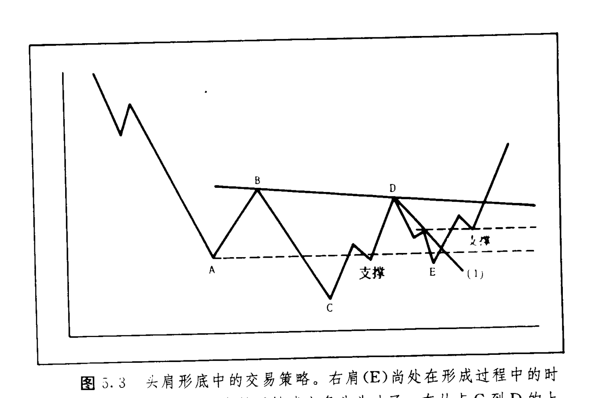

> 图5.3 头肩形底中的交易策略。右肩（E）尚处在形成过程中的时候，很多技术型交易商就开始建立多头头寸了。在从点C到D上冲的一半到三分之二的回撤位置上，或者当价格跌向近期的支撑水平或支撑性跳空的时候，或者在价格跌到与左肩点 A 的水平差不多的时候，或者当短暂的下降趋势线（线1）被向上突破时，统统是早期的入市机会。当颈线果然被突破后，或者事后发生回向颈线的反扑时，可以追加更多的头寸。

有些人先测出从头部的底点上冲的距离（点C到D），然后在其50%或66%回撤位置买进。还有些人会看看市场下方有无跳空存在，以利用之作为买进点。也有些人或许沿着点D和E画出一条短期的下降趋势线，该趋势线一被突破便买进。有些人考虑到这种形态具有相当的对称性，从而当右肩的发展接近了左肩的低点的水平时买进。这里要说明的是，在右肩形成过程中，会发生许多预期性的买进行为。如果上述尝试性头寸果真有利可图，那么，在颈线被实际穿越时或者在颈线突破后市场反扑时，交易商就会追加更多的买进头寸。

## 流产的头肩形形态

一旦价格越过颈线，头肩形形态就完成了，市场也就不应再返回颈线的另一边。在顶部，一旦颈线被向下突破了，那么只要随后有任何一个收市价格返回到颈线上方，都是严重的警讯，表明此次突破可能是无效信号。显而易见，这就是流产头肩形的由来。此类形态起初貌似典型 <!-- pdf p121 / 书页 106 --> 的头肩形反转，但在其演化过程中的一定时刻（无论是在颈线突破前还是其稍后），价格将恢复原先的趋势。

由此，我们可以得出两条教训。其一，没有哪个图表形态百发百中。它们在大多数时间是成功的，但并不是永远如此。其二，技术型交易商必须永远警惕自己分析中的错误信号。在期货市场，致胜的关键之一，就是要尽快摆脱亏损的交易头寸（这将在第十六章关于资金管理及其策略的讨论中介绍），确保交易损失限于小额。这里，我们或许可以为图表分析这门工具添加一条最实用的长处：它能够警告交易商认清现实、纠正错误。在期货行业，迅速地发现并承认自己的交易决策错误，及时采取断然的保护性措施，这样的能力和意志力是难能可贵的，我们绝不可以等闲视之。

## 头肩形作为调整形态

在接着讲述下一种价格形态之前，关于头肩形尚有最后一点需要补充。本章开头曾把它列举为最广为人知且最可靠的主要反转形态。但是朋友们必须明白，本图形偶尔也会充当调整性形态而不是反转形态。不过，后面这种情况与其说是惯例，不如说是例外。在第六章讨论持续型形态时我们将有详细讲解。

## 三重顶和三重底

我们在讨论头肩形形态时所引入的大部分要领，也适用于其它种类反转形态（见图5.4a到c）。三重顶（或底），比头肩形少见得多，其实是前者的小小变体。其主要区别是，三重顶或底的三个峰或谷位于大致相同的水平上（见图5.4a）。在判断某个反转形态到底应属于头肩形还是三重顶的问题上，图表分析者经常有争议。因为两种形态其实是一回事，所以这种论争是迂腐的。

在三重顶中，交易量往往随着相继的峰而递减，而在向下突破时则应增加。三重顶只有在沿着两个中间低点的支撑水平被向下突破后，才得以完成。在三重底中，情况正相反，形态完成的必要条件是，收市价格向上越过两个中间峰值的水平（我们还有另一种对策，那就是把价格突破最邻近的峰或谷选作反转信号）。底部形态完成时，向上突破的交易量是否强劲有力，也是同样关键的。

它们的测算意义与头肩形相似、以形态的高度为基础。通常，价格 <!-- pdf p122 / 书页 107 -->

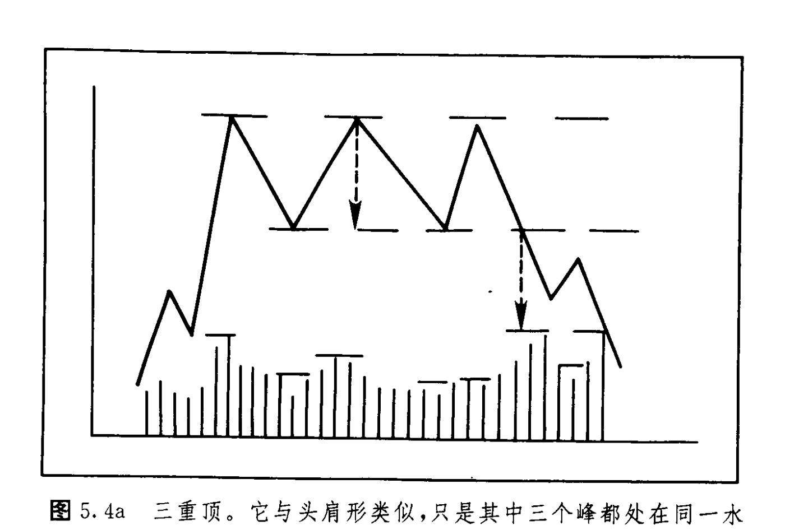

> 图5.4a 三重顶。它与头肩形类似，只是其中三个峰都处在同一水平。每个上冲峰的交易量均应见轻。当其中两个谷被市场以较重交易量向下跌破后，本形态完结。其测算技术是，自突破点起，向下投射出与形态的高度相等的距离。在突破发生后，回向下方直线的反扑现象也不少见。

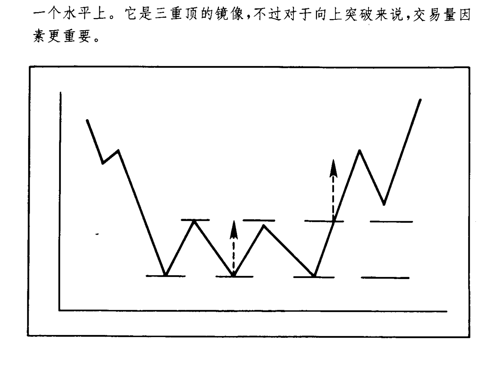

> 图5.4b 三重底。它与头肩形底类似，只是其中每个低点均处于同一个水平上。它是三重顶的镜像，不过对于向上突破来说，交易量因素更重要。

<!-- pdf p123 / 书页 108 -->

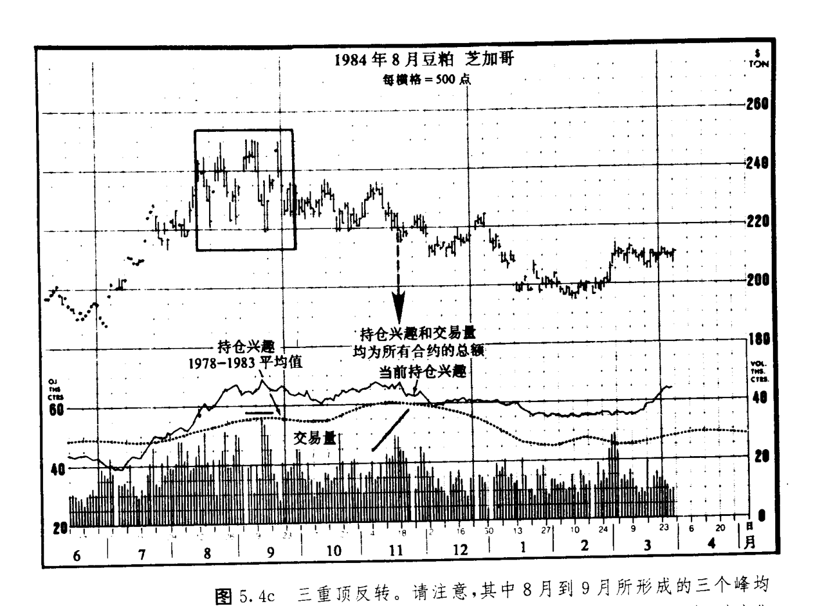

> 图5.4c 三重顶反转。请注意，其中8月到9月所形成的三个峰均处于250的水平。220附近一直是支撑区，一旦被向下跌破，则演化成阻挡区。同时，还要注意，后来价格何其接近其下方的目标。如果朋友们仔细观察，那么将看出，在这个顶部形态中，当价格下跌时，交易量更胜一筹。当11月发生向下的突破时，交易量更是显著地扩张（Chart courtesy of Commodity Research Bureau, a Knight-Ridder Business Information Service.）。

在突破颈线后，由突破点起算，至少将要走出等于形态高度的距离。一旦突破，随后回向突破水平的反扑现象也很常见。考虑到三重顶（或底）只是头肩形形态稍许变化，我们这里就不再赘述了。

## 双重顶和双重底

双重顶（或底）反转形态比三重顶（或底）常见得多，这种形态仅次于头肩形，出现得也很频繁，且易于辨识（见图5.5a到e）。图5.5a和5.5b 各展示了双重顶和双重底的两个例子。出于显而易见的原因，这类顶经常被称为“M 顶”，这类底被称为“W底”。从一般特点上讲，双 <!-- pdf p124 / 书页 100 --> 重顶与头肩形顶、三重顶类似、只是此处只有两个峰，而不是三个。交易量形态与测算法则也均类似。

在上升趋势中（如图5.5a 所示），市场在点A确立了新的高点，通常其交易量亦有所增加。然后，在减少的交易量背景之下，市场跌至B点。到此为止，一切均符合上升趋势的正常要求，趋势进展良好。然而，下一轮上冲抵达了C点后，收市价格却无力穿越前一个高点A点。接着，价格就开始跌回。此时，一个潜在的双重顶便跃然纸上。我们之所以讲“潜在”，是因为这才是所有的反转形态成立的必要条件，而只有在收市价格突破前一个低点B的支撑之后，这个反转才能成立。除非发生突破，否则价格可能仅仅是处于橫向延伸调整阶段中，为原先趋势的恢复作准备。

理想的双重顶具有两个显著的峰，且其价格水平大致相同。交易量倾向于在第一个峰时较重，而在第二峰时较轻。在较重交易量下，当价格决定性地收市于中间谷点B点之下时，顶部形态就完成了，标志着趋势向下方的反转。以后、在下降趋势恢复之前，市场往往先要反扑回突破点的水平。

## 双重顶的测算技术

双重顶的测算方法是，自向下突破点（中间谷点B即被突破的价位）开始，往下投射与形态高度相等的距离。另一种方法是，先测出双重顶中第一条下降轨迹（点A到B）的幅度，然后从位于B点的中间谷点开始，向下投射相同的长度。双重底的测算方法一样，只是方向相反。

## 理想形态的变体

各种市场分析领域都一样，现实情况通常都是理想模型的某种变体。比如说，有时双重顶的两个峰并不处于严格相同的水平上。有时第二峰相当疲弱，达不到第一峰的高度，这并不太成问题。而当第二峰实际上约略超过第一峰时，就出了些岔子。起初它貌似有效的向上突破，显示上升趋势已经恢复。然而好景不长，不久，它竟演化成顶部过程的一个部分。为了解决这个两难问题，前面曾经提到过的那些过滤法则或许会派上用场。 <!-- pdf p125 / 书页 110 -->

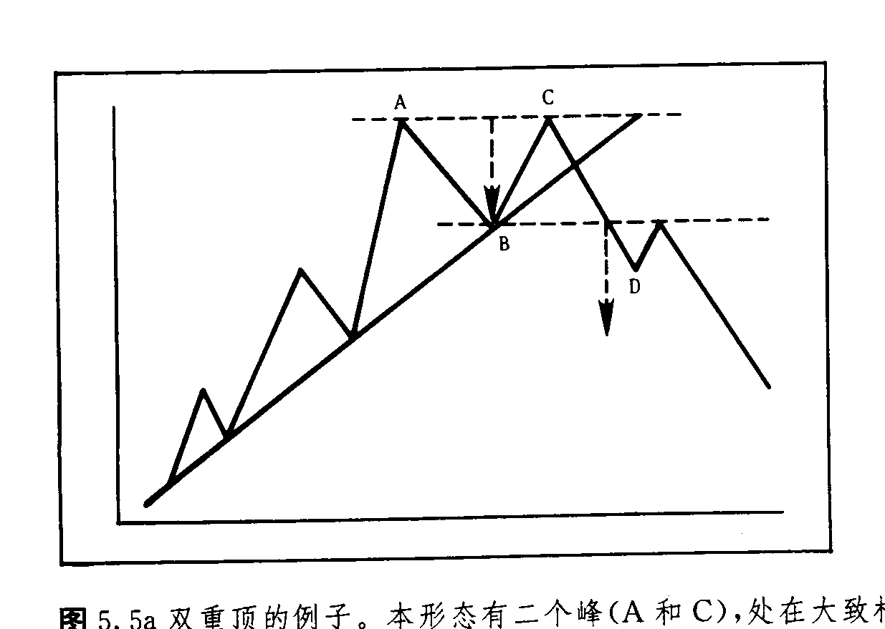

> 图5.5a 双重顶的例子。本形态有二个峰（A和C），处在大致相同的水平。当其中的中谷（点B）被收市价跌破后，本形态完结。通常，在第二个峰（点C）交易量较轻，而在向下突破时（点D），交易量有所增加。回向下方直线的反扑现象也不罕见。最小测算目标是，从突破点起，向下投射出与形态高度相等的距离。

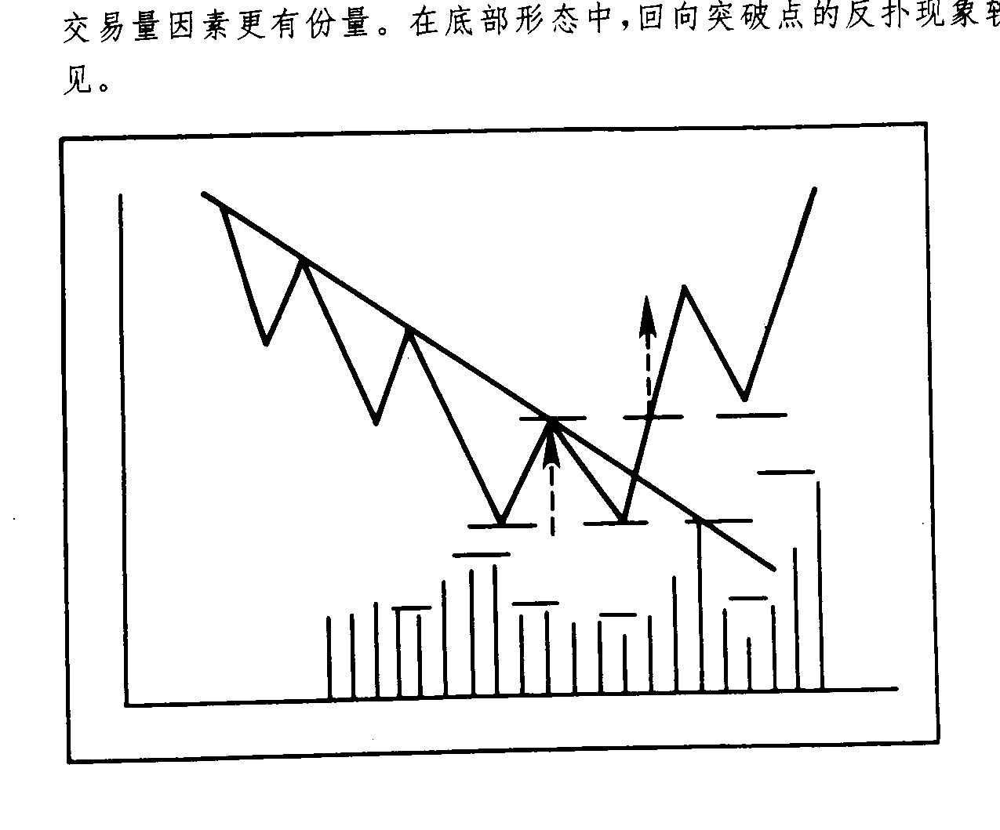

> 图5.5b 双重底的例子。它是双重顶的镜像。对这里的向上突破来说，交易量因素更有份量。在底部形态中，回向突破点的反扑现象较多见。

<!-- pdf p126 / 书页 111 -->

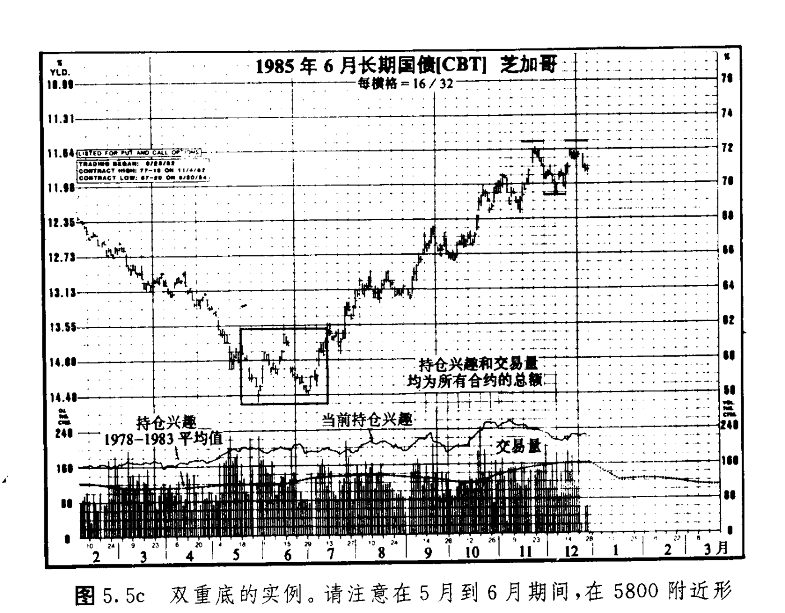

> 图5.5c 双重底的实例。请注意在5月到6月期间，在5800附近形成了两个清晰的底。当价格收市于6116以上时，底部形态完成，趋势转而向上。注意，在图中右上角，价格已经从前一峰值（72）处挡下。在上升趋势中，这种情况并不少见。但无论如何，价格必须收市于 6916的低点之下，方可完成这个双重顶 （Chart courtesy of Commodity Research Bureau, a Knight - Ridder Business Information Service.）。

## 过滤器

在判别突破成立与否的时候，大多数图表分析者都要求收市价格越过前一个阻挡峰值，而不仅仅是日内的穿越。其次，我们还可以采用某种价格过滤器。其中的一例便是百分比穿越原则（例如1%或3%过滤器）。第三，也可以选用双日穿越原则，这是时间过滤器的一例。换言之，为了证明向上穿越的有效性，价格必须接连两天收市于第一峰之上。

上述过滤器肯定不会是绝对可靠的，不过，它们的确有助于减少经常发生的错误信号（所谓“拉锯”现象）。这些过滤器有时有效用，有时也没用。分析者必须清楚，他面对的是百分比概率和可能性，错误信号的出现是免不了的，这是交易现实的客观规律。

在牛市中，双重顶的最后一程或最后一波在建立新高点之后，掉 <!-- pdf p127 / 书页 112 -->

头转而向下的现象并不稀奇。在这种情况下，最后的一轮向上突破就形成了“牛市陷阱”（见图5.6a 和b）。但是足资安慰是，绝大多数趋势信号还是能贯彻始终的，否则，整个趋势顺应理论就要丧失一大半价值和一大半可靠性了。

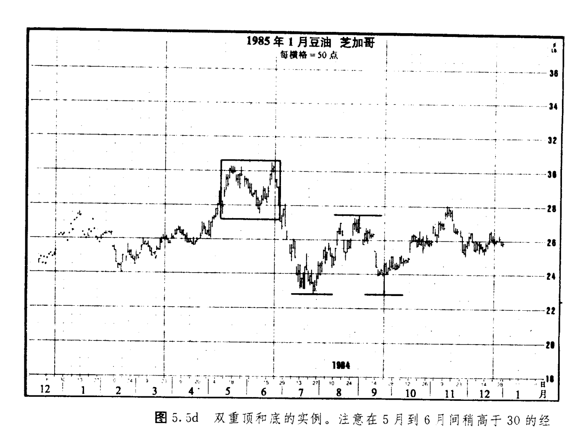

> 图5.5d 双重顶和底的实例。注意在5月到6月间稍高于30的经典的双重顶。在7月到9月间的两个底部也有可能形成一个双重底（Chart courtesy of Commodity Research Bureau,a Knight-Ridder Business Information Service.）。

## “双重顶”术语被大大滥用了

“双重顶”术语在期货市场上被大大地滥用了，大多数潜在的双重顶（或底）最终演化得面目全非。归根结底，价格本具有从前一峰值挡下，或者从前一低点弹起的强烈倾向，这种价格变化正是市场在阻挡或支撑水平上的自然反应，其本身并不足以构成反转形态。请记着，在顶部，价格必须真正跌破前一个向上反弹的低点，才能表明双重顶成立。

注意，在图5.7a中，在点C，价格被前一个高点A挡下。这一变化 <!-- pdf p128 / 书页 113 --> 在上升趋势中完全正常。然而，许多期货交易商在价格第一次试探前一个高点失败之后，马上就判断这个图形为双重顶。图5.7b 显示了在下降趋势中的对应的情况。对图表分析师来说，要判定价格从前一个 <!-- pdf p129 / 书页 114 --> 高点的下撤，到底是双重顶反转形态的开端，还是仅仅是既存趋势的暂时挫折（或者反过来，要判定从前一个低点的上弹是不是双重底反转形态的发轫），是极为困难的。在通常情况下，从技术角度看，趋势继续发展的可能性更大，所以明智的做法是，一定要等到形态完成之后，才采取相应的动作。

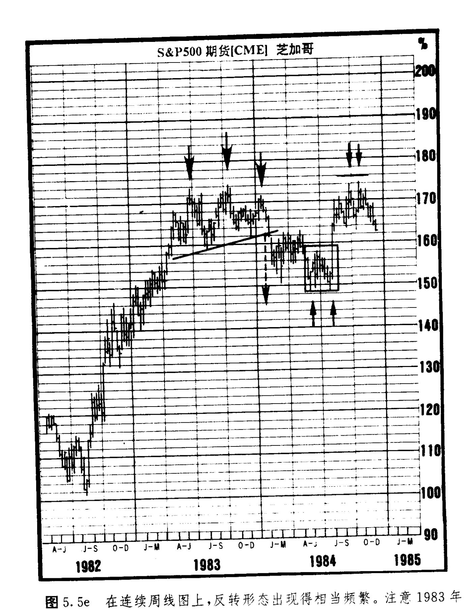

> 图5.5e 在连续周线图上，反转形态出现得相当频繁。注意1983年下半年形成的头肩形顶。其中向下的价格目标效用不凡。也请注意接近150处的小些的双重底，以及174附近的潜在的双重顶。从这张图上，我们也许可以得出如下看法：1984年年底的高点可能是一个主要的双重顶的第二个峰。当然，市场必须收市于148之下，才能确认这种看跌的解释。价格从重要的的阻挡水平上弹下的现象并不稀奇 （Chart courtesy of Commodity Research Bureau, a Knight-Ridder Business Information Service.）。

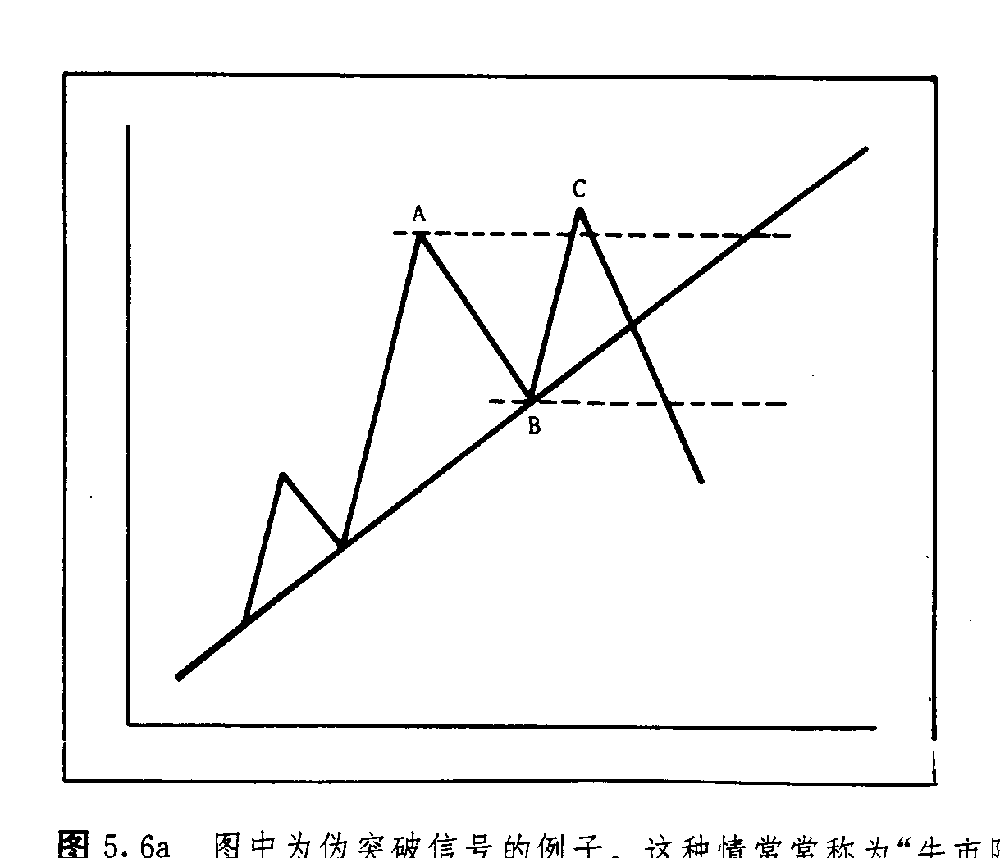

> 图5.6a 图中为伪突破信号的例子。这种情常常称为“牛市陷阱”。有时，在接近主要上升趋势的尾声时，价格先是向上超越先前的峰，而后却溃不成军。图表师借助时间和价格过滤器来避开此类拉锯现象。这里的顶部形态很可能属于双重顶的类型。

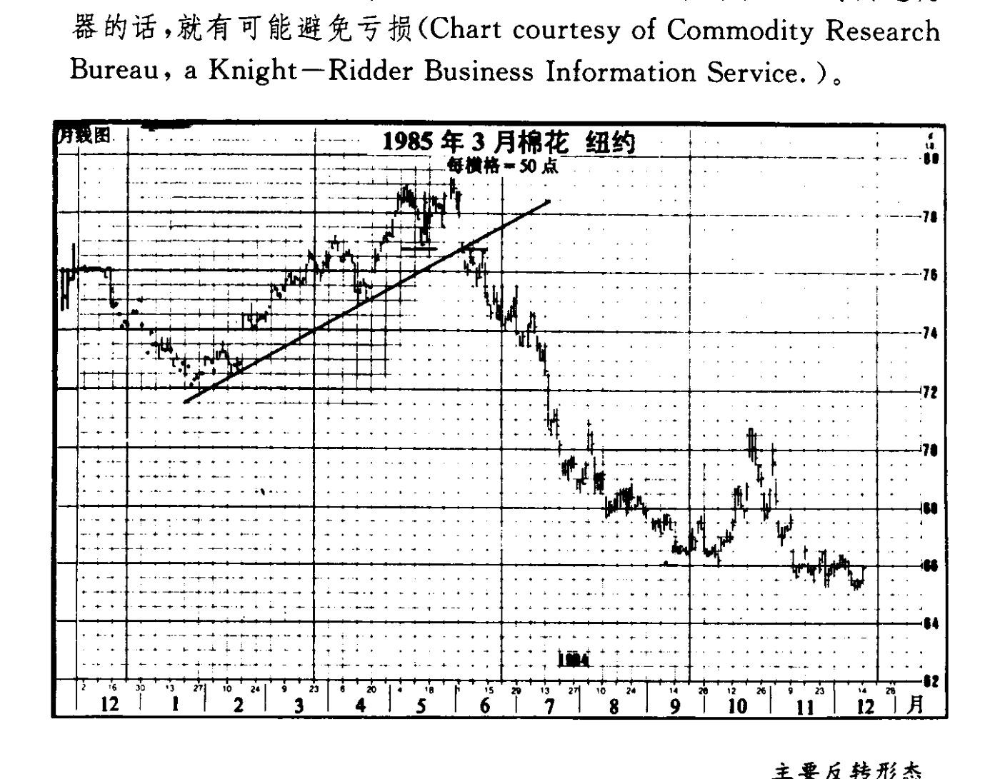

> 图5.6b 伪向上突破信号的实例。注意，在图表上方，价格起先向上突破了过去的高点，发出了错误的看涨信号。然后，它却掉转方向，完成了一个双重顶的变体。不过也请注意，价格并没能够在先前峰值上方维持2个相继的交易日。在这种情况下，如果采用了双日时间过滤器的话，就有可能避免亏损（Chart courtesy of Commodity Research Bureau, a Knight-Ridder Business Information Service.）。

<!-- pdf p130 / 书页 115 -->

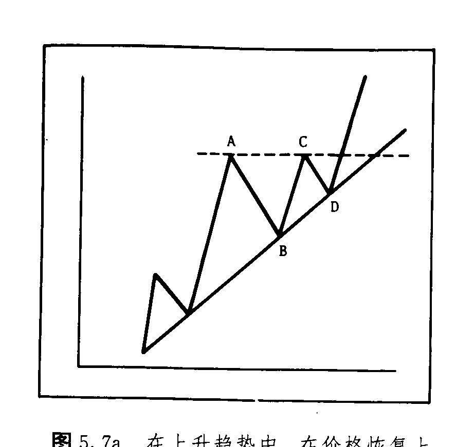

> 图5.7a 在上升趋势中，在价格恢复上升之前，先从过去的峰值正常挡下的例子。这属于正常的市场行为，切不可与双重顶混为一谈。仅当点B的支撑被跌破后，双重顶才能成立。

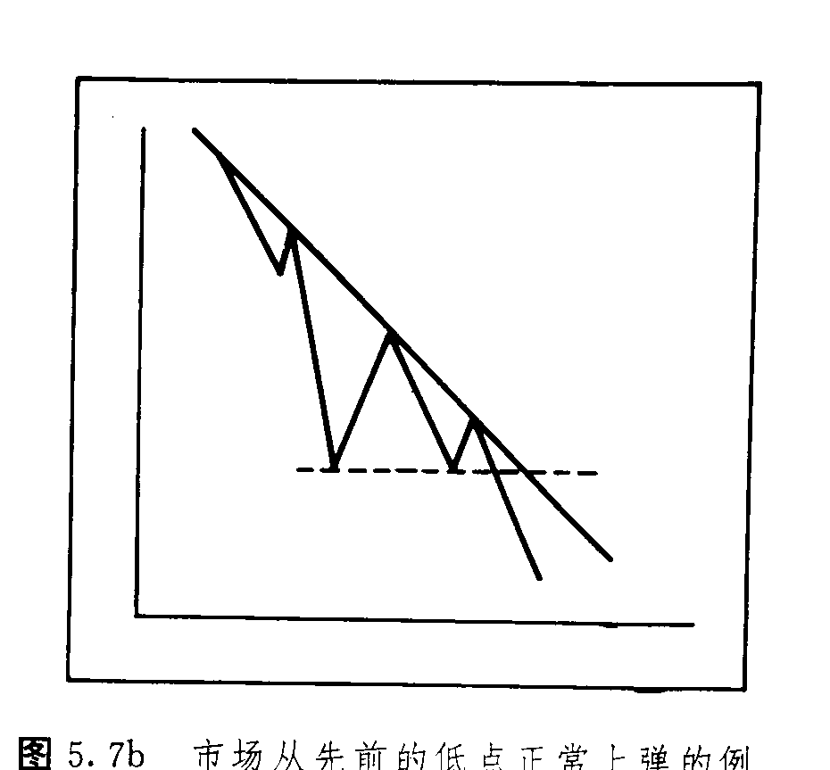

> 图5.7b 市场从先前的低点正常上弹的例子。这也属于正常的市场行为，切不可与双重底混淆。在正常情况下，价格在达到先前的低点时，至少总要上弹一次。这种正常现象可能诱使一些朋友犯了过早预期双重底的错误。

## 两峰或两谷之间的持续时间很重要

最后，形态的规模始终是很重要的一个方面。双峰之间持续的时间越长、形态的高度越大，则即将来临的反转的潜力越大。这一点对所有的图表形态而言，都是成立的。一般地，在最有效力的双重顶或底形态中，市场至少应该在双峰或双谷之间持续一个月，有时甚至可能达到两、三个月之久（在更大范围的月线图和周线图上，这类形态可能跨越数年）。这里所列举的大部分例子，是市场的顶部形态。现在朋友们应该清楚了，底部形态只是顶部形态的镜像，而两者之间的几点一般性的差别，在本章的开头部分我们已有交代。 <!-- pdf p131 / 书页 116 -->

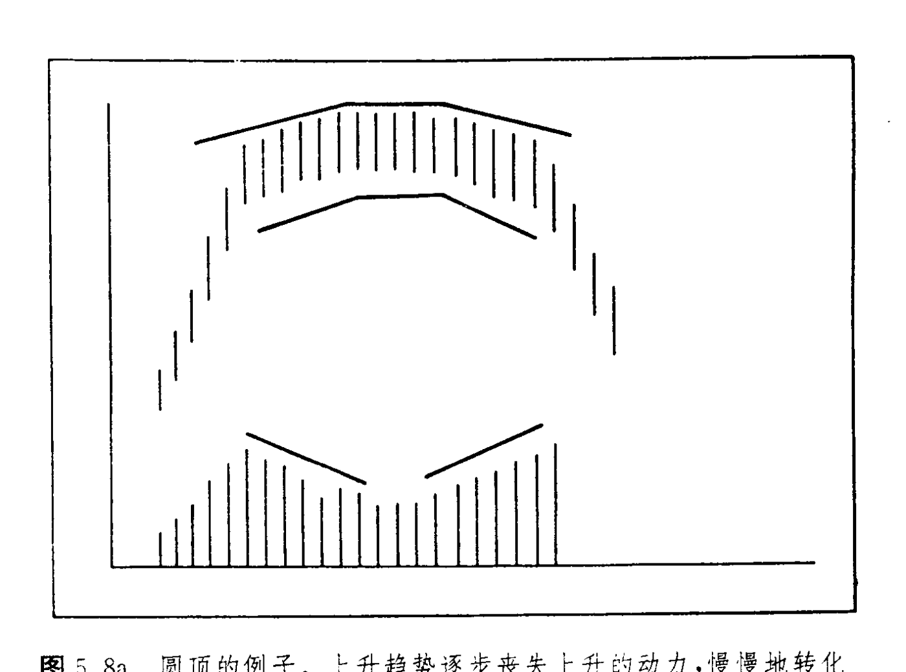

> 图5.8a 圆顶的例子。上升趋势逐步丧失上升的动力，慢慢地转化为新的下降趋势。注意，与之相应，交易量往往也形成了自己的圆形形态。这种顶部形态又称“倒扣碗形”。

## 圆顶和圆底

下面要讲的反转形态比前面几种都少见得多。它有好几个名字——圆顶或圆底、圆形、盆形或者碗形（如果系顶部形态，则不妨加上“倒扣”二字）。本形态代表着趋势的很平缓的、逐渐的变化。图5.8a和b 展示了这种图表形态。

请注意，图中价格从上升到下降、或者从下降到上升的变化过程，极为平缓。同时也请注意，图表下方的交易量也倾向于形成相应的盆状形态。在顶部和底部，交易量均随着市场的逐步转向而收缩，最后、当新的价格方向占据主动时，又都相应地逐步增加。

有时在圆底中点的稍后的位置上（如图5.8b 所示），价格在异乎寻常的重大交易量的背景之下突破，向上冲刺，然后又回落到缓慢的圆形形态过程中。在底部的末端，有时会出现一个“盆把”（或者说“平台”），随后新的上升趋势将恢复。请注意，在交易量图上的圆底上，过了中点之后，交易量突然开始上升，随着价格进一步上涨，交易活动相应逐步增加；平台出现时，交易量下降；接下来，当价格向上方突破时，交易量又进一步扩张。 <!-- pdf p132 / 书页 117 -->

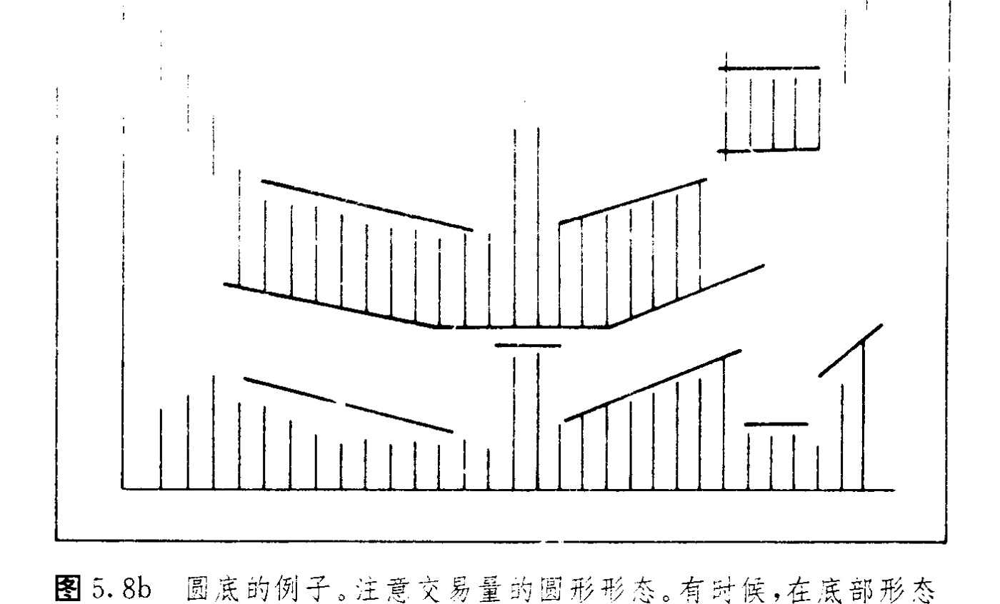

> 图5.8b 圆底的例子。注意交易量的圆形形态。有时候，在底部形态的中点稍后，交易活动会突然增加。在右侧，常常形成平台，此类形态在底部比在顶部更多见。底部形态的完结既可以以A 点的峰被向上突破为标志，也可以以点B处向上突破平台为标志。

我们很难确切地说圆形形态何时完成。如果在中点 A 处价格上冲，那么此后，当这个高点被向上穿越时，可能就是牛市信号。还有一个变通的办法，即把从平台向上的突破，作为底部完成的信号。

圆底不具备精确的测算规则。不过技术分析师还是拥有其他各种技术工具，可以测算出新趋势的潜力。比如说，原有趋势的规模就是个重要的参考，能够提供价格回撤的一些大致范围。同时，圆形形态本身持续的时间也是很有价值的信息，其持续时间越长，则未来运动的潜力越大。另外，技术分析者还需要考虑其它要素——诸如原先的支撑和阻挡水平、百分比回撤、跳空、或长期趋势线等等。

如前面所述，相对来说盆形或者圆形形态，出现得较不频繁。此处之所以要着重讲述圆形底形态，是因为根据我个人的经验，一旦这种罕见形态果真出现了，通常便是市场的底部。我怀疑，在过去十年，此类形态罕见的原因之一，在于我们所经历的特定市场条件。1970年代以剧烈牛市为特点，而1980 年代则以熊市为代表，都不具备滋生圆底的环境条件。今后，在期货市场再度稳定以后，在各种主要底部形态中，我们很可能将看到圆底卷土重来。 <!-- pdf p133 / 书页 118 -->

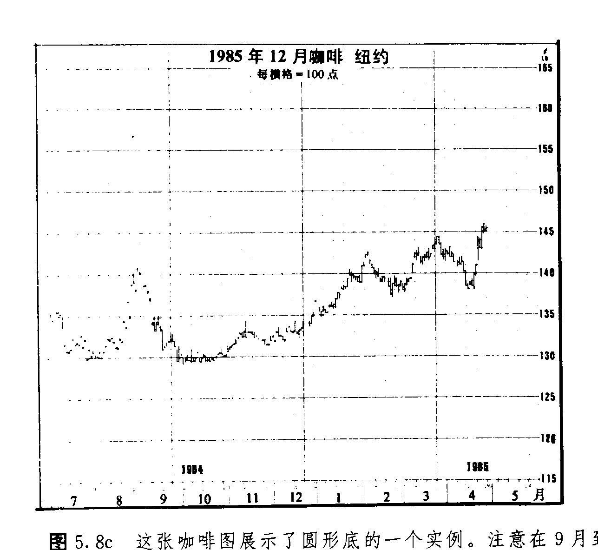

> 图5.8c 这张咖啡图展示了圆形底的一个实例。注意在9月到11月的趋势的逐渐变化过程。这一类市场底部通常是缓慢乏味的（Chart courtesy of Commodity Research Bureau, a Knight-Ridder Business Information Service.）。

## V形形态，或称长钉形

最后要讲的这种反转形态可谓神出鬼没，在其出现时最难于判别，但它并不罕见。实际上，因为V形顶或底（或称长钉形）其实不是形态，所以我们极难判定。前面讨论的所有的反转形态均代表着趋势的逐渐变化。现存趋势先逐渐放缓，进而供求双方的力量对比达到相对平衡，最终，买卖双方通过“拔河比赛”，决定原有趋势到底是反转还是恢复。

在前面的各种形态中，价格有一段横向延伸的时间，分析者能够利用这个机会研究市场行为，仔仔细细地探求其去向的线索。这种阶段称为转换阶段。这是绝大部分反转形态的特点。

然而，V形形态代表着剧烈的市场反转，同市场逐步改变方向的惯常方式大相径庭。当它发生时，在几乎毫无先兆的情况下，趋势出人意料地突然转向，随即向相反的方向剧烈地运动。因为其身后并无形态可寻，从而其本质是非形态的。这类变化极为经常地孕育在关键反转日或岛状反转（见第四章有关内容）之中。交易商如何预期这类形态的降临， <!-- pdf p134 / 书页 119 --> 从而在其实际发生时，及时地把它判别（或至少猜测）出来并采取适当的措施呢？为了解答这些问题，我们要进一步深入研究V形顶形态（见图5.9a到c）。

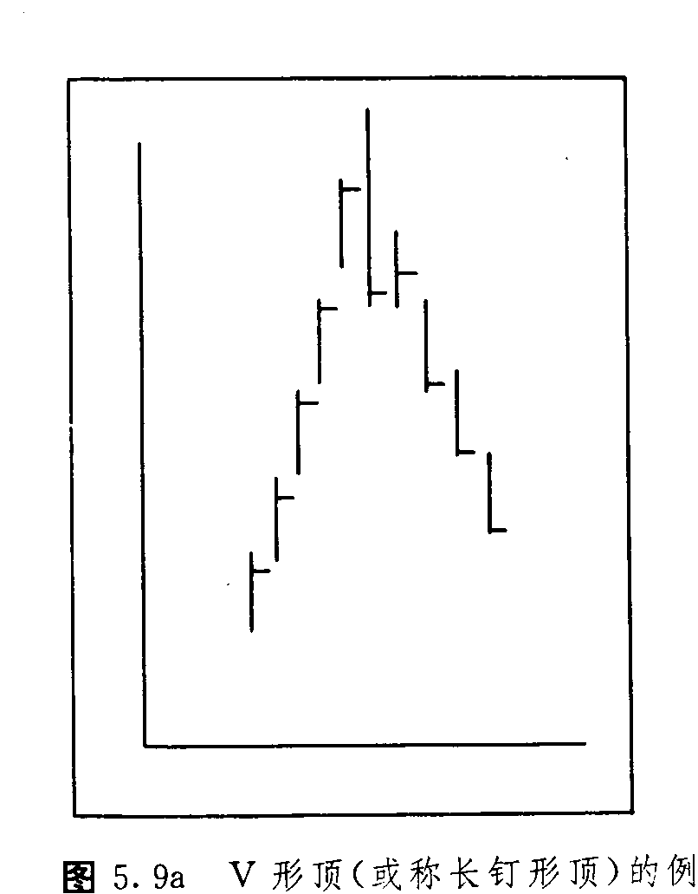

> 图5.9a V 形顶（或称长钉形顶）的例子。此类形态通常出现在失控的牛市环境中，事前市场向上伸展得太过分了。转折点通常以关键反转日或者岛形反转的形式发生。届时市场陡然反转，突然掉头。

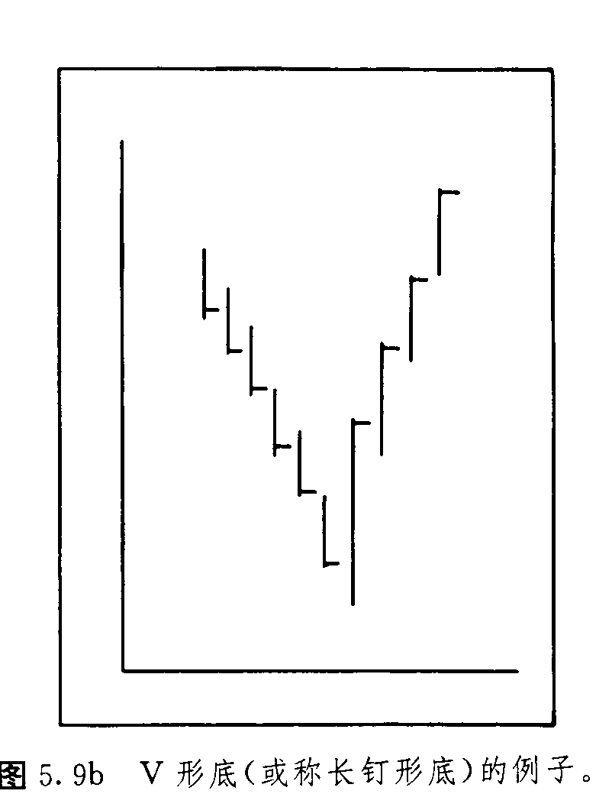

> 图5.9b V 形底（或称长钉形底）的例子。下降趋势极快地反转为上升趋势，事先毫无征兆，中间也没有转换阶段。这可能是最难以识别和交易的价格形态。

首先，事先必须有趋势存在。趋势以V形反转的现象，极经常地出现在市场持续上涨，一路很少调整或只有微小调整的情况下。通常，事前已经发生过数次价格跳空。当前的局面显得失去了控制，市场似乎已远远超出了绝大多数正常预期。目前，大部分职业交易商对这种情况已经提高警惕了。

我们可以想见，交易商当然梦想着自己能够在这种脱缰了似的市场中赶上潮流。但是从某个时刻开始，即便是最富经验的交易商也开始因为上涨的持续而不安。这种情况实在好象“骑虎难下”一样，抓住老虎，安全地爬上虎背只是开头，如何不出危险又不失体面地从虎背上下来才是棘手的难题。

这种困扰事出有因。市场有个极难对付的坏习惯，一旦它脱缰之后，起初总要朝一个方向走得过远，然后，又常常会向相反的方向突然反噬回来，就象一根橡皮带被拉得太长，突然“唰”地反弹回来。这类突然回弹的特点是，事先通常无迹可寻，事后，市场向相反方向的剧烈运 <!-- pdf p135 / 书页 120 --> 动、往往引发一系列交易所涨（或跌）限价。

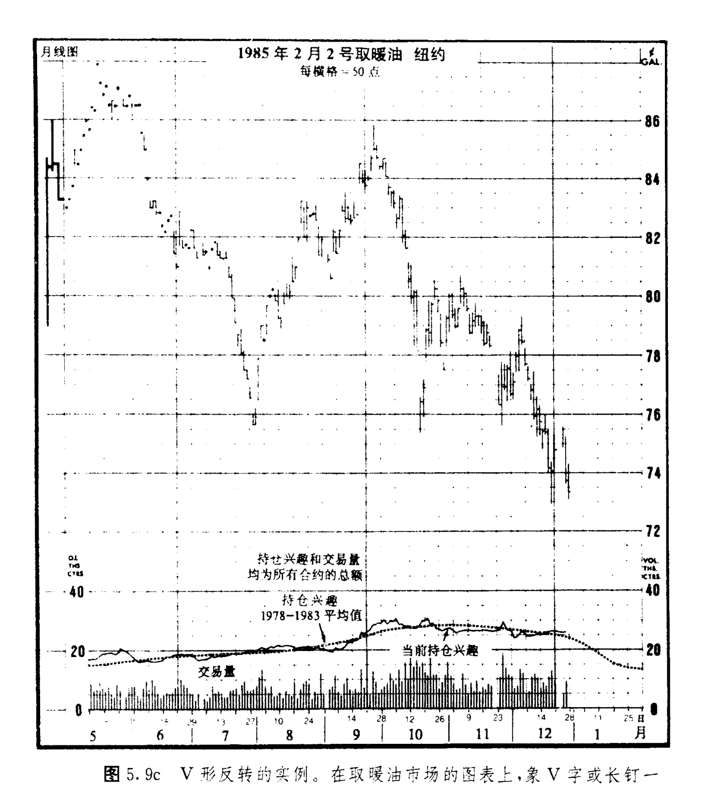

> 图5.9c V形反转的实例。在取暖油市场的图表上，象V字或长钉一样的突然反转屡屡发生。由于其中缺乏转换阶段，市场变得难以驾驭。请注意图中的许多关键反转日和岛形反转（Chart courtesy of Commodity Research Bureau, a Knight - Ridder Business Information Service.）。

## V 形反转形成条件

形成V形反转的主要条件是陡峭的或脱缰的趋势。其转折点以关键反转日或岛状反转形态为标志，同时伴随着重大的交易量。有些时 <!-- pdf p136 / 书页 121 --> 候，这种反转的唯一有效信号是，市场对其非常陡峭的趋势线的突破。移动平均线在这种情形下帮助不大，因为它的天性使它滞后于失控的价格变化。

随之而来的下跌，通常在极短时间内回撤到原先趋势的某个显要的比例（多达1/3或50%）位置。发生这种反向剧烈运动的原因之一是，在原先趋势中缺乏支撑和阻挡水平，它一路上的许多价格跳空也留下了“真空”。

事情发生后，在市场顶部被套牢的人急于抛售，以摆脱亏损头寸，这就反过来进一步加剧了下跌的速度。所以，另外一个危险的信号是，事前市场上高得非同寻常的持仓兴趣，尤其是在持仓兴趣的增长主要发生在原先趋势的后面部分的情况下（我们将在第七章中更多地讨论持仓兴趣）。

交易商面临着两难选择，一方面，市场趋势强劲，大大地有利可图；另一方面，他不得不选择恰当的时机，及时平仓出市，以免被套住。他总可以利用逐步尾随的保护性止损指令“让利润充分增长”，这是既能防止趋势突然反向，又能充分积累利润常用的方法。问题是，在市场失控之后，V 形反转突如其来，即使我们已经预先设置好止损指令，但是由于市场在相反的方向经常发生限价的情况，平仓出市变得出奇地困难。而如果交易商试图猜想此类顶部即将降临，预先平仓获利，那么结果通常是过早地出市，丧失了更多的潜在利润。当然，话说回来，没有人敢说发财是件如履平地的容易事。

这里，我们主要讲述了市场的顶部，底部介绍得较少。虽然本形态在两种情况下均有发生，但最剧烈的实例还是出现在顶部。

## 扩展V形反转形态

V形形态有一种变体，称为扩展V形形态。在这种形态中，当市场反向后，很快形成一个小平台，除此之外，它与V形形态基本一致。如图5.10a所示，平台通常形成在图形右侧。它与旗形形态（在第六章中讲解）颇为相似，也朝新趋势的相反方向稍稍倾斜。

在顶部，平台向上倾斜；而在底部，则往往向下倾斜。当平台出现时，交易量亦会有所下降，然后在趋势恢复之后，交易量再度增长。在平台突破后，我们就认为该形态已经完成了。扩展V形反转形态比真正的V形形态要少见些，但它能够为图表分析者提供更多的反应机会。在平台阶段，我们要么可以平仓了结旧头寸，要么可以顺着新趋势的方向开立新头寸。 <!-- pdf p137 / 书页 122 -->

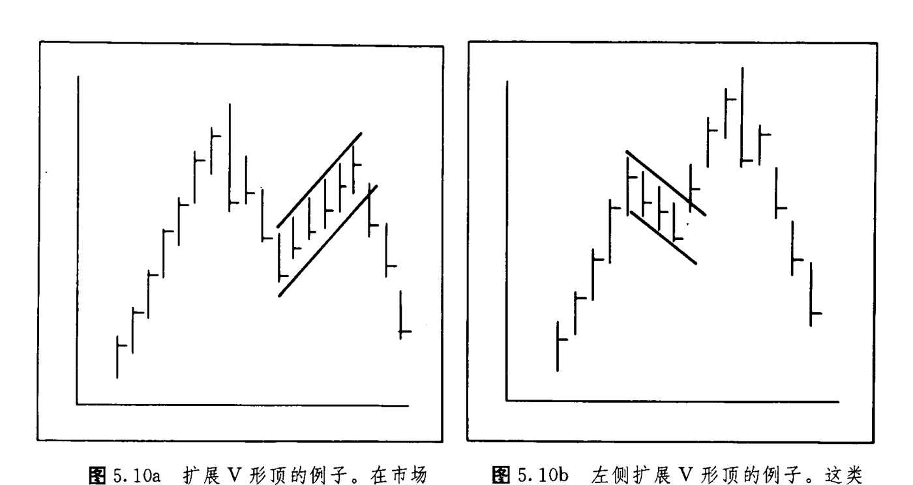

> 图5.10a 扩展V形顶的例子。在市场转折后，马上形成了一个小平台。通常，它稍稍地斜向新趋势的相反方向。当平台被突破时，趋势反转的过程也就完成了。底部扩展V形反转的形态与此类似，但上下正好倒过来。

> 图5.10b 左侧扩展V形顶的例子。这类形态相当少见。它与正常的扩展V形一样，只是其平台超前于市场的转折点。

## 左侧扩展 V形形态

本形态比扩展V形形态更为少见，其中平台出现在形态的左侧，先于市场的反转（见图5.10b）。尽管这种形态在市场反向后对交易商无甚价值，但它也能提供一点参考。它原先在图上形成的向上反弹低点一旦被向下突破，则顶部形态便完成了。这个向上反弹低点也许暂时从市场下方提供了一定的支撑，从而减缓了下跌的速度，使交易商有更多的应对时间。

## 结语

本章我们讨论了五种最常用的主要反转形态—头肩形、双重顶和底、三重顶和底、圆形以及V形。其中最普遍的是
头肩形，双重顶和底，以及V形反转。这些形态通常意味着趋势正在发生重要的转折，因而被划分到主要反转形态这一类中。还有另一类形态，它们在本质上较为短期，且通常表示趋势的休整而不是反转，所以恰如其分地，我们把它们归结为持续形态。下一章我们将对后面这类形态展开研究。
