# 第九章 移动平均线

> 原书 PDF 第 229–267 页。OCR 自扫描件，图表已截取到 `images/09/`。

<!-- pdf p229 / 书页 214 -->

## 引言

移动平均线这种技术指标，最富灵活性，适用最广泛。因为它构造方法简便，而且它的成绩易于定量地检验，所以它构成了绝大部分自动顺应趋势系统的运作基础。

图表分析在很大程度上是主观的，我们很难核查分析者成绩。因此，图表分析不太适合计算机。与此相反，移动平均线的规则却可以简易地编成计算机程序，然后，由计算机自动地生成各种买入或卖出信号。不同的图表分析者也许会对同一个价格形态到底属于三角形、还是钻石形，或者对同一个价格形态到底是倾向于看涨、还是看跌而争执不下，但是，从平均线得出的趋势信号却是精确的，不随我们的主观意志而变。

下面，我们先为移动平均线下个定义。正如“平均”二字所指，它是最近10天收市价格的算术平均线。所谓“移动”，实质上就是指我们在 <!-- pdf p230 / 书页 215 --> 计算中，始终采用最近10天的价格数据。因此，被平均的数组（最近10天收市价格）随着新的交易日的更迭，逐日向前推移。在我们计算移动平均值时，最通常的做法是采用最近10天的收市价格。我们把新的收市价逐日地加入数组，而往前倒数的第11个收市价则被剔去。然后，再把新的总和除以 10，就得到了新的一天的平均值（10天平均值）。

在上例中，我们只选用了简单的10天收市价的移动平均值。实际上，其它计算移动平均值的方法并不都如此简单。关于怎样才能使移动平均线效果最佳，还有不少问题。比方说，我们应该计算多少天的平均值才合适？到底该用较短期的呢还是较长期的呢？是否有一种广泛地适合所有市场的最佳移动平均线？或者是否每个市场都有一种最佳移动平均线？只有收市价最适合计算移动平均值吗？同时采用好几条移动平均线，是不是效果更好？是简单的移动平均线，还是线性加权的移动平均线，或者还是指数加权移动平均线效果最好？是不是在某些情况下移动平均线表现得好，而在有的情况下则表现一般？

其实，围绕着移动平均线的用法，还有许多问题有待解答。在本章我们要解决其中的许多疑问，并且还要就移动平均线的一些最通常的用处列举示例。不过先要声明，这些问题迄今尚无严格的定论，我们将要交代的只是该领域现有的一些研究结果。

## 移动平均线：具有滞后特点的平滑工具

移动平均线实质上是一种追踪趋势的工具。其目的在于识别和显示旧趋势已经终结或反转、新趋势正在萌生的关键契机。它以跟踪趋势的进程为己任。我们也可以把它看成弯曲的趋势线。然而，这里必须明确，正统的图表分析从不企图领先于市场。移动平均线也不例外，它也不超前于市场行为，它追随着市场。仅当事实发生之后，它才能告诉我们，新的趋势已经启动了。

移动平均线是一种平滑工具。通过计算价格数据的平均值，我们求得一条起伏较为平缓的曲线。从这条较平滑的曲线上，我们大大地简化了探究潜在趋势的工作。不过，就其本质来说，移动平均线滞后于市场变化。较短期的移动平均线，比如5天或10天的平均线，比40天的平均线更贴近价格变化。可是，尽管较短期的平均线能减小时滞的程度，但绝不能彻底地消除之。短期平均线对价格变化更加敏感，而长期移动平均线则迟钝些。在某些市场上，采用短期移动平均线更有利。而在另 <!-- pdf p231 / 书页 216 --> 外的场合，长期平均线虽然迟钝，也能发挥所长（见图9.1a和b）。

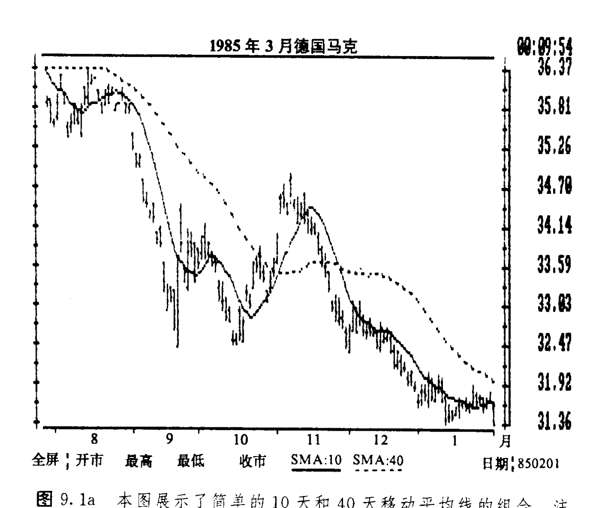

> 图9.1a 本图展示了简单的10天和40天移动平均线的组合。注意，其中 10天平均线的时间跨度较短，因而更贴近价格趋势。而 40天平均线则与之有较大的距离。移动平均线平滑了价格趋势，但总是滞后于价格变化。实线为 10天平均线，虚线为 40天平均线。

## 平均哪种价格？

在上面的例子中，我们所采用的平均值都是从收市价中计算得来的。一般认为，收市价是每个交易日最重要的价格，因此，在构造移动平均线时用得最普遍。不过朋友们也应该了解，有些分析者更愿意使用其它的价格。比如，有些人更偏好使用所谓中间价，即当日价格区间中点的价格。

有些人也采用收市价格，但是他们是把每天的最高价、最低价和收市价加在一起，然后除以3，再代入移动平均值的计算式。还有些人则针对每天的最高价和最低价，分别求出两条移动平均线来，最后得到一条“价格带”。在这种方法中，有两条移动平均线，它们相互分开，中间形成了一条所谓价格波动的“容器”，或称“包容带”。稍后我们将探讨采用价格带可能具备的长处。尽管有这些变通的做法，在移动平均线的算法中，最常用的仍然是收市价格（或者说，结算价格）。在本章中，我们要把 <!-- pdf p232 / 书页 217 --> 主要精力集中在它身上。

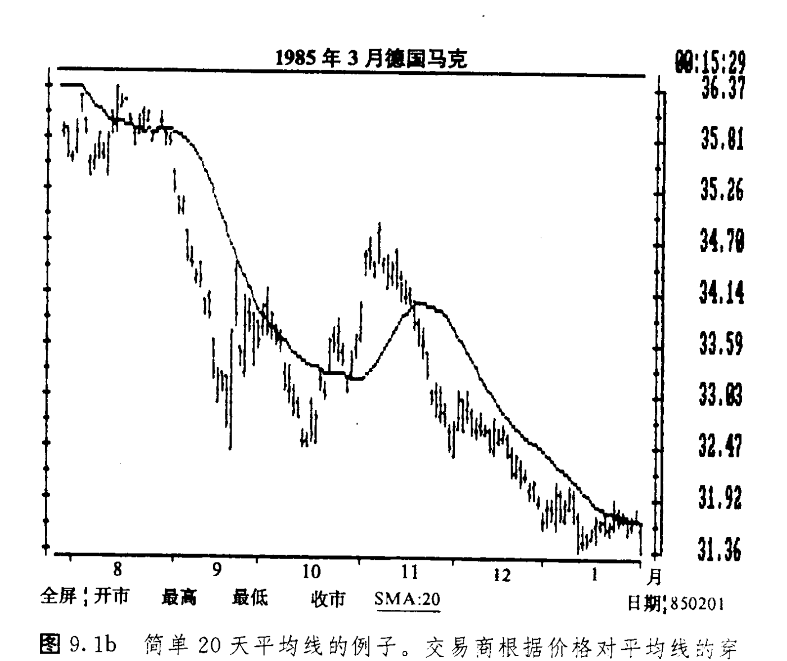

> 图9.1b 简单20天平均线的例子。交易商根据价格对平均线的穿越来取得交易信号。目前价格低于平均线，意味着趋势看跌。注意、20 天平均线平滑了价格变化，但它滞后于后者。

## 简单移动平均值

所谓简单移动平均值，即算术平均值，它最常用。但是，也有人怀疑其效果。主要的疑问有两个。第一种批评是，每个平均值仅仅把它所覆盖的那段日子（例如最近10天）包括进来。第二种批评是，简单移动平均值对其中每一天都一视同仁。例如在10天平均值中，最近10天中每一天的分量都同当天的一样，每天的收市价格都占有10%的权重。在5天平均值中，每天的权重都是20%。有些分析者认为，距当前越近的日子的价格变化应当具有越大的权重。

## 线性加权移动平均值

为了解决上述权重问题，有人提出了“线性加权移动平均值”的概念。在这种算法中，如果以 10天平均值为例，那么，第10天的收市价要乘以 10，第9天乘以9，第8天乘以8，依此类推。这样，越后来的收市 <!-- pdf p233 / 书页 218 --> 价，权重越大。当然，下一步，我们要把其总和除以上述乘数的和（在本例中为55：10+9+8+⋯⋯＋1=55）。无论如何，线性加权平均值法依然没有解决前一个问题，即它仍然仅仅包含平均值移动区间内的价格（见图9.2a和b）。

## 指数加权移动平均值

这是一种更为复杂的平均方法，称为“指数加权移动平均值”，它一举解决了简单平均值法所面临的两种责难。首先，指数加权平均值给较后来的价格以较大的权重，由此，它属于加权平均值的性质。另外，尽管它给予过去价格的权重较小，却的确囊括了自期货合约上市以来所有的历史价格。不用说，它的计算公式很繁复，我们必须借助计算机来计算。乍看起来，既然指数加权平均值法不但同时解决了简单平均法的两个缺陷，而且在这两方面还翻出了新名堂，那么，它在上述三种方法中就该最合用。可惜，事实并不尽然。本章后面将要比较三者的优缺点。

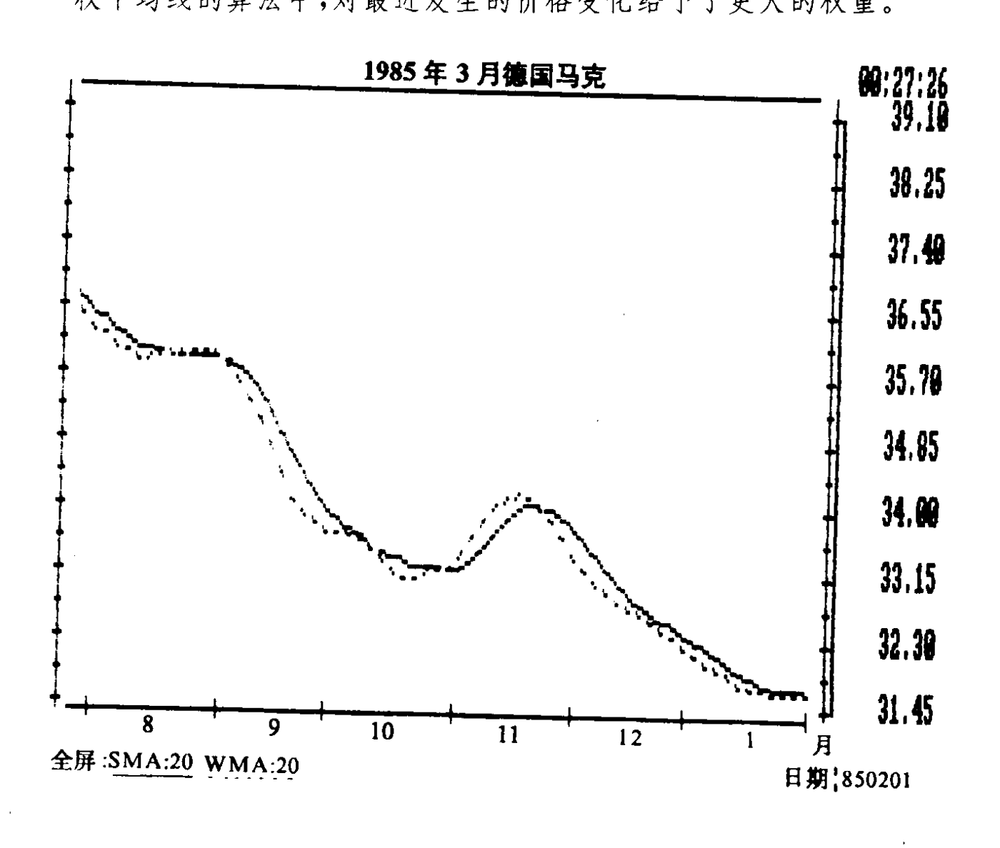

> 图9.2a 简单20天移动平均线（实线）与线性加权移动平均线（虚线）的比较。注意，加权平均线（虚线）往往领先于简单平均线（实线）。在加权平均线的算法中，对最近发生的价格变化给予了更大的权重。

<!-- pdf p234 / 书页 219 -->

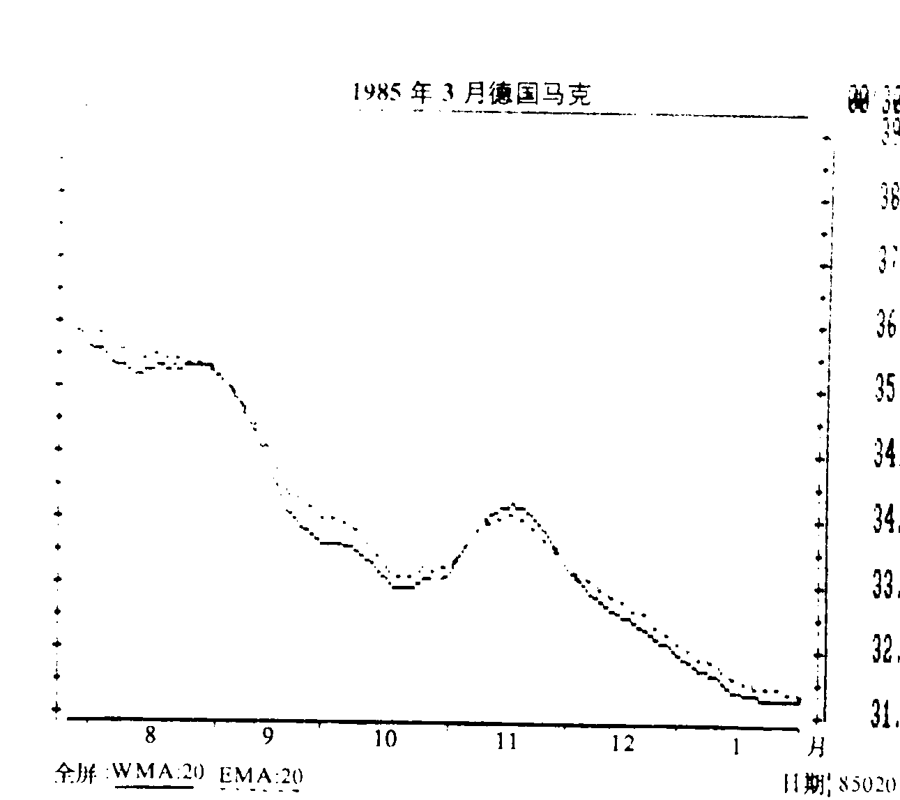

> 图9.2b 20天线性加权移动平均线（实线）与指数加权移动平均线（虚线）的比较。指数加权平均线也属于加权平均法，但它包括了所有的历史数据。其中对更近的价格变化也给予了更大的权重。

## 单独采用一条移动平均线

期货分析者最常用的是简单移动平均线。我们的讨论也主要集中于这种方法。有些期货交易商只采用一条移动平均线来产生趋势信号。在日线图上，我们把移动平均值伴随着每天的价格图线，逐日点出。当收市价格升高到移动平均值之上后，就产生了买入信号。当收市价低于移动平均值后，就出现了卖出信号。有些分析者为了进一步验证上述信号，还希望看到移动平均线本身也朝穿越的方向变化。

如果我们采用非常短期的移动平均线（如5天或10天平均线），移动平均线就非常贴近收市价格轨迹，并时常出现穿越现象。这些穿越信号可能是有效的，也可能是错误的。如果我们采纳这些极为敏感移动平均线信号，就会导致较多的交易次数（因而交易费用更高昂），并引发较多的伪信号（拉锯现象）。如果平均线过于敏感，有些短期的随机价格变化（或称“噪音”）就可能会激发错误的趋势信号。

较短期的平均值产生较多的伪信号，不过利弊总是不分家的，从另一方面来看，它能更及时地揭示趋势信号。这很合情理，因为平均值越 <!-- pdf p235 / 书页 220 --> 敏感，则信号出现得越早。因此这里也有一番取舍的功夫。我们的窍门是，力求找出最合适的移动平均线，一方面它很灵敏，足以及时地产生信号，另一方面它又相当迟钝，足以避开大部分随机的“噪音”。

### 长期移动平均线同短期移动平均线

通常，当价格处于横向延伸的区间中时，短期移动平均线的效果较佳。因为在这类环境下，价格基本上无趋势可循，短期的较敏感的平均线能捕捉更多的短线价格波动（见图9.3）。

然而，一旦价格趋势形成了 ——无论是上升还是下降—长期移动平均线就更为有力了。较不敏感的移动平均线（例如 40天的）在跟踪趋势时，距离价格较远（因为它具有更长的时间滞后），这样，就不会在市场出现临时性调整的时候产生错误信号，从而，我们可以更长久地利用主要趋势。

反过来，当市场出现短暂的调整时，较短期的平均线就会发出平仓了结的信号，或者甚至发出逆着当前主流趋势的买卖信号。前面我们曾说过，关键在于选择时间跨度恰当的平均值。到这里，事情就很清楚了，没有哪种平均线能够在所有的场合下都最合适。正确的选择是，当市场处于无趋势阶段时，采用较短期的平均线；而当市场处于趋势良好的阶段时，则采用较长期的平均线。

下面我们把上述比较再深入一步。当趋势持续时，较长期的平均线表现较佳。但是在趋势反转时，它的缺点就暴露无遗了。因为较长期平均线较为迟钝，它原本是从更远的距离外追踪趋势的，这样才使之在趋势过程中，不与短暂的调整搅在一起。也正因其迟钝，当趋势反转时，它也不能及时反应出来。因此，我们给出另一个推论：只要趋势持续，那么较长期平均线就作用良好，但是当趋势处于反转过程中时，较短期的平均线更适用。

于是，我们清楚了，单独采用一条平均线的做法有好几处缺陷。也许组合使用两条移动平均线更好。不过，在讨论组合使用两条移动平均线的方法之前，我们还需要把移动平均线概念理解得更透彻些。以下先说说过滤器和价格带。

### 关于一条移动平均线的过滤器

为了减少采用一条移动平均线时出现的拉锯现象，分析者在移动平均线信号上施加了过滤器。以下是其中几种具体的做法。 <!-- pdf p236 / 书页 221 --> 

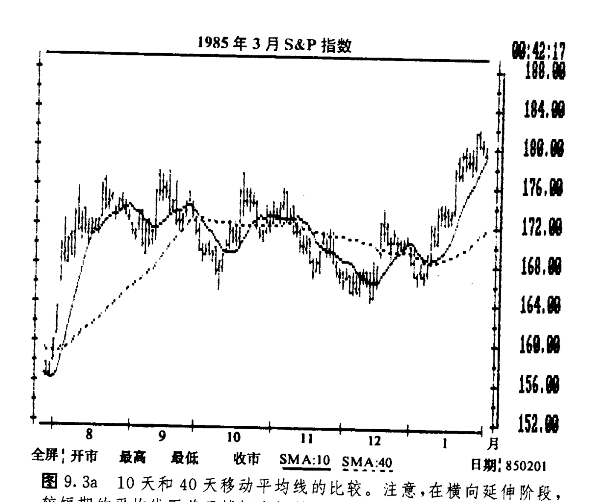

> 图9.3a 10天和40天移动平均线的比较。注意，在横向延伸阶段，较短期的平均线更善于捕捉市场转折点（实线）。而当市场处于趋势阶段时，较长期平均线（虚线）的帮助更大。

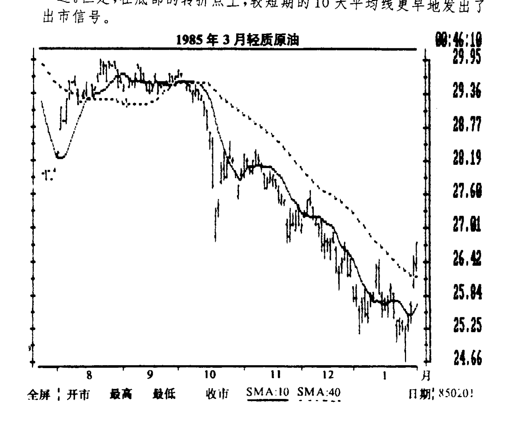

> 图9.3b 请注意，在下降趋势中，较长期的40天平均线（虚线）以“安全”的距离追随着趋势，使交易者在整个下跌中始终维持在空头一边。但是，在底部的转折点上，较短期的10天平均线更早地发出了出市信号。

<!-- pdf p237 / 书页 222 -->

1. 某些分析者在采纳移动平均线的信号之前，不仅要求收市价格必须穿越移动平均线，同时也要求当天的全部价格范围清晰地突出在移动平均线的同一侧。

2. 另一种过滤器是，收市价格穿越移动平均线的幅度必须达到预定的要求，这一点属于穿越规则的范畴。预定穿越幅度可以是最小价格单位的一定倍数，或者是某个百分比。例如，在纽约商品交易所（COMEX），黄金的最小价格单位为10美分（0.10）。那么举例说，我们就可以把过滤器设置为5倍于最小价格单位，即50美分（0.50）。在百分比过滤器中，可能要求收市价格穿越移动平均线的幅度达到1%（以目前的 COMEX 黄金市场计，约为3.00）。当然，使用过滤器也是个两难选择问题。过滤器越小，那么它的保护性能越差。而过滤器越大，则信号发生得越迟——这又是一桩“公平买卖”。过滤器提供的保障越佳，那么其入市信号就越滞后，从而错过越多的价格变化，“成本”越高。

3. 有些分析者要求，移动平均线信号必须由其余图表的突破信号所验证。这样，就可以获得较强的信号，避免在短暂的横向区间中，接连地陷入拉锯现象中。我们可以选用点数图的信号作旁证。还可以选用“周规则”的突破信号（稍后我们要进一步讲述所谓周规则的突破信号）。采用此类过滤器也有短处。交易商对过滤器越倚重，那么他离移动平均线信号的本意就越远。

4. 也有些分析者采用了时间过滤器。他们在动手之前，先观察一到三天。因为绝大部分错误信号往往很快就露出马脚，市场重新返折到平均线的原来的那一侧。所以，如果我们要求信号在出现后一二天内始终保持有效，就可以甄别相当多的伪信号。本方法所付的代价是，等到信号确认，入市已晚了一步。

5. 另一种流行的过滤器是“百分比包络线”，或者说“波幅带”。具体的做法是，在移动平均线的上方和下方的一定的百分比位置上，分别作出移动平均线的平移曲线。换言之，在移动平均线之上或之下，距离移动平均线一定百分比的位置上，另画两条曲线。当收市价格不仅高过移动平均线自身，而且超越了上包络线之后，才构成买入信号。基本的移动平均线则变成了止损出市点（见图9.4a 和b）。

在上包络线和移动平均线之间，形成了所谓的缓冲区。当价格处在这两条线之间时，我们不采取任何举措。只有当收市价向上穿越了上包络线后，我们才把它看作买入信号。而万一收市价格再回到移动平均线之下，那么刚才所开立的多头头寸就应平仓止损了。 <!-- pdf p238 / 书页 223 --> 

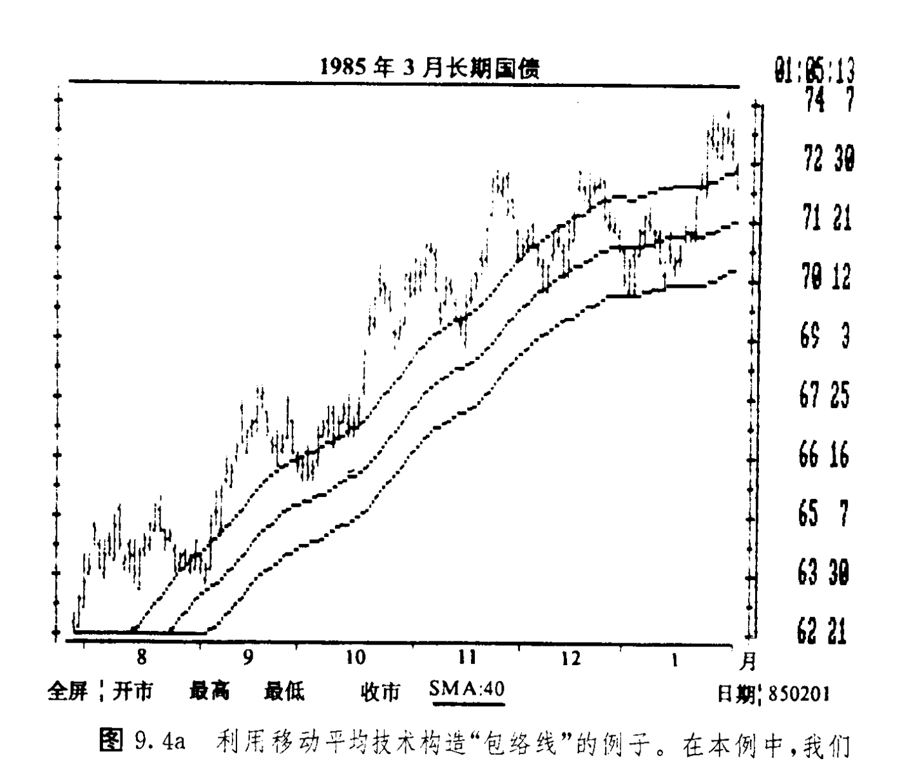

> 图9.4a 利用移动平均技术构造“包络线”的例子。在本例中，我们在40天移动平均线的基础上，把它向上、下各平移1.5%，就构造出了包络线。换言之，上方的线和下方的线均与移动平均线相差1.5%。

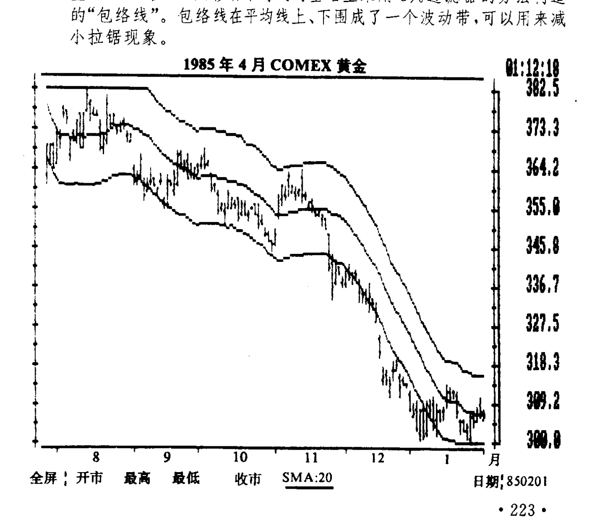

> 图9.4b 在20天移动平均线的基础上采用 3%过滤器的办法构造的“包络线”。包络线在平均线上、下围成了一个波动带，可以用来减小拉锯现象。

<!-- pdf p239 / 书页 224 -->

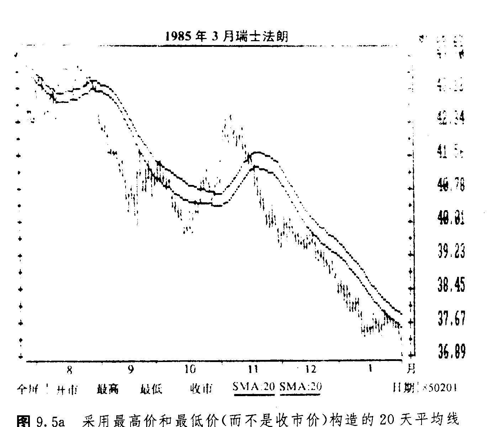

> 图9.5a 采用最高价和最低价（而不是收市价）构造的20天平均线的价格带的例子。本技术减少了交叉的次数，从而消除了部分伪信号。

我们要求收市价格跌破下包络线方构成卖出信号，而如果收市价格再回到移动平均线之上，则应止损平仓刚才开立的空头头寸。采用此类过滤器的主要长处是，当价格处于缓冲区（或称“中性区”）时，我们毋需持有任何头寸。对于始终与市场相联的（始终“在市”的）交易系统来说，这种方法尤具优势。

6. 如果我们针对每日的最高价和最低价，分别采取与在收市价格下同样的移动平均方法，就得到了价格带（包容带）。它由两条移动平均线形成———条是关于最高价的，一条是关于最低价的（见图 9.5a和b）。

收市价格必须穿越上边线，才构成买入信号。然后，下边线就可用来确定止损出市点。而当收市价格跌破下边线时，才构成卖出信号，然后，上边线就成为止损保护线。在上升趋势时，下边线恰似看涨的趋势线。在下降趋势中，上边线正如看跌的趋势线。

## 采用两条移动平均线

在前面各个部分，我们曾交代，采用一条以上的移动平均线有其 <!-- pdf p240 / 书页 225 --> 

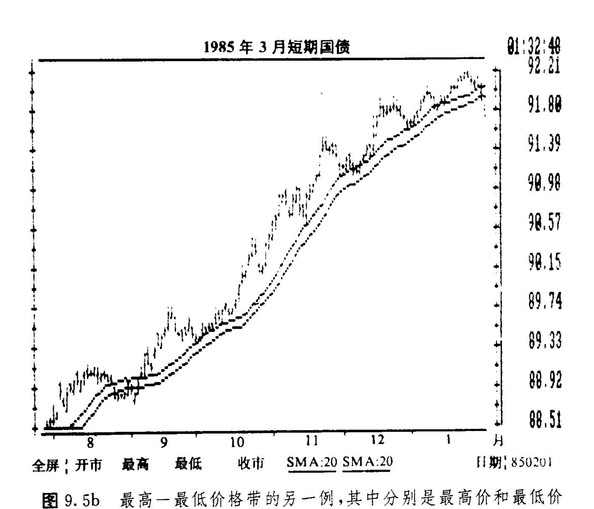

> 图9.5b 最高一最低价格带的另一例，其中分别是最高价和最低价的20天移动平均线。

独到之处。在有些场合下，短期平均线的作用更好些，而在有些场合下，较长期的平均线更能发挥所长。在单独采用一条移动平均线的情况下，常常会出现大量拉锯现象，从而有必要使用各种过滤器。为了提高移动平均线方法的效果和可信度，许多分析者选择两条或三条移动平均线，把它们组合起来使用。

我们这里仍然主要谈简单移动平均值，暂且不管与之相对的加权平均值，或者指数加权平均值那两种变通办法（当然，以后我们也要列出一个实例，看看组合使用两条指数加权平均线的情况）。有研究表明，两种简单平均线相组合，在各种可能的组合之中效果可能是最佳的。

当我们采用两条移动平均线时，较长期者用来识别趋势，较短期者用来选择时机。正是两条平均线及价格三者的相互作用，才共同产生了趋势信号。

### 怎样利用两条移动平均线产生信号

双移动平均线法有两种具体的用法（见图9.6a到d）。

1. 第一种称为“双线相交法”。就是说，当短期平均线向上穿越长期 <!-- pdf p241 / 书页 226 --> 

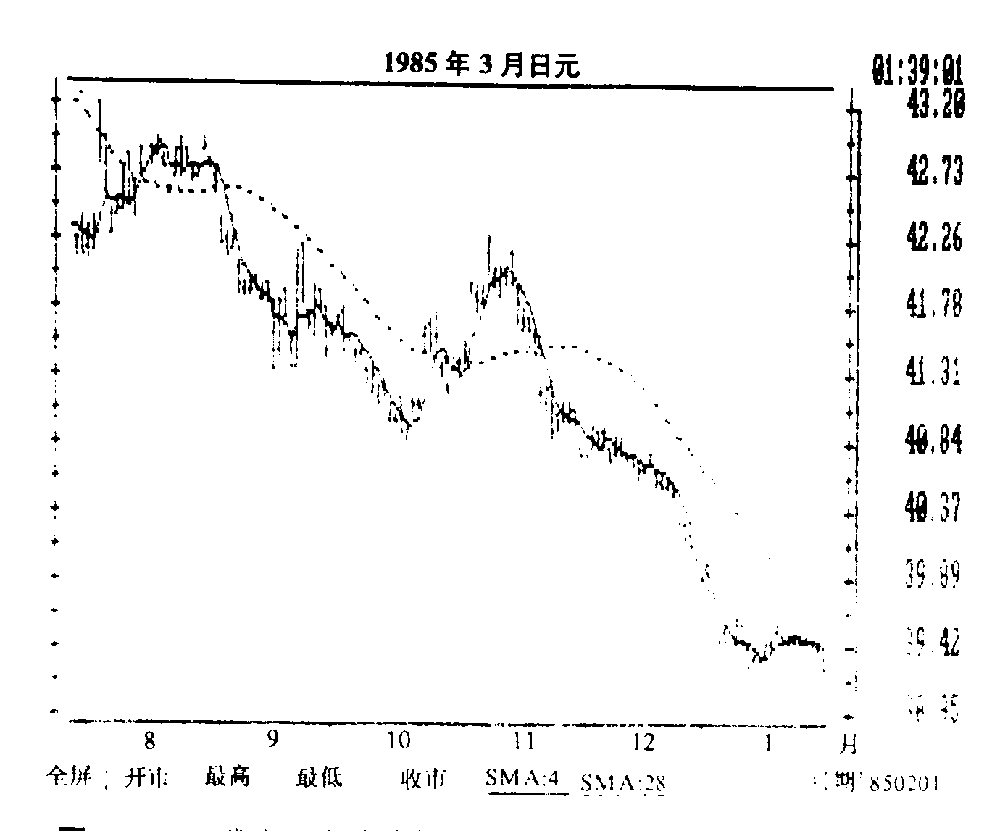

> 图9.6a 双线交叉方法的例子。当较短期的4天平均线向下穿越较长期的28天平均线时，构成卖出信号。上述天数是优化后的数字（见表9.5）。

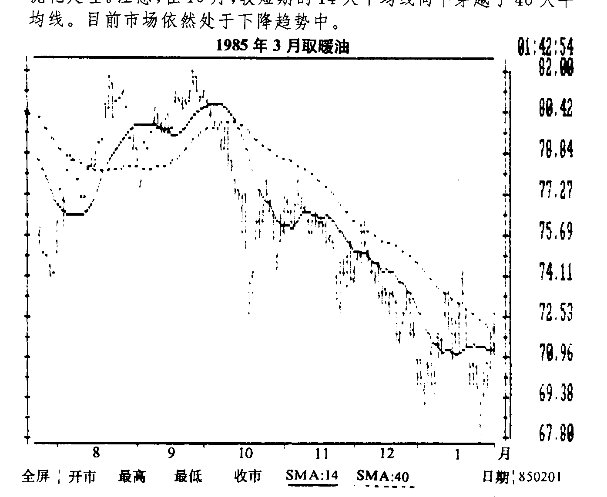

> 图9.6b 双线交叉法的另一个例子。两条平均线的时间跨度均经过优化处理。注意，在10月，较短期的14天平均线向下穿越了40天平均线。目前市场依然处于下降趋势中。

<!-- pdf p242 / 书页 227 -->

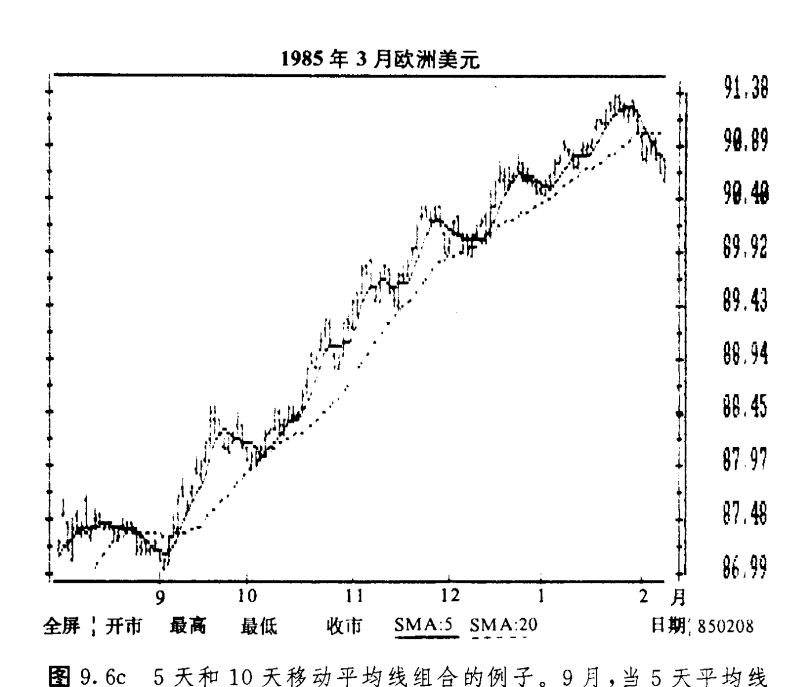

> 图9.6c 5天和10天移动平均线组合的例子。9月，当5天平均线向上穿越20天平均线时，发出了“买入”信号。这是5个月前的事。注意，目前5天平均线刚刚向下穿越20天平均线，给出了“卖出”信号。

平均线时，构成买入信号。例如，两条平均线分别为5天和20天的移动平均线，或者是 10天和 40天的移动平均线。在前一种情况下，当5天平均线向上穿越20 天平均线后，构成买入信号；而当5天平均线向下穿越 20 天平均线后，形成卖出信号。在本例中，系统是连续工作的，即它始终在市，要么处于多头状态，要么处于空头状态。在后一种情况中，当10天平均线向上穿越40天平均线时，则为上升趋势信号；当10天平均线向下穿越 40天平均线时，则为下降趋势信号。同采用单移动平均线法相比，采用双移动平均线法在时间上滞后于市场更多一些，但由此也减少了拉锯现象。在后面，我们研究如何在具体市场上选择最佳平均线的问题时，还要继续讨论双移动平均线相交法。

2. 第二种使用双移动平均线的方法是，把它们中间看作某种中性区。那么，仅当收市价格同时向上越过了两条平均线之后，才构成买入信号。然后，如果价格再跌回中性区，则上述信号被取消。同样，仅当收市价格同时向下穿越了两条平均线之后，才构成卖出信号。然后，如果价格再涨回两条平均线之间的中性区，我们就平仓了结上述空头头寸。只要价格维持于中性区内，我们就袖手静观。依此方法设计的系统，也有一些其他系统所不及的长处。上述两种方法都有其他种种变化。 <!-- pdf p243 / 书页 228 --> 

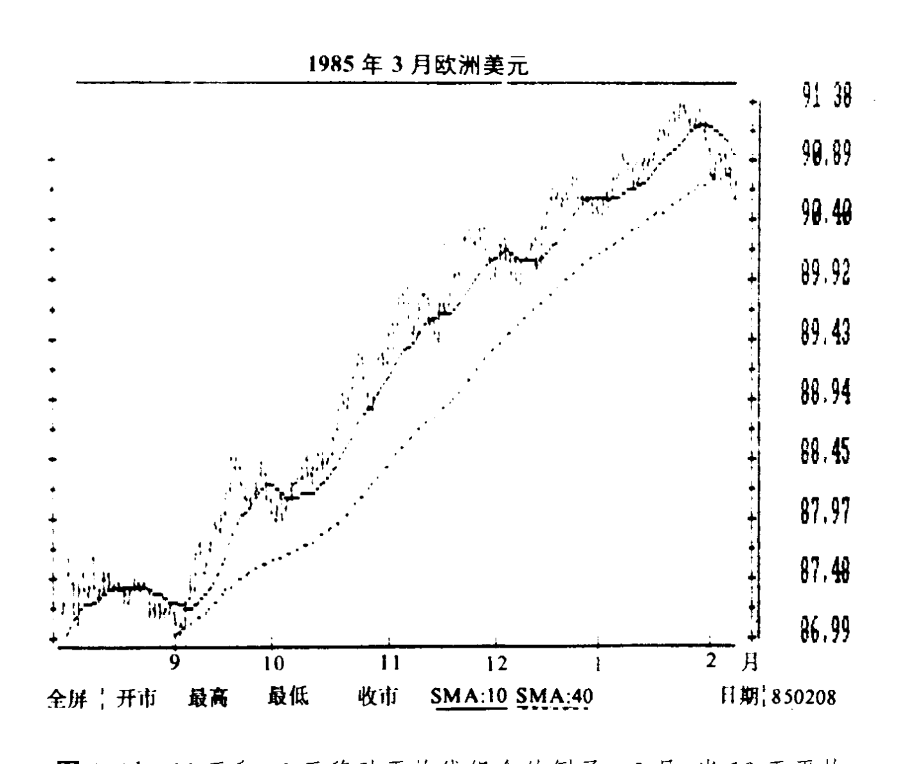

> 图9.6d 10天和40天移动平均线组合的例子。9月，当10天平均线向上穿越40天平均线时，构成“买入”信号。请注意，5个月以来，目前价格第一次向下同时跌破了两条平均线。这可以解释为“卖出”信号。

## 三条移动平均线相结合，或曰三重交叉法

既然两条移动平均线似乎比一条更好，那么，如果把三条平均线相组合，就该胜过两条平均线的组合了。基于这样的设想，就有了三重交叉方法。最常用的三重交叉法系统，要数4-9—18天移动平均线的组合。这个概念最先出自R•C•艾伦1972年的著作《怎样从商品市场发财》（温莎图书出版社）。稍后，在1974年，他还有《怎样利用4天、9天、18天移动平均线的组合从商品市场获取更多利润》（贝斯特图书出版社）。在商品行业，5天、10天和20天移动平均线是使用得最广泛几种，4—9—18天系统其实只是它的一种变化。目前，许多商业化图表服务都提供 4—9—18天移动平均线的组合，许多可视回馈系统也不例外。 <!-- pdf p244 / 书页 229 -->

### 怎样利用4-9—18天移动平均线系统

我们已经指出，移动平均线的时间越短，则它追随价格趋势时，越贴近价格。由之可以推论，在这种组合中，最短期的4天平均线最贴近价格趋势，9天平均线次之，18天平均线最远。因此，在上升趋势中，合理的排列应当为，4 天平均线高于9天平均线，而后者又高于18天平均线。在下降趋势中，顺序正相反，4天平均线最低，9天平均线次之，18天平均线居上（见图9.7a和b）。

在下降趋势中，当4天平均线同时向上越过了9天和18天平均线后，则构成买入的预警信号。随后，一旦9天平均线也向上越过了 18天平均线，则该预警就得到了验证，说明上述买入信号成立。这样一来，就使4天平均线居于9天平均线之上，而9天平均线又居于18天平均线的上方。在市场调整时，偶尔也许会有三线绞混的情况，但上升的大趋势不变。有些交易商在这种三线绞混的过程平仓获利，也有人以之作为买入机会。显然，在应用本规则时，有很大的变通余地，这取决于当事人的交易风格。

当上升趋势反转为下降趋势时，首先发生的情况是，最短期的（也是最敏感的）平均线——4天平均线——向下跌破9天平均线和 18天平均线。这还只是卖出的预警信号。不过，也有人会利用这个交叉信号，作为充分的理由卖出平仓，了结原有的多头头寸。随后，如果中等天数的平均线—9天平均线—也向下跌破18天平均线，则卖出信号得到确认（见图 9.7a和9.7b）。

## 最佳移动平均线组合

现在，我们已经考察了所有的三种移动平均线——简单平均、线性加权平均、指数加权平均。也研究了单移动平均线、双移动平均线的组合、和三条移动平均线的组合。不过，前面我们还列举了不少疑问，下面就来看看其中一些答案。

在我们讨论其中部分问题时，参考了美林公司研究部门的工作。他们在弗兰克•霍克海默领导下，从 1978年到1982年，发表了一系列有关计算机交易系统的研究报告。这些成果引人注目，是期货行业中迄今对移动平均线应用最深入的研究。为了发现表现最佳的移动平均线组 <!-- pdf p245 / 书页 230 --> 

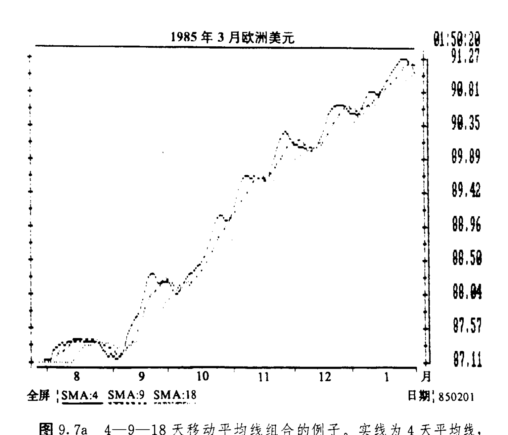

> 图9.7a 4—9—18天移动平均线组合的例子。实线为4天平均线，虚划线为9天平均线，虚点线为 18天平均线。

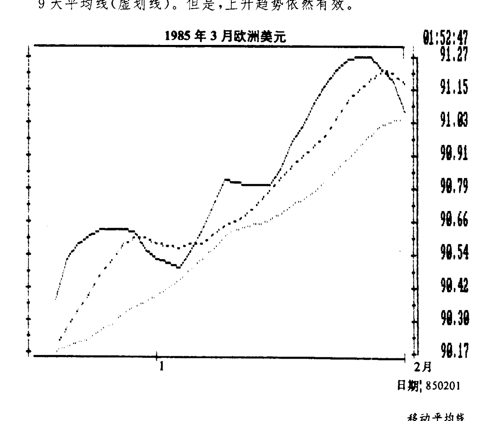

> 图9.7b 上例的局部放大。这里请注意，4天平均线（实线）刚刚跌过9天平均线（虚划线）。但是，上升趋势依然有效。

<!-- pdf p246 / 书页 231 -->

合，他们进行了大量的移动平均线技术的试验。他们还把这些移动平均线的组合，同其它各种技巧，诸如周价格管道（即周规则）、日内和日间价格管道、线性回归、以及韦尔斯•王尔德的方向性运动系统等作了比较。

他们的研究目的，是要得到上述每种技术的最佳（或优化的）成绩，然后对各种技术的结果加以比较，从所有可能的方法中，发掘出对每个市场最切合的技术指标。

### 美林公司研究部门的结果

以下我们就来看看这些研究结果，同时，也观摩观摩他们对移动平均线的具体运用方法。霍克海默有一篇文章《计算机能帮您做期货交易》，发表在1978年的《商品年鉴》上（由商品研究局出版），其中介绍了他们的部分成果。他们利用从1970年到1976年的13种商品的资料，按交易月对移动平均线法进行了测试。移动平均线的时间跨度从3天到70天逐渐改变。对简单平均法、线性加权平均法，和指数加权平均法分三组分别进行测试。所有结果分别列表比较，以对每个市场找出最优越的平均值（见表9.1到9.3）。最后，在表9.4中，再把三种平均方法的情况汇总比较，以找出三个类型中最佳者。

为了挑选最适合的指标，他们采用了一种检测系统，所衡量的项目有，累计的净利润或净亏损、最大的连续亏损、以及几种盈利比率等。从这些研究中，可以得出下面几点有益的结论。

1. 首先，我们引用霍克海默自己的论述：“这些试验为我们提供了经验性的根据，表明期货价格的变化并不是完全随机发生的。事实上，这些趋势顺应技术产生了显著的利润，即使我们把交易费用考虑进去也不例外。因而技术分析作为一种价格预测方法，它的有效性在这里得到了支持。”（霍克海默，第60页）。

2. 没有哪种移动平均线在所有市场都表现得最佳。或者换种说法，每个市场看来都有自己独有的优越移动平均线，具体市场具体选择。

3. 较长期的移动平均线胜过较短期的移动平均线。所谓长、短区别的分水岭，位于 40天平均值附近（8周）。在60天到70天的区间（13周）中，优越平均线的数目多得令人吃惊。

4. 简单移动平均值方法既胜过线性加权平均值法，也胜过指数加权平均值法。在13 种市场中，如表9.4所示，其中有10例是简单平均值法最佳，有2例是线性加权平均法最优，而指数加权平均值中选的情况只有1例（可可市场），可见其表现最差。 <!-- pdf p247 / 书页 232 --> 

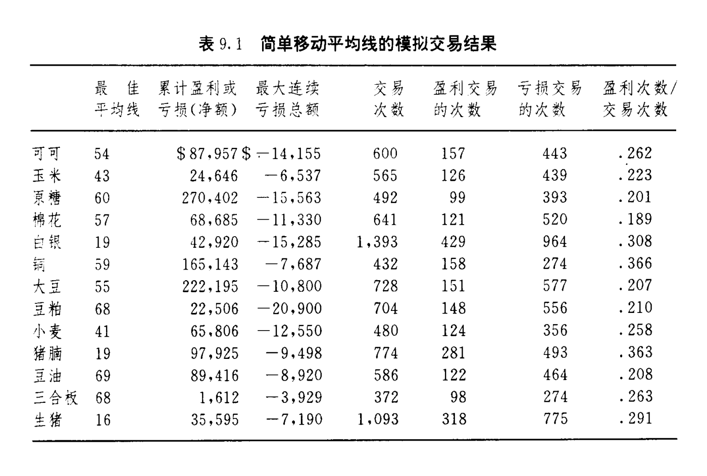

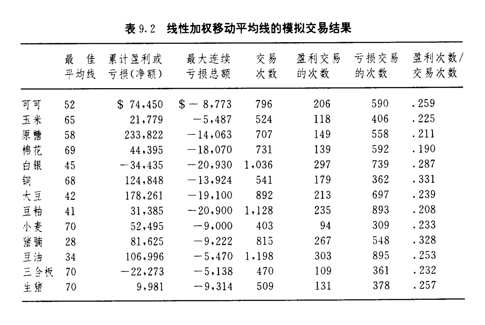

<!-- pdf p248 / 书页 233 -->

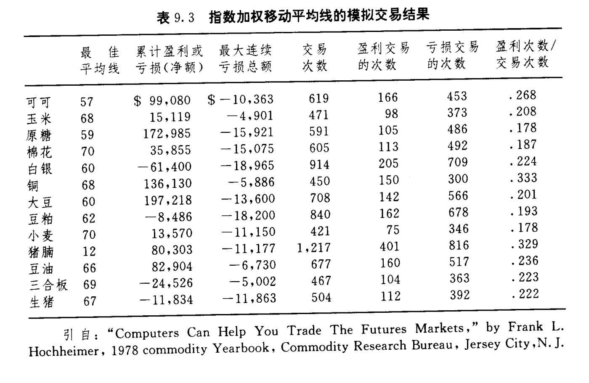

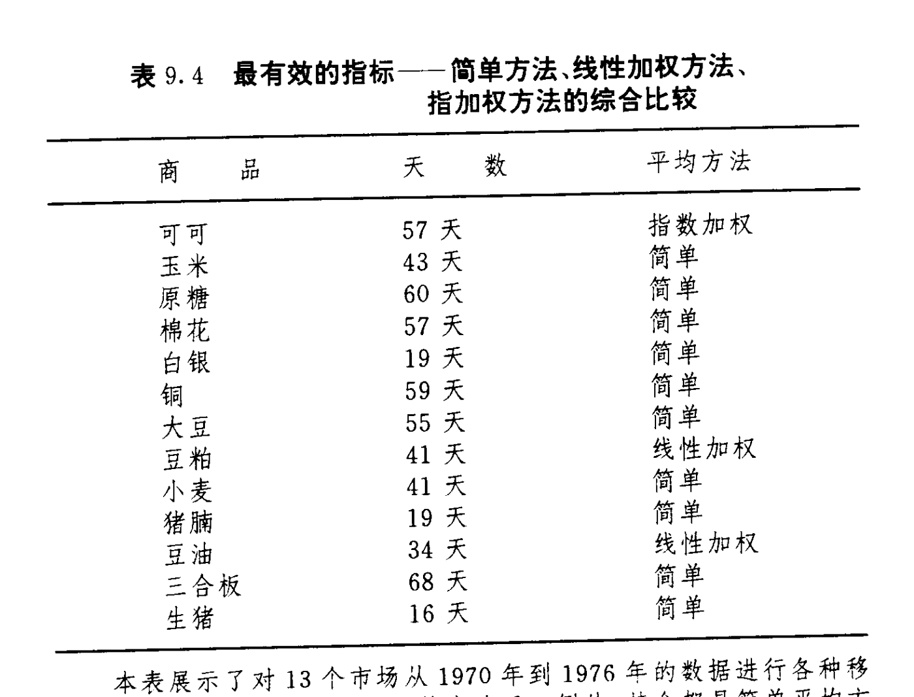

> 本表展示了对13个市场从1970年到 1976年的数据进行各种移动平均方法测试的结果比较。其中除了3例外，其余都是简单平均方法表现最佳。（引自：Hochheimer, 1978 Commodity Year Book，Commodity Research Bureau， Jersey City，N.J.）

<!-- pdf p249 / 书页 234 -->

### 双平均线法同三平均线法

在确认了简单平均值法最出色之后，他们转向双移动平均线相交法和三移动平均线相交法的研究。这里，他们只采用简单平均法。他们把研究结果（从1970年到1976年的数据得来）与前面提到的各种管道技术相比较。他们在 1979年进行的比较研究中，共涉及了 17个市场，其中有10例表明，使用双平均线法的获利能力最强。而三平均线法只在4例中占到上风。剩下三个市场呢，数各种价格管道技术最合适。稍后，我们将介绍价格管道技术，作为对移动平均线方法的补充（关于以上研究的详细情况，见《计算机交易技术》，美林公司部商品部编，1979年2月号）。

关于移动平均线，除了前面的四条结论外，还可以加上一点——双移动平均线组合看来是最好的选择。那么归纳一下，在移动平均线方法中，最好的办法可能是，根据市场的具体情况，通过优化过程，选出它的双简单移动平均线的最佳组合。

这里的所谓优化，贯穿着上述研究的始终。每条移动平均线（或者每种技术指标）都应当、也能够针对具体市场的个性、特点进行优化处理。

表9.5是美林公司关于双线相交法的最新研究报告（计算机交易技术1982，美林公司商品部）。最近这份报告一直覆盖到1981年全年，其中还包括了几种新的期货市场。

### 在优化过程中碰上的难处

优化过程的困难之一是，一有新数据，我们就得把优选的过程从头再来一遍。每当市场情况发生变化，优化结果——优选的移动平均值的时间跨度（天数）就可能也得变。尽管美林公司的研究结果表明，在一段时间内，优选的移动平均线天数相当稳定，但是我们必须明确，不可以对过去优选的天数过分倚重。在此我要强调，前面各表中的优选天数，仅仅是为了说明问题而引用的，而不是说在目前的市场条件下，它们仍是最佳的平均线天数。

随着微电脑的出现，各式应用软件层出不穷，优化过程相对简易了。其实，针对几乎所有的技术指标，我们都可以根据不同的市场情况，优选出最佳的时间参数。然而，问题依然棘手，到底我们应该隔多久按照何种频繁程度——重新优选一次呢？如果我们测试的频繁程度不够，交易者就要冒优选参数过时的风险。如果我们做得太频繁，那 <!-- pdf p250 / 书页 235 --> 又会有新问题。

并非所有的分析者都推崇优化方法。有人认为，全部优化过程，不过是把这些参数调整一下，以适应过去的价格资料。这些怀疑论者觉得，既然这些所谓优选参数从没有在真实市场条件下，真刀实枪地检验过，当然就是可疑的了。

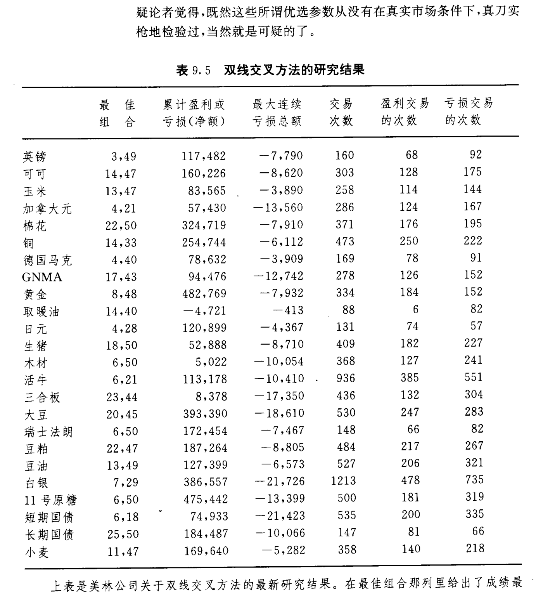

> 上表是美林公司关于双线交叉方法的最新研究结果。在最佳组合那列里给出了成绩最好的移动平均线组合。例如在英镑市场上，3天和9天移动平均线的组合最佳。上述数字仅仅是为了举例才给的，它们是好几年前的事了。朋友们在对它们进行当前市场的测试之前应该谨慎从事。优化的平均线必须适时地重新测试和刷新。（Source：“Computerized Trading Techniques 1982，” Merrill Lynch Commodities，Inc.，Frank L. Hochheimer and Richard J. Vaughn.）

<!-- pdf p251 / 书页 236 -->

在期货市场上，关于最佳移动平均线方法的争议恐怕永无止境。前面的研究结果当然也不是终结的答案。不过，这些研究的确为我们提供了一份工作纲要。在我们今后从事本领域更深入的研究的时候，它们是很好的起点。

## 移动平均线的位置

关于移动平均线同价格资料的相对位置的问题、也有争论。绝大部分技术分析者，把最近的移动平均值，描画在最近一天的位置上。然而，也有人宁可把最近的移动平均值，描画在距离最近一天一定天数以后的位置上。他们称之为，“让移动平均线领先价格变化”。这种移动平均线，同传统的移动平均线相比、即与上述前一种做法相比较•距离价格本身更远。具有领先时间的移动平均线方法意味着价格与平均线的相交要滞后更长的时间，因而伪信号更少。

阿瑟•斯克拉罗的办法更新奇。在他的《期货图表职业分析者手段》（商品研究局，1980年）中，建议把移动平均线向后挪动，移动幅度为其时间跨度天数的平方根。例如，如果移动平均线的时间参数为2天到4天，那就把它向后移2天；如果时间参数为5天到9天，就向后移3天；如时间参数为10天到 16天，就移4天，等等。

必须明确，如果我们把移动平均线向后推移，实际上就是把最近一天的收市价格同当日位置上的移动平均值相互比较。举例来说，如果移动平均线向未来推移了5天，那么就是把最近一天的收市价与倒数第5天的移动平均值相比较。由此可见，为什么价格与移动平均线的交叉普遍地推迟了。把移动平均线放置在不同位置上，可能会引出了一系列有趣的新用法。不过，最通常的做法还是，把移动平均值放在传统的即期位置，即使之与最近价格所处的日期一致。

### 移动平均线取中

从统计学角度来看，更准确的做法是把移动平均线“取中”（见图9.8a 和b）。就是说把每个移动平均值都画在它所覆盖的时间区间的中点上。比如说，与通常的做法相比，10天移动平均线就要向前移5天。20天的移动平均线则应向前移10天。不过，移动平均线取中有个重要缺陷，就是由之产生的趋势改变的信号实在过于滞后。因此，通常、我们还是把移动平均值放在它所覆盖的时间区间内的最后一天，而不是中点。取中技术一般只用在周期分析中，以分离各种潜伏的市场周期。在 <!-- pdf p252 / 书页 237 --> 

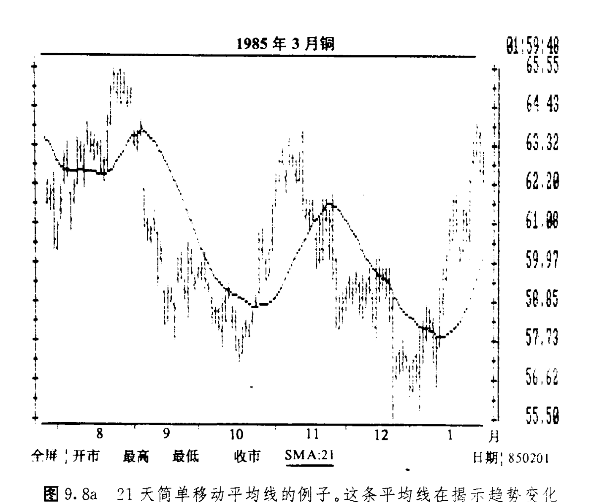

> 图9.8a 21 天简单移动平均线的例子。这条平均线在揭示趋势变化上表现不错。

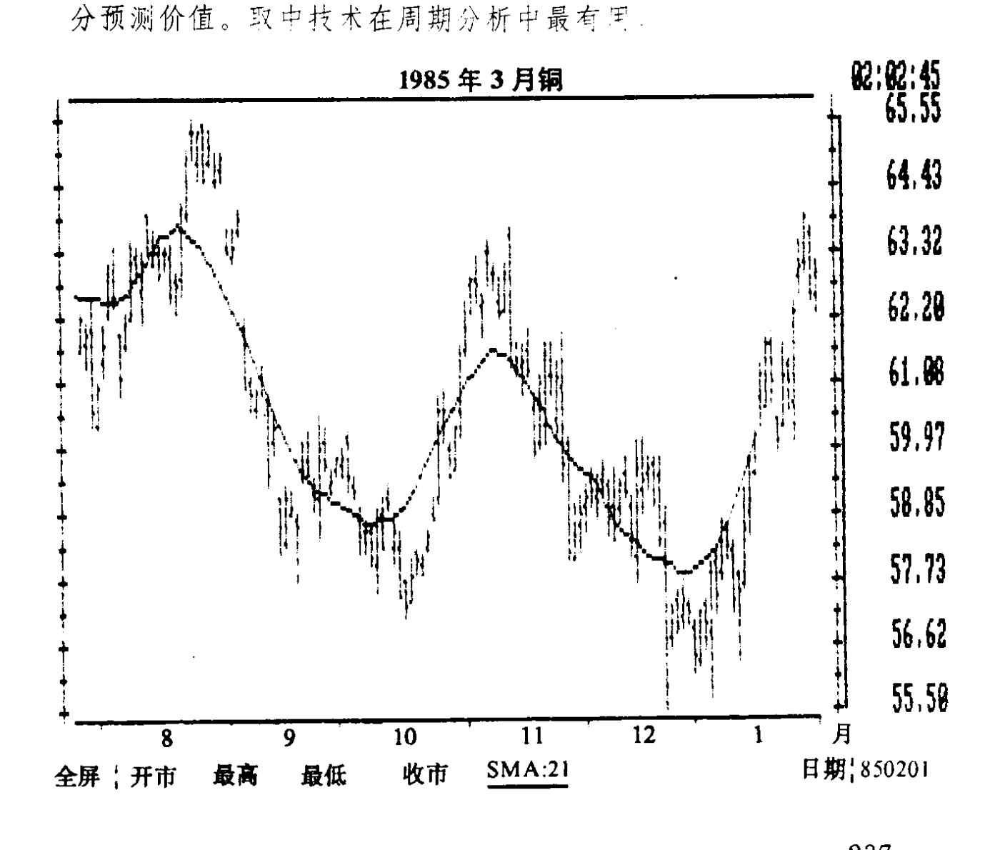

> 图9.8b 本图的移动平均线与图9.8a相同，但是其位置却不同，这里把它“取中”了。正如朋友们所见，在这里，移动平均线丧失了大部分预测价值。取中技术在周期分析中最有用。

<!-- pdf p253 / 书页 238 -->

第十四章我们讨论趋势分解的时候，对取中的移动平均线会有更多介绍。

## 移动平均线与周期现象关系密切

许多市场分析者相信、在市场运动中，时间周期起着重要作用。因为时间周期具有重复再现的特点、并且可以定量测算，所以，我们有可能预测市场出现顶或底的大致时间。从为时6天的短期周期开始，一直到长达54年的康德拉蒂耶夫周期，许多种时间周期同时并存。这是个迷人的技术分析领域，后面专门有一章对此详加阐述。

我们在这里引入周期概念，只是为了说明以下一点：影响某市场的主流周期与这个市场上最恰当的移动平均线之间，似乎颇有关联。换句话说，我们应按照每个市场的主流周期，来相应地调整移动平均线的天数。

看来，移动平均线和周期确实有一定的关系。举例来说，在所有的商品市场上，月周期都是最广为人知的。每个周期都倾向于按照一二个倍数因子，与其上一级长周期，或者下一级短周期和谐地相互呼应。这就是说，上一级长周期是本周期长度的双倍，下一级短周期则是本周期长度一半。

于是，我们从月周期上或许就能解释5天、10天、20天和 40天移动平均线之所以流行的缘故。月周期的长度是20天。40 天移动平均值是20天的两倍。10天移动平均值是20天的一半，5天移动平均值又是10天的一半。

在较为通用的移动平均线中（包括4天、9天和18天移动平均值，它们分别是从5天、10天、和20天中导出的），有不少可以用周期的影响以及各级周期之间的和谐关系加以解释。碰巧的是，四周周期也有助于解释四周规则成功之所在。本章稍后就要讲四周规则，以及它的“小兄弟”——二周规则。

## 菲波纳奇数字在移动平均线法中的应用

在关于艾略特波浪理论的一章中，我们将介绍菲波纳奇数列。不 <!-- pdf p254 / 书页 239 --> 过，在这里我们先要指出，这个神奇的数列——例如13,21,34,55、等等—在移动平均线法中看来也颇有用武之地。这一点不但对于日线图成立，而且在周线图中也适用。在日线图中我们曾提到 21天移动平均线，这也是个菲波纳奇数字。在周线图上，不管是在股票市场，还是在商品市场，均证明13周移动平均线很有价值。关于这些数字的深入探讨，我们留给十三章（见图9.9a到d）。

## 移动平均线适用于任何时间尺度

移动平均线方法最主要应用于日线图。不过，其实它既可以应用在更长期的趋势分析上，也可以应用于更短期的研究中。我们不应该忽视这两个方面。在股市分析中，长期的移动平均线，例如 10周或13周平均线，与30周平均线的组合使用方法，可以说由来已久了，但在商品期货市场上，它们还未受到应有的重视。在连续周线图上，我们可以用10周与30周移动平均线的组合来追踪开始于数年之前的主要趋势（见图9.10）。

从时间尺度上说，如果我们再往另一个方向看看，那么，也可以把移动平均线法应用于日内图上，辅助我们进行短线交易。无疑，在这些短线图表上，移动平均线给出的信号也是有效的。但是，对于当日交易者来说，应对及时是极为关键的，而移动平均线方法天生具有时间滞后的特点，那么，其时间滞后性质是否会损害它在当日交易中的效用呢？这是我给朋友们提出的疑问。

## 结语

在这一章，我们给出了移动平均线的许多具体用法。从某种意义上说，或许正是由于这种方法的极大灵活性，惹出了麻烦。使用者是“满箩里挑瓜，挑得眼花。”我们下面试着概要一下。大部分分析者使用双移动平均线或三移动平均线的组合。其中，各种平均值均由收市价算得，并且在图上描绘在它所覆盖的最近一个收市价的同一日期上，既不领先，也不靠后。最常用的移动平均值天数为5天、10天、20天和40天，或者是这些数字某种变通（例如4天、9天和18天）。话说回来，朋友们不 <!-- pdf p255 / 书页 240 --> 妨尽管放手地去尝试。随着微机和优化软件的普及，移动平均线分析法已经大为简易，有趣得很。

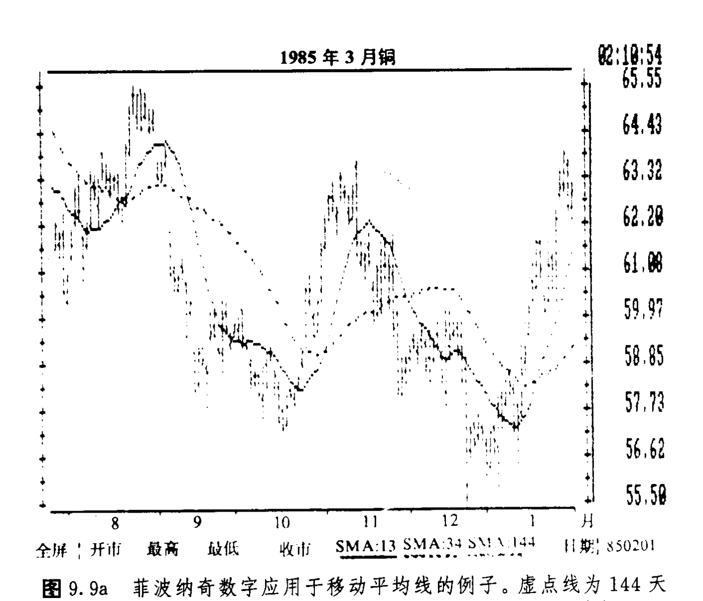

> 图9.9a 菲波纳奇数字应用于移动平均线的例子。虚点线为144天平均线（30周平均线），它刚刚被突破。其它两个平均线分别为 13天和34天。13天平均线（实线）已经向上穿越了34天平均线（虚划线），发出了买入信号。

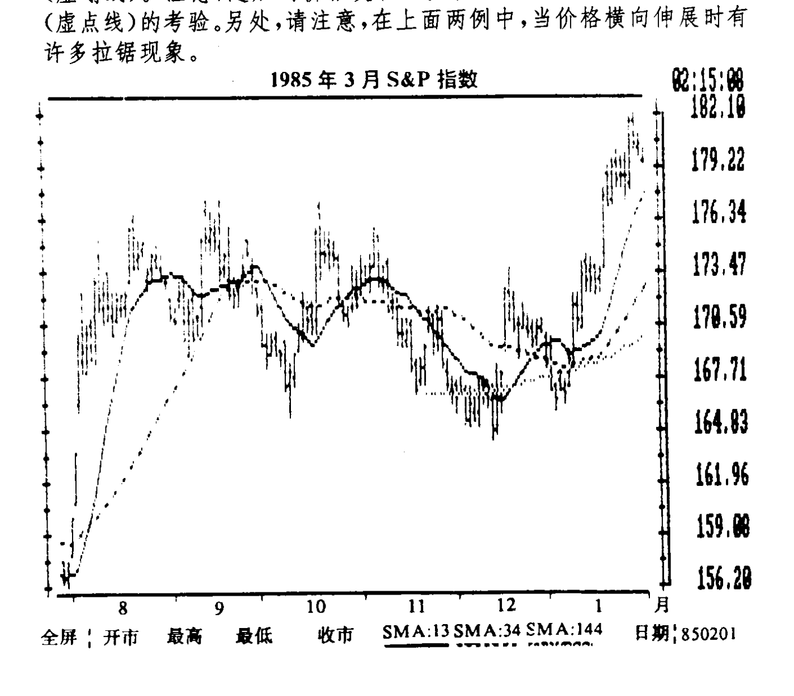

> 图9.9b 菲波纳奇数组13、34和144 另一个实例。12月下旬有个精采的买入信号，其中13天平均线（实线）向上穿越了 34 天平均线（虚划线）。注意，随后的价格变化经受住了较长期的144天平均线（虚点线）的考验。另处，请注意，在上面两例中，当价格横向伸展时有许多拉锯现象。

<!-- pdf p256 / 书页 241 -->

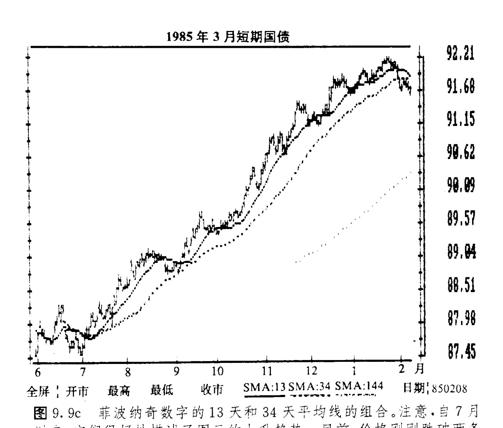

> 图9.9c 菲波纳奇数字的13天和34天平均线的组合。注意，自7月以来，它们很好地描述了图示的上升趋势。目前，价格刚刚跌破两条平均线，发出了趋势可能反转的早期警讯。图中还有第三条线、它远低于价格变化，这是144天（30周）平均线。

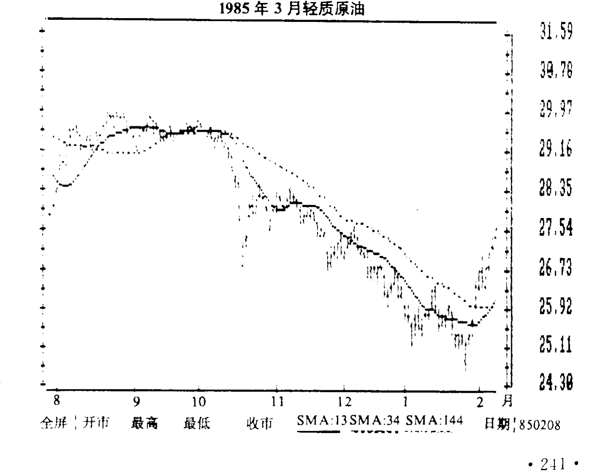

> 图9.9d 菲波纳奇数字的 13 天和34天移动平均线很好地描述了价格的下跌。10月有个“卖出信号”，13天平均线向下穿越了34天平均线。目前价格已经向上穿越了两条平均线，并且 13天平均线也向上穿越了 34天平均线，这是新的上升趋势的萌生信号。现在价格正向144天（30周）平均线进发。

<!-- pdf p257 / 书页 242 -->

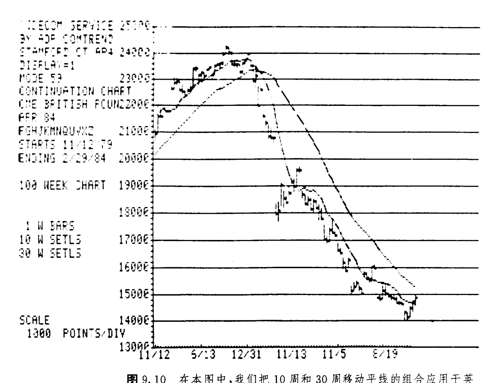

> 图9.10 在本图中，我们把10周和30 周移动平均线的组合应用于英镑的连续周线图上。注意，在 1980 年底，两条平均线向下穿越了 2. 30的水平，精确地揭示了一轮主要熊市的开端（Source: Automatic Data Processing, Inc. ，Comtrend Division, Stamford, CT.）。

## 关于移动平均线法的一些争论

移动平均线的信号指示我们顺着趋势的方向交易。这一点正符合期货交易中最源远流长的一些成功要诀，是移动平均线法最大的优越性之一，也解释了它如此流行的原因。这种方法“让利润充分增长，把损失限于小额”听来耳熟吧？每个新手肯定都碰到过这条历久恒新的法则。这里所要强调的是，移动平均线法正是以上述原则为基础，通过具体的买、卖信号，促使使用者遵守了这些原则。

无论如何，因为移动平均线在本质上是追随趋势的，所以当市场处于良好的趋势阶段时，其工作状态最佳。而当市场忽上忽下，进入了横 <!-- pdf p258 / 书页 243 --> 向延伸阶段后，则表现很糟。而后者所占时间常常达到了三分之一至一半，有时甚至更多。

事实上，移动平均线法在相当多的时间内不能发挥所长。正因为这个容易被忽视的理由，我们不能过分依赖移动平均线技术。我们反复强调，技术型交易商必须掌握一整套技术工具。在市场趋势良好的时期，移动平均线法无懈可击，那就不妨打开自动交易系统，自己去钓一阵子鱼。而市场处于其余场合时，采用非趋势顺应系统，比如超买一超卖摆动指数，更合适。所以下一章，我们要讲摆动指数。

## 移动平均线作为摆动指数

比较两条移动平均线之间的差距，是构造摆动指数的一个办法。由此，双移动平均线相交法就有了新的意义，用途更广泛了。在第十章，我们将介绍它的具体做法。在这一章的前面部分，曾提到两条指数加权移动平均线相比较的话题，该方法称为移动平均线相互验证/相互背离交易法（MACDTM），它主要用作摆动指数，因此，我们也要把关于这一技术的讲解放到第十章。

## 移动平均线法应用于其它技术资料

实质上，我们可以把移动平均线法应用于各种技术数据或者技术指标。既可以把它应用于持仓兴趣和交易量数据，包括权衡交易量，也可以把它应用于各种技术指标：差价和比价。当然也可以应用到摆动指数。图9.11a和b以及图9.12a 和b例示了移动平均线法一些广泛的应用。

## 周规则

在我们设计跟踪趋势系统的时候，除了移动平均线外，也有别的选择。其中最著名也最成功的技术之一，称为周价格管道，或简称周规则。本方法也具有移动平均线的许多优点，而且省了不少麻烦，使用起来也简便一些。

在过去十年中，随着计算机技术的进步，关于在期货市场建立技术性交易系统的问题，人们进行了大量的研究。这些系统在本质上是自动 <!-- pdf p259 / 书页 244 --> 

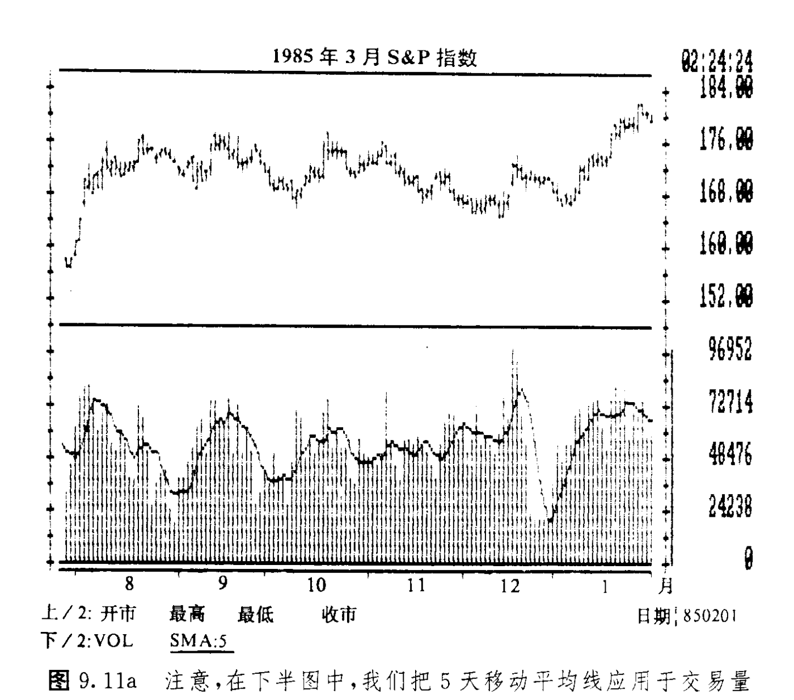

> 图9.11a 注意，在下半图中，我们把5天移动平均线应用于交易量柱形图。通过平均线法，有时也能够平滑交易量的趋势，简化其跟踪研究工作。所有的交易信号均可以通过交易量的平均线的变化而有所验证。在本例中，交易量平均线与价格变化极为合拍。

化的，消除了人类情感和主观判断的影响。另一方面，它们也越来越臻于复杂。起初用的是简单的移动平均法，后来，又加入了双移动平均线交叉、三移动平均线交叉的内容，再后来，又把移动平均值线性加权、指数加权。最近，人们又引入了高级的统计学系统，例如线性回归系统。上述系统的首要目的依然是追随趋势，即首先识别趋势，然后顺着既有趋势的方向交易。

不过，随着越来越复杂、越来越富于想象力的系统和指标的出现，也有些不妥的倾向。人们往往忽视了那些简单、基本的工具，而它们的效果相当好，经受住了时间的考验。下面我们就来说说其中一种最简便的方法——周规则。

1970年，邓恩和哈吉特公司的金融服务部门推出了一本《交易商手册》。其中对当时最流行的自动交易系统进行了模拟测试和比较研究。该项研究的最后结果表明，在所有的测试对象中，“四周规则”系统最为成功。这种系统是由理查德•唐迁创立的。唐迁先生目前在希尔森•莱曼・运通公司工作，担任其高级副总裁兼金融顾问。他被推崇为 <!-- pdf p260 / 书页 245 --> 

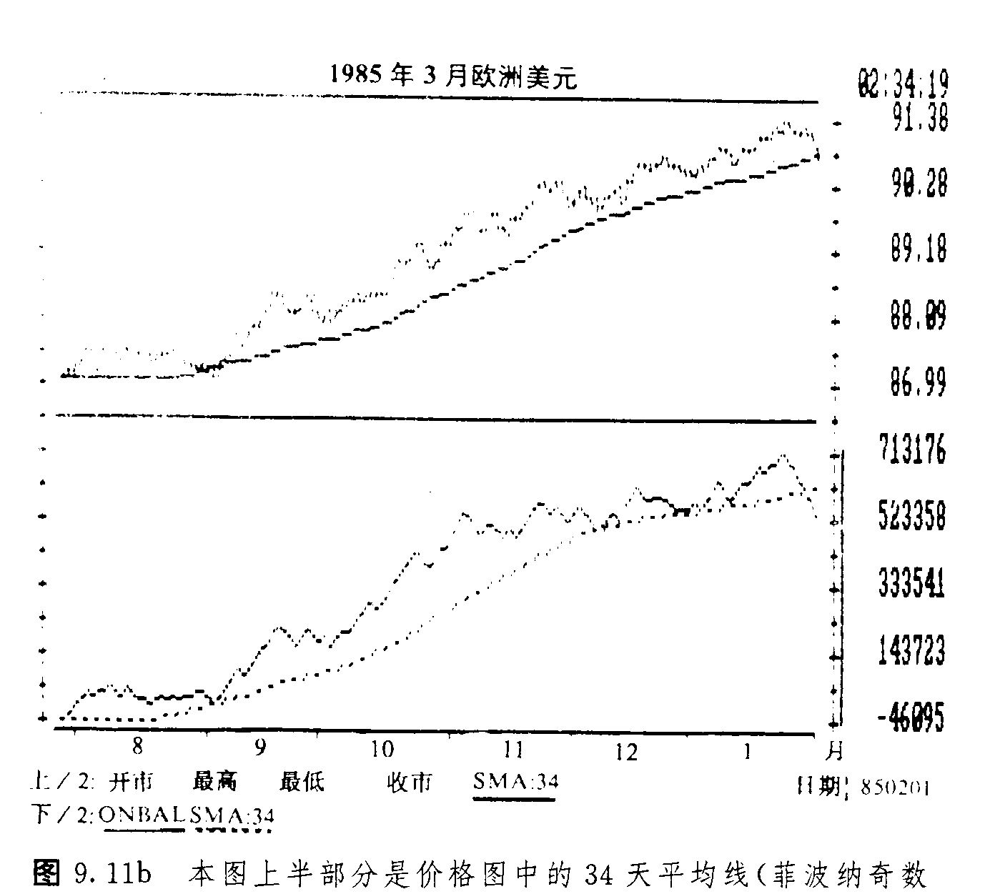

> 图9.11b 本图上半部分是价格图中的34天平均线（菲波纳奇数字）。下半部分是相同的平均方法在权衡交易量（OBV）中的应用。

商品期货自动交易系统领域的先驱（在1983年，《投资帐户管理报道》推举唐迁为首届“最佳获利奖”得主，表彰他对商品市场资金运作领域的巨大贡献。该机构目前向后来的受奖人颁发“唐迁奖”）。

### 四周规则

根据四周规则建立的系统很简单：

1. 只要价格涨过前四个日历周内的最高价，则平回空头头寸，开立多头头寸。
2. 只要价格跌过前四个周内（照日历算满）的最低价，则平回多头头寸，建立空头头寸。

如上所述，本系统属于连续工作性质（连续在市），即系统始终持有头寸，或者是多头，或者是空头。一般地，连续在市系统具有一个基本缺陷。当市场进入了无趋势状态时，它仍处在市场中，难免出现“拉锯现象”。我们曾经强调过，在市场处于这种无趋势的横向状态时，趋势顺应 <!-- pdf p261 / 书页 246 --> 

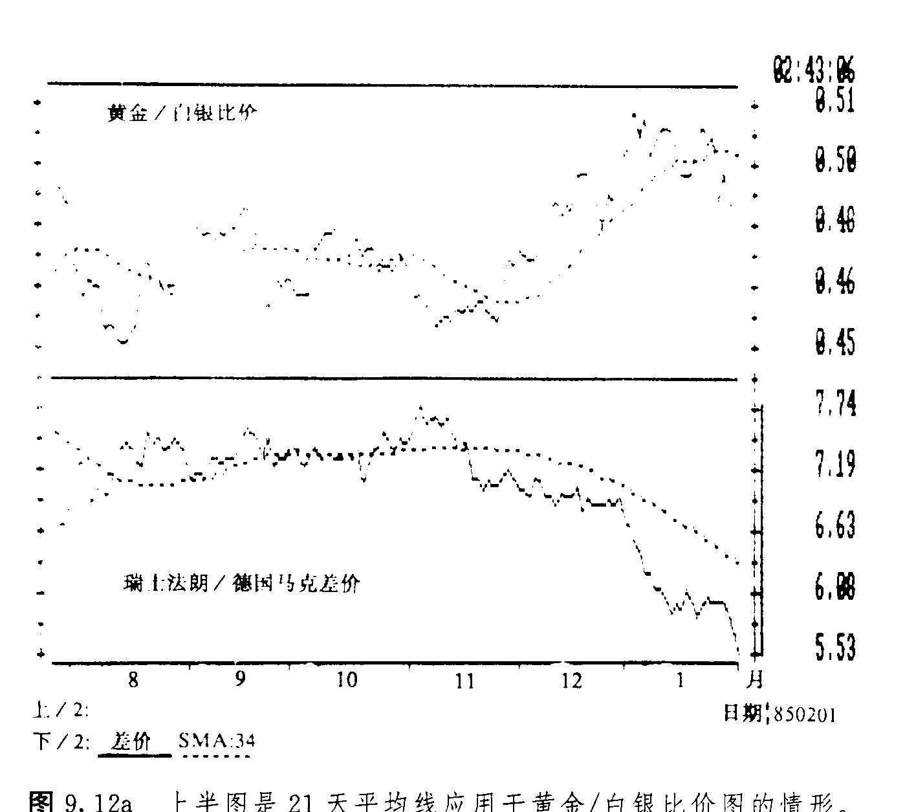

> 图9.12a 上半图是 21天平均线应用于黄金/白银比价图的情形。下半图是34天平均线在瑞士法朗与德国马克差价图中的应用。

系统效果很差。

我们也可以对四周规则进行修正，使之不连续在市。办法是采用较短的时间跨度，比如一周或二周，作为平仓的信号。换言之，必须出现了“四周突破”，我们才能建立头寸，但是只要朝相反方向的一周或二周的信号出现，就平回该头寸。之后，交易商将居于市场外，直到下一个四周突破信号出现再入市。

本系统坚实地建立在技术分析原理之上。信号自动给出，并且清晰、分明。因为它是顺应趋势的，所以实际上能够保证，每当市场出现重大趋势时，用户总站在正确的一边。同时，它的结构也体现了商品交易一句老生常谈格言—“让利润充分增长，把损失控制在小额”。本系统还有一个特点，由之引生的交易往往不太频繁，所以其佣金成本较低。这一点，正是很多资金管理者所重视的，因而这种系统（或其变体）很流行。不过，经纪商们的态度当然就两样了。最后一点，既可以应用计算机来实施本系统，也可以不用。

周规则也有自己的反面意见。同所有趋势顺应系统所遭受的指责一样，反对者怪它不能捕捉顶或底。那么，趋势顺应系统到底做了些什么呢？最重要的一点是，四周规则的表现同绝大多数趋势顺应系统一样 <!-- pdf p262 / 书页 247 --> 

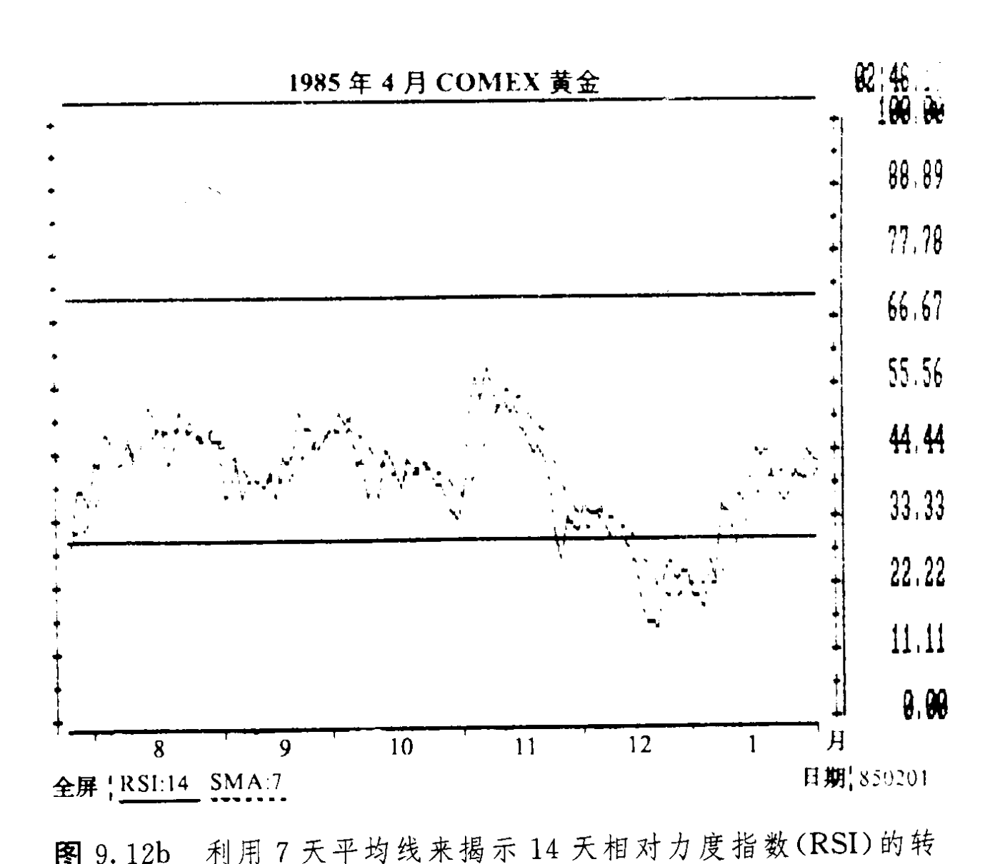

> 图9.12b 利用7天平均线来揭示14天相对力度指数（RSI）的转折。

漂亮，甚至超过其中许多种方法；同时，它还有个长处：惊人地简明。

### 对四周规则的修正

我们对四周规则的讨论是对其原形展开的，不过，它也具备许多种修正和改进形式。首先，我们并不是非得把本规则运用于交易系统不可。我们也可以把周规则的信号简单地看作一种技术指标，由之来辨识价格突破、趋势反转等信号。周规则的突破信号也可以辅助其它技术，比如移动平均线等，起到与过滤器类似的验证作用。一周和二周规则便是极佳的过滤器。因此，当移动平均线的交叉信号出现后，为了确定是否依照这个信号开立头寸，我们必须根据二周规则，考察在其相同方向是否也有两周规则的突破信号。

### 周规则也可以优化

我们也可以针对不同的市场，调整周规则的时间跨度。我们并不是对每个市场都机械地使用四周规则，而是具体市场具体分析。在讨论移动平均线时，我们曾引用了一系列美林公司的研究报告。在《美林公司 <!-- pdf p263 / 书页 248 --> 商品研究报告》1979年2月号上，“自动化交易技术”一文，对各种周规则的突破信号也进行了广泛的研究。其中对每个市场，都得出了相应的优化周规则。此外，在这篇文章中还提出，通过改变每周结束的日子，系统的成绩可以进一步改善。例如，据该报告称，在糖期货市场，最好采用五周规则，并且把每周的结束日人为地规定为星期四。在大豆市场，最佳的选择是两周规则，并把星期一人为规定为每周的最末一天。在更早的美林公司的研究中，还对日间突破（“日规则”）的各种天数进行了检测。

### 根据灵敏度要求调整时间跨度

根据风险管理和灵敏度的具体需要，我们可以相应地扩大或缩短周规则的时间跨度。举例来说，如果我们要求系统更灵敏，则可以缩短时间跨度。当市场急剧上升，从而价格相对地处于“高处不胜寒”的境地的时候，我们就可以缩短时间跨度，使系统更灵敏。假定我们已经根据四周规则的向上突破信号，建立了一个多头头寸，那么，就可以把保护性止损点设置在过去两周的最低价的下方。如果随后市场急剧上冲，交易商试图采用更紧凑的保护性止损方法来监控该多头头寸的话，那么还可以选用一周规则来设置止损点。

当市场处于横向伸展的情形时，那些相趋势而动的交易者袖手旁观，专心等待重要趋势信号的出现，那么这时，就可以把时间跨度扩张到八周。这样，就能够避免开立短线的头寸，免得陷足于时机不成熟趋势信号中。

### 把四周规则与周期联系起来

本章前面曾交代，在期货市场上，以日为长度单位的周期具有重要意义。在所有的市场上，为时四周（或20天）的周期都是极为显著的。这或许说明了利用四周这种时间区间为何如此成功。它可能是最佳的时间跨度。请注意，我们也曾提及一周、二周以及八周规则。根据周期分析中的谐波理论，每个周期都与它相邻的周期成倍数关系（上一级周期是其2倍，下一级周期是其1/2）。

在讨论移动平均线的时候，我们曾指出，月周期加上谐波理论，解释了5天、10天、20天和40天移动平均线之所以盛行的原因。同样的道理，在四周规则上也适合。如果我们把上述天数换算成星期数，那么它们分别就是一周、二周、四周和八周。因此，对四周规则的最有效的修正是，以四周作起点，依次乘以2或除以2。在缩小时间跨度的时候，则从四周变为二周。如果要采取更短暂的时间跨度，那么甚至可以由二周 <!-- pdf p264 / 书页 249 --> 

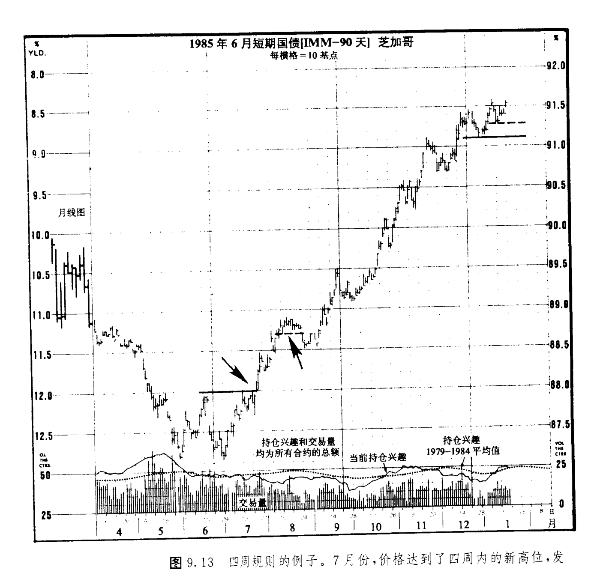

> 图9.13 四周规则的例子。7月份，价格达到了四周内的新高位，发出主要“买入”信号。它至今仍维持有效。其中水平的实线标志着四周规则的买入信号的出现。而水平虚线则是二周规则的标志线。本图说明，如果我们执行二周规则，就可能引起过早平仓出市的问题（Courtesy of Commodity Research Bureau, a Knight-Ridder Business Information Service.）。

而一周。在扩大时间跨度的时候，则从四周变为八周。因为本方法把价格与时间结合起来了，所以，谐波周期理论当然就起到了重要作用。我们把周期规则的时间跨度除以二以缩短之，乘以二以扩张之，这一做法着实可以从周期理论找到充分的根据。 <!-- pdf p265 / 书页 250 --> 

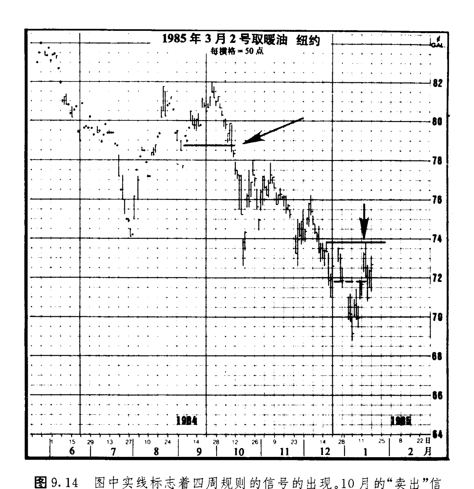

> 图9.14 图中实线标志着四周规则的信号的出现。10月的“卖出”信号目前依然有效。注意，目前价格刚刚向上穿越虚线，指示着二周内的新高位，不过，如果要构成“买入”信号，则收市价必须向上穿越稍低于74的实线（Courtesy of Commodity Research Bureau, a Knight-Ridder Business Information Service.）。

### 使周规则保持简明

凡事有长处就有短处。当我们试图对四周规则加以优化，或者进行上述调整的时候，这种方法也就逐渐丧失了它的最大的长处—简明。四周规则是一种简单的突破信号系统，其理论基础来自显要的月周期。我们可以对当初的系统进行修正，通过较短的时间跨度——一周规则或二周规则——来达成平仓目的。如果用户希望系统更灵敏，那么也可以采用二周规则作为入市的信号。因为周规则的本意就是力图简便易行，所以，我们最好按照上述时间跨度来应用它。四周规则既简明，又实用，朋友们不妨一试（见图9.13到9.16）。 <!-- pdf p266 / 书页 251 --> 

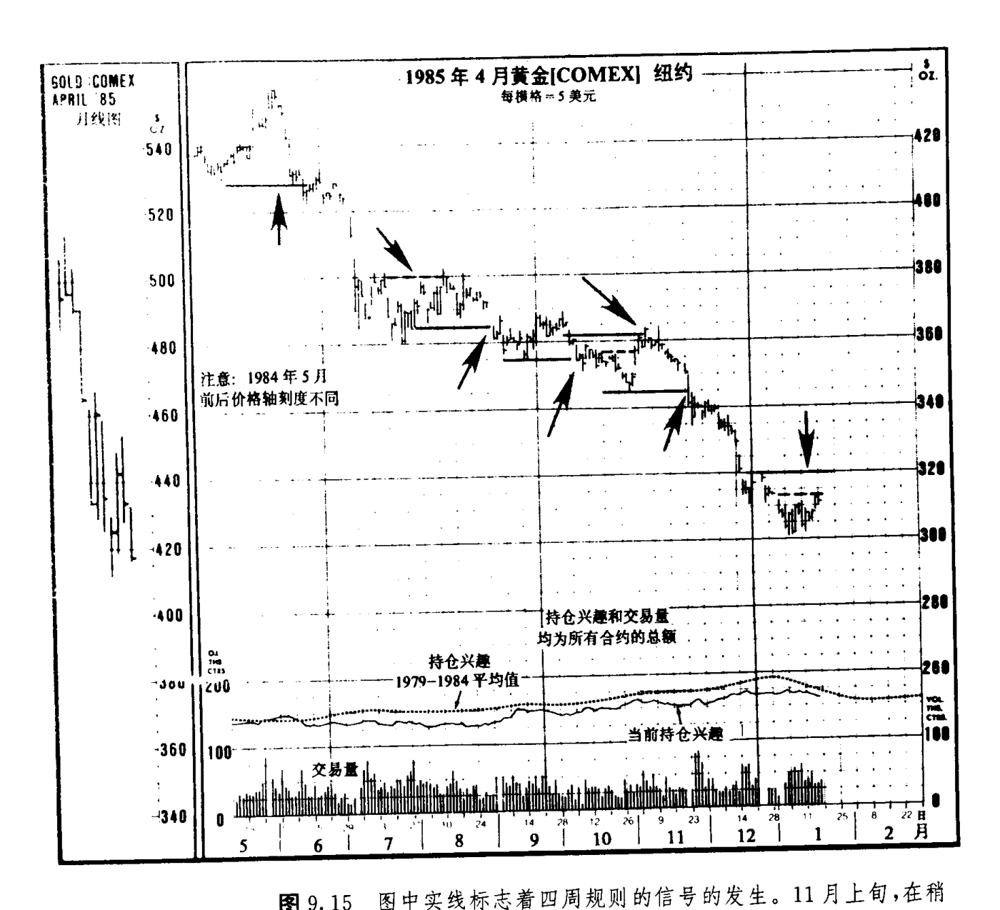

> 图9.15 图中实线标志着四周规则的信号的发生。11月上旬，在稍高于＄360处，有一个伪买入信号。我们可以利用二周规则（虚线）来及早地平仓止损。在其右侧，必须等收市价向上越过虚线，我们才平回原有的空头头寸。而当收市价格向上穿越实线后（$320的水平），方构成开立新头寸的“买入”信号 （Courtesy of Commodity Research Bureau, a Knight-Ridder Business Information Service.）。

## 参考文献

除了本章前面提到的参考书外，下列两本著作对移动平均线和唐迁的四周规则也有介绍。在P•J•考夫曼编辑的《商品市场技术分析》一书中，收入了弗兰克•霍克海默以美林公司的研究为基础写作的两 <!-- pdf p267 / 书页 252 --> 

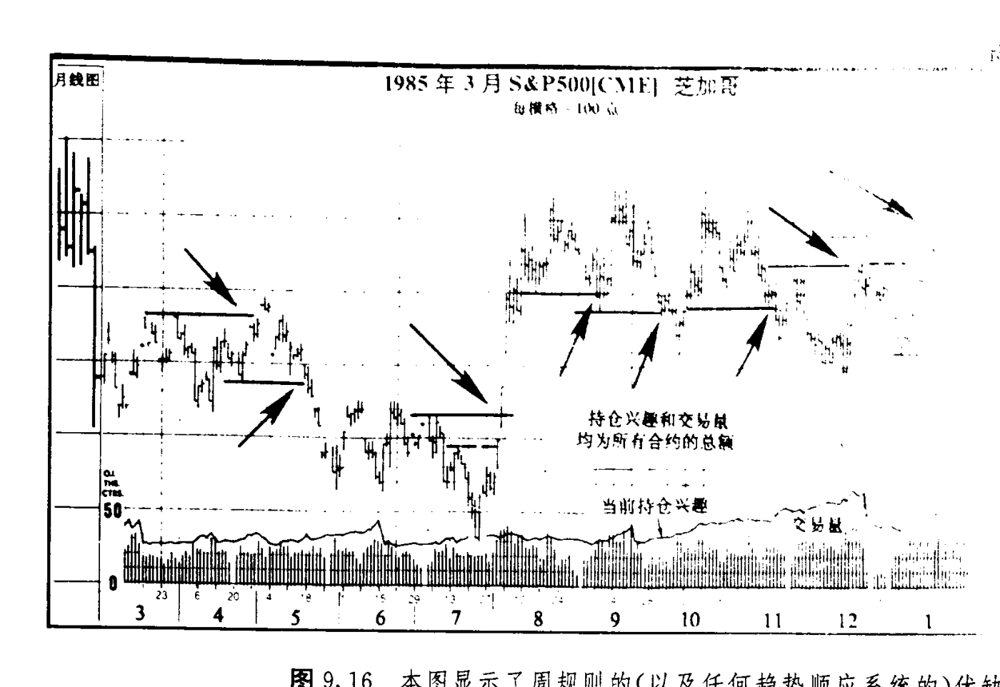

> 图9.16 本图显示了周规则的（以及任何趋势顺应系统的）优缺点。从5月到7月的下降趋势的大部分，从7月到8月的上冲，以及在1月的看涨突破，均被成功地捕获了。本系统确保交易者能够投入每一场重要趋势。但是请注意，所有的错误信号都发生在9月到1月，也就是当价格横向伸展的时候。如果我们采取的是八周规则，则可以避免其中部分拉锯现象。象所有的系统一样，四周规则也难免有不足之处。在趋势状态下，其效用最优 （Courtesy of Commodity Research Bureau, a Knight-Ridder Business Information Service.）。

章，“移动平均线”和“管道和平均线的相交”（约翰•威利父子公司，1980年）。另一本书名为《商品和股票的技术性交易系统》，作者是查尔斯•帕特尔，加州交易系统研究公司 1980年出版，其中也有讨论各种移动平均线技术和唐迁的周规则的内容。
