# 第十一章 日内点数图

> 原书 PDF 第 311–335 页。OCR 自扫描件，图表已截取到 `images/11/`。

<!-- pdf p311 / 书页 296 -->

## 引言

目前最流行的图表类型是日线图。但是，大量证据表明，本世纪前，股市交易者最先使用的是点数图技术。点数图这个说法来自维克托。德维利尔斯在1933年出版的《点数图法预测股价变化》（温莎图书版）一书中。这种技术曾有过不少叫法。在19世纪 80年代和90年代，称为“记价法”。这个名字出自1901年7月20日查尔斯•道为《华尔街日报》撰写的评论中。究其实质，它是过去从纸带上读取价格方法（名符其实地称为“纸带读取法”）的翻版。

道氏指出，记价法的出现时间是1886年，大约沿习了15年。1933年，德维利尔斯认为本技术已经有了 50年历史，从而其起用时间当在19 世纪80年代。1889年曾经出现过一本叫《华尔街的把戏》的书，作者笔名是霍伊尔，但真名已佚，我们也无从了解出版者的情况。在这本书中提到了这种按顺序记录股票价格的方法。霍伊尔很可能是第一个述 <!-- pdf p312 / 书页 297 --> 及本方法的人。约瑟夫•M•克莱茵则在1904年发表了他对本技术所进行较深入的研究，其中，他称之为“趋势记录”法。克莱茵把它起源上溯到1881年前后。从本世纪20年代到1933年，它是“数字图”，此后，这种记录市场变化的方法变成了“点数图”，它的名目才算定案。R•D•威科夫在本世纪 20年代也发表了数种关于点数图的论著。

从1896年开始，《华尔街日报》开始每日发表股市的最高价、最低价和收市价，由此才开始了日线图的历史，因此，点数图比日线图至少早出现了15年。有些朋友可能对“点数图”这个名称的由来感兴趣。本世纪20年代流行的所谓“数字”图，真的是把价格（数字）绘在图表上的。到本世纪30年代，人们用“X”符号（即德维利尔斯的所谓“点”）代替了数字。德维利尔斯笔下的“点数图”其实同时照顾到了两种方法的特点。不过，他也指出，他宁愿用“点”来代替老脸色的“数”。后来，“点数图”这个名称就流传开来，成为本方法的正名，一直沿用至今。

我们分三步来介绍点数图技术。本章，我们先看看这种方法本来的情况，它是用日内的价格变化来绘图的。首先要讨论怎样作图，然后谈谈如何解读这种图表。线图对价格变动的描绘是一维的。通过对日内价格演化的研究，我们将获得大量被线图完全丢失了的价格资料。举例来讲，我们可以借之发现潜藏的支撑和阻挡水平，并且对价格密集区的分析也具备了全新的内涵。另外，我们还可以看到各种点数图价格形态。点数图有其独特的价格目标计算方法，即横向“数列”法，对此我们也要介绍。

构造日内价格图的最大难处是，不容易获得日内价格资料，而邮寄日内图表的办法耗费的时间又太长，赶不上趟。不过，根据报纸上的每日高低价格也可以绘制点数图。这是一种抄近道的方法，当然会丢失很多重要的价格资料，但还是能得到一些点数图技术的益处。最常用的处理办法是三点转向法。它是由阿贝•柯恩同查克亚图表服务系统推广出来的，下一章我们将对它进行研究。

最后，我们要看看优化点数图技术。为了提高点数图的效用，人们在70年代就对点的大小和反向条件进行了一些比较研究。我们将概要地介绍一下其中部分研究成果，比较一下优化点数图同传统的三点反向图的异同。

我们首先必须声明，点数技术是个复杂的课题。这里只打算覆盖其主要的因素。如果有的朋友乐于深入地研究这种极其有益的方法的话，不妨阅读本章后面所推荐的参考书。 <!-- pdf p313 / 书页 298 --> 

## 点数图与线图

我们先来看看点数图和线图之间的基本差异，考察几个图例。

点数图纯粹是关于价格变化的研究。这就是说，在画点数图时，我们不考虑时间因素。相反地，在线图上，我们把价格和时间结合在一起。从线图的构造来看，其竖直轴为价格轴，水平轴为时间轴。例如，在日线图上，每天的价格线段均向右移动一格，画在前一天的右侧。即使当日的价格变化很少，甚至没有变化，我们在图表上还是要照章行事，仍然必须在当天的位置上作出标记。而在点数图上，我们仅仅记录价格的变化。如果价格没有变化，那么点数图也不需要我们碰它。从而，在市场活跃的时期，我们可能需要进行大量的作图工作；而在市场平静的时期，可能不怎么需要动手。在点数图上，也有一些时间记号，以备用户参考（关于这些符号，在介绍图表作法时，我们再细谈），但是它们同图表的实际意义并无瓜葛，仅仅是为了带来一点方便而已。

两种图表的重要差别在于对交易量数据的处置上。在日线图上，我们在价格线段下方，画出当日的交易量线段。而在点数图上，则忽略了交易量数据，把它另作处理。“另作处理”这话很要紧。尽管点数图不记录交易量的数据，这并不等于说完全放弃了交易量（或称“交易活动”）的信息。相反地，因为日内点数图记录了当天所有的交易活动，所以交易量的多寡也就反映在图上所记载的价格变化之中。因为我们在决定支撑或阻挡水平时，交易量是较重要的判断依据，而点数图能够显示交易活动最多价格水平（亦即重要的支撑或阻挡水平），所以，在这一点上，点数图也特别有用。等我们讨论到支撑和阻挡的题目时，再来谈这一点。

图11.1和11.2分别是 S&P期货合约的日线图和点数图，两者所覆盖的时间范围相同。从外观上看，两者很相像，但究其实质，则大不相同。从两张图上我们都能把握一般价格趋势的格局，但两者的价格显示方式却大相径庭。请注意，在图 11.2中，“X”列和“O”列交替排列。X列表示价格上升，O列表示价格下跌。每当X 列涨过前一个X列一个X后，就构成了向上突破的信号。

相应地，每当O 列跌过前一个O列一个O后，就构成了向下突破的信号。请注意，上述突破信号比日线图上的突破信号明确得多了。我 <!-- pdf p314 / 书页 299 --> 

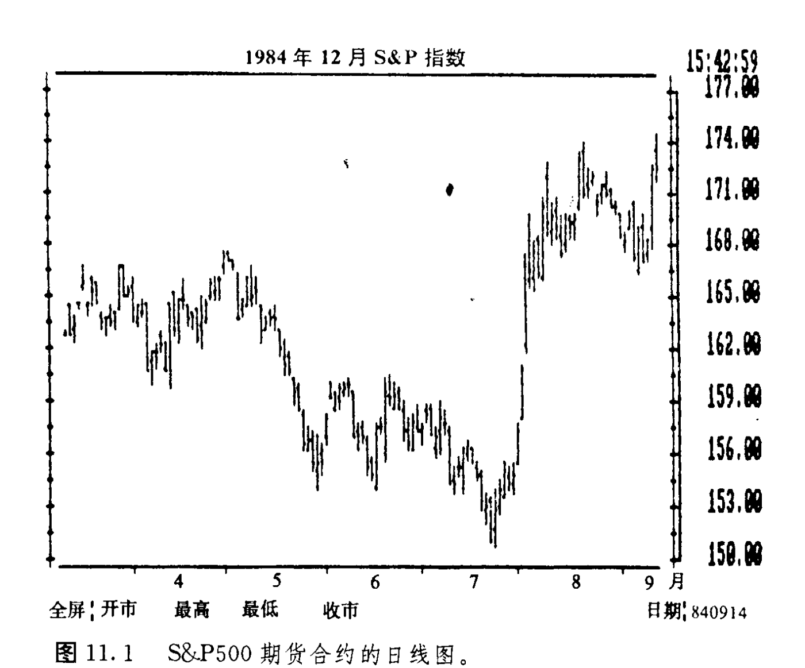
> 图11.1 S&P500期货合约的日线图。

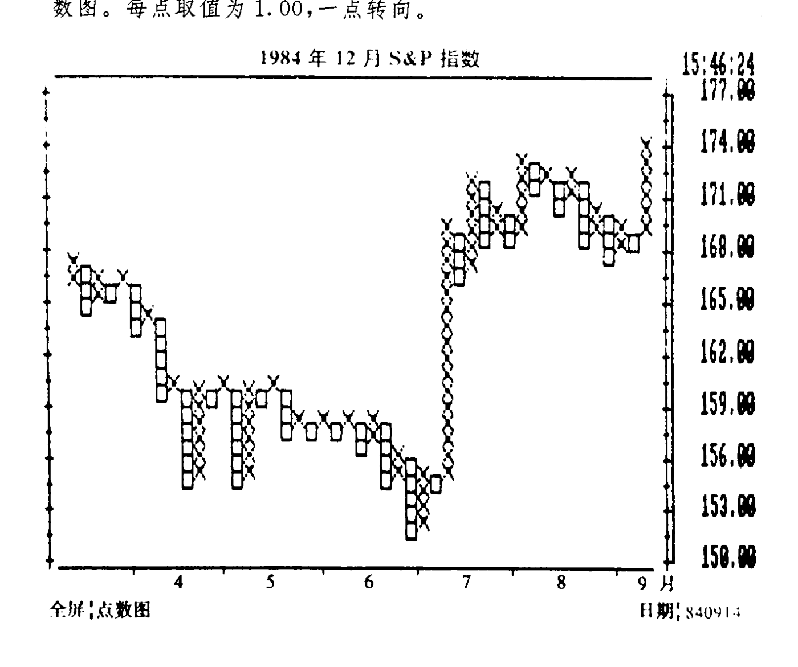
> 图11.2 本图内容与上例相同，是 S&P500合约在同一时间内的点数图。每点取值为1.00，一点转向。

<!-- pdf p315 / 书页 300 -->

们当然可以把这种突破信号用作买卖信号。后面我们还要详细地阐述买卖信号的问题。通过上面两张图表的相互比较，我们可以发现，点数图有一个明显的优势，即能够既精确又简易地标志趋势信号。

图11.3和11.4还展示了点数图的另一大优势——灵活性。从图11.2到图11.4，所有的点数图显示的都是完全一致的价格内容。在三张图上，每一点（每个O或X）均代表1.00，即1个指数价格的点。在图11.2中，我们采用的是一点转向规定。这就是说，其中把每个单点反转都显示在图上。我们有两个办法来修改点数图——改变每点代表的数值，或者改变转向规定（即每次转向所要求的点数）。通过改变转向规定的点数，我们可以得出不同的图形。请注意，在图11.2中，共有47列。在图11.3中，我们把单点转向规定修改为三点转向规定，结果把价格变化大为浓缩了。请注意，这里的列数已经从 47列减少到26列了。图11.4 采用五点转向规定，进一步压缩了价格资料。这张图的列数几乎再减去了一半，仅有14列。

### 调整点数图灵敏度

综合起来，我们既可以采取较少的转向点数规定来提高点数图的灵敏度，也可以采取较多的转向点数规定，来降低它的灵敏度。单点转向规定可以应用于研究短期市场行为；而五点转向规定可以应用于研究长期趋势的变化。在上述点数图里，我们把每点取值为1.00。通过更小的每点取值，例如 0.50,0.20，或者0.10，我们可以逐步增加点数图对小规模市场变化的灵敏度。

这种巨大的灵活性，是点数图分析法的最大的优势之一。朋友们可以调整点数图的各种参数来适应自己的个别需要。上面，我们已经说过了点数图的一些特点（好象都有点超前了），下面就来讲解点数图画法。

## 日内点数图的画法

我们曾讲过，点数图的原型是日内价格图表，它本来是用于记录股市变化的，其目的在于记录股票的每一点价格变动。人们觉得，采用这种方法，能够较好地判断积聚（买进）和消散（卖出）的机会。当时一般只采用整数形式进行记录，其中每点取值为一个价格点，并且把每一点的方向变化都记录在案。小数基本上忽略不计。后来，当人们把这种技术引入期货市场时，为了适合各种市场的标价方式，就必须调整每点取 <!-- pdf p316 --> 

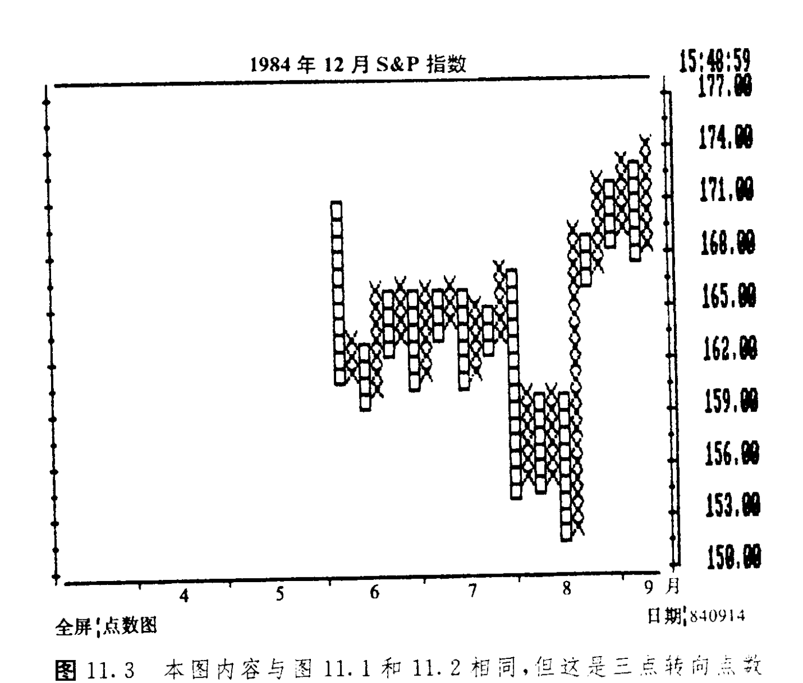
> 图11.3 本图内容与图11.1和11.2相同，但这是三点转向点数图。

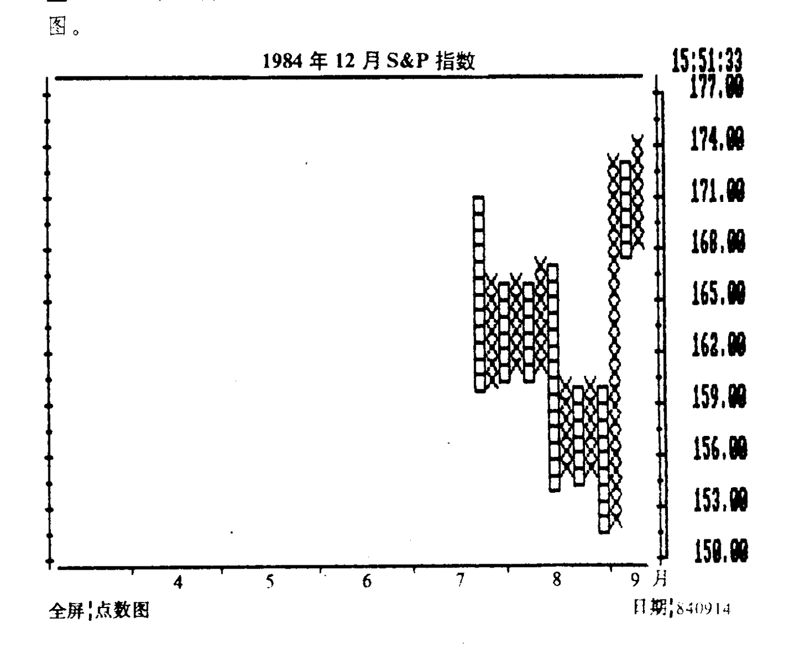
> 图11.4 本图内容与图11.1到图11.3相同，但这是五点转向点数图。

<!-- pdf p317 / 书页 302 -->

值。以后我们还要研究如何恰当地给每点取值。现在，我们先用一些实际的价格数据绘制一张点数图。

首先，我们最好选用适当的绘图纸。数年前，市面上曾有一种特制的图表纸，上面标好了一点转向的格子。这是1978年由摩根•罗杰斯和罗伯茨公司推出的，它不但有此类绘图纸，同时还提供必要的价格数据，以备用户刷新图表。其绘图纸有11英寸高，17英寸宽，其中标好了为点数图特制的绿线。在水平方向，每个第5格都涂黑了（其中的道理马上就水落石出了）。

可惜的是这家公司在1978年关了门。虽然它的股价服务体系为马勒资讯公司所接管，但是这种绘图纸却从此绝迹了，而且后者也不再提供期货的资料。为了填补这个空白，有些大的华尔街经纪公司只好自己印制点数图纸。如果朋友们能弄得到，下面的练习就容易多了。要是没有，那么最好能买到每英寸10格，每5格有一条重色线的坐标纸。关于格子的大小并没有一定之规，但每英寸10格看上去正合适。随便你自己，只要格子的数目足以表示价格变化就行。

下一步，我们要确定每点的大小，以及转向规定的点数。所谓点大小，也就是图中每点所代表的价格。例如，在黄金的点数图上，点的大小可选为＄1.00。如果用户要求图表更迟钝些，则可以选取更大的值，如＄2.00甚至＄5.00。如果要得到更灵敏的图来对付短期价格变化，那么点大小可取为＄0.50。而且，为了进行微观的研究，我们甚至还可以采用最小价格增量 $0.10。

所谓转向规定就是我们预先规定的市场从当前列回撤的点数，如果市场的回撤幅度达到了这个规定点数，我们则向右另起一列，用另一个方向的符号绘图。如果我们选择一点转向规定，就能够在图上反映幅度为1点所有方向变化。如果采取三点转向规定，那么只有市场方向性改变达到3个点的幅度时，我们才会相应地转向，绘制另一列。因此，每点取值和转向规定是我们调整点数图的有且仅有的两个途径。在作图之前，我们必须首先确定这两个参数。下面来看几个实例。

我们用下面的一组数字作一张灵敏的棉花市场的点数图，其中采取三点转向规定，每点取值为1个价格点。如此灵敏的点数图一般只能容纳一天的价格变化，所以仅适用于非常短期的分析和交易。这组数字是这一天交易活动的实际记录。

| 5/29 | | | | | | | |
|---|---|---|---|---|---|---|---|
| 8515 | 8525 | 8510 | 8515 | 8510 | 8515 | 8505 | 8515 |
| 8512 | 8515 | 8510 | 8516 | 8510 | 8515 | 8506 | 8510 |
| 8506 | 8510 | 8500 | 8514 | 8510 | 8517 | 8510 | 8519 |

<!-- pdf p318 / 书页 303 -->

| | | | | | | | |
|---|---|---|---|---|---|---|---|
| 8508 | 8515 | 8510 | 8525 | 8520 | 8525 | 8522 | 8525 |
| 8520 | 8525 | 8522 | 8525 | 8520 | 8523 | 8520 | 8523 |
| 8517 | 8525 | 8520 | 8528 | 8525 | 8539 | 8535 | 8538 |
| 8535 | 8545 | 8540 | 8544 | 8540 | 8545 | 8535 | 8544 |
| 8540 | 8545 | 8535 | 8538 | <u>8532</u> | 8538 | 8535 | 8543 |
| 8540 | 8543 | 8539 | 8549 | 8545 | 8550 | 8547 | 8554 |
| 8546 | 8563 | 8553 | 8565 | 8560 | 8563 | 8560 | 8563 |
| 8560 | 8563 | 8560 | 8563 | 8557 | 8560 | 8552 | 8555 |
| 8546 | 8550 | 8545 | 8550 | 8545 | 8550 | 8540 | 8560 |
| 8550 | 8553 | 8545 | 8555 | 8540 | 8548 | 8542 | 8545 |
| 8540 | 8545 | 8537 | 8540 | 8535 | 8550 | 8546 | 8555 |
| 8550 | 8558 | 8555 | 8565 | 8560 | 8570 | 8565 | 8570 |
| 8566 | 8575 | 8570 | 8580 | 8570 | 8580 | 8575 | 8585 |
| 8577 | 8585 | | | | | | |

现在我们看图 11.5。请注意左侧价格轴的刻度，每两道横线之间代表一个价格点，价格轴的起点为8500，每格1点地向上递增。每5小格，就有一道水平的粗线，这样便于绘图，因为越向右侧作图，就越容易弄错位置，粗线有助于对照价格轴。有些图表师还有一个高招。每个第5条线都代表以0或5结尾的价格数值，在这些线上，他们不画传统的“X”或“0”符号，而是直接标“0”或“5”这两个数字。之所以这么做，是因为以0或5结尾的价格在图表上代表了自然形成的支撑和阻挡水平。不过，为了避免混淆，我们这里只采用“X”和“O”符号。

因为起始价格为 8515，所以我们先在相应的格子里，标一个记号。此时，还不知道这一列的方向向上还是向下。因为下个数字是8525，价格上升了，所以，我们从8515到8525，都画上“X”。再下个数字为8510，它向另一个方向（向下）改变的幅度已经超过了三点转向规定，因此我们转入右边的下一列，从 8525一直到8510，在每个格子里，统统画上“O”。请记住，当价格上升时我们用“X”表示，而价格下降时用“O”表示。第四个数字是8515，所以我们又向右另起一列，用“X”标在从8510到8515的一路上。这一套听起来或许复杂，其实很简单。只要我们抓住这样一条要诀就行了：除非在本列中价格向相反方向回撤的幅度达到了转向规定的要求，因而我们必须另起一列的情况以外，我们总是呆在同一列中。因为这是一张三点转向的图表，其中每点只代表1个价格点，所以，价格要向相反方向变化3个价格点，才能另起一列作图。

如果朋友们觉得需要练习练习，不妨继续把价格数字同图表对照下去，直到 8532（我们在它下面标了一道横线）。注意，这时你已经到了 <!-- pdf p319 / 书页 304 --> 图表最右边了。虽然画到这里你可能已经忙活半晌了，但是这其实还只是这一天的交易活动的一半。事实上，上图结束的时间差不多是中午12点。而这一天还有三个小时的交易呢。显然，这种1点图表实在太灵敏了。

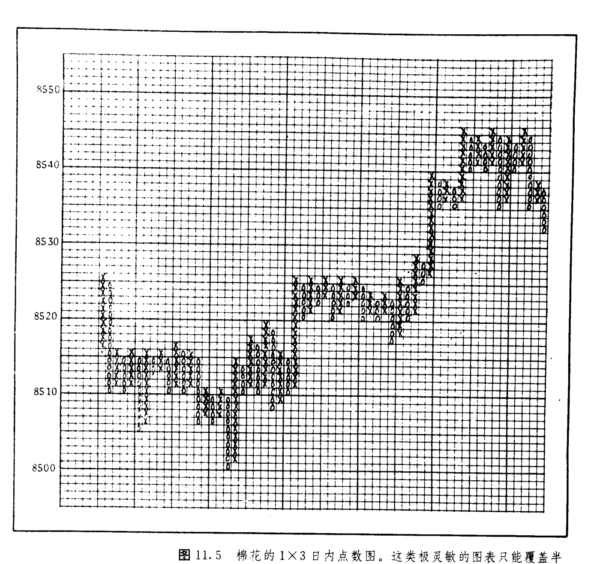
> 图11.5 棉花的1×3日内点数图。这类极灵敏的图表只能覆盖半天的交易活动。很可能太灵敏了，因而没有什么实用价值。请注意，对于我们研究很短期的市场行为来说，这里提供了极其丰富的细节资料。

图11.6采用了与上例完全一样的数据，但这里每点取值为2个价格点。我们可以直接根据上面的1点图来作这张2点图，当然也可以用那组数字从头来。第二张图的转向规定也是三点，不过这里相当于6个 <!-- pdf p320 / 书页 305 --> 价格点，因此，滤掉了许多弱小的“噪音”，图形更小，也更易操作。图11.6显示了当天全天的交易活动。我们在点数图右边作出了当日的价格在日线图上的价格线段，请注意比较。在这条价格线段上，只体现出了当日的最高价、最低价和收市价，而在其点数图中却包含了那么多的价格资料。看，这一天里的价格密集区、支撑水平和阻挡水平现在一目了然。那么，点数图为什么在场内交易商中间如此流行，这下就很清楚了。在日线图上，根本别想获得这样高的精确度。如果我们仅仅依赖日 <!-- pdf p321 / 书页 306 --> 线图，就将丧失大量的重要价格资料。

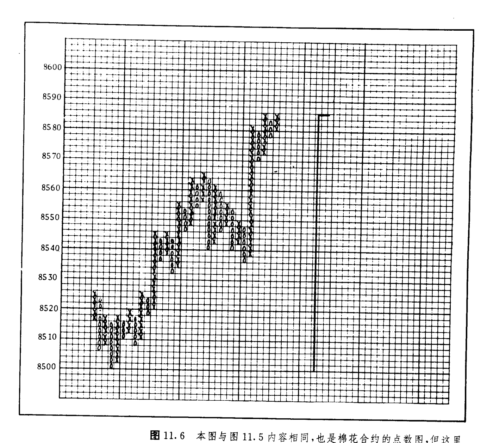
> 图11.6 本图与图11.5内容相同，也是棉花合约的点数图，但这里每点（格）取值为2个价格点。注意，本图通过对每点取值的调整，包含了全天的交易情况。请把点数图所表示的价格变化同右侧表示当日最高、最低、收市价的竖直线段比较一下。注意，在日线图上，丧失了很多细节资料。

以上我们介绍了三点转向点数图的画法。现在我们再来看看一点转向的情况。下列数字是瑞士法朗期货合约9天的价格资料。作图时，我们把每点取值设为5个价格点。因此，向反方向变化达到5个价格点以上的动作都可以显示出来。

| 日期 | 价格 |
|---|---|
| 4/29 | 4875 4880 4860 4865 4850 4860 4855 |
| 5/2 | 4870 4860 4865 4855 4860 4855 4860 4855 4860 4855 4865 4855 |
| 5/3 | 4870 4865 4870 4860 4865 4860 4870 4865 |
| 5/4 | 4885 4880 4890 4885 4890 4875 |
| 5/5 | 4905 4900 4905 4900 4905 |
| 5/6 | 4885 4900 4890 4930 4920 4930 4925 4930 4925 |
| 5/9 | 4950 4925 4930 4925 4930 4925 4935 4925 4930 4925 4935 4930 4940 4935 |
| 5/10 | 4940 4915 4920 4905 4925 4920 4930 4925 4935 4930 4940 4935 4940 |
| 5/11 | 4935 4950 4945 4950 4935 4940 4935 4945 4940 4965 4960 4965 4955 4960 4955 4965 4960 4970 |

图11.7a是最后得出的图形。我们从图的左侧开始。首先，本图价格轴的安排，已经体现出了每点取值为5个价格点这一要求。

第1列：在4875标一个记号。因为下一数字为4880，上升了，所以我们填入X符号。

第2列：下一个数字是 4860，因此我们向右另起一列，从 4880往下一格起，向下画“O”，一直填到 4860。

第3列：第三个数字是 4865。我们向右另起一列，向上移动一格，在4865画“X”。且打住。到此为止，我们在第3列上仅仅画了一个“X”，因为价格只向上推升了一点（即5个价格点）。在一点转向图上，我们必须在每列至少填满两格。请注意，下一个数字是4850，要求另起一列画“O”，直到 4850为止。那么，我们就这样画吗？不行。因为这么一来，在第3列中就只能有一个 <!-- pdf p322 / 书页 307 --> X点。因此，我们就在第3列，把上端单独地以“X”开始，然后向下到4850 都画上“O”。

第4列：接下来的数字是4860，我们向右另起一列，从 4850向上移一格，然后向上画“X”到 4860。

第5列：然后是4855。因为这个价格是向下的变化，所以我们到下一列，从 4860向下移一格，画“O”。注意，从数据表上看，这是当天的收市价。我们再往后看一列。

第6列：5月2日开始的价格是 4870。到此为止，在第5列中也只有1个“O”。但是每一列都必须至少有两个符号，因此，我们在其中要再填入“X”，到 4870为止（因为这一价格上升了）。但，请注意，我们把前一天的收市价格涂掉了，这就是我们前面说的为了便于识别时间而作的记号。把每天的收市价都涂黑，我们就很容易追溯各天的交易情况了。

为了进一步了解制图程序，朋友们不妨继续对照下去。请注意，在本图中，有好几列“X”和“O”并存。这种情况只会出现在一点转向的点数图上，这是由每列必须至少有2个符号的要求所引起的。“纯粹家”们或许对并用“X”和“O”很有些腹非。然而经验表明，通过这种方式，我们很容易追踪价格变化的次序。

图11.7b与图 11.7a采用的是相同一组数据，但这里改成了三点转向规定。注意，这张图表具有浓缩的特点，丢掉了不少资料。一点转向图表通常只适用于非常短期的活动，而三点转向图表则适合研究中等趋势。至于五点转向图表，因为其浓缩力更强，所以一般适用于长期趋势的研究。三种点数图作图的顺序正如上述，是从一点转向图开始的。三点转向图和五点转向图可以直接根据一点转向图作出来。显而易见，我们是不可能从三点转向图或五点转图作出一点转向图的。

### 价格跳空

按照传统的做法，点数图不考虑价格跳空。在两个相继的价格之间，所有的空格都要填上相应的符号。但是，也有人在点数图上留出价格跳空所对应的空白。虽然这种做法不符合严格的绘图规则，却也可能是一项改进，因为价格跳空也能形成重要的支撑和阻挡水平。如果我们能够从点数图上知道它们的位置，那当然是大有益处的。 <!-- pdf p323 / 书页 308 --> 

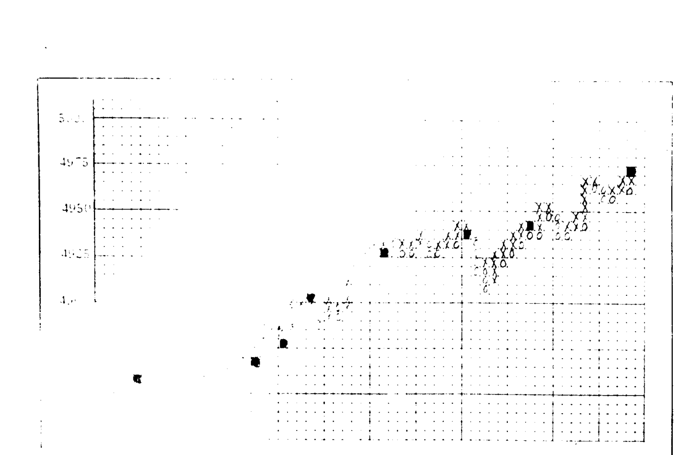
> 图11.7a 德国马克合约的5×1点数图。涂黑的格子代表每天的收市价格。

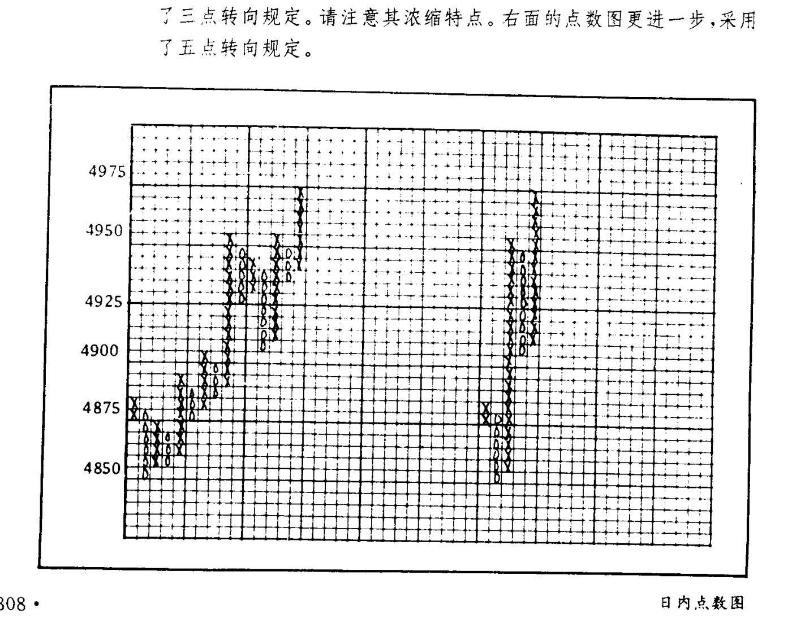
> 图11.7b和c 下图中，左面的点数图与图11.7a 内容一致，但采用了三点转向规定。请注意其浓缩特点。右面的点数图更进一步，采用了五点转向规定。

<!-- pdf p324 / 书页 309 -->

### 时间记号

图表师可以随自己的方便作时间记号。我们可以用一个字母表示每月的头一个价格。例如，用“J”代表1月，或者用“F”代表2月，这样就便于追溯年月日期。在新的一年开始的时候，可以在相应列对应的图表底部标出年份（如 1985）。当然这些时间记号仅仅是个参考，与图表本身的意义甚少关联。我个人喜欢采用这些标记。

### 密集区分析

日内一点转向点数图具备一个惊人的长处，即显示重要的价格密集区。所谓密集区，就是在一段时间里，价格水平（横向）伸展，从图上看，其轨迹介于清晰的区间之中。事实上，揭示价格密集区的能力，也许是点数图最有价值之处。

密集区分析有很多妙用。不过，其主要目的是帮助分析者预先确认价格突破的方向。比如，在上升趋势中，密集区既可能只是上升趋势的喘息之机，也可能构成反转形态，发出向下反转的主要趋势性信号。关键是要尽早弄清楚这两种差别。那么，我们除了进行点数图的形态分析之外（稍后就要讲到），也可以从密集区本身找出一些线索。

有一条经验最要紧，那就是要搞清楚在密集区中交易活动最多的部位。如果大多数“O”和“X”都接近交易区间的顶部，那就意味着市场上供给充裕，可能代表着消散（卖出）的机会。如果交易活动集中在区间的底部，就可能代表着积聚（买进）的机会。同时，朋友们还应记住，如果密集区的长度足够大，那么其中最近发生的交易活动具有更重的分量。这就是说，如果早先的交易活动接近区间的顶部，而最近的交易活动接近底部，那么本形态说到底还是看涨的，而不是看跌的。

## 横向数列法

日内一点转向点数图还有一个主要的长处，它能够通过横向数列法得出价格目标。在我们讨论线图及其价格形态时，曾讨论过价格目标问题。但是，在线图中计算价格目标的方法，实质上全部是以垂直测 <!-- pdf p325 / 书页 310 --> 算原则为基础的。就是说，我们先要测出形态的高度（波动幅度），然后向上或向下垂直地投射相等的距离。举个例子，在头肩形态中，我们先测算出从头部到颈线的竖直距离，然后从颈线上的突破点开始顺势投射出相等的距离，就得到了价格目标。

### 点数图可以横向测算

横向测算方法的理论前提是，密集区的长度同价格突破后的运动幅度之间存在直接的联系。如果由密集区构成了底部形态，那么我们就可以对突破完成后的市场潜力做一番估计。这么一来，一旦新的上升趋势形成，我们就可以用对密集区横向测算的结果来验证原有的垂直测算结果（见图 11.8）。

进行横向测算的目的在于找出形态的宽度。要知道，我们这里讨论的是日内一点转向点数图。对于其它各类图表，应当对本方法做适当的修改，这一点放到后面再讲。一旦我们确认了顶部或底部形态，就可数出形态本身的列数来。例如，如果它有20列，那么向上或向下的价格目标就是在从测算点起 20个格子开外。关键在于确定从哪条线开始起算。有时这个问题容易解决，有时却困难得多。

通常，在我们横向数列的时候，大多是沿着密集区的中分线进行的。或者说得更具体些，密集区内的水平直线总会与许多列的符号相交，也可能在某些列上碰不上符号，而碰上空格，我们应当选用那条碰到空格最少的直线来计算列数。换句话说，该直线碰上的符号数最多。找出这样的直线后，就可以数列了。重要的是，我们必须把密集区内所有的列都算上，即使是直线遇上空格的列也不应该漏过。得出密集区的列数后，我们就从这条直线开始，向上或向下投影出去，以求得价格目标。

有些分析者借助圆规来寻找价格目标。把圆规的一只脚放在密集区的最右边做圆心，然后以密集区的宽度为半径，向上或向下画一条圆弧。如果图形比较宽，我们就有可能找出好几种价格目标来。从密集区的最右侧开始，我们把圆心沿着密集区内逐次向左侧挪动，分别按照相应的半径画弧，就作出了近期、中期和远期价格目标。

我们曾说过，一旦新的趋势出现了，先前出现的密集区就可以用来验证最初的数列的结果。比如在上升趋势中，我们既可以用沿直线数列法，也可以用一把圆规从各个密集区中推算出上方的价格目标。我们可以用这些后来求出的结果来验证当初从底部或顶部形态中得到的价格目标。朋友们必须牢记，上述数列方法只是对市场潜力的一种大致的推算，这一点很要紧。如果我们以为底部宽度和未来的市场运动幅度之间存在着一一对应的关系，那是不现实的。我们的主要目 <!-- pdf p326 / 书页 311 --> 的是在价格突破后，能够通过估算价格目标，判明这场突破到底只是小动作、还是大有潜力的重要端倪。

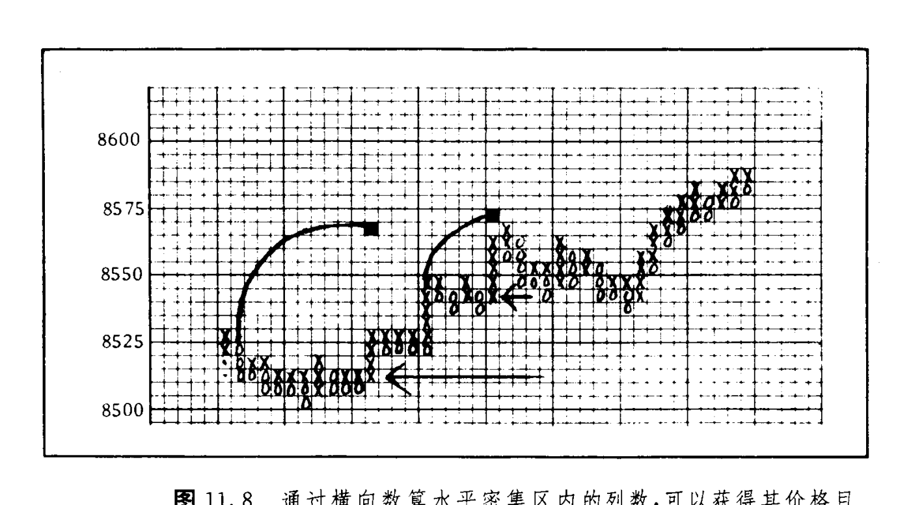
> 图11.8 通过横向数算水平密集区内的列数，可以获得其价格目标。密集区越宽，则目标越远。

## 价格形态

我们也可以从点数图上识别价格形态。从基本结构上说，这里的价格形态与线图类似，但其中也有些区别。例如，线图上的某些常见的形态——如价格跳空，旗形，以及三角旗形——在点数图上是找不到的。因为日内点数图上有较大规模密集区，所以它的价格形态也有所不同。图 11.9展示了点数图上最常见的几类反转形态。我们可以看出，它们同前面我们讲过的线图上的形态并无太大不同。

这里的大多数形态属于双重和三重顶、底，头肩形，V字形，倒V字形，圆形底、顶等，以及它们的变体。在点数图的词汇中，“杠杆支点”这个术语出现得不少。概括地说，“杠杆支点”是指一个界定分明的密集区，它发生在市场完成了一场重要上升或下降运动之后，是市场的积聚性质的底部形态或者消散性质的顶部形态。如果它出现在底部，那么该区域的下边界就被市场不断地向下试探，当然，其中间也夹有市场的试探性的上冲。这里的“杠杆支点”外形经常与双重或三重底极相似。当价格从该密集区的顶部向上突破后，这个底部形态就告完成了。

那些具备显著的横向区间的反转形态，相当便于我们进行目标测算。相反地，因为V形底不具有明显的横向价格区间，所以要横向数列 <!-- pdf p327 / 书页 312 --> 是不可能的。在图 11.9中，涂黑了的小格子代表买卖入市点。等到后面我们才讲到交易策略的问题。但是这里请朋友们注意，这些入市点一般出现在市场重新试探支撑区（在底部）或者重新试探阻挡区（在顶部）的时候，以及价格区间的突破点以及趋势线的突破点的位置上。

### 趋势分析和趋势线

在图11.9中，趋势线是价格形态的一部分。日内点数图的趋势线分析方法同线图相同。我们沿着相继出现的谷作上升趋势线，沿着相继的峰作下降趋势线。平行的管道线也可以应用如常。前面关于线图的趋势线所交代的内容均适用于日内点数图的分析。不过，对于下一章讲到的变通点数图来说，情况就不同了。在变通点数图上，我们采用45°倾角的直线，并且其画法也是两样的。

基本趋势分析的概念也适用于点数图。在点数图上，所谓上升趋势也是一系列依次上升的峰和谷。当价格无力涨至或超越前一个峰值时，通常构成当前趋势发生变故的第一个警讯。相应地，在下降趋势中，如果价格无力跌至或越过前一个低谷，也构成可能出现底部过程的第一个警讯。所有的有关理论均适用于点数图分析。

### 支撑和阻挡

在我看来，点数图最大的长处就是便于识别支撑和阻挡水平（或区域）。下面，我们就以这方面的讨论来结束这个部分。横向伸展的价格密集区是交易活动最频繁的地方，因而正是强大的支撑和阻挡区所处的位置。在以前关于支撑和阻挡的讨论中，我们曾指出，价格在一定的区域停留的时间越长，则在此处发生的交易活动越多，从支撑作用和阻挡作用的角度来看，该区域也就越重要。线图当然有助于识别这种区域，但是其中丢失了很多资料。点数图不但能够显示这些区域的位置，而且能够表明在相应的区域到底发生了多少价格活动（交易量）。

举例来说，在上升趋势中，正确的交易策略是在市场跌近支撑水平时买进。但是何处是支撑呢？点数图就能够以其独特的方式表明潜在的密集区的位置，而这种方式在线图上实际上是做不到的。在上升趋势中，过去的密集区是以后价格下挫时的支撑区。在下降趋势中，先前的密集区在之后价格上冲过程中，将起到阻挡作用。

如此一来，选择时机的工作就简便得多了。从图 11.5到11.8，都是很短期的（1天到9天）的日内价格图表。每当我们决定入市或出市的时候，为了准确地找出最佳的出、入市机会，就必须运用这些极灵敏的图表。借助它们，我们可以进行微观的市场研究，因而能够显著地改 <!-- pdf p328 / 书页 313 --> <!-- pdf p329 / 书页 314 --> 善交易成绩。

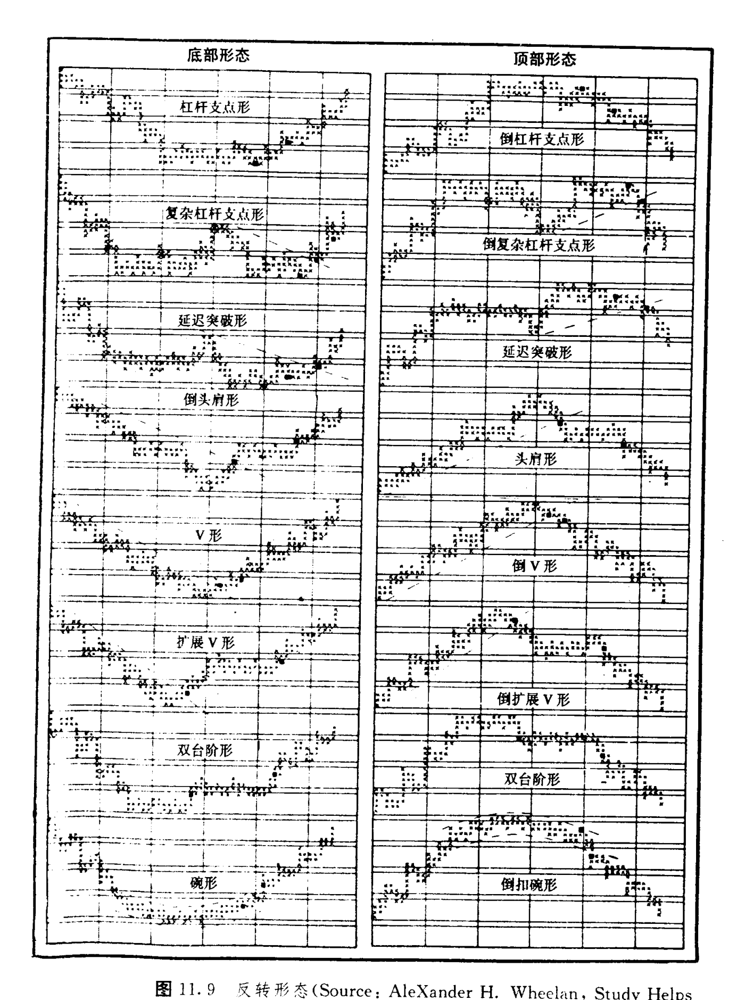
> 图11.9 反转形态（Source: AleXander H. Wheelan, Study Helps in Point and Figure Technique [New York, NY: Morgan, Rogers and Roberts, Inc., 1954] p.25.）。

### 止损措施

稳妥地设置止损指令是商品交易成功的最关键的因素之一。保护性止损措施是一种极可取的交易技巧。问题是，我们到底应当把止损指令放置在什么水平上。如果把它们安排在线图的某些位置上（如支撑水平、价格跳空或趋势线下方），有时候这些地方过于显眼，因而相当脆弱。在很多时候，为了符合线图上好点位的要求，我们不得不把止损水平放在距离入市水平过远的地方。而日内点数图能够提供距离更接近也更不惹眼的止损点。

## 结语

最后，我们就日内点数图提出几点一般性的评论。这种短期图表在场内交易商中间大受青睐，其原因是显而易见的。然而，如果我们认为这种技术仅仅适用于极短期的交易，那就错了。诚然，本技术在短期领域中很有功效，但是，我们可以把点数图应用于任何时间尺度之下。我们可以利用它来显示成年累月的价格变化。在进行长期市场分析时，我们只要修改一下每点取值以及转向规定就行了。我们甚至也能构造延续数年的连续点数图图表。不论时间尺度如何，图表的研读方法本身总是一致的。我们可以自作主张的是选择数据的方法，以及按照哪些月份采集连续资料。一般来说，在构制连续图表时，最佳的分析对象是最活跃的月份（具有最大的持仓兴趣的合约）。话说回来，对朋友们的唯一的限制其实是你自己的想象力，以及你打算在这种图表上花费的时间。

经常有人问起，究竟应当如何在各个商品市场上选择合适的每点取值以及转向规定。在很大程度上，这要看我们构图的目的以及对灵敏度的要求。朋友们必须通过尝试比较，来选出适合自己的参数。在下一章，我们要讨论每点取值以及转向规定的问题（包括优化问题），以改进点数图的效果。

## 从哪里取得点数图及有关数据

自从 1978 年摩根・罗杰斯和罗伯茨公司关门后，我们就很难得到必要的日内价格资料了。不仅如此，我们甚至也找不到现成日内点数图 <!-- pdf p330 / 书页 315 --> 的服务项目。幸亏后来的情况有所好转。自70年代早期开始，只有ADP 康川视觉系统提供日内价格和图表。但是这种系统大多为经纪公司所拥有，对个人交易商来说，成本太贵了（见图11.10）。

最近，其它信息机构在点数图上也做了许多工作。例如，市场透视公司已经开发出了精美的日内点数图服务，其符号颇合传统，也是“X”和“O”。其中，不同的交易日交替地使用黑色和绿色显示，从而极大地提高了视觉效果。另外，这种图上也能显示价格跳空（见图11.11）。

夸春期货图表公司的图表服务更新潮，它是唯一用书面形式发送日内图表的资讯公司。说这么多，无非只有一个意思，虽然日内资料到今天为止也还不容易得到，但这方面的问题已经日益引起注意了。我强烈地感觉到，已经有越来越多的交易商了解了日内点数图的潜在价格，因此它即将卷土重来（见图 11.12到11.14）。

无论如何，如果你对日内点数图既无兴趣，也没有时间一步一趋地作图，又得不到必要的日内价格资料的话，请不要泄气。我们也可能根据报纸上的价格资料，获得点数图的某些好处。虽然在这种变通的办法里，我们要丢失一些东西，但还是能够保留其中大部分特色。想知道个中奥妙吗？请看下一章。 <!-- pdf p331 / 书页 316 --> 

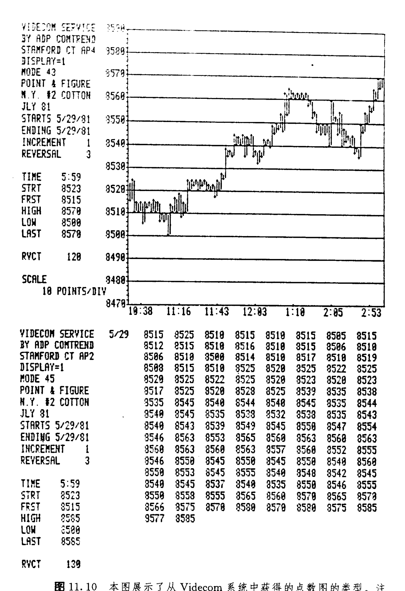
> 图11.10 本图展示了从 Videcom 系统中获得的点数图的类型。注意，图中以箭头代替了“X”和“O”。对应于点数图的日内价格数据可以显示在屏幕下部，以备手工绘图之用 （Source: Automatic Data Processing, Inc.，Comtrend Division, Stamford, CT.）。 <!-- pdf p332 / 书页 317 --> 

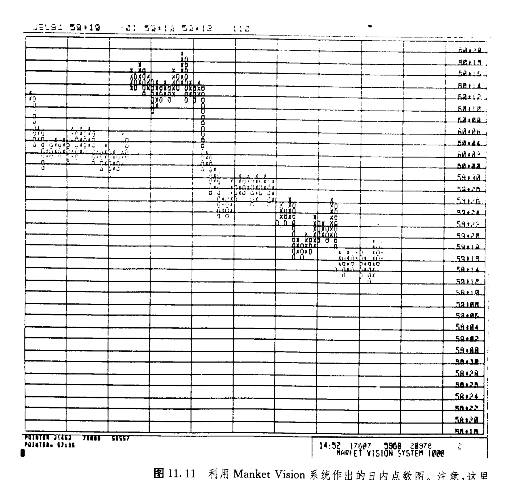
> 图11.11 利用 Market Vision 系统作出的日内点数图。注意，这里采用了传统的“X”和“O”符号点。还请注意，本图左上部有一个大规模的价格跳空，发生在两个交易日之间。本图显示了9月长期国债合约的5天的交易活动。在实际的屏幕显示下，该系统通过绿色和黑色来交替显示各天的价格变化 （Source: Courtesy of Market Vision Corporation, New York,NY.）。 <!-- pdf p333 / 书页 318 -->

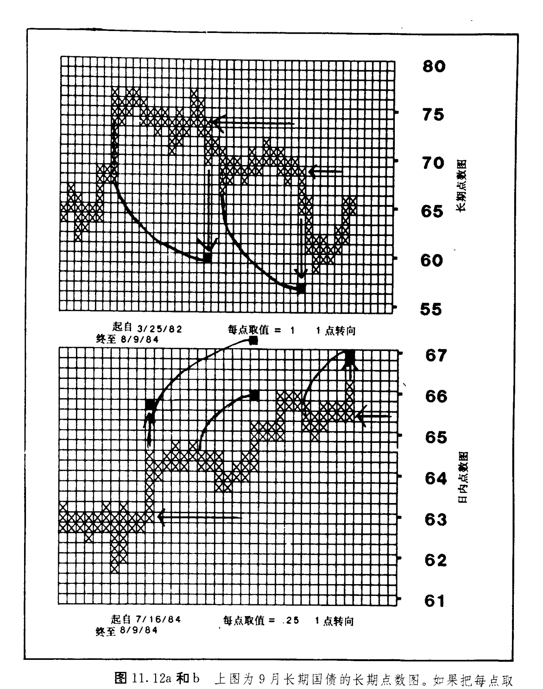
> 图11.12a和b 上图为9月长期国债的长期点数图。如果把每点取值设为一个较大的价格数值、则可以在本图中容纳2年以上的价格变化。请注意其中的水平区域，以及通过横向数算技术获得的下方的价格目标。下图较为灵敏，其中每点取值为8个价格基点。请注意这里的明显的水平区间，以及横向数算技术的应用 （Source: Courtesy of Quotron Futures Charts， Racine,WI.）。 <!-- pdf p334 / 书页 319 -->

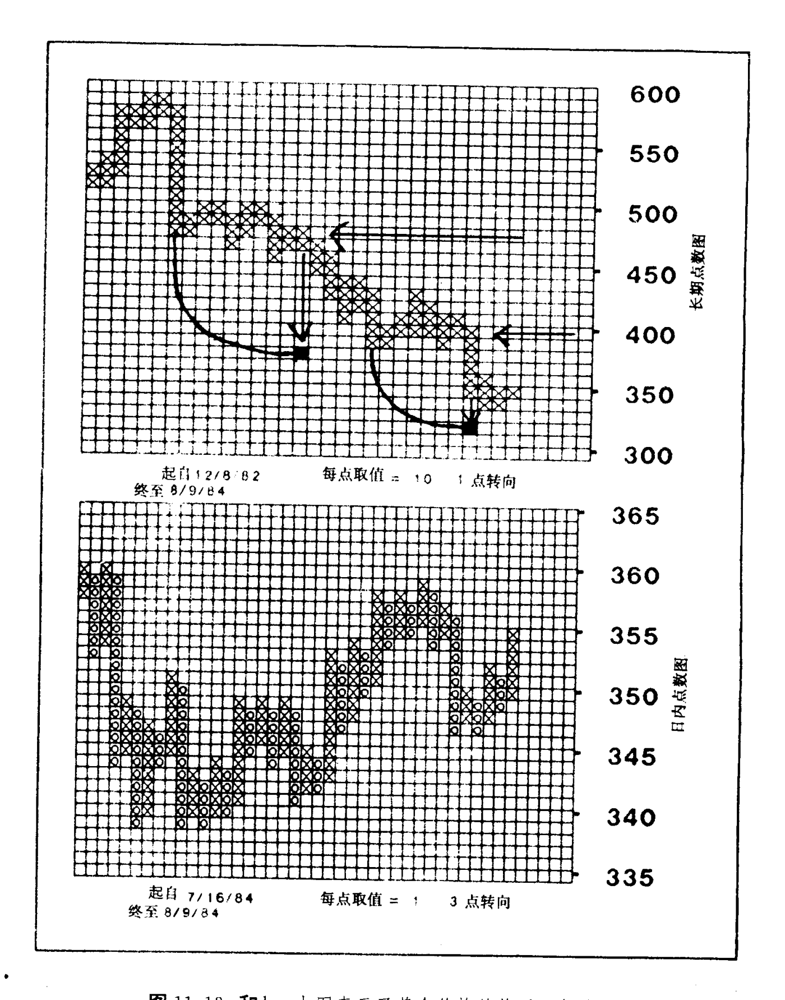
> 图11.13a和b 上图表示了黄金价格的将近2年的下跌过程。每点取值$10。注意图中在水平区间处横向数算技术的应用。下图较为灵敏，每点取值为$1，三点转向。本图覆盖了约1个月的价格变化（Source: Courtesy of Quotron Futures Charts,Racine,WI.）。 <!-- pdf p335 / 书页 320 -->

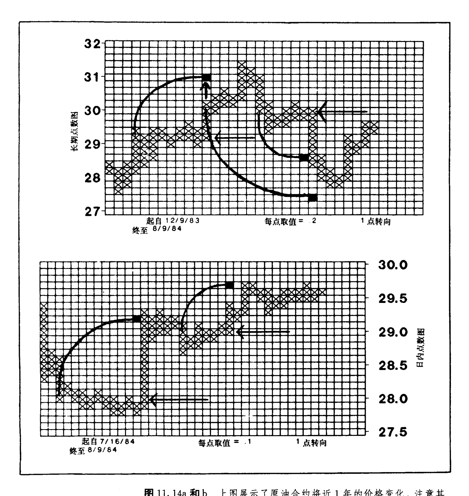
> 图 11.14a和b 上图展示了原油合约将近1年的价格变化。注意其中横向数算技术的应用。下图只覆盖了1个月的价格变化。下图每点取值为 0.1美元，而上图每点取值为 0.2美元。注意，下图灵敏得多 （Source: Courtesy of Quotron Futures Charts, Racine,WI.）。