# 第十三章 艾略特波浪理论

> 原书 PDF 第 356–396 页。OCR 自扫描件，图表已截取到 `images/13/`。

<!-- pdf p356 / 书页 341 -->

## 历史背景

1978年，查尔斯•J•柯林斯发表了他的专论《波浪理论》。这本书是个源头，其中的理论后来广泛流传，人称“艾略特波浪理论”。这是因为波浪理论的奠基人是拉尔夫•纳尔逊（R•N•）•艾略特。柯林斯就是以艾略特本人的原著（艾氏把他的书题献给柯林斯）为基础完成这篇专论的。

艾略特（1871-1948）原来是位会计，曾供职于餐馆和铁路公司。他在墨西哥和中美洲的不少铁路公司里都干过。后来，他在危地马拉大病一场，随后在1927年就退休了。以后几年，他回到加利福尼亚的老家养病。

正是在这段漫长的疗养期中，他揣摸出了股市行为理论。显然，道氏理论对他有极大的影响，因此，波浪理论中有很多道氏理论的印迹。 <!-- pdf p357 / 书页 342 --> 1934年，柯林斯正任投资顾问公司的股市通讯的编辑。艾氏写信给柯林斯说，他本人一直是罗伯特•雷的股市通讯的读者，对雷氏关于道氏理论的书颇熟悉。艾略特还写道，波浪理论是“对道氏理论极为必要的补充。”

从此，艾略特与柯林斯建立了联系，告诉了他自己的新发现，并希望进入柯林斯所在的公司工作。到了 1938年，经过大量的书信往来后，柯林斯终于给他深深地折服了，于是帮助他开始了他的华尔街生涯，并且同意为他出版那篇《波浪理论》。柯林斯举荐艾略特担任了《金融世界》杂志的编辑。后来在1939年，艾略特在这份杂志上一口气发表了十二篇文章，鼓吹自己的理论。1946年，也就是在其逝世2年前，他完成了关于波浪理论的集大成之作，《自然法则——宇宙的秘密》。

这个题目听来有点大而无当，但这正是因为艾略特坚信，他的股市理论是制约人类一切活动的普遍自然法则的一部分。从这种宏观的方面看，他的理论自是有其妙处。不过，这种大问题不妨留给大智慧家去探究，我们还是集中地谈谈他在股市方面的建树。多亏A•汉密尔顿•博尔顿从1953年起，在《银行信用分析家》发表了《艾略特波浪附刊》。直到1967年他去世为止，每年一份，共刊发了 14期。如果不是博尔顿，艾略特的理论也许早已湮没无闻了。1960年，博尔顿发表了《艾略特波浪理论——一份中肯的评价》，这是艾略特身后关于其理论的第一部宏篇巨制。1967年，A•J•弗罗斯特接手《艾略特波浪附刊》。1970年，他为《银行信用分析家》撰写了他的最后一份关于艾略特理论的论作。

1978年，弗罗斯特和普里克特合作发表了《艾略特理论》（新经典文库出版）。现在人们把这本书推崇为该领域的经典。1980年，普里克特更上一层楼，发表了《R•N•艾略特选集》（新经典文库出版），把久违了的艾略特的原作重新呈现在人们面前。普里克特本人在生意场上被人称为卓越的艾略特理论家，他也编发一份咨询材料，《艾略特波浪理论家》。这是一份月刊，其研究对象是股市、利率和贵金属。普里克特的新经典文库公司还出版另一份咨询材料，《商品市场艾略特波浪通讯》，是由戴维•韦斯主持的，完全针对商品期货市场。在此，我向普里克特先生表示衷心的感谢，他为我们慷慨地提供了本章的大多数图表。

## 波浪理论导论

根据我的经验，大部分人都觉得艾略特波浪理论过于玄奥，难以把握，其实它的理论基础是相当简单的。朋友们不久就可以看出来，这里有许多观点听来都颇不陌生。这是因为艾略特的大部分理论与道氏理 <!-- pdf p358 / 书页 343 --> 论以及传统的图表技术天造地设般地吻合。然而，艾略特波浪理论又向前迈了一步，对市场运作具备了全方位的透视能力，从而有助于解释特定的形态为什么要出现，在何处出现，以及它们为什么具备如此这般的预测意义等等问题。另外，它也有助于我们判明当前的市场在其总体周期结构中所处的地位。

我们曾说过，大多数技术分析方法在本质上都是顺应趋势的。道氏理论确有种种长处，但瑜不掩瑕，其信号必须等到在新趋势确立之后才能产生。但是，艾略特波浪理论对即将出现的顶部或底部却能提前发出警告信号，而这一点事后才为那些较为传统的方法所验证。以后，我们将力图指出波浪理论同更经典的图表技术的共同之处。

本节要作一点说明。在本章关于艾略特波浪理论的讨论中，我们走的是中庸之道。我们不求面面俱到，只打算讲清楚艾略特波浪理论中较重要的内容。至于详细的介绍，你最好指望弗罗斯特和普里克特的《艾略特波浪理论》（新经典文库版）。

## 艾略特波浪理论的基本原理

波浪理论具有三个重要方面——形态、比例和时间，其重要性依上述次序等而下之。所谓形态，指波浪的形态或构造，这是本理论最重要的部分。而比例分析的意思是，通过测算各个波浪之间的相互关系，来确定回撤点和价格目标。最后一方面是时间，各波浪之间在时间上也相互关联，我们可以利用这种关系来验证波浪形态和比例。有些艾略特理论家认为，时间关系在进行市场预测时较不可靠。

艾略特理论原本是应用在主要的股市平均价，特别是道•琼斯工业股票指数的分析上的。在这种理论上述最基本的形式下，它认为股票市场遵循着一种周而复始的节律，先是五浪上涨，随之有三浪下跌。如图13.1所示的，是一个完整的周期。数一数其中波浪的数目，那么，一个完整的周期包含8浪—5浪上升，3浪下降。在周期的上升阶段，每一浪均以数字编号。1浪、3浪和5浪是上升浪，称为主浪，而2浪和4浪方向与上升趋势的方向相反，因为2浪和 4浪分别是对1浪和3浪调整，故称之为调整浪。上述五浪完成后，出现了一个三浪形式的调整。这三个波浪分别用字母a、b、c来表示。

关于各个波浪本身的结构问题，很重要一点就是要考察清楚它们的规模。我们知道，趋势具有很多的规模层次。艾略特把趋势的规模（或者说是度）划分成9个层次，上达覆盖200年的超长周期，下至仅仅延续数小时的微小尺度。关键的是我们要记住，不管我们所研究趋 <!-- pdf p359 / 书页 344 --> 势处于何等规模，其基本的八浪周期总是不变的。

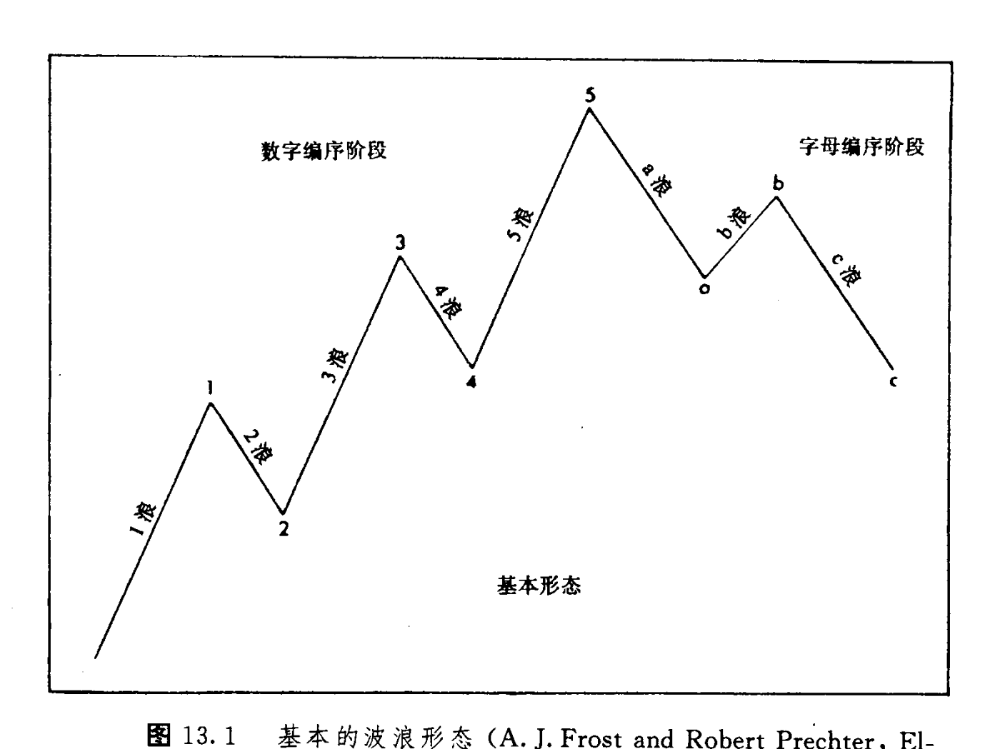
> 图13.1 基本的波浪形态（A. J. Frost and Robert Prechter, Elliott Wave Principle [Gainesville, GA: New Classics Library, 1978], p. 20. Copyright 1978 by Frost and Prechter.）。

这样，每一浪都可以向下一层次划分成小浪，而小浪同样可以进一步向更下一层次划分出更小的浪。反之亦然，每一浪本身也是上一层次波浪的一个组成部分。图13.2显示了上述关系。最大规模的二浪——浪①和浪②——可以划分成8个小浪，然后，这8个小浪再细分，共得到34个更小的浪。而最大的浪—浪①和浪②—只是更高一层次的五浪上升结构中的二个浪而已。在图中最右侧，高一层次的③浪呼之欲出。把图13.2中的34个小浪再细分到其下一层次，就得到图13.3所示144个小浪。

上面提到的数目—1，2,3,5，8，13,21,34,55,89,144——并不是偶然出现的。它们是菲波纳奇数列的一部分，而这个数列乃是艾略特波浪理论的数学基础。稍后，我们还要谈到这一点。现在，请朋友们从图13.1看到13.3，注意其中波浪的一个显著特征。到底应当把某一浪划分成五浪结构，还是划分成三浪结构，这取决于其上一层次波浪的方向。例如，在图13.2中，（1）浪、（3）浪和（5）浪被细分成五浪结构，这是因为由它们组成的上一层次的浪①是上升浪。而因为（2）浪和（4）浪的方向与这个大趋势相反，所以，它们只被细分为三浪结构。请仔细看调整浪（a）、（b）和（C），它们构成了上一层次的调整浪②。注意，其中 <!-- pdf p360 / 书页 345 --> 两个下降浪—（a）和（C）—都被细分成五浪结构。这是因为它们的运动方向与上一层次的浪—②浪——的方向一致，相反地，（b）浪与其上一层次的②浪方向相反，因此被细分为三浪结构。

在我们应用艾略特方法的时候，能不能辨识三浪结构和五浪结构，显然具有决定性的重要意义。五浪结构和三浪结构各自具有不同的预测意义。举例来说，一组五浪结构通常意味着其更大一层次的波浪仅仅完成了一部分，好戏还在后头（除非这是第5浪的第5个小浪）。最重要的一点是调整，绝不会以五浪结构的形式出现。例如，在牛市上，如果我们看到一组五浪结构的下跌，那么这可能意味着这只是更大一组三浪调整（a一b-c）的第一浪，市场的下跌尚未有穷期。在熊市中，一组三浪结构的上涨过后，接踵而来的是下降趋势的恢复。而五浪结构上涨则说明将会出现更实在的向上运动，其本身甚至可能构成了新的牛市的第一浪。

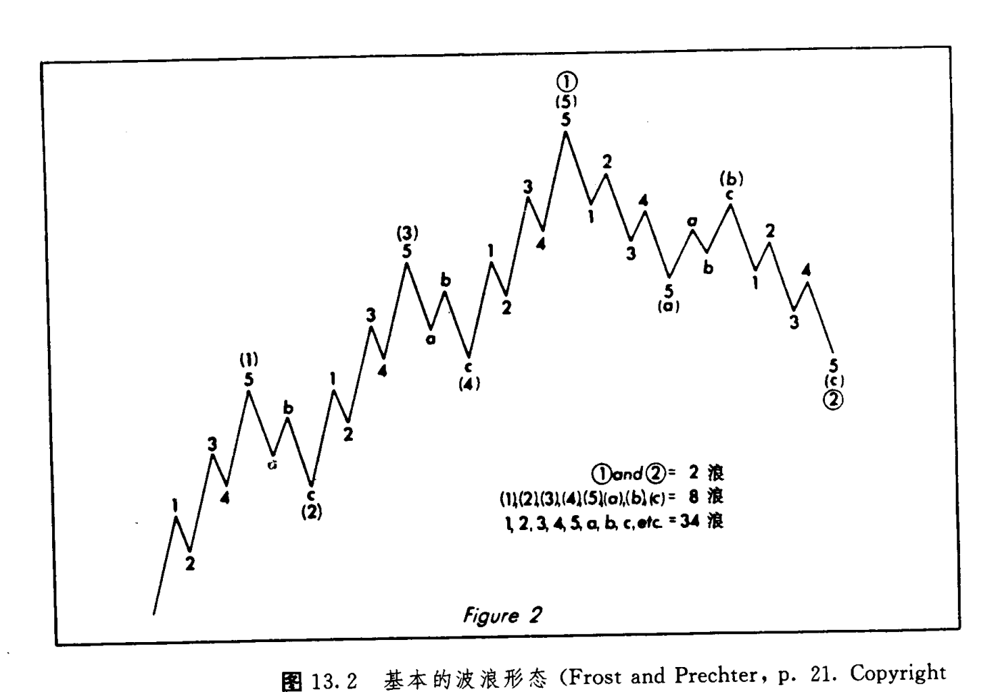
> 图13.2 基本的波浪形态（Frost and Prechter, p. 21. Copyright 1978 by Frost and Prechter.）。

<!-- pdf p361 / 书页 346 --> 

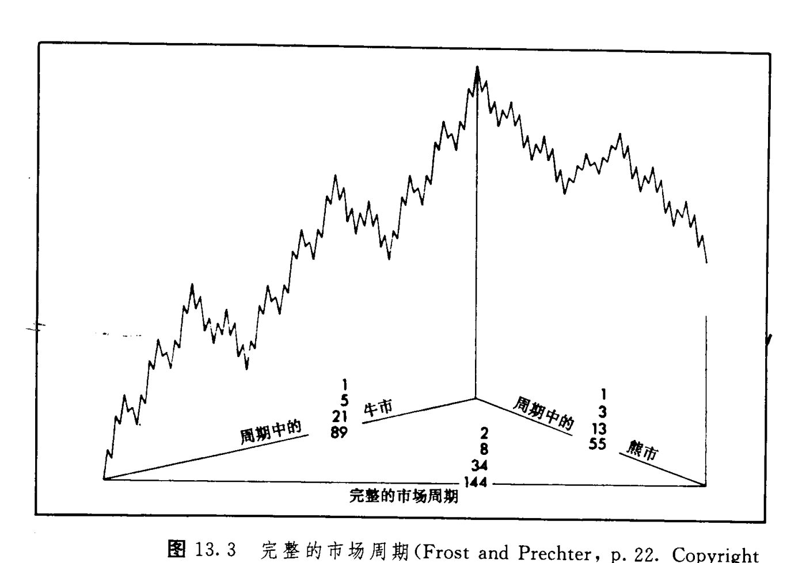
> 图13.3 完整的市场周期（Frost and Prechter, p. 22. Copyright 1978 by Frost and Prechter.）。

## 艾略特波浪理论和道氏理论的联系

且住，让我们先来看一看艾略特的五浪上涨的思想，同道氏理论的牛市上涨三阶段论的明显联系。很清楚，艾略特的想法——三浪上涨，间以二浪调整——与道氏理论是合缝对榫的。无疑，艾略特受到了道氏理论的影响，同样清楚，艾略特认为他超越了道氏理论，实际上是发展了后者。有意思的是，两位先生在构造他们的理论时，都从大海那里得着了启示。道氏把主要趋势、中等趋势和短暂趋势，分别比作大海之中的潮汐、浪涛和波纹。艾略特则在他的著作中，时时提到海水的“流与转”，并把他的思想命名为“波浪理论”。

这里还想打个岔。今年夏天，当我在科得角度假时，偶尔得到了一点关于大海的想法，或许同道和艾略特多少有些联系。亨利•本斯顿在他的《荒屋》（巴兰坦书籍版，1928年）中，描绘了他在科得角海滩上度过的与世隔绝的一年。他对大海作了细致的刻画，把海浪拍岸的过程形 <!-- pdf p362 / 书页 347 --> 容成“三步曲”。他写道，浪涛三节拍、三节拍地卷向海岸。“先卷来三个大浪，接着是一阵不很规则的涌动，然后，再是三个大浪。”（第34页）。往下他还有鼻子有眼地说，当地海岸警卫队的士兵们熟知海性，总是利用三浪过后的平息期出航。谁知道呢？也许道和艾略特对大海的了解比他们还深呢。

### 各浪特性

两种理论在描绘牛市的三个阶段上，也有一定程度的重合之处。艾略特几乎没有论及每个波浪的个性。关于各浪特性的研究，首先出现在普里克特的书中，这是他对艾略特思想的创造性发挥。牛市的三个心理过程（在第二章中讲过），与艾略特的三个主浪的特性类似。如果我们掌握了具体波浪的特性，那是大有益处的，尤其是在波浪划分不清的情况下。还有一点也很重要，不论波浪的层次高低（或规模大小），同一类波浪的特性总是一致的。

### 1浪

第1浪差不多有一半处于市场的底部过程中，常常貌似从非常压抑的水平发生的不起眼的反弹。第1浪在五浪中通常也是最短的一浪。有时候1浪也可能很剧烈，特别是在主要的底部形态过程中。

### 2浪

第2浪通常回撤（或吐还）1浪的全部或大部分的上涨进程。但是，正是因为2浪能够在1浪的底部上方打住，才构成了许多传统的图表形态，如双重底或三重底，倒头肩形底等。

### 3浪

至少在普通股的领域里，第3浪通常是最长的、也是最猛烈的一浪。3浪向上穿越了1浪之顶，代表了各种传统的突破信号，以及道氏理论的买入信号。实际上在这一时刻，所有的趋势顺应系统都挤进了这一趟牛市。在这一浪，交易量通常是最重的，价格跳空也出足风头。因此，毫不奇怪，第3浪最有可能出现延长现象（见下一节）。在五浪结构中，3浪在主浪中绝不会是最短的。在这个阶段，即使是从市场的基本面来看，也肯定是乐观的。

### 4浪

第4浪通常是一个复杂的形态。同2浪一样，它也是市场调整巩固阶段，但其构造通常与2浪不同（见本章后面的“交替规则”一节）。三角形形态通常出现在第4浪。4浪绝不能重叠1浪的顶部，这是艾略特理论的中心法则之一。

### 5浪

在股市中，5浪通常比3浪平和得多。而在商品市场上，5浪常常是最长的一浪，而且最可能延长。正是在5浪之中，许多验证性的指标，如 OBV 交易量，开始落后于价格变化。也正是在这一时刻，在各 <!-- pdf p363 / 书页 348 --> 种摆动指数上，出现了相互背离信号，警示市场可能出现顶部过程。

### a浪

当上升趋势进入调整阶段后，a浪通常被误解成只是寻常回撤。如果a浪具备了五浪结构，那就天机泄漏，事情严重得多了。在前一轮上涨中，警觉的分析者已经发现了摆动指数的背离现象，到这时，也许又看出交易量的形态苗头不对。现在较重的交易量或许是伴随着向下的动作出现的（不过这并非必要条件）。

### b浪

b浪是新趋势中的向上反弹，通常伴随着较轻的交易量，并且通常是旧有的多头头寸“侥幸脱逃”的最后机会，也是建立新的空头头寸的第二个机会。根据调整的所属类型（见本章调整浪一节），这一浪上冲或许会试探旧的高点（形成双重顶），甚至先越过旧的高点，然后才掉头向下。

### c浪

当c浪出现时，上升趋势无疑已告结束。根据当前调整所属的类型，c浪常常会跌过a浪的底，形成了在所有传统技术工具上的卖出信号。实际上，如果在4浪和a浪的底部连出一根直线，那么它所描画的有时就是我们熟悉的头肩形。

### 波浪延长

理想的上升趋势具有五浪结构。但是，其中某个主浪延长的情况并不罕见。换句话说，1浪、3浪和5浪都可能再添上额外五小浪结构，形成其延长的形式。图13.4表示了在各种情况下的延长形态。第一种情况最不常见，属于1浪延长；第二种情况，是3浪延长，在股市中最常见；第三种情况，是5浪延长，在商品市场最常见；在最后一种情况下，我们很难弄清哪一浪是延长浪，因为其中5个主浪的长度相等。碰上这种局面时，我们只需牢记一点，问题便迎刃而解：在九浪结构中，其中每个主浪都占据了相等的长度，它同完整的五浪结构具有同样的意义。

波浪延长现象具有一定的预测意义。首先，其中只能有一个浪延长。并且，另外两个未延长的浪倾向于在时间和幅度上大小相等。因此，如果3浪延长了，5浪就不再延长，并且它将与1浪相像。如果1浪和3浪都是正常的波浪，那么5浪就是最可能延长的一浪。最后，我们这里再交代一点，是关于5浪延长的“双回撤现象”。就是说，在5浪延长完成后，开初市场将以三浪结构向下运动到延长部分的起点。随后，市场再度上冲，回试延长部分的顶部。这里是个分水岭，从此，市场要么恢复上升趋势，要么形成顶部，因其在更大尺度的周期中的地位而定。图13.5显示了牛市中的双回撤现象。

<!-- pdf p364 -->

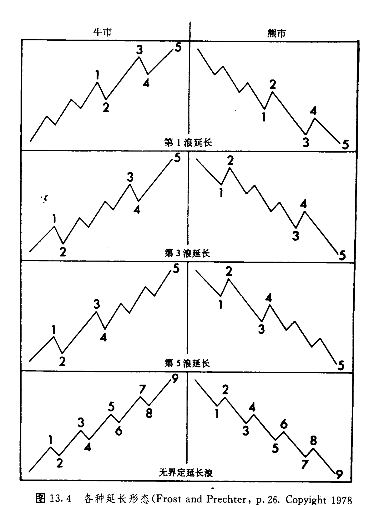
> 图13.4 各种延长形态（Frost and Prechter, p. 26. Copyright 1978 by Frost and Prechter.）。

### 斜三角形和衰竭形态

在主浪中，还有另外两种变化——斜三角形和衰竭形态。图13.6和13.7是斜三角形的两个例子。斜三角形通常出现在第5浪（最后一浪）中。就其效果来看，它是一个楔形。在第六章介绍图表形态时，我们 <!-- pdf p365 / 书页 350 --> 讲过，上升楔形总是看跌的，而下降楔形则是看涨的。在这种形态中，也具有五浪结构，其中每一浪都细分成三浪结构。如果陡峭的趋势线被跌破了，那么这种形态通常标志着市场发生了重要转折。

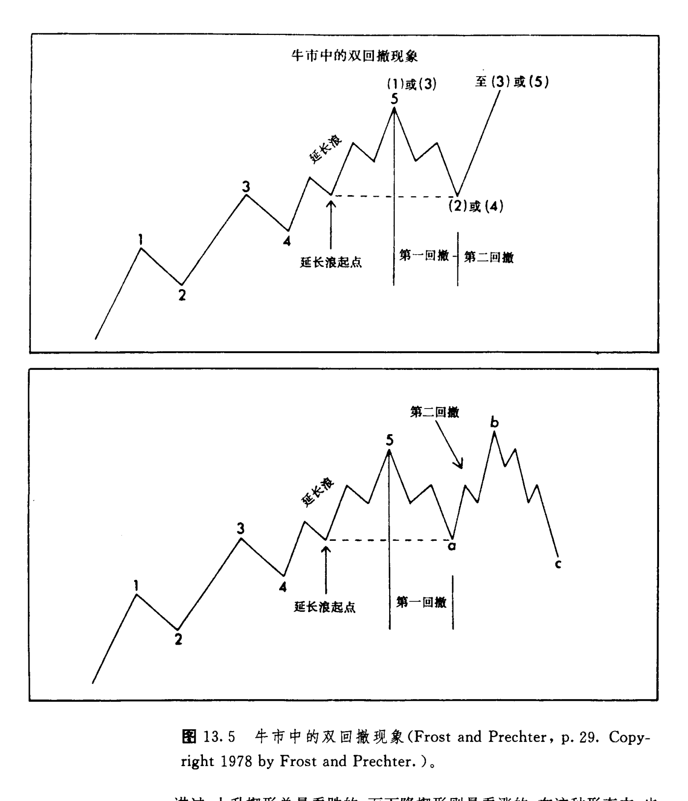
> 图13.5 牛市中的双回撤现象（Frost and Prechter, p. 29. Copyright 1978 by Frost and Prechter.）。

图13.8和13.9表示衰竭形态。衰竭形态出现在第5浪（最后一 <!-- pdf p366 / 书页 351 --> 浪）。以牛市为例，它的情形是，5浪自身已具备所需的五浪结构，但无力向上超越3浪的高点。在熊市上，5浪不能够跌破3浪的低点。注意，按照我们的最通常的说法，艾略特的衰竭形态就是双重顶或双重底。

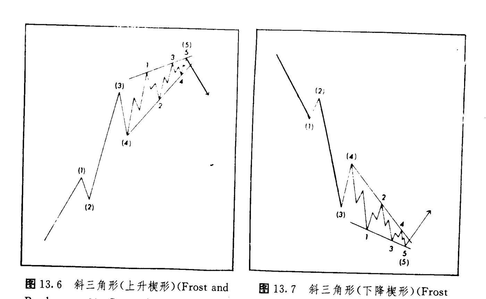
> 图13.6 斜三角形（上升楔形）（Frost and Prechter, p. 31. Copyright 1978 by Frost and Prechter.）。
> 图13.7 斜三角形（下降楔形）（Frost and Prechter, p. 31. Copyright 1978 by Frost and Prechter.）。

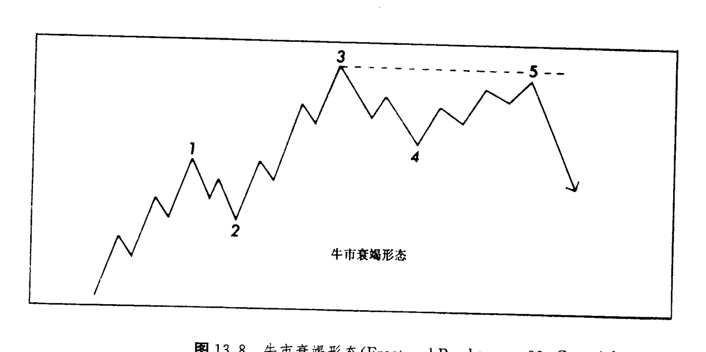
> 图13.8 牛市衰竭形态（Frost and Prechter, p. 33. Copyright 1978 by Frost and Prechter.）。

<!-- pdf p367 / 书页 352 -->

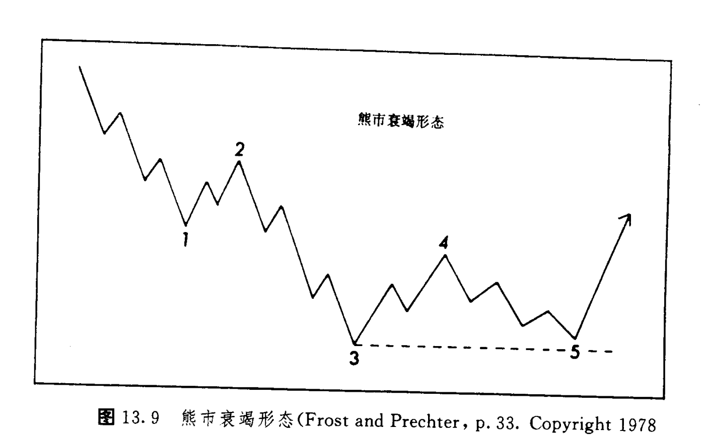
> 图13.9 熊市衰竭形态（Frost and Prechter, p. 33. Copyright 1978 by Frost and Prechter.）。

## 调整浪

以上，我们讨论的主要是与趋势方向一致的主浪，现在就来看看调整浪。一般地说，调整浪的界定较不明确，因此较难辨识和预料。然而，有一点却是明确的，调整浪绝不会以五浪结构出现。调整浪属于三浪结构，而不是五浪结构（唯一的例外是在三角形形态中）。调整浪有四个类型—锯齿形，平台形，三角形以及双三浪结构和三三浪结构。

### 锯齿形

锯齿形属于三浪结构的调整浪形态，其方向与主要趋势相反，可以进一步细分为5-3-5的波浪序列。图13.10和13.11显示了牛市中的锯齿形调整的情况，而图13.12和13.13则显示了熊市中的对应情况。注意，中间浪B的下跌远远未及A浪的起点，而C浪的动作远远高出 A浪的高点。

锯齿形有一种较少见的变体，如图13.14 所示，我们称之为双锯齿形。这种变体有时会出现在较大规模的调整形态中。实际上它是由两个5-3—5序列的锯齿形通过中间的a-b-c形态连接而成的。

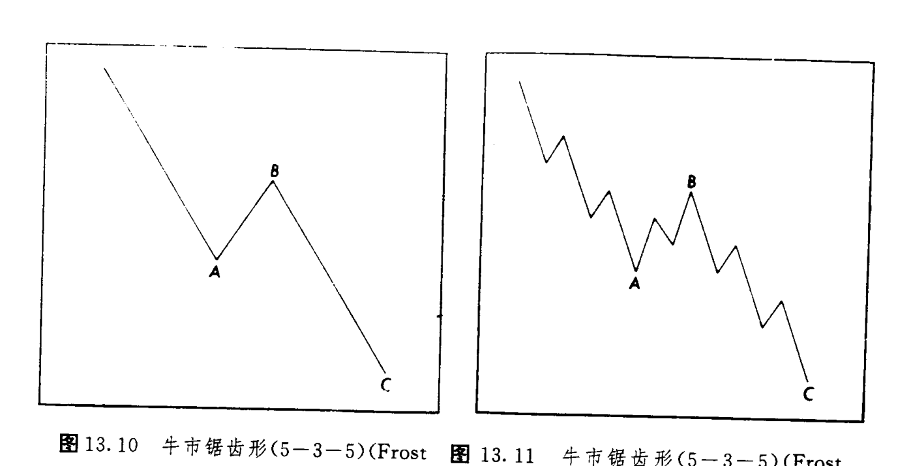
> 图13.10 牛市锯齿形（5-3-5）（Frost and Prechter, p. 36. Copyright 1978 by Frost and Prechter.）。
> 图13.11 牛市锯齿形（5-3-5）（Frost and Prechter, p. 36. Copyright 1978 by Frost and Prechter.）。

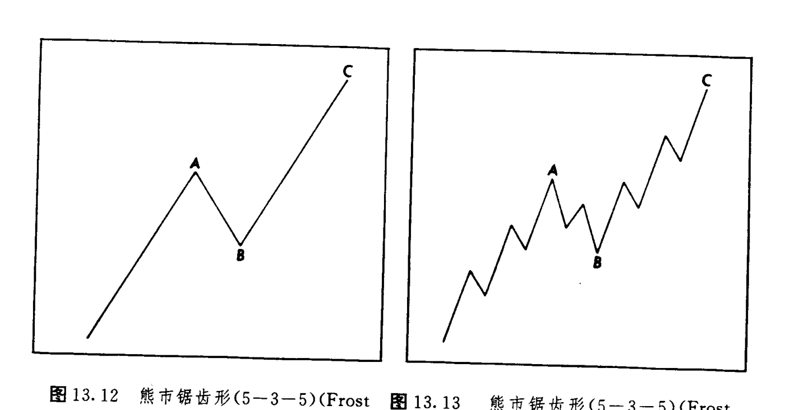
> 图13.12 熊市锯齿形（5-3-5）（Frost and Prechter, p. 36. Copyright 1978 by Frost and Prechter.）。
> 图13.13 熊市锯齿形（5-3-5）（Frost and Prechter, p. 36. Copyright 1978 by Frost and Prechter.）。

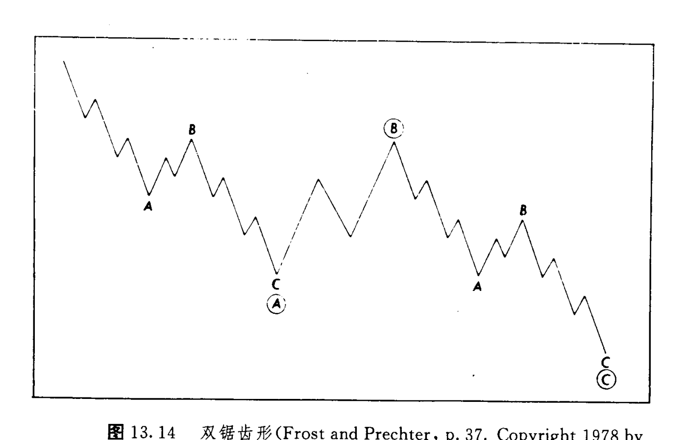
> 图13.14 双锯齿形（Frost and Prechter, p. 37. Copyright 1978 by Frost and Prechter.）。

### 平台形

平台形调整与锯齿形调整的区别在于，前者是3-3-5序列的形 <!-- pdf p368 / 书页 353 --> 态。注意，在图13.16和13.18中，A 浪是三浪结构，而不是五浪结构。一般地，平台形在更大程度上属于巩固形态，而不是调整形态，因此在牛市中被理解成市场坚挺的体现。从图 13.15到图13.18，都是常规的平台形的例子。例如，在牛市中，B浪一直上冲到了 A浪的最高点，表 <!-- pdf p369 / 书页 354 --> 现出市场的力度较强。最后的C浪在A浪的底部或其稍下方便告结束，这同锯齿形的情况正相反，在那里，C浪的终点要低得多。

相对于常规的平台形，也有两种“不规则的”变体。从图13.19到13.22显示了第一类变体。请注意其中的牛市例子（图13.19和13.20），B 浪的顶超越了 A浪的高点，而C浪跌过了 A浪的底。

另一种变体的情形是，B浪达到了 A浪的高点，但C浪无力抵达A 浪的底。自然，后面这种变体表示牛市的力度较强。本变体在牛市和熊市下的例子，分别显示在从图13.23到图13.26中。

最后一种平台形调整的变体称为顺势调整，体现了更为坚挺的市场动力。图13.27表示牛市中的顺势调整。注意，其中b浪明显高于a浪之顶，并且c浪也高过主浪1浪的高点。这种调整形态相对少见，它代表市场过于强劲，以致于不能正常地形成调整形态。

### 三角形

三角形通常出现在第4浪中，先于主要趋势的最后一轮动作（它也可能在a一b一c序列调整的b浪中出现）。因此，在上升趋势中，我们可以说三角形既可能是看涨的，也可能是看跌的。讲它看涨，是就它意味着趋势将恢复这层意义而言的。而说它看跌，则是因为它表明在完成剩下的一个上涨浪之后，市场可能也就到顶了（见图 13.28）。

<!-- pdf p370 / 书页 355 -->

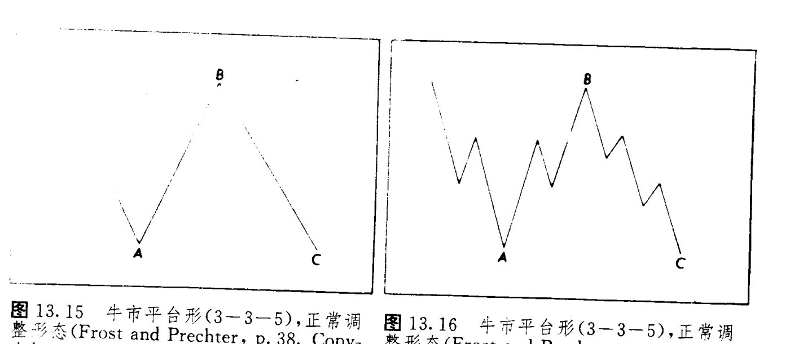
> 图13.15 牛市平台形（3-3-5），正常调整形态（Frost and Prechter, p. 38. Copyright 1978 by Frost and Prechter.）
> 图13.16 牛市平台形（3-3-5），正常调整形态（Frost and Prechter, p. 38. Copyright 1978 by Frost and Prechter.）。

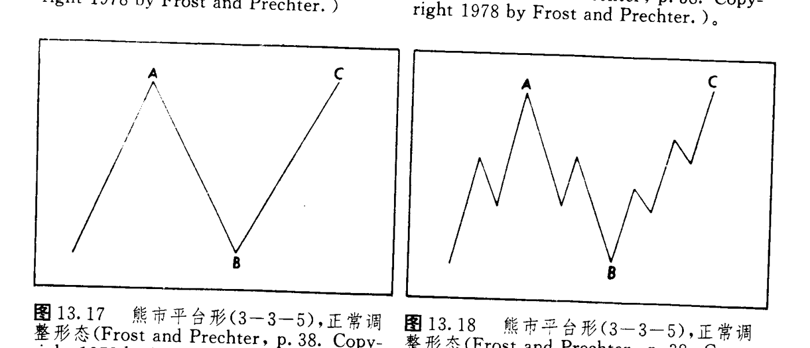
> 图13.17 熊市平台形（3-3-5），正常调整形态（Frost and Prechter, p. 38. Copyright 1978 by Frost and Prechter.）。
> 图13.18 熊市平台形（3-3-5），正常调整形态（Frost and Prechter, p. 38. Copyright 1978 by Frost and Prechter.）。

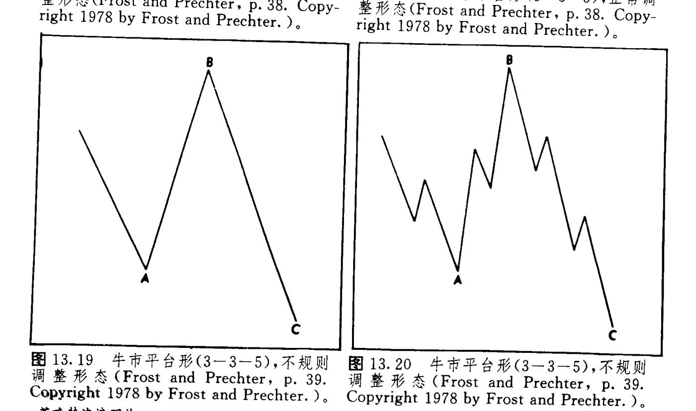
> 图13.19 牛市平台形（3-3-5），不规则调整形态（Frost and Prechter, p. 39. Copyright 1978 by Frost and Prechter.）。
> 图13.20 牛市平台形（3-3-5），不规则调整形态（Frost and Prechter, p. 39. Copyright 1978 by Frost and Prechter.）。

<!-- pdf p371 / 书页 356 -->

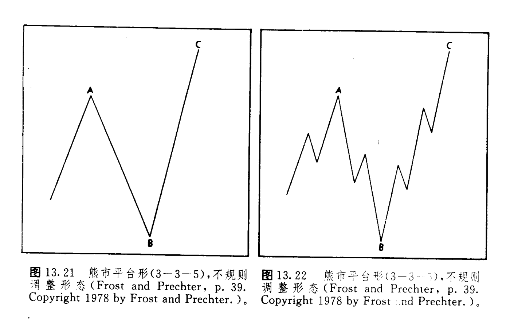
> 图13.21 熊市平台形（3-3-5），不规则调整形态（Frost and Prechter, p. 39. Copyright 1978 by Frost and Prechter.）。
> 图13.22 熊市平台形（3-3-5），不规则调整形态（Frost and Prechter, p. 39. Copyright 1978 by Frost and Prechter.）。

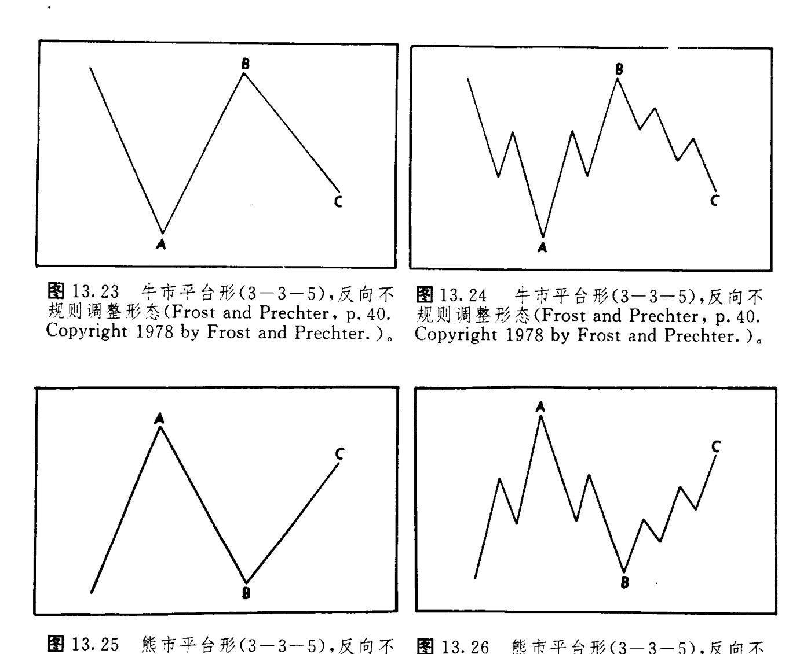
> 图13.23 牛市平台形（3-3-5），反向不规则调整形态（Frost and Prechter, p. 40. Copyright 1978 by Frost and Prechter.）。
> 图13.24 牛市平台形（3-3-5），反向不规则调整形态（Frost and Prechter, p. 40. Copyright 1978 by Frost and Prechter.）。
> 图13.25 熊市平台形（3-3-5），反向不规则调整形态（Frost and Prechter, p. 40. Copyright 1978 by Frost and Prechter.）。
> 图13.26 熊市平台形（3-3-5），反向不规则调整形态（Frost and Prechter, p. 40. Copyright 1978 by Frost and Prechter.）。

<!-- pdf p372 / 书页 357 -->

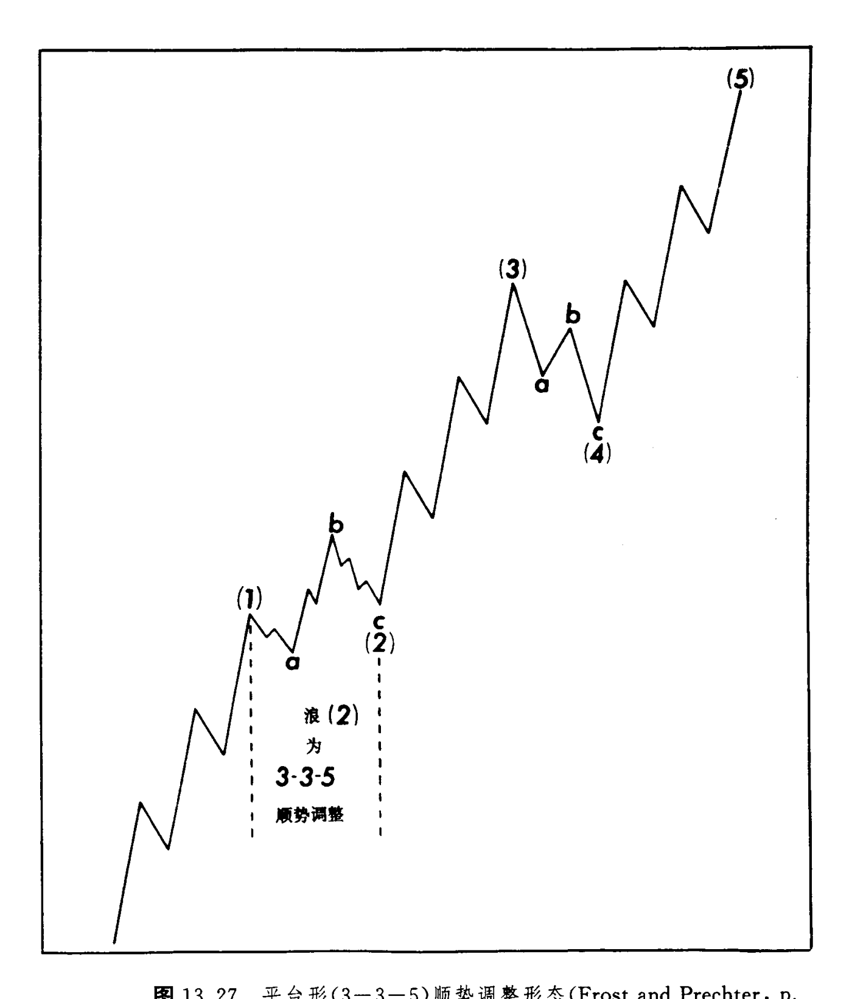
> 图13.27 平台形（3-3-5）顺势调整形态（Frost and Prechter, p. 42. Copyright 1978 by Frost and Prechter.）。

艾略特对三角形的解释与经典的价格形态分析如出一辙，但是照例，他又为这种分析增添了一定程度的确切性。还记得在第六章我们讲过，三角形形态通常是作为持续形态出现的，这一点与艾略特的想法颇为投合。艾略特的三角形属于横向巩固形态，可以划分为五浪结构，其中每一浪又可以进一步细分为三浪结构。艾略特也把三角形划分成四种类别——上升三角形，下降三角形，对称三角形和扩大三角形—统统是我们以前在第六章中碰到过的。图 13.28 是在上升趋势 <!-- pdf p373 / 书页 358 --> 和下降趋势中四种三角形的例子。

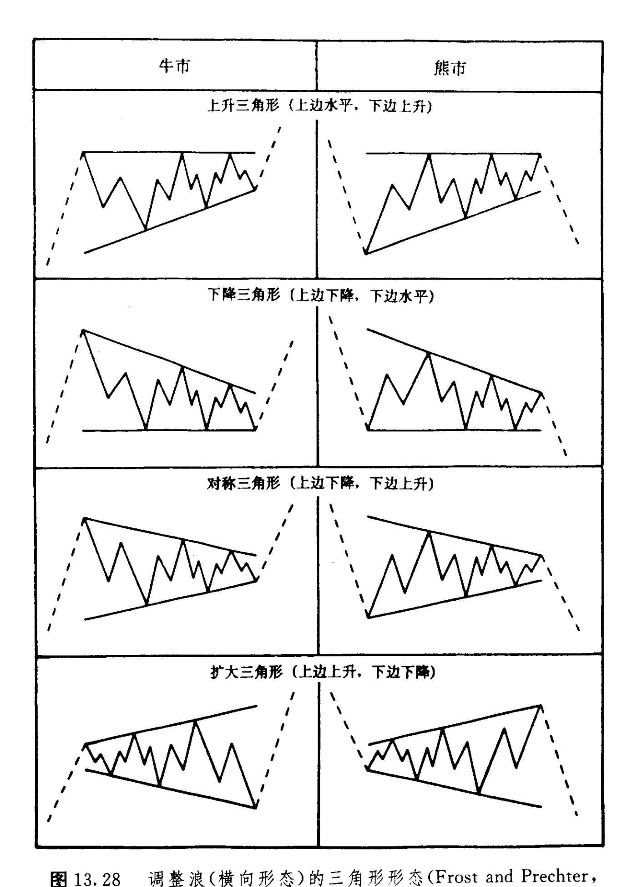
> 图13.28 调整浪（横向形态）的三角形形态（Frost and Prechter, p. 43. Copyright 1978 by Frost and Prechter.）。

因为在商品期货行业，图表形态有时较为局促，不能象在股市上那样充分发育，所以，在期货市场，三角形只具备三浪结构而不是五浪结构的现象并不罕见（但是我们必须牢记，形成三角形的最低要求依然是四个点——两个高点，两个低点——以作出两条相互聚拢的直 <!-- pdf p374 / 书页 359 --> 线）。艾略特波浪理论也认为，三角形内的第5浪（最后一浪）有时可能先突破相应的趋势线，发出伪信号，然后才再度“扎回”本来的方向。

艾略特关于三角形完成之后的第5浪（最后一浪）测算方法，基本上同经典的图表技术一致—即预期市场即将走出的距离，与三角形的底边的高度相等。还有一点要说明的是，最后的顶部或底部出现的时间的问题。根据普里克特的观点，三角形的顶点（两条聚拢的直线的交点）常常标志着最后第5浪的完成时间。

## 双三浪结构和三三浪结构

调整浪的最后一种类型是两个或三个简单形态的组合，属于较不常见的复杂形态。图13.29和13.30是两个例子。在图13.29中，两组a－b一c形态合并起来，形成了七浪。在图13.30中，三组a一b-c形态合并在一起，形成了十一浪。朋友们请注意，这些形态与经典的交易区间（或者巩固形态）何其相似乃尔。

现在，我们已经介绍了艾略特波浪理论的各种基本的波浪形态。下面我们概要地说一说几个综合性的要领—交替规则和管道技术。

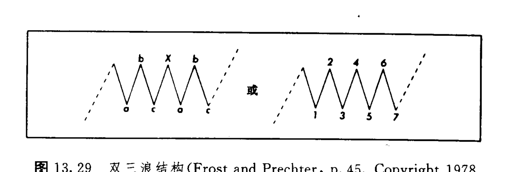
> 图13.29 双三浪结构（Frost and Prechter, p. 45. Copyright 1978 by Frost and Prechter.）。

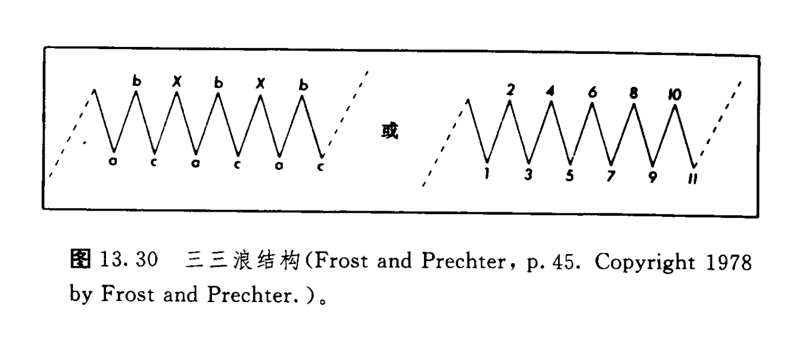
> 图13.30 三三浪结构（Frost and Prechter, p. 45. Copyright 1978 by Frost and Prechter.）。

<!-- pdf p375 / 书页 360 -->

## 交替规则

从较为广义的角度来看，交替规则（或原理）认为，市场通常不会接连地以同样的方式演变。如果上一次的顶部或底部是这个样子，那么下一回很可能就是另一个样子了。交替规则并不能确切地说明下面出场的是什么，但它可以说明什么可能是不会出现的。就其更具体的应用来看，在绝大部分情况下，它告诉我们应该预期什么类型的调整形态。调整形态交替出现。换个说法，如果调整浪2浪是简单的a一b一c结构，那么4浪很可能就是复杂的形态，比如三角形。反过来，如果2浪是复杂的，那么4浪可能就是简单的。在图13.31中有几个例子。

## 价格管道

波浪理论还有一个重要的方面，是关于价格管道用法的。在第四章，我们讲过趋势的管道特点。在艾略特这里，价格管道也是测算价格目标的一个法子，并且也有助于验证波浪序列的完成。一旦上升趋势确立了，我们就可以通过1浪和2浪的底点连接出基本的上升趋势线。然后，如图13.32 所示，我们通过1浪的高点，引出其平行线，这便是管道线。上升趋势常常完全局限于这两条边界线之间。

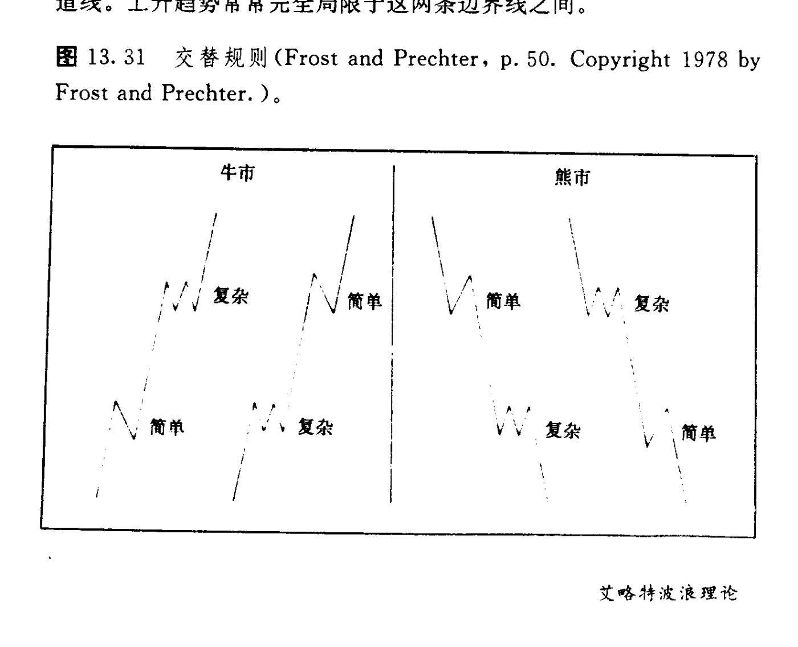
> 图13.31 交替规则（Frost and Prechter, p. 50. Copyright 1978 by Frost and Prechter.）。

<!-- pdf p376 / 书页 361 -->

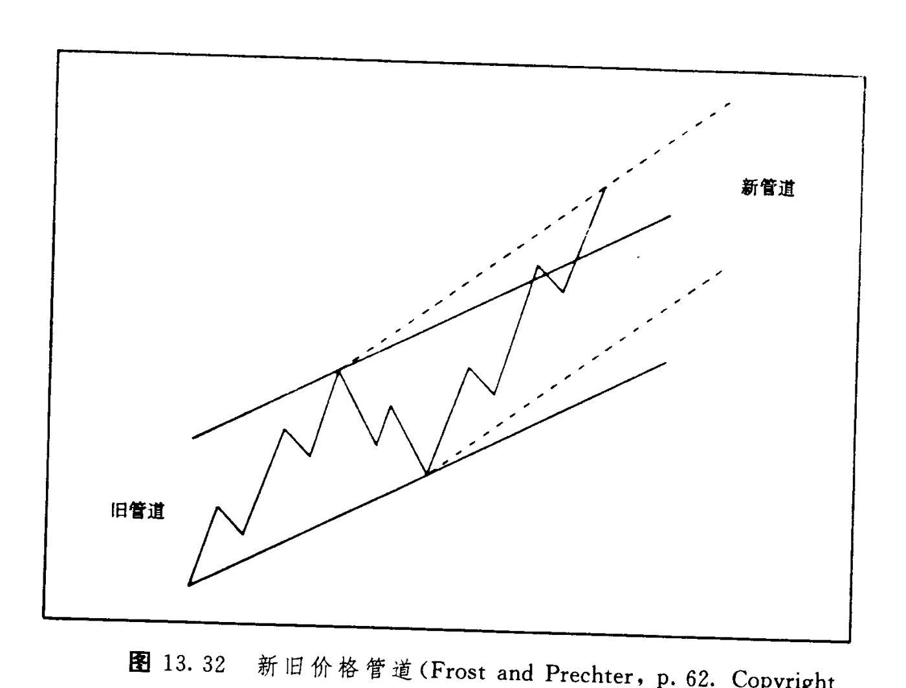
> 图13.32 新旧价格管道 （Frost and Prechter, p. 62. Copyright 1978 by Frost and Prechter.）。

如果3浪开始加速，突破了上方的管道线，那么我们就必须分别从1浪的顶点和2浪的底点出发，引出另一组平行线，如图13.32中的虚线所示。最后所得的管道如图13.33所示，下边线沿着二个调整浪—2浪和4浪—的底点，上边线通常经过3浪的顶点。如果3浪极度强劲，或者是延长浪，那么，上边线或许就得从1浪顶点引出了。第5浪在终结之前，应当向上抵近上侧的管道线。如果朋友们需要对长期趋势作出管道线，那么建议大家也采用半对数刻度图表，以同算术刻度的图表相参照。

### 4浪作为支撑区

关于波浪的形态及其要领就快介绍完了，不过下面这个要点我们还需要补充一下，那便是4浪在之后的熊市中所起到的显著的支撑作用。当五浪结构的上升阶段完成后，熊市就出台了。通常，这一轮熊市不会跌过比它低一层次的、前面的第4浪（即在之前的牛市中形成第4浪）。这是个惯例，虽然也有例外，但是通常看来，第4浪的底还是兜得住这个熊市的。在我们测算价格下跌的最远目标时，这点信息的确非常有用。

<!-- pdf p377 / 书页 362 -->

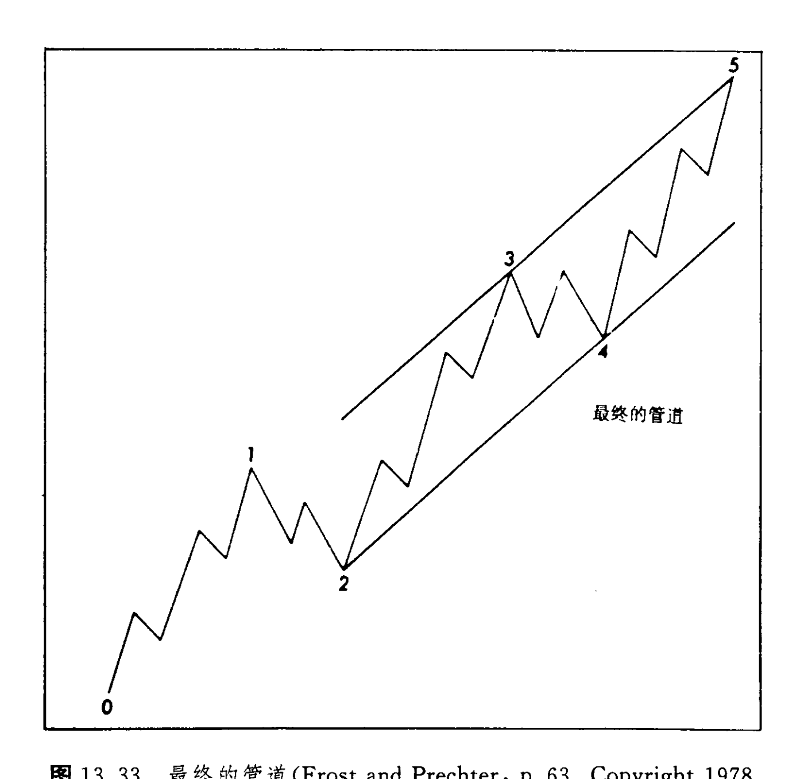
> 图13.33 最终的管道（Frost and Prechter, p. 63. Copyright 1978 by Frost and Prechter.）。

## 菲波纳奇数列是波浪理论的基础

到过意大利比萨城的人，绝大多数都见过那座著名的斜塔。对于她的建筑师波那纳来说，塔虽然斜了点儿，却不失为一块好纪念碑。波那纳、比萨斜塔和股市、艾略特理论挨得上吗？有点牛头不对马嘴。但是，许多人都不知道，离塔不远，就树立着一个小塑像，他就是13 世纪的数学家——里昂纳多•菲波纳奇。那么，菲波纳奇同研究股市行为的艾略特波浪理论又有什么牵连呢？千丝万缕！艾略特在他的《自然法则》中交代，波浪理论的数学基础，就是菲波纳奇在13 世纪发现的（更准确地说，是重新发现）一组数列。该数列后来以其发现者命名，一般称为菲波 <!-- pdf p378 / 书页 363 --> 纳奇数列（或菲波纳奇数）。

菲波纳奇发表了三部主要著作，其中最著名的是《Liber Abaci》（称为《计算书》）。这本书把阿拉伯数字引入欧洲，使之逐步取代了古老的罗马数字。他的著作对后来的数学、物理学、天文学、工程学的发展也作出了贡献。在《计算书》中，菲波纳奇数列第一次出现，是作为兔子繁殖的数学问题的解答写出来的。这组数列是1,1,2,3,5,8，13,21，34，55,89,144，等等，以至无穷。

这个数列有许多有趣的性质，并不只是在它的数字之间存在连续性关系这一点。

1. 任意两个相邻的数字之和，等于两者之后的那个数字。例如，3和5之和为8，5和8之和为13，往下依此类推。
2. 除了开始的四个数字外，任意一个数字与相邻的后一个数字之比，均趋向于0.618。例如，1/1=1.00，1/2=0.50，2/3=0.67，3/5=0.60，5/8=0.625，8/13=0.615，13/21=0.619，往下依此类推。注意，上述比值围绕着 0.618上下波动，越往后，波动幅度越小。另外，还请注意1.00，0.50，0.67这几个数值。等后面谈到比例分析、百分比回撤时，我们再来仔细分说。
3. 任意一个数字与相邻的前一个数字的比值约等于 1.618，或者说是0.618的倒数。例如，13/8=1.625、21/13=1.615、34/21=1.619。数字越大，则相应的两种比数越分别接近 0.618和 1.618。
4. 隔一个数字相邻的两个数字的比值趋向于2.618，或者其倒数，0. 382。例如，13/34=0.382,34/13=2.615。

还有其它许多有趣的关系，上述几条是最著名的、最重要的。前面我们说过，菲波纳奇只是重新发现了这个数列。这是因为古希腊和埃及的数学家们早已通晓1.618和0.618这两个比值了。它们就是黄金分割律，或称黄金比数。在音乐、艺术、建筑和生物学中，都有它们的影子。希腊人利用黄金分割律建造了巴特农神殿，埃及人借助黄金比数筑起了大金字塔，毕达哥拉斯、柏拉图、里昂纳多•达•芬奇也都通晓它的性质。

有些研究者对菲波纳奇比数的探究几近走火入魔。有人居然统计了 65名妇人的肚脐的高度，宣称其平均值是她们身高的 0.618（我们无从知道，他是照肚脐的上边还是下边算起的，当然，更不明白为什么在人身上会出现这个比数）。我们这里的全部目的，是想表明菲波纳奇比值的确在大自然中俯拾皆是，并且实质上也浸透了人类活动。 <!-- pdf p379 / 书页 364 --> 

## 对数螺线

关于黄金分割、黄金矩形、对数螺线，乃至波浪理论的数学基础——菲波纳奇数列的探讨，其实超出了本章的范围。但是，我们还是应当作以下的说明。一般认为，对数螺线是遍及整个宇宙的一种“生长形态”，而它正是以黄金比数为基础构造出来的。再进一步，从大自然的最细微的结构起，直到最宏观的宇宙天象，其中的对数螺线的形态始终保持着一贯性。这里有两个典型的实例。蜗牛壳的轮廓线和银河系的外观，都具有同样的对数螺线形态（人耳也是一例）。最后这一点更切中主题。因为股票市场不仅属于大规模的人类群体活动的范畴，而且也是大自然的“生长现象”的一种体现（所有的人类活动，都毫不例外地以此为特征），所以，一般认为，股票市场必然服从同样的生长螺线规律。

## 菲波纳奇比数和价格回撤

前面我们曾经交代，波浪理论由三个方面构成—波浪形态、比数、和时间。上面我们已经讨论了波浪形态。这是三者之中最重要方面。那么，现在就来谈谈菲波纳奇比数和百分比回撤在其中的应用。这些比例既适用于价格，也适用于时间，只是在前面一方面的应用可能更为可靠。稍后我们再讲时间这个方面。

首先，让我们回头看看图13.1和13.3，其中所表示基本的波浪结构，都是按照菲波纳奇数列组织起来的。一个完整的周期包含8浪，其中5浪上升，3浪下降——这些统统是菲波纳奇数字。再往以下两个层次细分，分别得到34浪和 144浪—它们也是菲波纳奇数字。然而，菲波纳奇数列在波浪理论中的应用，并不只在数浪这一点上。在各浪之间，还有个比例的关系问题。下面列举了一些最常用的菲波纳奇比数：

1. 三个主浪中只有一个浪延长，另外两者的时间和幅度相等。如果5浪延长，那么，1浪和3浪大致相等。如果3浪延长，那么1浪和5浪趋于一致。
2. 把1浪乘以 1.618，然后，加到2浪的底点上，可以得出3浪起码目标。 <!-- pdf p380 / 书页 365 -->
3. 把1浪乘以3.236（=2×1.618），然后分别加到1浪的顶点和底点上，大致就是5浪的最大和最小目标。
4. 如果1浪和3浪大致相等，我们就预期5浪延长。其价格目标的估算方法是，先量出从1浪底点到3浪顶点距离，再乘以1.618，最后把结果加到4浪的底点上。
5. 在调整浪中，如果它是通常的5-3-5锯齿形调整，那么c浪常常与a浪长度相等。
6. c浪长度的另一种估算方法是，把a浪的长度乘以 0.618，然后从a浪的底点减去所得的积。
7. 在3-3-5平台形调整的情况下，b 浪可能达到乃至超过a浪的顶点，那么，c浪长度约等于a浪长度1.618倍。
8. 在对称三角形中，每个后续浪都约等于前一浪的0.618倍。

### 菲波纳奇百分比回撤

除了上列的比数外，还有其它一些，不过上述是最常用的。这些比数有助于确定主浪和调整浪的价格目标。另外，通过百分比回撤，我们也可以估算出价格目标。在回撤分析中，最常用的百分比数是61.8%（通常近似为62%），38%，和50%。在第四章我们就已经指出，市场通常按照一定的可预知的百分比例回撤——最熟悉的是33%，50%，以及67%。菲波纳奇数列对上述数字稍有调整。在强劲的趋势下，最小回撤通常在38%上下。而在脆弱的趋势下，最大回撤百分比通常为62%。

前面我们说过，在菲波纳奇数列里，除了头四个数字外，菲波纳奇比数趋向于0.618。头三个比数分别是1/1（100%），1/2（50%），以及2/3（67%）。很多人在学习艾略特理论时都不清楚，自己所熟知的50%回撤，其实也是一个菲波纳奇比数。三分之二回撤也一样（三分之一回撤作为一个间隔菲波纳奇比数，也是艾略特理论中的一部分）。对先前牛市或熊市的完全回撤（100%）位置，也标志着重要的支撑或阻挡区。

## 菲波纳奇时间目标

我们还没怎么讲波浪理论的时间方面。毫无疑问，菲波纳奇时间关系是存在的，只不过预测这方面关系是较为困难的，并且有些艾略特理 <!-- pdf p381 / 书页 366 --> 论家觉得它在三个方面中是最不重要的。菲波纳奇时间目标是通过向未来数算显著的顶和底的位置而得出来的。在日线图上，分析者从重要的转折点出发，向后数算到第13、第21、第34、第55、或者第89个交易日，预期未来的顶或底就出现在这些“菲波纳奇日”上。在周线图、月线图、甚至年线图上，我们都可以应用本技术。在周线图上，分析者按照菲波纳奇数列，向后逐周探求时间目标。

## 综合波浪理论的三个方面

理想的情形是波浪形态、比数分析、时间目标三个方面不谋而合。比如说，波浪分析表明第5浪已经完成；并且5浪已经走满了从1浪底点到3浪顶点的距离的1.618倍；同时，从本趋势起点（前一个低谷）至今，正好13周，从前一高峰到现在正好 34周。那么，我们就很有把握了：市场重要的顶部即将出现。

对股票和期货市场图表的研究结果表明，其中存在很多种菲波纳奇时间关系。然而，问题首先就在于我们有太多的选择余地。我们可以按照由顶到顶、由顶到底、由底到底、由底到顶等多种方式，来数算菲波纳奇时间目标。可惜，我们总是事后才能肯定这些关系。在很多时候，我们不清楚究竟哪种关系适合当前的形势。

## 菲波纳奇数字与周期分析

下一章我们专门讲周期，关于时间因素在市场预测中的意义，实在一言难尽。这里我们要说的是，到处都有菲波纳奇数字，甚至在周期分析中，我们也会与之不期而遇。举个例子。为期54年的康德拉季耶夫周期是个很著名的长期经济周期，对大多数商品市场都有很强的影响，而54明显地近似菲波纳奇数字，55。最后顺便说说，这组奇妙的数字在其它分析领域中也有用处。例如，在移动平均线分析中，我们就常常采用菲波纳奇数字。这并不奇怪，因为大多数成功的移动平均线同各种市场上的主流周期都颇有渊源。 <!-- pdf p382 / 书页 367 --> 

## 艾略特波浪理论在股市与商品市场上应用的比较

关于波浪理论在股市与商品市场上应用的区别，其实前面我们已经提过一些了。比方说，在股市上，往往是3浪延长；而在商品市场，常常是5浪延长。在股市，4浪不可以与1浪有重叠，这是个铁律；而在期货市场这一点却要打折扣，不那么严格（在期货图表上可能出现日内穿越现象）。有时候，商品的现货市场图表上的艾略特形态比其期货市场清晰得多。另外，由于我们在商品期货市场采用了连续图表，引致了扭曲现象，这或许影响到长期的艾略特形态。

在两个领域中，最显著的区别可能在于，商品市场能够“容得下”主要牛市，即新牛市的高点往往不能超越旧牛市的高点。在商品市场上，很可能后一轮五浪结构的牛市无力达到前一个牛市的最高点。许多商品市场在1980年到1981年期间的主要顶部，都超不过七、八年前形成的主要顶部。我们知道，长期性的螺线生长形态对于股市分析理论是至关紧要的基础。然而，上述这个“不能生长”的区别就为螺线生长理论蒙上了一层阴影，所以，我们就不可等闲视之了。对两个领域的最后的比较研究说明，在商品市场上，最佳的艾略特形态似乎出现在长期延长形态之后当市场发生突破的时候。

重要的是我们要记住，波浪理论的本意是应用于股市平均指数的。对单个普通股票来说，其表现并不尽如人意。而在某些期货市场上，交易活动更清淡，那么，它的效果当然可能更糟。要知道，群体心理是艾氏理论的重要依据之一。有例为证，正因为黄金市场具有广泛的“群众基础”，波浪分析在这个市场上大有作为。

## 归纳总结

现在让我们来归纳一下波浪理论的要点，并把它们恰当地组织起来。

1. 完整的牛市周期由8浪构成，其中先是5浪上涨，后是3浪下跌。
2. 如果当前趋势与比它更高一层次的趋势方向一致，则划分成五浪结 <!-- pdf p383 / 书页 368 --> 构。
3. 调整浪始终以三浪结构出现。
4. 有两种简单的调整形态：锯齿形（5-3-5）和平台形（3-3-5）。
5. 三角形通常出现在第4浪，并且总是发生在最后一浪之前。也可以出现在调整浪b浪中。
6. 既可以把波浪组合成更长的波浪，也可以把波浪细分成更短的波浪。
7. 有时某一主浪会延长，那么，另二个主浪则在时间和幅度两方面相当。
8. 菲波纳奇数列是艾略特波浪理论的数学基础。
9. 波浪的浪数序列服从菲波纳奇数列。
10. 菲波纳奇比数和回撤可以用来确定价格目标。最常用的回撤比例是62%，50%和38%。
11. 交替规则警示我们，不要指望同一类形态连续地出现。
12. 熊市不应当跌破前一轮牛市的第四浪的底部。
13. 4浪不可与1浪有重叠（在期货市场不严格如此）。
14. 艾略特波浪理论由波浪形态、比数、以及时间三个方面组成，其重要程度依序降低。
15. 该理论原本应用于股市平均价，在个股市场并不同样有效。
16. 该理论在具有广泛参与的期货市场上，如黄金市场，表现最好。
17. 该理论应用于商品市场的主要不同点是，这里的新牛市往往容纳于旧牛市的价格范围之内。

就股市和期货市场分析而言，艾略特波浪理论很可能是最兼包并蓄的技术方法了。它是建筑在更经典的技术，如道氏理论和传统的图表分析方法之上的。绝大部分价格形态都可以用艾略特波浪结构加以解释。通过菲波纳奇比数的“投射”和百分比回撤，它构造出了“摆动目标”方法。在本章引言中，我们曾指出，对艾略特波浪理论的大多数素材，朋友们都不会感到陌生。它把所有上述因素都考虑进来，并给它们 <!-- pdf p384 / 书页 369 --> 

## 波浪理论应与其它技术工具协同使用

然而，没有哪个单独的理论包含了所有的答案。许多年来，我成功地运用了艾略特波浪理论和菲波纳奇数字。照我的经验来看，如果说所有的商品市场都可以用精确的艾略特形态来解释，那是不对的。在有些场合，艾略特图形清晰可辨，但也有些场合不行。如果我看出了艾略特形态，那么当然会加以运用。但如果看不出来，就不妨另辟蹊径。如果无视其它技术指标，给不清晰的市场变化勉强加上艾略特形态的话，那就是死搬硬套了，后果好不了。关键仍然是只把艾略特波浪理论看作市场预测之谜解答的一部分。我个人的看法是，该理论与本书中其余技术分析理论相得益彰，如果我们把它们协调起来使用，就大有胜算了。

## 参考资料

关于艾略特波浪理论和菲波纳奇数列，我们有两本最好的参考书。一是《R•N•艾略特选集》，罗伯特•R•普里克特编；一是《艾略特波浪理论》，作者是弗罗斯特和普里克特，两者均为新经典文库公司出版。从图13.1到13.33，全部引自《艾略特波浪理论》（蒙新经典文库公司准许）。另外还有两种市场通讯，也是新经典文库公司出版的。一份是《艾略特波浪理论家》，主持人为罗伯特•普里克特；另一份是《艾略特理论商品通讯》，主持人是戴维•A•韦斯。

关于菲波纳奇数列，我们有一本入门书，《懂一点菲波纳奇数字》，作者是爱德华•D•多布森。这本书附录了一份精心编制的参考书目，均与菲波纳奇数列的应用有关。

P•J•考夫曼在他的《商品交易系统和方法》（约翰•威利父子公司，1978年，第192-197页）中，收录了他对菲波纳奇数字的独到见解，其中谈到怎样把它们与卢卡斯数字结合起来，以增强其效用。

不过，并非所有的文章都替艾略特波浪理论捧场。如果想了解一点艾略特思想的反面意见，不妨看看“R•N•艾略特其人及其编造波浪其事”，作者是弗雷德•格姆，发表在《金融分析家杂志》1983年1月/2月号上。 <!-- pdf p385 / 书页 370 --> 

## 艾略特波浪理论应用实例

从图13.34到13.41，是艾略特波浪理论在商品期货市场一些实例，其中演示了该理论的要点。在图13.42 和13.49中，我们采用了一些菲波纳奇数列的较复杂的应用，这里需要作点解说。

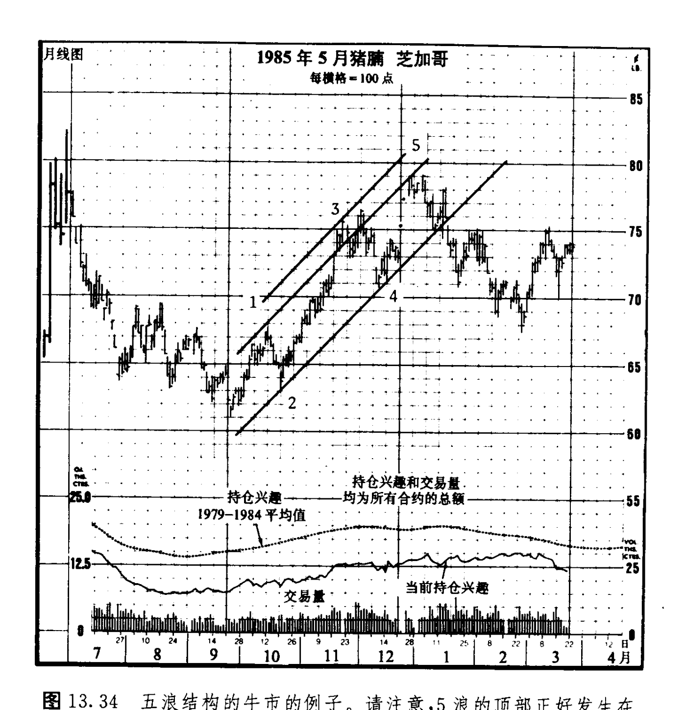
> 图13.34 五浪结构的牛市的例子。请注意，5浪的顶部正好发生在第一条管道线上（Courtesy of Commodity Research Bureau, a Knight-Ridder Business Information Service.）。 <!-- pdf p386 / 书页 371 --> 

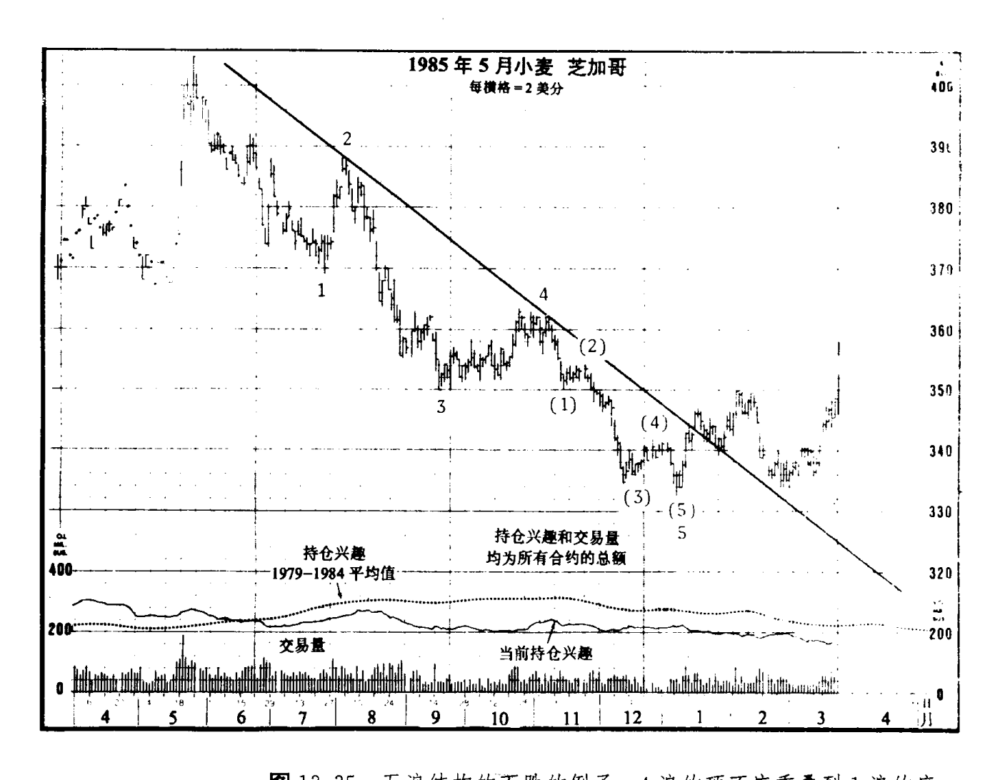
> 图13.35 五浪结构的下跌的例子。4浪的顶不应重叠到1浪的底。如果朋友们更仔细地观察的话，那么，5浪本身也可以细分成5个小浪。最佳的趋势线常常是连接2浪和4浪而成的（Courtesy of Com-modity Research Bureau, a Knight-Ridder Business Information Service.）。 <!-- pdf p387 -->

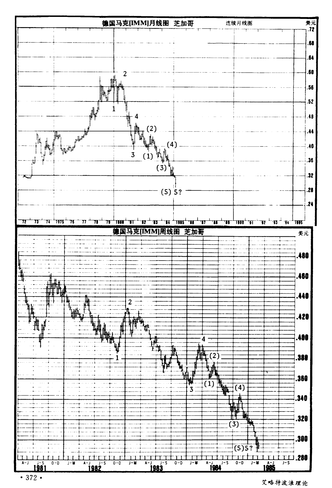
> 图13.36（前一页）上图为月线图，其中展示了5个向下的主要浪，且最后一浪也可细分为5个小浪。下图为周线图，是上图的更详细的情况。请注意其中所有的五浪结构的下跌。自 1984年早期开始的最后一轮下跌也可细分为5小浪，这意味着市场底部可能为时不远了 （Courtesy of Commodity Re-search Bureau, a Knight-Ridder Business Information Service.）。

<!-- pdf p388 / 书页 373 -->

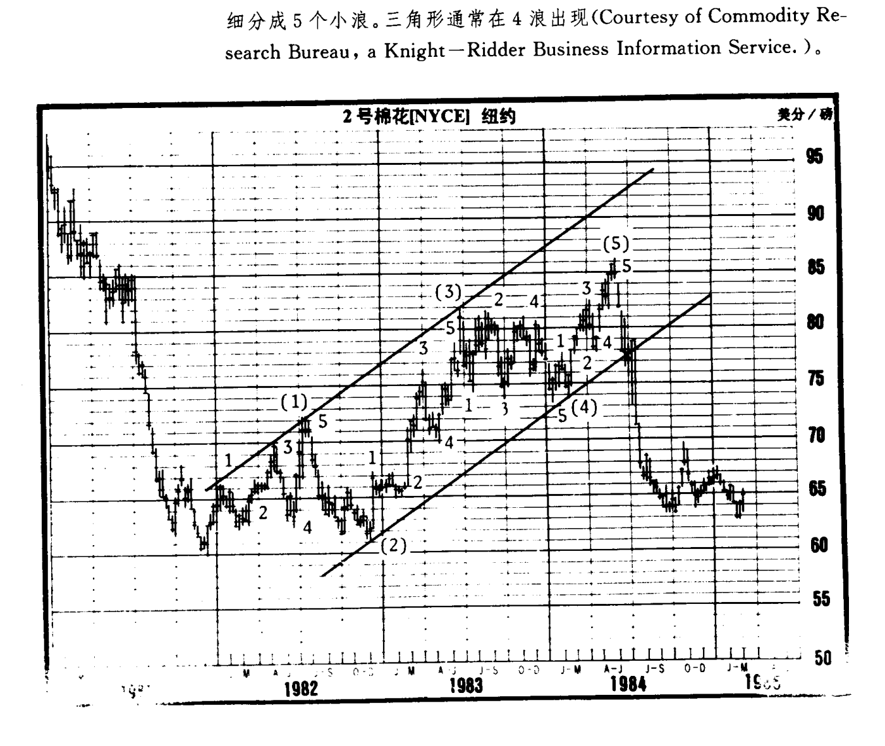
> 图13.37 五浪结构上升的另一例。请注意管道线。还请注意，其中每个主浪（上升浪）均细分为5个小浪。4浪为三角形巩固形态，其中也可细分成5个小浪。三角形通常在4浪出现（Courtesy of Commodity Research Bureau, a Knight-Ridder Business Information Service.）。

<!-- pdf p389 / 书页 374 -->

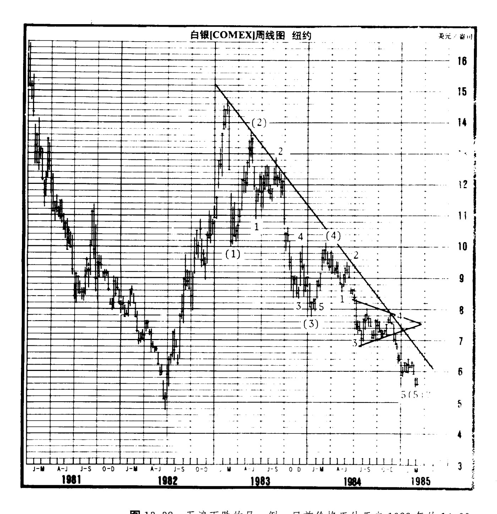
> 图13.38 五浪下跌的另一例。目前价格正处于自1983年的14.00以上的高点开始的下跌过程的第5浪。请注意主浪3是如何分成5个小浪的。第5主浪始于10.00附近，看起来也可细分为5个小浪。注意最后这一浪的4浪的三角形 （Courtesy of Commodity Research Bureau, a Knight-Ridder Business Information Service.）。 <!-- pdf p390 / 书页 375 --> 

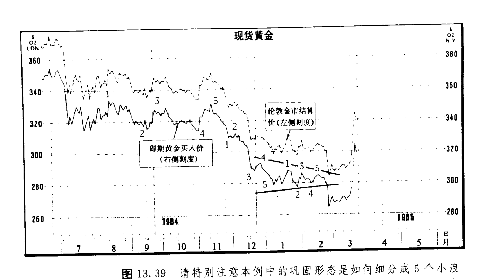
> 图13.39 请特别注意本例中的巩固形态是如何细分成5个小浪的。本图中底部附近（1月/2月）的对称三角形具有5个小浪。三角形通常先于最后一浪出现 （Courtesy of Commodity Research Bu-reau,a Knight-Ridder Business Information Service.）。

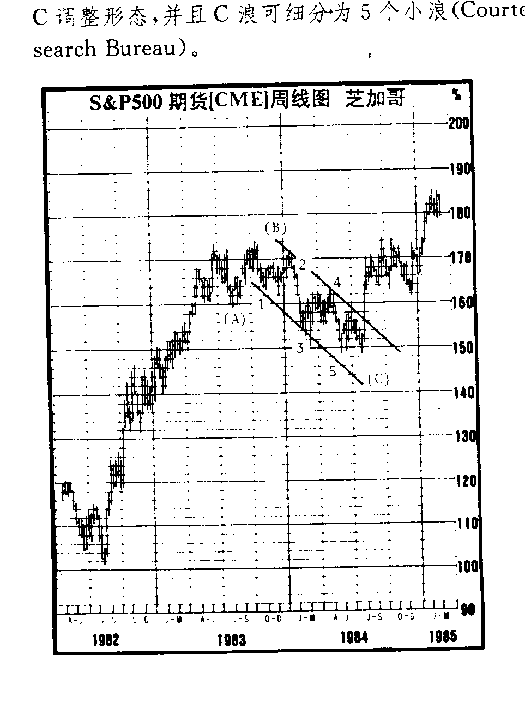
> 图13.40 在这张周线图上，为期13个月（这是个菲波纳奇数字）的调整只不过是38%回撤，之后市场再度上升。请注意其中典型的A-B-C调整形态，并且C浪可细分为5个小浪（Courtesy of Commodity Research Bureau）。

<!-- pdf p391 / 书页 376 -->

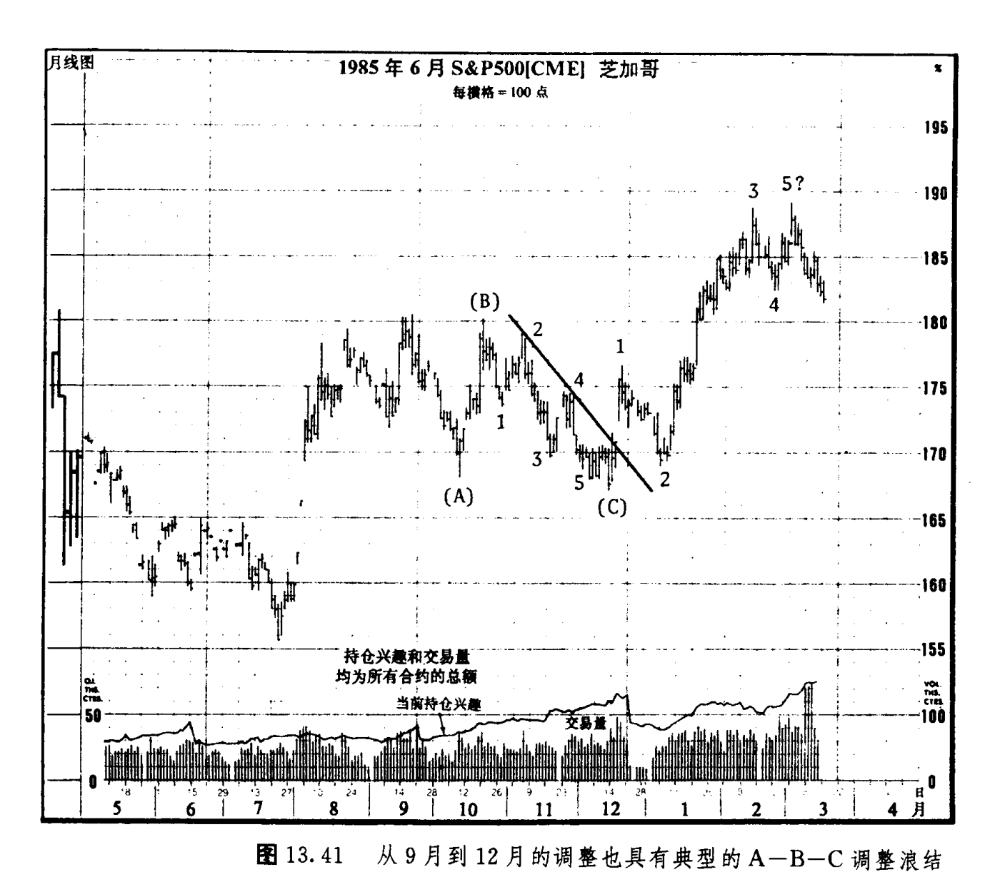
> 图13.41 从9月到12月的调整也具有典型的 A-B一C 调整浪结构。其中C浪细分为5个小浪。这一向下的调整属于50%回撤。注意，之后的上涨可能已经完成了5个小浪 （Courtesy of Commodity Research Bureau, a Knight - Ridder Business Information Ser-vice.）。

## 菲波纳奇扇形线、弧线及时间区

借助于 Compu Trac 的技术分析软件，我们能够应用以下三种菲波纳奇概念——扇形线，弧线，以及时间区。前面我们对时间区已有介 <!-- pdf p392 / 书页 377 --> 绍。图中的竖直线标志着菲波纳奇时间区。具体做法是，从显著的顶或底起，向后数算一定的菲波纳奇时间间隔。于是，从起点出发，这些竖直直线依次向右出现在与数字5、13,21，34,55,89，144，233 等等相对应的位置上。其中，我们跳过了菲波纳奇数字1,2，3。如此做法的目的在于标识出可能出现趋势性变化，或者当前趋势恢复的菲波纳奇时间目标。

菲波纳奇扇形线的构造方法与速度线的颇近似（关于后者第四章有介绍）。首先，我们在图上标出上下两个极端的点（通常是市场的重要顶点和底点）。然后，我们从第二个点起，向第一个点引出一条垂直的线段。接着，按照38%，50%和62%的比例，划分垂直线段。再从第一点出发，分别通过这三个分点，连成三条直线。在以后的市场反弹中，这三条直线分别标志着38%，50%以及 62%菲波纳奇回撤位置，将起到支撑和阻挡的作用。

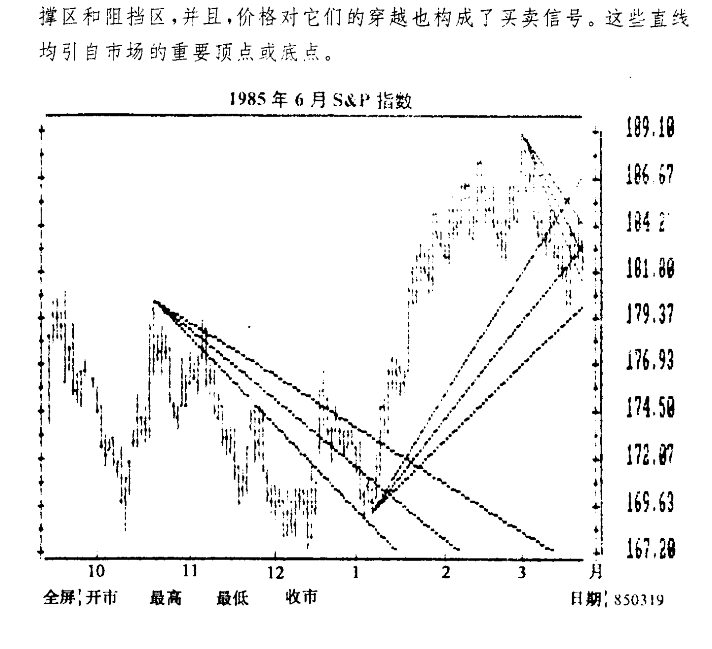
> 图13.42 菲波纳奇扇形线的例子。这些直线的作法与速度线类似。但它们所标志的是38%、50%、和62%回撤。我们可以用它们来确定支撑区和阻挡区，并且，价格对它们的穿越也构成了买卖信号。这些直线均引自市场的重要顶点或底点。

<!-- pdf p393 / 书页 378 -->

菲波纳奇弧线体现了时间因素。这也是一种回撤测算技术，其构造方法与扇形线的类似。先找出一个顶点和一个底点，然后以其中一点为圆心，按照菲波纳奇参数，38%，50%，62%，从两点之间的垂直线段上截得三个半径，分别画出三条弧线。这三条弧线从时间和价格两方面标识了可能出现支撑或阻挡的位置。通常我们要把弧线和扇形线结合使用，另外，还可以协同地使用时间区。因为三种工具都是测算重要支撑和阻挡区的，所以，如果其中两种或三种线条重合在同一位置上，那么其趋势信号就会较强。如果朋友们仔细考察一下这里所附的图表，就能对这些概念有较好的理解了。显然，大家必须进行相当多的尝试，才能学会如何把这几种稍显复杂的菲波纳奇工具融会到自己的市场分析中去。计算机加上 Compu Trac 软件使这项工作相对便当了些。图 13.42到13.49就是用 Compu Trac 软件制作出来的！

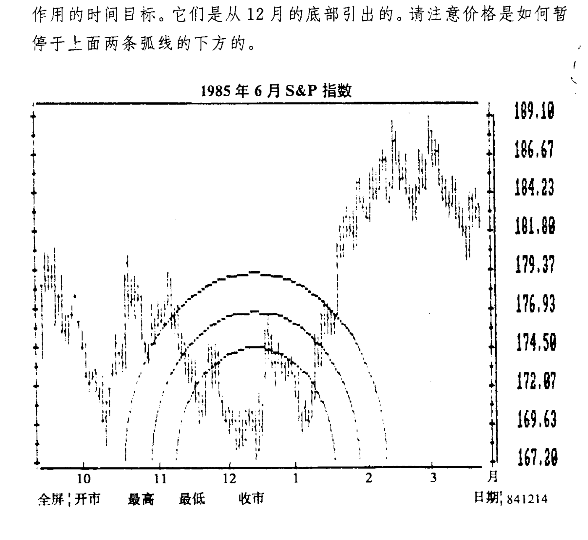
> 图13.43 菲波纳奇弧线的例子。其中的测算思路与其扇形线的类似，以38%、50%、和62%回撤为基础。这些弧线有助于判定支撑和阻挡所作用的时间目标。它们是从12月的底部引出的。请注意价格是如何暂停于上面两条弧线的下方的。

<!-- pdf p394 -->

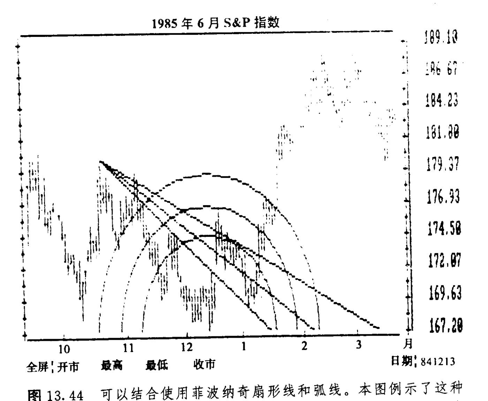
> 图13.44 可以结合使用菲波纳奇扇形线和弧线。本图例示了这种情形。只要是扇形线和弧线相吻合的位置，就标志着较强劲的支撑或阻挡区。

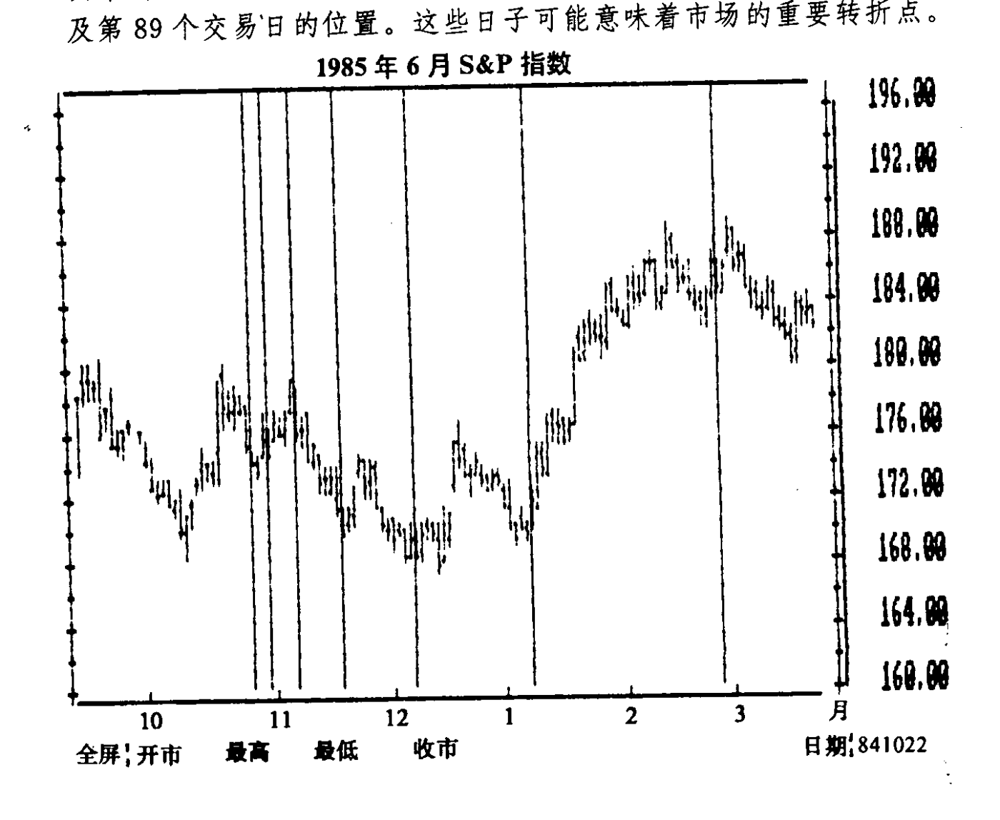
> 图13.45 从重要的市场顶部或底部起向未来数算，可得出菲波纳奇时间目标。在本例中，菲波纳奇时间目标是自10月的峰起测出的。图中的垂直线分别标志着未来第5、第8、第13、第21、第34、第55、及第89个交易日的位置。这些日子可能意味着市场的重要转折点。

<!-- pdf p395 / 书页 380 -->

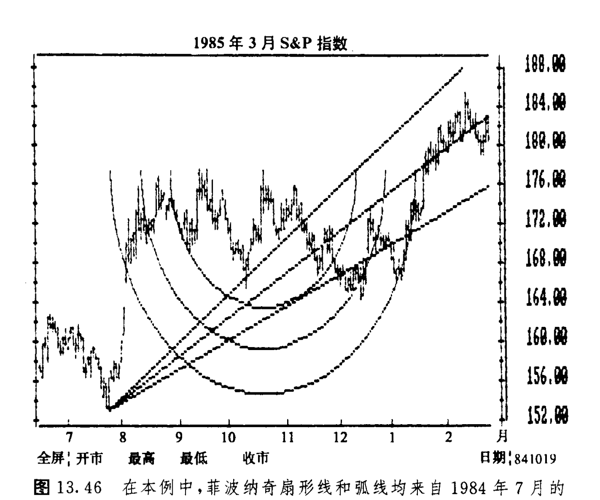
> 图13.46 在本例中，菲波纳奇扇形线和弧线均来自1984年7月的低点和10月的高点。请注意，其中的弧线提供了市场下方的支撑区，有助于揭示市场转折的时间。

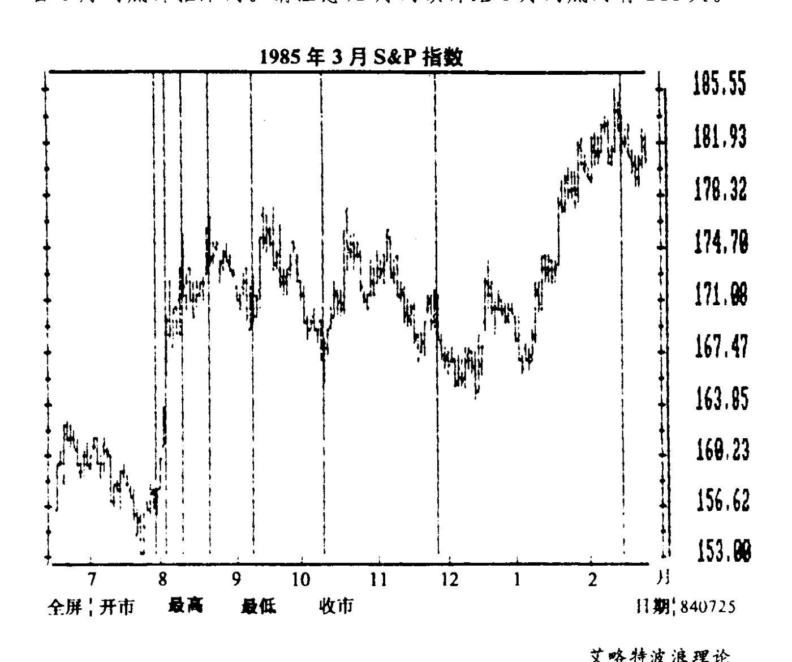
> 图13.47 菲波纳奇时间目标在上图中的应用。请注意，这些时间目标中有一部分很好地揭示了一些市场转折点。这些菲波纳奇时间目标是自8月的底部推来的。请注意，2月的顶部距8月的底约有144天。

<!-- pdf p396 -->

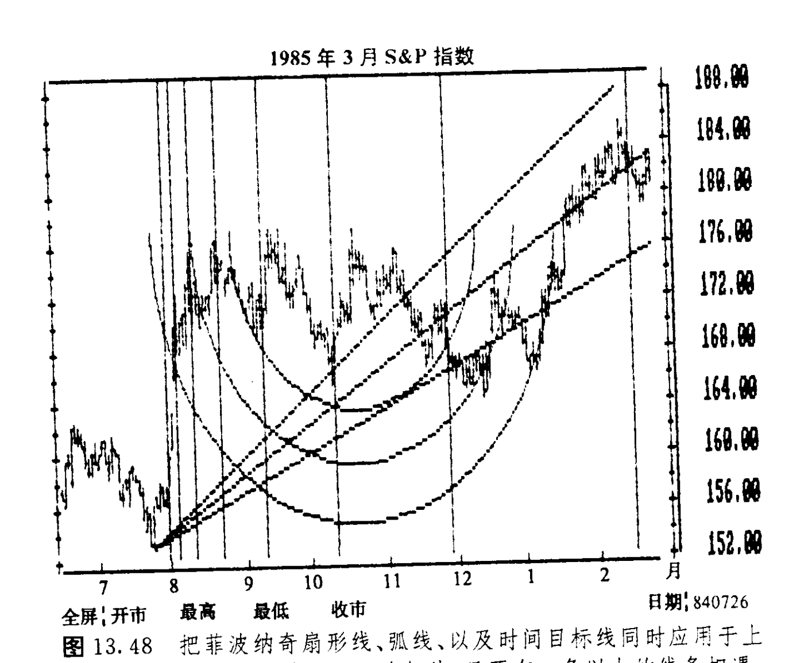
> 图13.48 把菲波纳奇扇形线、弧线、以及时间目标线同时应用于上两例中的价格图表的情形。无论何处，只要有一条以上的线条相遇，则构成较强的信号。

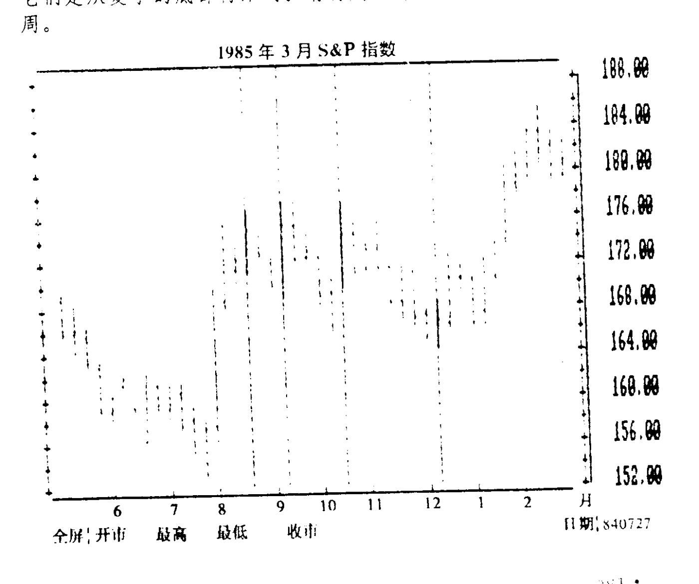
> 图13.49 把菲波纳奇时间目标应用于相同的期货合约的周线图的情形。实质上，每个垂直的菲波纳奇时间目标线都代表了市场的转折点，它们是从夏季的底部得来的。请特别注意，12月的底距夏日的底21周。
