# 第十五章 计算机和交易系统

> 原书 PDF 第 435–463 页。OCR 自扫描件，图表已截取到 `images/15/`。

<!-- pdf p435 / 书页 420 -->

## 引言

在技术分析和商品期货交易中，计算机日益担负起越来越重要角色。在本章中，我们要说说它的优越性。计算机为分析者准备了各种技术工具，使用起来极为便捷。而数年之前，这些工作需要花费大量的人力。当然，也得用户知道如何使用这么多的工具才行，这一点倒是计算机的不利之处。

如果用户对各种指标的理论基础没有适当的理解，不熟悉各种指标的研读方法，那么这一大堆计算机软件非叫他晕头转向不可。更糟糕的是，有的朋友因为手头上有大量的各种技术信息，有时会产生一种错觉，以为这样一来自己就占了上风。看着面前一大堆令人眩目的终端、键盘，难免飘飘然，俨然自己已成了技术分析大师。

我这里要强调的是，如果用户已经掌握了技术分析的基本概念，那么计算机就会使他如虎添翼。事实上，如果考察一下各种计算机程 <!-- pdf p436 / 书页 421 --> 序，我们就会看出，其中许多的工具和指标都相当地基本，都是我们前面各章中所介绍的内容。当然，也有一些复杂的工具，非得借助计算机不可。

我曾听到一些计算机交易者说，没有计算机，就没法做交易。我不敢苟同。早在计算机还是孕育于科学家脑子里的一点点灵感之前，交易商就在市场上沉浮了。实事求是地说，如果没有计算机掺和的话，在技术分析和实际交易中有很多事情可以做得更好。有的工作我们只需要用到一张图、一把尺，比计算机方便得多。有些长期性分析根本用不着计算机。就事实而言，如果我们要分析市场，那么在打开计算机之前，就应该已经完成了大量的技术分析工作了。计算机尽管有用，却只是工具而已。它可以帮助优秀的技术分析者百尺竿头、更进一步。然而，它却不能使蹩脚的分析者脱胎换骨。

### Compu Trac 软件

在前几章，我们曾经提到几种 Compu Trac的软件。目前这个软件最负盛名，是现有的最周详的技术分析系统。因此，我们将主要以此为例，来看看计算机的工作情况。首先，我们先谈一谈该系统的计算机硬件的配置。然后，我们再检讨一下其中现有的各种工具和指标。接下来，我们再介绍一下它的附属特点，比如其中可供用户选择的各种自动功能。计算机不但提供了各种技术研究途径，而且也便于我们对它们进行获利能力的检测。这一点正是计算机的优化能力之所在，从而，也构成了它的最有价值的特征。如果用户懂得编制程序的方法，那么还可以不囿于已有的软件，创造自己的指标和系统。

### 韦尔斯•王尔德的方向性运动系统和抛物线系统

我们还要仔细考察一下韦尔斯•王尔德的较为流行的“方向性运动系统”和“抛物线系统”。在我们的讨论中，将以这两个系统为例，来评价自动交易系统的优缺点。我们将看到，自动的趋势顺应系统唯有在特定的市场环境中才能表现良好。另外，我们还要说明，也可以把自动系统简单地用作验证性的技术指标，纳入我们的市场分析中。

### 人工智能形态识别

在我们给出的每张菜单上，都有如此之多的指标可供选择，朋友 <!-- pdf p437 / 书页 422 --> 们或许会吃惊不已。计算机不是让我们活得更便当，而是摆出了这许多花样，其中每一样都要好好去研究，这不是把事情弄更麻烦了吗？例如，Compu Trac 大约提供了 40 种研究。如果我们指望这么多资料都相互验证之后，才下结论（以及寻求交易时机）的话，行得通吗？人工智能形态识别或许可以解决这个问题。它是利用计算机的逻辑能力开发出来的复杂系统，能够从许多指标中选取最佳的组合，并加以利用。对这个方面，我们也要稍作介绍。

## 一点计算机常识

我们可以把 Compu Trac 应用于各种金融工具，包括股票、期权、以及期货。我们这里主要意在期货。可以把它配置在IBM 个人微机PC、XT、AT等机型、它们的兼容机、以及苹果机上。我们以 IBM-PC机型为例。本系统采用菜单指令方式，易于操作。就是说，我们可以不断地通过选择菜单上开列的功能，进行各种操作。PC 机有两个软盘驱动器，因此，我们需要两张软盘才能工作。在A驱动器中，装 Compu Trac 软件包。在B驱动器中，装数据文件。

Compu Trac 并不提供即市数据。用户需要从别的途径搜集数据。我们既可以把数据人工地输入到数据盘上，也可以通过电话线从资讯服务中自动读取数据（需要加装电话转换器）。建议朋友们采用自动的数据服务方式。Compu Trac 对各家数据服务系统都作了介绍。它们也提供为了传输数据、建立文件所需的软件和设备。

刚开始的时候，用户至少应该搜集过去数月的价格资料，以免无米可炊。以后，新的资料逐日地加入。如果把计算机与报价系统联网，那么它也能够“在线”地分析市场的即时价格。不过，在我们的例子中，只谈逐日搜集的数据。这些数据要在闭市后才能得到。最后，我们还需要一台打印机，要能打印出屏幕上的各种内容。如果我们接上绘图仪，则可以画出彩色图表来。

## 分析工具

下面我们来简要地介绍一下它所包含的各种工具及其各种选择。这个软件可以分别按照日内的、逐日的、逐周的、逐月的、逐季节的、以及逐年的形式来显示资料。日间图表共有三种格式。例如标准的江恩格式，其中每根价格线段相继排列，不给节假日和周末留出空白。也有 <!-- pdf p438 / 书页 423 --> 每周七天的格式，主要用于周期分析，在这种形式里，节假日和周末都在图表上空了出来。在周间图表上没有空白问题，但用户也可以人为地以选择一天作为每周的起始日。

让我们浏览一下各种菜单。菜单1是主菜单（见图15.1）。最左列的那串数字（从F1到F8）是 IBM 键盘上左侧的键（记住，我们现在说的是 Compu Trac/pc 软件）。其中每个按键都对应着一定的功能，敲击一下即可把它激发出来。下面是每项的概要介绍。

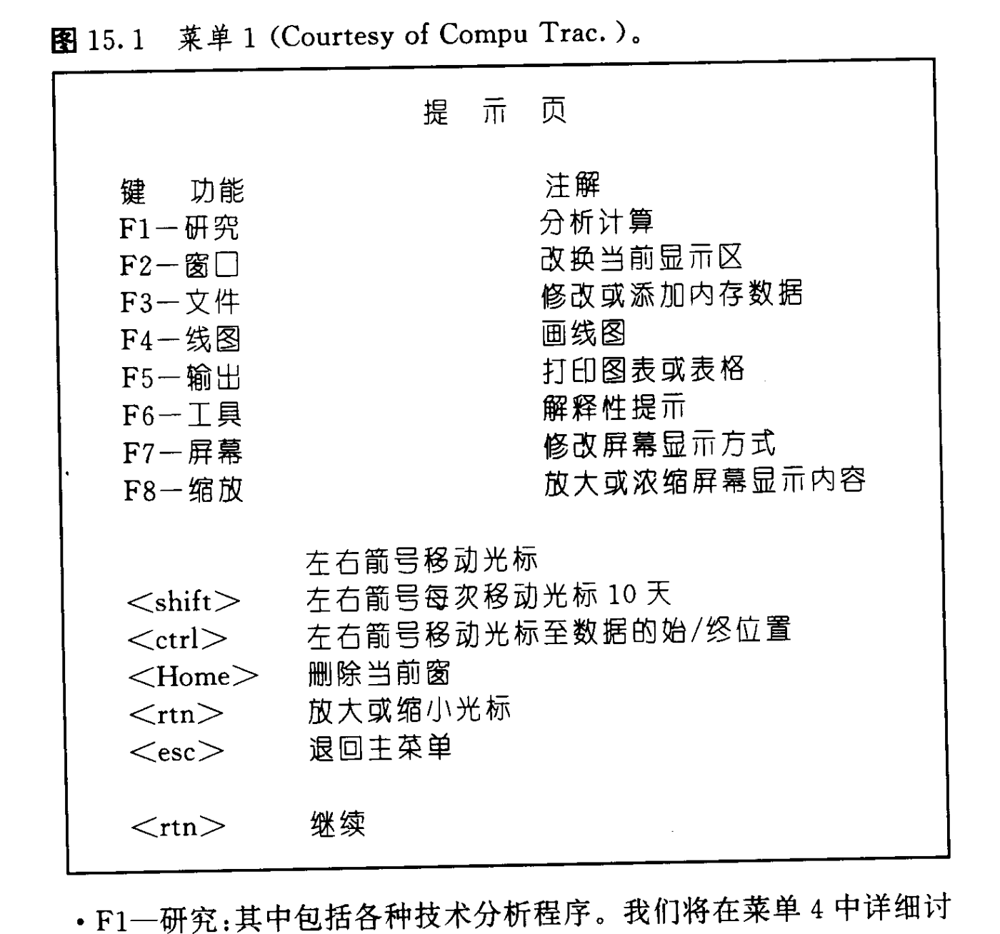
> 图15.1 菜单1（Courtesy of Compu Trac.）。

- F1—研究：其中包括各种技术分析程序。我们将在菜单4中详细讨论。
- F2—分窗：用户有两选择——全屏幕显示或分屏幕显示。在我们进行某些分析时，比如摆动指数分析，需要把屏幕分成两个窗口。
- F3—文件：把数据文件读入内存。
- F4—线图：在“当前窗”显示线图。所谓当前窗，在全屏显示情况下，即整个屏幕，在分屏显示状态则为其中之一，由用户选择。
- F5—输出：从打印机上获得各种硬拷贝。既可以印出屏幕上的图表，也可以打出屏幕下方对应于图表的数据表。 <!-- pdf p439 / 书页 424 -->
- F6—工具：各种分析工具。我们在菜单3中再讲工具子菜单。
- F7—屏幕：各种屏幕显示方式。
- F8—扩缩：放大或浓缩屏幕显示方式。如果“放大”，则可以取得放大的效果，进行局部研究；如果“浓缩”，则屏幕上将增加数据显示，以进行较长范围的考察。

菜单下方是其它的注解，其中包括光标的移动等。我们可以把光标置于屏幕上的任何位置上。在屏幕下方，将显示光标所在日期的各种资料。把光标前后移动，我们就能读出各日的数据。翻动功能能够将光标移动到图表的最左端，从而显示更多的历史资料。在使用某些分析工具时，比如作趋势线等，我们可能也要移动光标。如果用户想在图表下面看到日期而不是价格，那么按F7键（屏幕）就行了。

在上述主菜单状态，按F7键，则进入菜单2状态（见图15.2）。这里也一样，只要我们敲击各个键就可以完成相应的功能选择。例如，通过F1（图解），用户可以在图表下方选择显示数据或日期。所谓数据，包括当前光标所在日期的价格、交易量、持仓兴趣和技术指标的数值。请注意，用户可以通过F3（对数）键，把价格轴从算术刻度变换成对数刻度，构成半对数图表。利用对数刻度，我们可以把在算术刻度下挤成一团的价格图线理清楚，以便分析。F7（模式）键是用来切换屏幕显示精度的，我们可以在中、高分辨率之间进行选择。在彩色状态下，我们只能采用中分辨率。

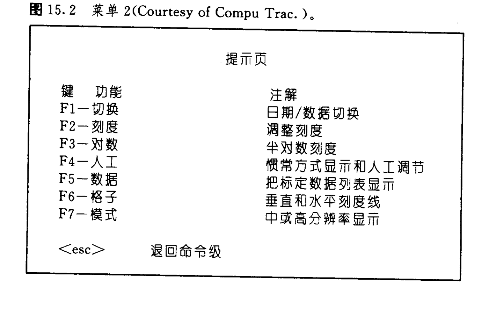
> 图15.2 菜单2（Courtesy of Compu Trac.）。

<!-- pdf p440 / 书页 425 -->

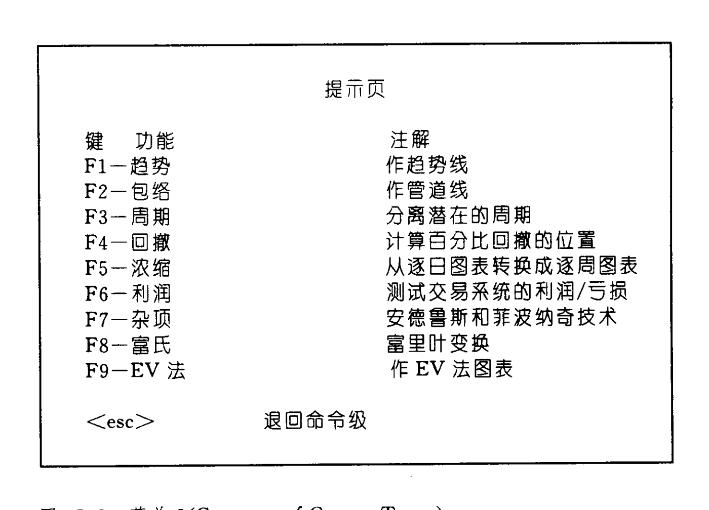
> 图15.3 菜单3（Courtesy of Compu Trac.）。

## 工具菜单

在主菜单状态下按下F6键，则进入工具子菜单。本菜单（菜单3）是我们进行技术分析的要害部分。

- F1—趋势：作趋势线和管道。用户通过光标在图上选择画线的点。
- F2—包络：在价格图线上方或下方作出平移的包络线，比如移动平均线包络线（见第九章）。
- F3—周期：在图上标注周期（见第十四章）。
- F4—%回撤：在选定的高低点之间标注百分比回撤的位置。用户必须先选择好高低点。后面，我们还要详细解说这一点。
- F5—压缩：可以由逐日图表格式而变换成逐周图表格式，进而逐月图表格式。
- F6—利润：进行获利能力的测试（我们事先必须在本程序的另一部分，“获利力测试部分”做好预置工作）。
- F7—杂项：其中包含各种复杂的技术工具，如菲波纳奇弧线、区域、时间区（见第十三章）、以及安德鲁长叉等。
- F8—富氏：进行富里叶分析。这是一种复杂的统计学工具，主要用于 <!-- pdf p441 / 书页 426 --> 鉴别周期（见第十四章）。
- F9—EV图：绘制交易量加权日线图。把日线图中的竖直线段变换成长方形小框，其宽度表示当日的交易量。交易量越重，则当日的价格框越粗。这也是显示交易量信息的一种方法。

以上我们谈到了在屏幕上显示数据的各种方式，以及适用于这些方式的一些研究工具。朋友们已经看到，其中许多工具，象趋势线和百分比回撤，我们都相当熟悉。还有的呢，如安德鲁长叉、富里叶分析、EV图等，或许有些陌生（图15.13a和b到15.14a和b是这些新工具的几个图例）。计算机的好处就在于能够便当、快捷地完成上述功能。然而，效果如何，依然完全取决于用户能否把这些工具揉合到自己的分析中。另外，我们也没有必要把这些工具使用个遍。朋友们不妨根据自己的交易风格和思路，从中选择最合适的工具。下面我们就来考察一下其中各种研究手段。

## “研究”手段的选择

在主菜单（菜单1）状态下我们敲击F1，就进入到“研究”子菜单。在这里我们可以进行各种推算和分析。菜单4就是进行技术性研究的子菜单。其中共有29种选择。只要按我们一下相应的键，就可以进入各种分析方法的下一个子菜单，进行下一步选择。例如，“交易量”（第2页之 A键）敲完后，我们便看到以下子菜单：

A. 简单

B. 刷形图

C. OBV 法

D. 交易量累积（VA 法）

E. VA 法摆动指数

我们可以分别以实线、刷形图（这是通用的格式）、OBV 法、VA法、VA 法摆动指数（在第七章中我们均有介绍）等形式，把交易量资料显示出来。

“移动平均”（N键）敲完后，用户就得到以下选择。

A. 简单

B. 加权

C. 指数加权 <!-- pdf p442 / 书页 427 --> 

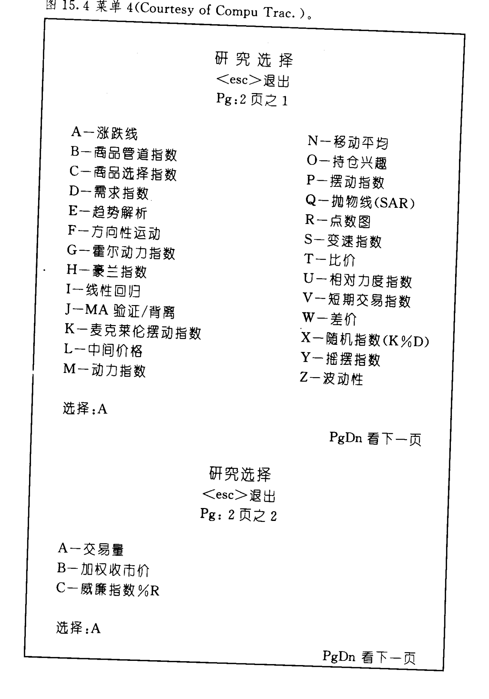
> 图15.4 菜单4（Courtesy of Compu Trac.）。

在每种情况下，用户都必须选择计算平均值的对象（比如最高价、最低价或者收市价）。我们还可以把移动平均线应用到任何一组数据或者某种已构造好的技术指标上去，比如 OBV交易量、各种摆动指数、或者甚至某种差价等。用户也必须定义采用平均线的条数，以及每条平均线的时间跨度的天数。最后，还需要选择一下平均线的位置， <!-- pdf p443 / 书页 428 --> “取中”呢，还是依照通常的做法（我们在第九章讨论过移动平均线）。

绝大多数研究手段都要求用户定义计算式中的天数。不过，通常系统也提供缺省值，即软件本身针对各种研究，预备好了一定的数值。例如，在进行随机指数分析时，缺省值为5天，而相对力度指数（RSI）的缺省值是14天。缺省值在屏幕上有显示，用户简单地按一下回车键，就表示接收缺省值。如果用户对某种研究不熟悉，不会选择最佳的输入数值的话，这一缺省值特点就特别有帮助。用户通过试验，可以调整或优化这些参数，以适应自己的需要。

我们这里不打算讲解所有的菜单。其中有些研究，如涨跌线法、豪兰指数、麦克莱伦摆动指数、短线交易指数（TRIN）等，主要应用于股市分析（采用纽约股票交易所的 NYSE 涨跌数字），我们这里不再作描述。大部分研究在前面各章中均有介绍。商品价格管道等指数（CCI）和需求指数基本上属于摆动指数的范畴（后者采用交易量进行计算）。趋势解析和霍尔动力指数，在关于周期的第十四章中我们讲过。移动平均线相互验证／背离指数（MACD）、动力指数（价格之差）、移动平均线摆动指数（两条平均线之距离）、变速指数（ROC）、相对力度指数（RSI）、随机指数（K%D）、以及威廉斯指数（%R），在第十章“摆动指数”中，我们也都讨论过。另外，关于移动平均线、持仓兴趣、交易量、点数图、比价、以及差价等就更不用说了。最近，这个软件包中又添置了商品选择指数、线性回归、中间价格、摇摆指数、以及波动性指数等研究手段。

## 韦尔斯•王尔德的抛物线和方向性运动系统

在这里，时间和篇幅都不允许我们对上述29种研究逐一地仔细分说。不过，其中还是有两种研究值得我们进一步地探究一下。它们都是J•韦尔斯•王尔德爵士创立的，在他的《技术型交易系统新思路》（趋势研究版，1978年）中有介绍。在这本书中，还包括了王尔德对另外三种研究的见解。这三者也被包括在 Compu Trac的菜单中——商品选择指数、相对力度指数、摇摆指数。

### 抛物线系统（SAR）

王尔德的抛物线系统属于时间、价格反转系统，始终“在市”。 <!-- pdf p444 / 书页 429 --> “SAR”这串字母表示“止损并反做”（Stop And Reverse），意思是我们在执行保护性止损指令的同时，也顺着原头寸的反方向再开新头寸。这也是一种趋势顺应系统。它的名称来自它的外观，当它跟踪市场的时候，其止损点的轨迹与抛物线类似（见图 15.5到15.8）。注意，当价格上涨的时候，抛物线系统的点子（即止损并反做点）居于价格下方，也呈升势，但它开头往往步调较慢，然后才跟上趋势的变化。在下降趋势中，道理也一样，而方向相反（点子在价格上方）。系统也可以为用户提供下一天的 SAR 价位。

王尔德为本系统设置了一种加速因子。他把每天的止损点都顺着趋势方向有所升降。在趋势刚萌发的时候，止损点位置的变化相对较慢，从而为新趋势的巩固留出了时间。之后，随着加速因子的增长，SAR 点位变化的步调也相应地加快，直至赶上价格变化的速度为止。如果趋势出了问题，那么结果通常是出现止损并反做的信号。正如这些图例所示，在趋势环境下，抛物线系统的工作效果奇佳。在图15.5和15.6中，请注意，在德国马克和原油市场上，该系统跟踪趋势效果何其漂亮。但是，在图15.7 和图15.8分别所示的 S&P500 指数和美国政府债券市场的例子中，情况就有所不同了。在两个市场上，在其趋势良好的部分，该系统效果优良，而在横向伸展的无趋势阶段，却接连地发生拉锯现象。

在 S&P500市场（如图15.7所示）上，请注意，从12月到下年1月，属于横向延伸阶段，该系统频频“拉锯”。随后，在1月上旬，它给出了绝好的买入信号；但2月以后，该系统却变本加厉，出现了更多拉锯现象。这张图很典型，充分显示了大多数趋势顺应系统的长处和短处。这些系统在市场处于强烈的趋势状态时，表现颇佳。但是据王尔德本人的估计，这样的市场阶段大约只占到市场总时间的30%。如果他的判断合乎实际的话，那么就等于说，趋势顺应系统在70%时间内效果不如人意。到底我们如何处理这个进退两难的困局呢？

### 方向性运动指数（DMI）

如果我们能够选用某种过滤器或者某种措施，预先确定市场是否处于趋势状态的话，问题可能就解决了。这一点正是王尔德设计方向性运动指数的动机（见图15.9）。方向性运动指数标志着每个市场方向性运动（趋势）的多寡，借助它我们可以比较各个市场的趋势性程度。王尔德利用 ADXR 线，按照从0到100的读数刻度，把各个市场的方向性运动情况加以评级。ADXR 线越高，就表示该市场的趋势性越强，因而就能充当趋势顺应系统更好的用武之地。在图15.9中，上下两条ADXR 线分别对应于前面所讲的 S&P500指数和德国马克市场。从上 <!-- pdf p445 / 书页 430 --> 

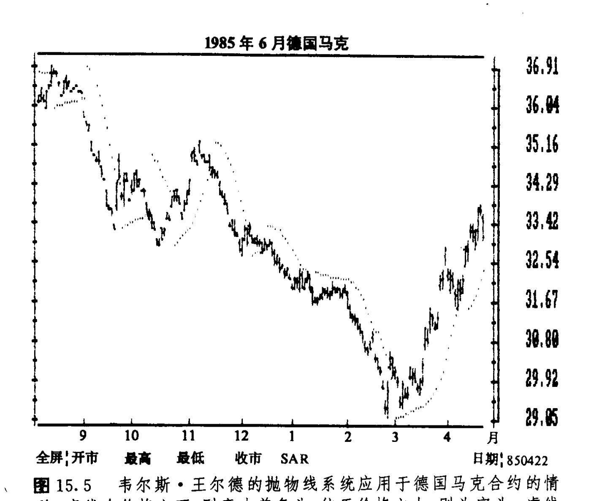
> 图15.5 韦尔斯•王尔德的抛物线系统应用于德国马克合约的情形。虚线在价格之下，则意味着多头；位于价格之上，则为空头。虚线的点代表SAR（止损并反做点）。本系统连续在市。与所有的趋势顺应系统一样，本系统在趋势市场中工作状况最佳。

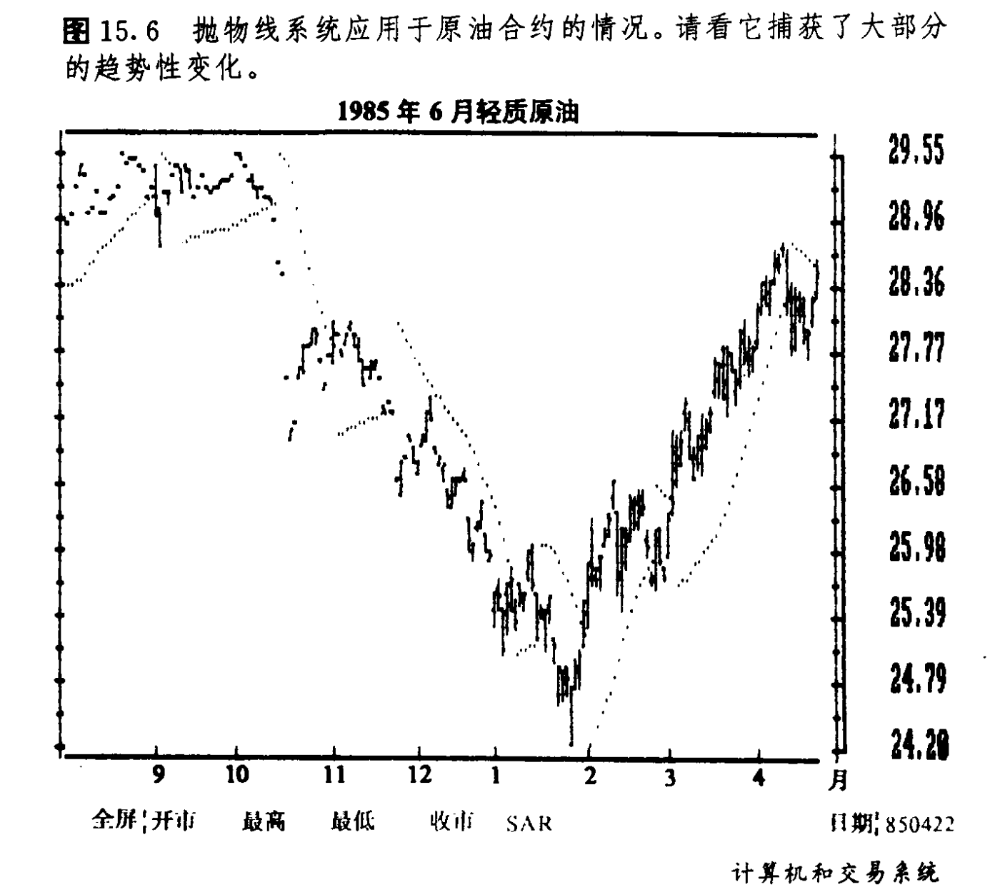
> 图15.6 抛物线系统应用于原油合约的情况。请看它捕获了大部分的趋势性变化。

<!-- pdf p446 / 书页 431 -->

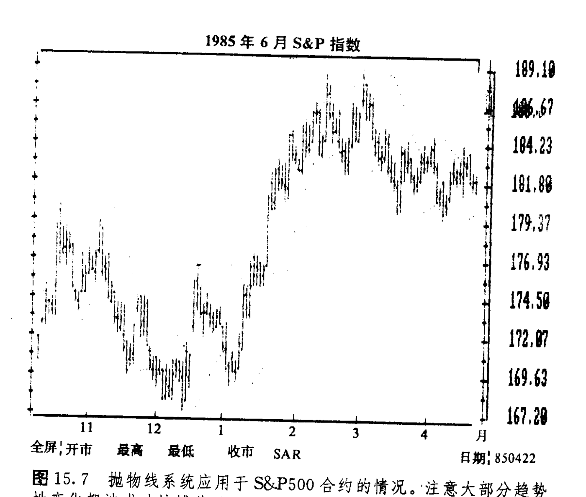
> 图15.7 抛物线系统应用于S&P500合约的情况。注意大部分趋势性变化都被成功地捕获了。但是，在市场横向伸展阶段（从12月到1月以及从3月到4月），该系统出现了相当多的拉锯现象。在没有趋势的市场状况下，趋势顺应系统效果不理想。

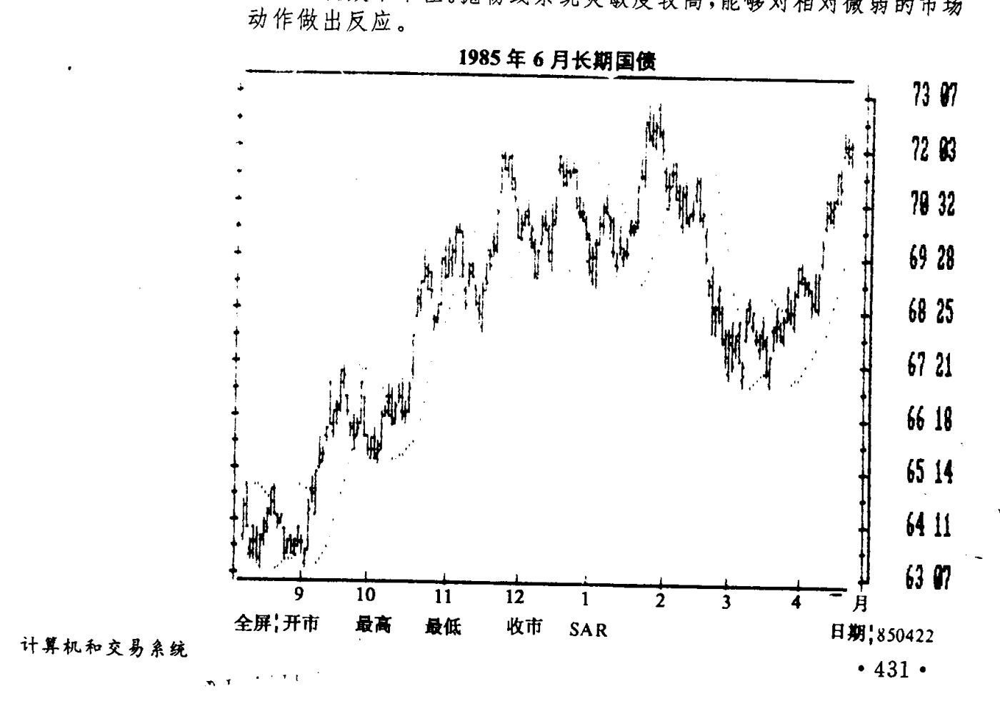
> 图15.8 请注意，从12月到1月，当市场处于横向延伸阶段时，抛物线系统效果不佳。抛物线系统灵敏度较高，能够对相对微弱的市场动作做出反应。

<!-- pdf p447 / 书页 432 -->

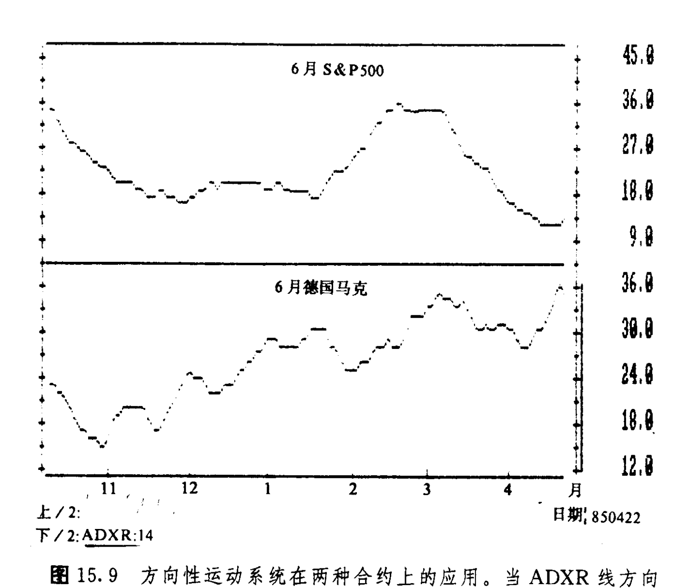
> 图15.9 方向性运动系统在两种合约上的应用。当 ADXR 线方向向下，且低于20时（如 S&P合约的情况），表明市场不适合趋势型系统的操作。而当 ADXR 线向上时（如德国马克的情况），则表明市场具有强烈的趋势特性，非常适合趋势顺应系统的应用。

年的11月起，德国马克（下方的图线）表现出很强的趋势特点。如果ADXR 线很低（在20之下），则意味着市场处于无趋势状态，就不适合采用趋势顺应系统。S&P500指数合约正好做了这种情况的实例。此时此地，我们还是收起趋势顺应系统为好。

回头考察一下图15.5 和15.7，我们看到，抛物线系统在德国马克市场上成绩不坏，但在S&P500市场的后面部分却很差劲。本来，如果事先有方向性运动指数的话，趋势型交易商就可以及时地从股票指数市场全身而退，转而投入外汇市场。因为 ADXR 线的读数刻度是从0到100分布，所以，趋势型交易商只要径直地选择趋势程度最高的市场就行了。而对于方向性运动水平较低的市场，我们不妨采用非趋势系统（如摆动指数等）。

我们既可以把方向性运动指数用作一个独立的系统，也可以把它用作抛物线或其余趋势顺应系统的过滤器。在 DMI分析中，出现有两条线，一条是+DI，另一条是－DI。前一根线为正，度量市场向上的运动，后一根线为负，表示向下的运动。图15.10显示了这样两条线。其中实线表示＋DI，虚线即－DI。当＋DI线（实线）向上穿越-DI线（虚 <!-- pdf p448 / 书页 433 --> 

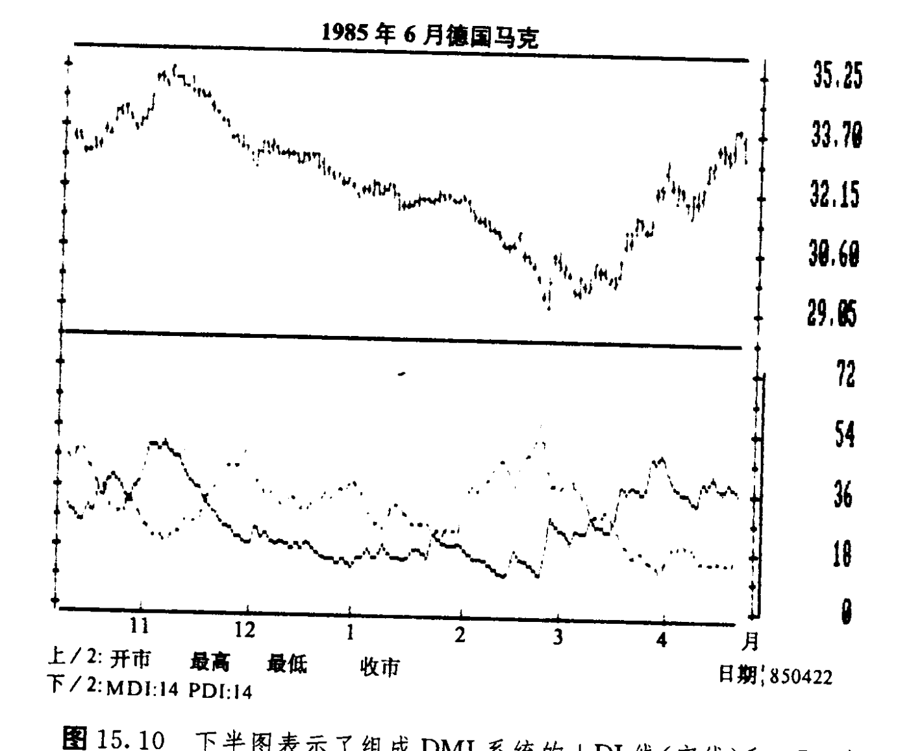
> 图15.10 下半图表示了组成DMI系统的＋DI线（实线）和－DI线（虚线）。当＋DI线向上穿越－DI线时，为买入信号。当＋DI线向下穿越－DI线时，构成卖出信号。目前，本系统指示“多头”。

线）时，构成买入信号，而当它向下穿过-DI线时，构成卖出信号。

图15.11a和b表示抛物线和方向性运动系统在黄金市场上的应用。请注意上图的抛物线，从上年11月以来，它共发出了8个买卖信号，其中不少属于拉锯现象。下图为同一时期的方向性运动指数，从11月来，是做空头的指示，而从3月中开始是做多头的指示，总共只有两笔交易。显然，抛物线系统更为灵敏，即其信号出现得既及时又频繁。无论如何，如果我们采用方向性运动指数作为过滤器，只在抛物线信号与方向性运动线的方向一致的情况下，才实施其信号，那么其中好些伪信号就可以避开了。由此看来，我们还是把抛物线同方向性运动系统综合起来使用为好。两者截长补短，相得益彰。

请注意图15.11b 的下半部分。这是ADXR 图表，其图线显示，从11月到2月，市场具有强烈的方向性运动的特征（曲线上升）：从2月上旬到3月上旬，趋势较弱（曲线下降）；之后，市场上重新出现了较强的趋势。趋势性系统的最佳工作时机是在ADXR线上升的时候。正如前面的图例所示，方向性运动系统和 ADXR 线并不怎么灵敏，因此，较适合于稍长线的趋势型交易商。王尔德还设计了另一种对市场趋势程度的评价方法，使之与短期的市场变化更合拍，这就是下面要介绍的商 <!-- pdf p449 / 书页 434 --> 

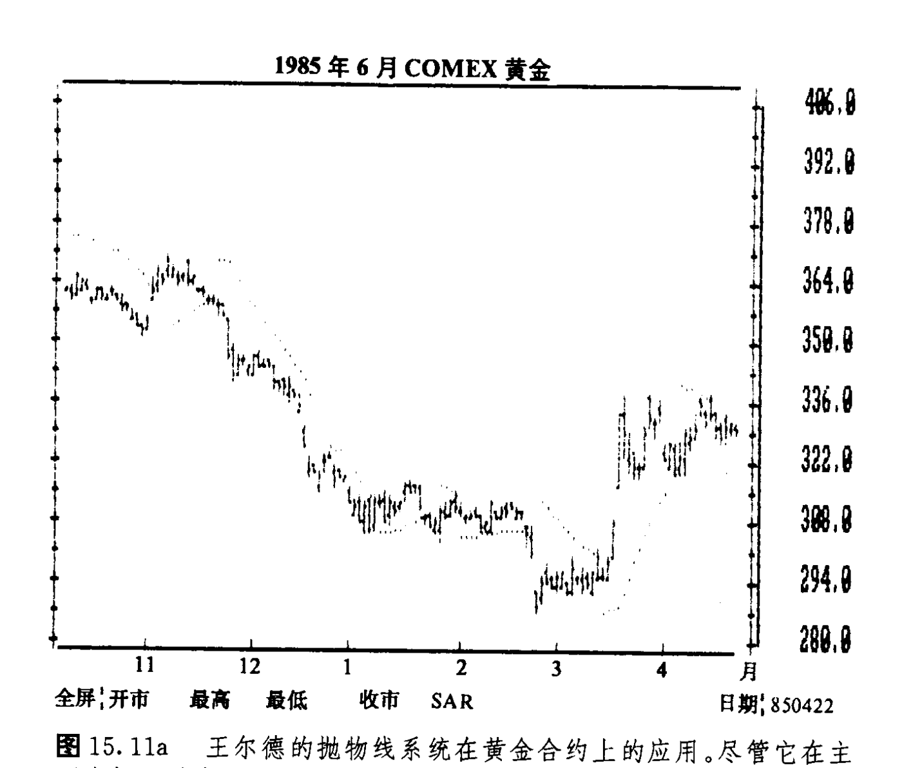
> 图15.11a 王尔德的抛物线系统在黄金合约上的应用。尽管它在主要市场运动中大为成功，但在趋势的短暂调整中，或当市场横向伸展时，也出现了数次拉锯现象。

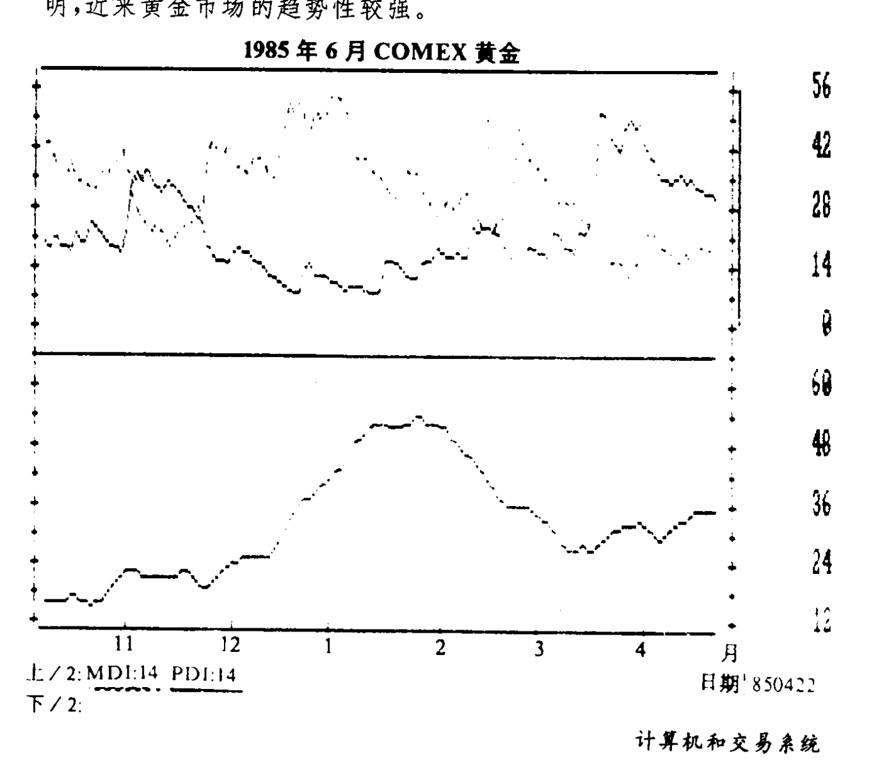

> 图15.11b 上半图显示DMI在上例图表上的应用。以 DMI系统作为过滤器，可以改进抛物线系统的工作成绩。下半图的ADXR线表明，近来黄金市场的趋势性较强。

<!-- pdf p450 / 书页 435 --> 品选择指数（CSI）。

### 商品选择指数（CSI）

王尔德在CSI的设计中，不但把方向性运动系统和 ADXR 线的算法移植过来，而且又增加了对波动性因子（所谓平均实际区间，ATR）、保证金要求、以及交易费用等因素的考虑。DMI意在为较长期的趋势型交易商服务，而 CSI则企图为短线交易者揭示波动性较强的市场。从 CSI可以鉴别“双高”市场：既有高的方向性运动特点，又有（相对于保证金要求和交易成本来说）高波动性特点。一般认为，无论从趋势性强弱的角度看，还是从波动性大小的方面来看，CSI水平高的市场都是很好的交易媒介。

以上介绍了王尔德的几种较出名的系统，给朋友们提供了一点基本的框架。如果有兴趣深入学习他的各种系统及其构造方法的话，不妨阅读王尔德的原著，相信朋友们一定不会失望的。

## 各种工具和指标分类

可想而知，面对花样如此繁多的研究手段，朋友们多少会有点无所适从。那么，下面我们就来整理整理，给它们分一分类：

- 基本的图表格式：线图、点数图、差价图、比价图
- 图表刻度：算术刻度和半对数刻度
- 线图：价格、交易量、以及持仓兴趣
- 交易量：简单形式、刷形图、OBV 法、VA 法、需求指数、EV 法等表示形式
- 基本的工具：趋势线和管道，百分比回撤，移动平均线，以及摆动指数。
- 移动平均线：参考包络线
- 摆动指数：商品管道指数（CCI）、动力指数、移动平均线摆动指数、变速指数、MACD、随机指数、威廉斯指数、RSI、VA 法、需求指数、霍尔动力指数
- 周期：霍尔动力指数、趋势解析、周期尺、富氏分析 <!-- pdf p451 / 书页 436 -->
- 艾略特波浪：菲波纳奇扇形线、弧线和时间区。
- 杂录：安德鲁斯长叉、线性回归、加权收市价、中间价格、波动性
- 王尔德：RSI、商品选择指数、方向性运动系统、抛物线系统、摇摆指数。

## 各种工具和指标的利用

这么多内容可谓千头万绪。如果我们满箩里挑瓜，那怎么下手呢？所以我们首先采用基本的工具，如价格、交易量和持仓兴趣、趋势线、百分比回撤、移动平均线、以及摆动指数等。点数图、差价图和比价图固然有用，但它们居于次要地位。请注意，摆动指数有很多种类。我认为，眉毛胡子一把抓，是不恰当的。我们不妨从中选定一 种最适合自己的，从一而终。如果朋友们对周期理论、菲波纳奇工具等领域有特别的兴趣，那么也不妨将它们看作第二位的信息。在我们从事周期分析的过程中，富里叶分析极有助益。我们也可以将得出的周期用来调整移动平均线和摆动指数的时间跨度。不过要清楚，这是个复杂的概念，有待朋友们深入学习和反复实践。对于采用自动交易系统的交易商来说，王尔德的抛物线和 DMI系统值得特别留心。剩下的那些工具和各种选择项，不妨由大家自己去揣摸体味。我个人建议，朋友们先找出对自己来说最行之有效的工具，然后集中地使用它们。本章后面还将回头谈起如何处理众多技术指标的问题（见图 15.12到 15.14）。

## 自动化、优选化及获利力试验

用户为每个市场选定了一组研究手段之后，就可以把工作流程自动化。这就是说，我们把一定的分析程序或手段搭配起来，分别与各种数据文件相对应。然后，用户就用不着再操心了，计算机会自动地完成所指定的各项任务。通过获利力测试程序，我们可以采用历史资料，对预先设计的交易规则进行检验。事实证明，这样的性能是计算机分析最有价值的特征。借助它，我们能够对任何交易系统或者技术指标进行历史资料的检测。同时，通过优化程序，我们能够分别为它们选出各自的最佳计算参数。最后，在这个技术分析软件包中，还有一个供用户自己设计研究的部分，称为用户研究。如果用户掌握计算机程序设计的知识，又喜欢独出心裁的话，大可以自己动手编制分析软件。 <!-- pdf p452 / 书页 437 --> 

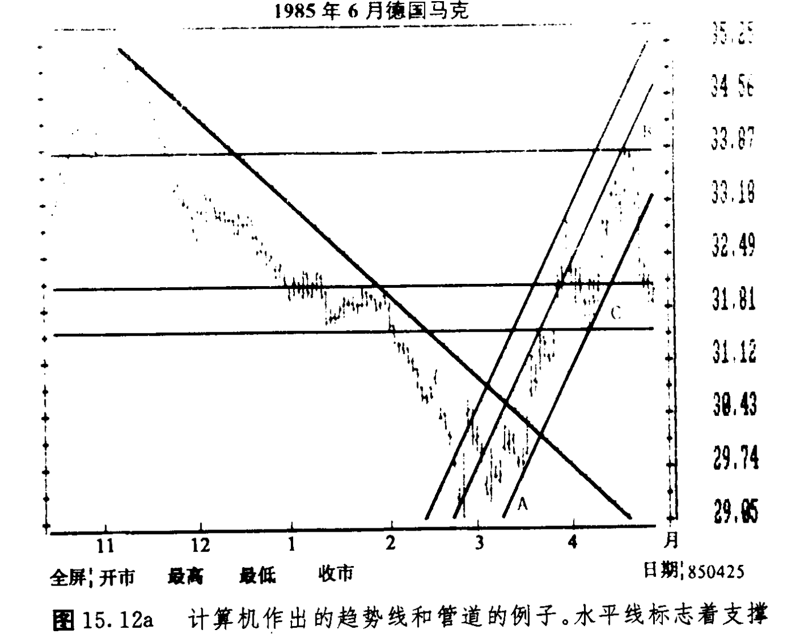
> 图15.12a 计算机作出的趋势线和管道的例子。水平线标志着支撑和阻挡水平。

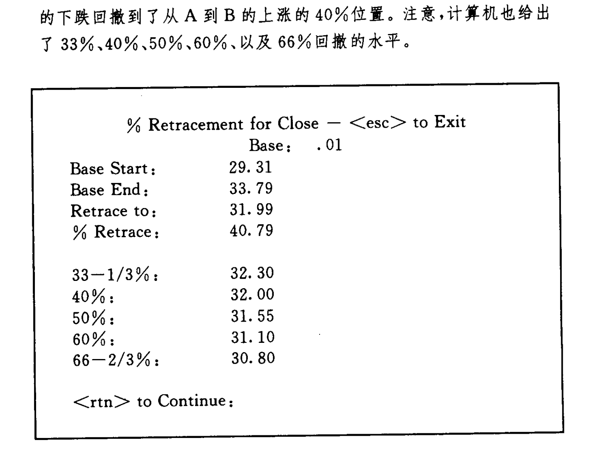
> 图15.12b 本程序可以标识上图中的百分比回撤的位置。自B到C的下跌回撤到了从A到B的上涨的40%位置。注意，计算机也给出了33%、40%、50%、60%、以及66%回撤的水平。

<!-- pdf p453 -->

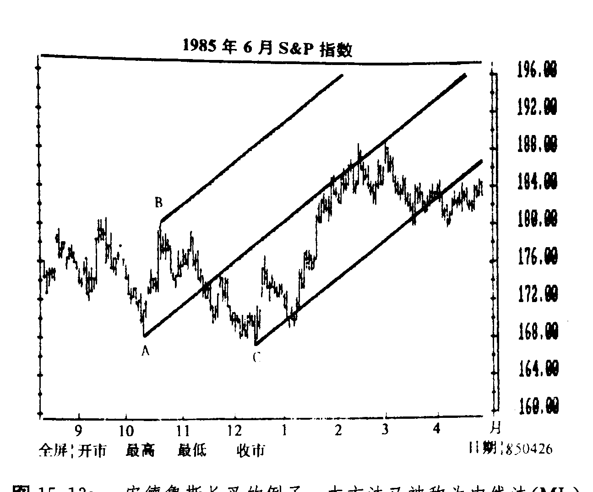
> 图15.13a 安德鲁斯长叉的例子。本方法又被称为中线法（ML）、安德鲁斯直线、阻挡中线（M.L.R.线）等。我们需要三点方可作出这一系列直线。其中稍后的两点（B和C）通过一直线（未画出）相连。然后，我们由第一点A点出发，通过BC的中点，作出其中分线。这条中分线即“中线”。这种方法也属于管道技术，是由艾伦•安德鲁斯博士首创的。这些直线常常形成支撑或阻挡区。

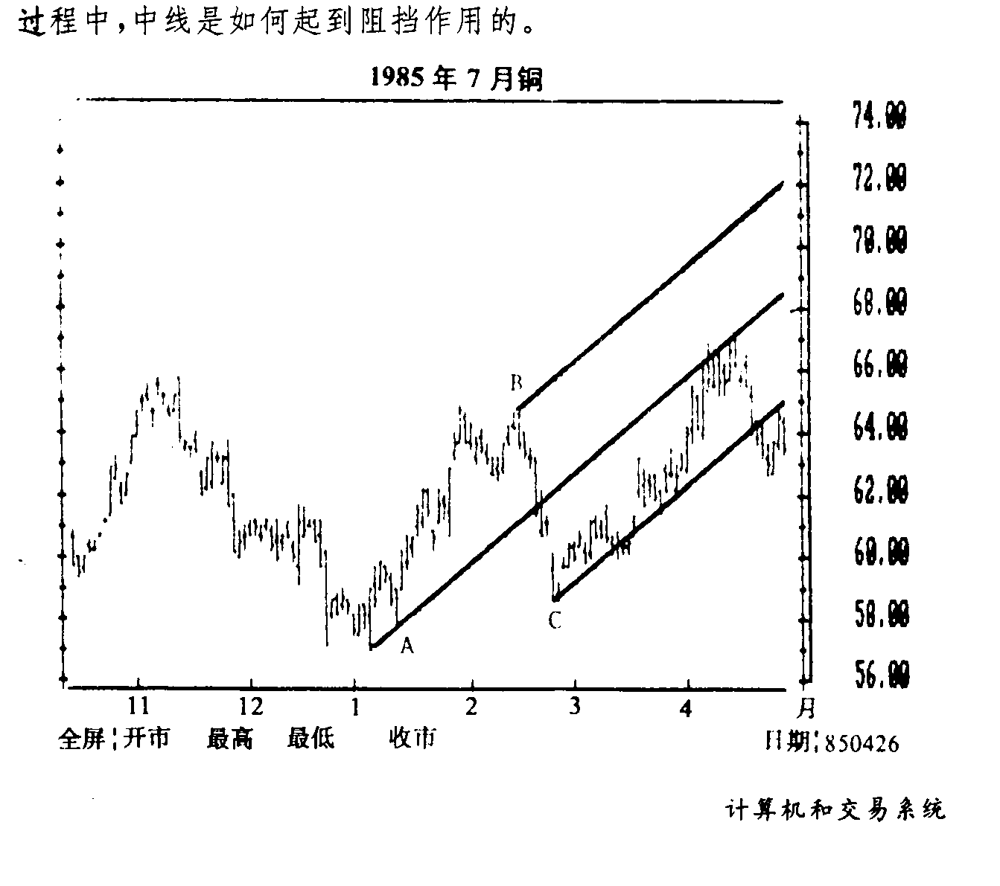
> 图15.13b 安德鲁斯直线应用于铜市场的情况。注意在4月的上冲过程中，中线是如何起到阻挡作用的。

<!-- pdf p454 / 书页 439 -->

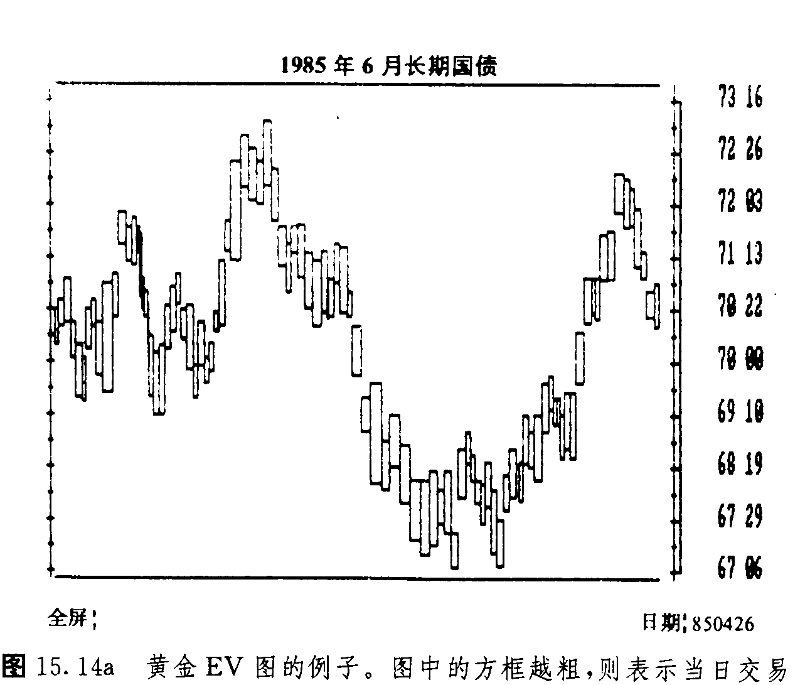
> 图15.14a 黄金EV图的例子。图中的方框越粗，则表示当日交易量越重。注意在向上突破时的较粗的方框（较重的交易量）。在最近的巩固阶段中，方框日益窄小（表明交易量渐轻）。请注意本图把交易活动表现得何其直观、形象。

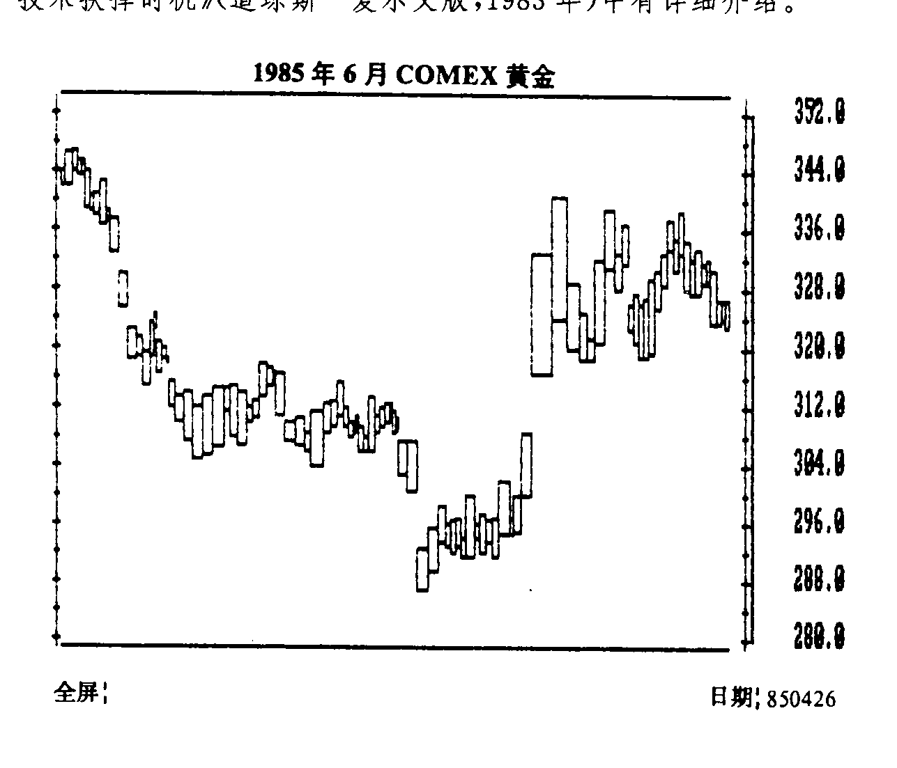
> 图15.14b EV 图表的另一个例子。这种方法是基于理查德•W•阿姆斯爵士的首创而来的。他在他的《股市的交易量周期：由 EV 图技术抉择时机》（道琼斯—爱尔文版，1983年）中有详细介绍。

<!-- pdf p455 / 书页 440 -->

## 关于计算机自动交易系统正反两方面意见

70年代的经济环境具有强烈的通货膨胀特点，在各个商品市场均发生了主要的看涨趋势，并持续数年之久。正是在这种强劲、持久的看涨趋势的大潮中，自动化的趋势型交易系统应运而生。从此，各种技术性交易系统如雨后春笋，大量地涌现出来。就其中的大部分来说，都有骄人的获利记录。也正是在这个时期，公众和私人的商品市场基金日益流行。这些基金大体上与股市中的互助基金相当。它们把持了动辄上百万、上千万的庞大的美元资金，并且在其运作过程中，严重依赖技术性的趋势顺应系统。只要牛市上涨不止，那就万事大吉。各种系统都财源广进，新基金也纷纷开张，所有人皆大欢喜。就在这个时候，变故发生了。80年代后期，通货膨胀的气泡终于胀破，市场踏上了历时五年的持续下跌的风雨里程。

80年代，自动化趋势顺应系统流年不利。虽然大部分采用这类系统的大基金仍然获利，但是其结果远不能与70年代的奇迹般的成绩相匹敌。对于这个退步，有好些说法。其一，这些系统从未在看跌市场下进行过检测。其二，80年代市场上的趋势不持久、不广泛。发生在熊市中的中等的上冲和巩固形态，打乱了交易商们的熊市部署，常常引发拉锯现象。尽管其中的趋势确实有据可查，但是它们主要集中于一小部分市场上。结果，从一二个趋势市场上取得的利润，被其它非趋势市场的损失冲抵殆尽。

根据这些系统在过去几年的表现，下面这一点已经很清楚了：仰仗计算机自动产生交易信号的趋势顺应系统，并不是取之不竭的聚宝盆。当然，这也不是说它们毫无价值，应当把它们统统扔到垃圾堆中去。关键在于，我们对之应有正确的认识。以下列举了这些系统的长处和短处。

### 自动交易系统的长处

1. 排除了人类主观情绪的影响。
2. 具有更严格的自律。 <!-- pdf p456 / 书页 441 -->
3. 能达到更高程度的协调一致性。
4. 顺着趋势方向交易。
5. 确保不错过每个顺着重要趋势的方向入市的机会。
6. 允许利润充分增长。
7. 把损失限制在一定范围。

### 自动交易系统的短处

1. 绝大多数自动交易系统是顺应趋势的。
2. 从获利角度看，趋势顺应系统主要依赖于主要趋势。
3. 当市场无趋势可循时，趋势顺应系统一般是不盈利的。
4. 市场在相当长的时间内没有趋势，而在这种阶段不适合采用趋势型方法。

依我个人的经验看，利用自动交易系统有时候是很成功的。不过在有些情况下，它们的表现有些令人失望。主要的麻烦是，这些系统不能判断市场何时已经无趋势可言，因而不能使我们及时地抽身退出。衡量某个系统好坏的标准有两方面，我们不但应该考察它在趋势市场下的获利能力，而且更重要的是，应该检验它在无趋势市场下保存资金实力的能力。这类系统无力为自己设置警戒，这一点是它们的最大的弱点之所在。事实表明，也正是在这一点上，那些著名的过滤器，例如韦尔斯•王尔德的方向性运动指数或商品选择指数大有用武之地。这些过滤器能够帮助交易商确定哪些市场最适合趋势型系统。

自动交易系统一般不能预期市场的反转，这也是它的短处。趋势顺应系统对趋势一跟到底，一直到趋势反转为止。它们不能判断市场何时处于长期的支撑或阻挡水平，何时出现摆动指数的背离现象，或者何时艾略特波浪形态的第5浪已经清楚可辨。在这些关键时刻，大部分交易商都会有所警觉，并着手部分地平仓实现利润。然而这些系统此时却仍然保留原来的头寸，直至市场方向完全转变以后才能反应过来。因此，如何利用这些系统以取得最大效益，完全取决于用户。就是说，我们必须抉择一下，到底是完全听由系统牵着鼻子走呢，还是把它们与其它各种技术因素结合起来，形成综合的交易方针。这样，我们就进行到下一部分，谈谈如何把自动化系统用作一般的技术指标，揉合到我们的预测和交易过程中去。 <!-- pdf p457 / 书页 442 --> 

## 把自动化系统的信号综合到分析中

为了便于说明问题，我们这里打算以商品研究局推出的“电脑期货趋势分析”（EFTA）为例。这是一种自动化的趋势顺应系统，能够自动产生买入和卖出信号。该系统把数种技术因素结合在一起，其中包括三种移动平均线（10天、20 天和40天的）、价格波动性、动力指数、以及时间周期等。它是通过计算机联网来逐日地获得上述数据的。在《CRB期货图表服务》的第2页，刊登有逐周安排的上述数据的表格，逢周五出版。我们就集中研究这些数据。

图15.15摘自《CRB图表服务》，是其中的“计算机趋势分析”一个实例。头两列是商品名称和交割月份。第三列（“计算机趋势”）给出趋势方向，这是本表中最重要的内容。其中有三种方向：上升、下降、或者横向伸展。第四列和第五列表示当前趋势的起始时间和起始时的价格水平。本表发表于1985年1月25日。请注意其中各个趋势已经持续时间。例如，英镑、德国马克、日元和瑞士法朗自从上年11月以来，就处在下降趋势之中了。这就意味着，如果交易商按本系统行事的话，那么他已经做空头2个月之久了。还请注意，短期政府债券市场自从上年7月以来，就一直显示“多头”信号，这是持续了6个月的趋势。象这样的市场，正是交易商所梦寐以求的。稍后我们再回头谈短期政府债券的行市。

第六列和第七列（“支撑和阻挡”）也包含着极有价值的信息。这些就是当前趋势改变方向的价格水平。如果趋势向上，如可可市场的情况，则其中给出支撑水平。如果趋势向下，如英镑市场的情况，则给出阻挡水平。倘若市场收市于或超过了阻挡水平，那么趋势就从下降转为横向伸展。如果趋势为横向伸展，如玉米市场的情况，则同时给出支撑和阻挡水平。倘若市场收市于或超过了阻挡水平，那么趋势将转而向上，而倘若收市于或跌破了支撑水平，那么趋势将转而向下。趋势绝不会在同一天内180°地反转，由升而降或者由降而升。它首先必须“横向伸展”地过渡一下，然后从这里开始，再恢复原来的方向或者掉头反向。因此，在本系统中也考虑到了没有趋势的情况。 <!-- pdf p458 / 书页 443 --> 

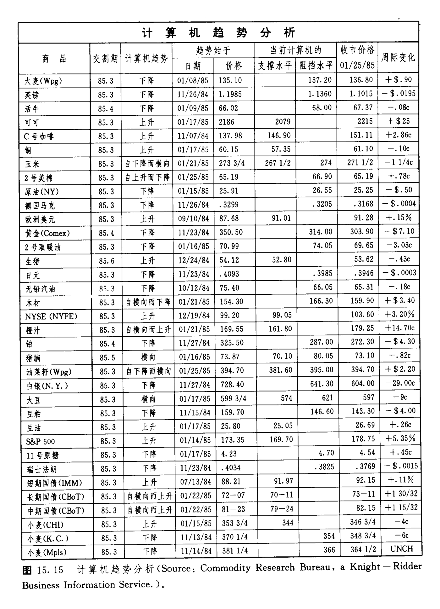
> 图15.15 计算机趋势分析（Source：Commodity Research Bureau，a Knight—Ridder Business Information Service.）。

<!-- pdf p459 / 书页 444 -->

### 使系统连续在市

显然，如果交易商实施本系统的指令的话，当趋势上升时则持有多头；当趋势下降时则持有空头；而当趋势为横向延伸时，则退出市场旁观。如果交易商乐意，也可以对本系统加以调整，使之连续化，即始终在市。我们有很多办法。对于长线的交易商来说，可以一直持有多头头寸，直至趋势反转向下为止。反过来，也可以一直持有空头头寸，直至趋势反转向上为止。这样一来，即使趋势已经转入了横向阶段，交易商依然保留着在原趋势下开立的头寸。当然，这种策略有可能招致大规模的损失。

我们还有个使之连续化的办法，其交易风格较为积极大胆。当趋势由上升转为横向伸展时，我们不仅平回原来的多头头寸，同时还要反做，开立空头头寸。倘若后来趋势转而向下，则我们再给空头加码。相反地，如果趋势从下降转为横向延伸，那我们就不仅平回所有空头头寸，同时还要开立多头头寸。倘若后来趋势转而向上，则我们再给多头加码。由此看来，我们对所有的系统，包括本系统在内，都可以加以调整，以适应交易者的具体需要和个人偏好。

### 利用系统的信号来约束自己

我们也可以简单地把系统的信号用作其它技术因素的自动化的验证信息。即使我们不打算采用自动交易系统，而是使用其它各种技术因素的话，我们依然可以借助它的信号来作为一种自律的手段，以保证自己在重要趋势中站在正确的一边。只要计算机趋势显示为上升，我们就不应开立空头头寸；只要计算机趋势显示为下降，我们就不应开立多头头寸（基本分析型交易商也不妨采用某种技术系统作为自己的交易意向的过滤器或者触发器。而上述正是个简易的法子）。通常，所谓趋势方向其实是个判断问题，那么，计算机的信号就可以在一定程度上，把交易商从犹疑不定之中解脱出来。它们可以阻止他踏入所谓“顶部套牢或底部套牢”的陷阱。

我很乐于在我的价格图表上，标明计算机给出的支撑和阻挡水平。如此一来，我就能提前知道这些关键的水平居于何处，趋势的变化可能在何处发生。我也会考察其它许多技术因素，例如趋势线、图上的支撑和阻挡水平等等，这些计算机资料都可用作额外的信息，来验证趋势变化。让我们回头看看短期政府债券市场，以此作为这种做法的例子。到1月25日，该市场的上升趋势已经持续6个月之久了。在接下来 <!-- pdf p460 --> 一周，价格有所下跌，穿破了紧随价格变化的上升趋势线。2月1日，星期五，在《CRB 图表服务》的“技术性评论”部分，我这样写道：

> 本周从长期阻挡区起，发生了急烈抛售的情况⋯⋯，从而打破了上升趋势。关于3月份短期国债，我们的计算机趋势在周五转而“向下”（自7月13日以来，一直是“上升”的）。3月份欧洲美元自从9月10月以来的上升趋势，也已经转为“横向伸展”。我们采纳了计算机的趋势改变信号，认为牛市已去，中性市场降临。

这里所要强调的是，如果我们把计算机趋势信号仅仅看作一般的技术指标，那么它也极具价值。在前面的例子中，两个短期利率市场在随后的将近两个月中，都剧烈地下滑了。

### 以系统信号作警报

我们还可以把计算机趋势分析用作绝好的审查工具，提醒自己警惕当前的趋势变化。请注意图 15.15所示的趋势变化。在其中的第三列，至少有7个市场的趋势方向有变化。星期一早晨，当交易商揣摸各种图表的时候，只要扫一眼这张表格，马上就能挑出7种交易对象。通过研究所有的图表，我们当然也可能获得同样的结论。但是，计算机使这项工作快速、简易，并且更具权威性。

### 以系统作为广泛性市场指标

在结束本节之前，我们再介绍一下在EFTA 每日研究中包含的一组有趣的数字——市场指标。其中包括每日价格上涨的合约数目与每日价格下跌的合约数目之比（合约总数在200种以上），每日涨达新高价的合约数目与每日跌出新低价的合约数目之比，以及计算机趋势为上升的合约数目占合约总数的百分比等。头两个指标是股市中类似指标在期货市场的翻版。尽管这两个数字，涨/跌数字和新高/新低数字，从传统上看，在商品市场并不常见，但是这个领域也颇有意思，有待我们进一步调查研究，以确定它们的预测性价值。

**计算机上升趋势合约比数** 我特别喜欢这个指标。它的百分比值从0到100分布。其作用如同摆动指数，可以确定商品市场作为一个整体是处于超买、还是超卖状态。从历史资料看，当这个数字超过70%时，商品市场处于超买状态，即将有所回撤。而当该数字低于20%时， <!-- pdf p461 / 书页 446 --> 通常意味着超卖状态，市场即将见底回升。这个数字是对市场总体气氛的评估，用来跟踪CRB期货指数的变化，是非常有效的。

## 人工智能形态识别

一方面，计算机给我们提供了一大套快速、简便的技术工具和指标，大大地简化了分析工作。另一方面，分析者的工作难度却同时有所提高。从前，技术分析者们只要掌握数种分析工具便能胜任自如，现在却必须同时面对多达40种的技术指标。根据认知心理学的研究，一般认为，人类意识在同时研究三种以上的变数之间的联系时，就会感到困难。如果要求分析者同时消化四种乃至更多的技术指标，也许他就会感到困扰。那么，如果我们决定只跟踪三种指标的话，哪三种最合适呢？

在我们进行市场分析时，计算机几乎完全被当成计算器了。其主要功能表现在计算数据、显示资料等方面，这节省了我们的时间。但是，如果计算机也能够对它计算的所有结果进行诠释的话，或许它就会更加有所作为了。这就是说，我们应当既充分利用计算机的计算能力，又充分开发它的逻辑功能。这就是所谓人工智能（AI）和形态识别（PR）的内容了。

人工智能是指计算机模仿人类的思维，借助具有“自学”能力的程序，来解决疑难。这时候，计算机实际上表现得活象具备了一定的“智能”那样。它能够判断形势，作出决定，并且能从错误中汲取教训。形态识别是指，计算机以对各项指标或因素的分类为基础，学会如何预测市场，作出决策的过程。“形态”这个词用在这里，与早先我们描述的各种图表“形态”，意思是不一样的。形态识别的目的是，把所有的技术指标组合在一起，以产生“协同”效果，而不是孤立地处理各项因素。

形态识别的第一步，是要从所有的技术指标中，选出表现最佳的个别指标。下一步，是挑出成绩最好的一对指标的搭档。第三步，找出结果最理想的三种指标的组合。往下，将重复上述步骤，不断添入新指标，直到所增加的新指标不能再改善组合的总成绩为止。在测试过程中，我们要使用两组不同的数据，一组是学习数据，一组是测试数据。从学习数据中获得的结果，必须从测试数据中得到验证。这种采用两组不同的数据进行测试的技术，避免了所谓“曲线自适”现象。这种现象经常成为人们批评各种技术指标的测试方法的理由，特别是针对我们为优化而进行的试验。

利用人工智能和形态识别，我们或许能够对症下药，解决把如此 <!-- pdf p462 / 书页 447 --> 花样百出的各种技术信息熔于一炉的问题。在处理相抵触的技术信息的问题上，我们首先利用计算机计算出所有的技术指标，然后针对各个特定的环境要求，从中选出最佳的组合。这样的解决方案是显而易见的，那么为什么在这个方面迄今并无太多建树呢？实际上到目前为止，这类研究主要还停留在纯理论性的实验室阶段，从未经受过实践检验。其费用昂贵，对计算机的性能要求太高。另外，即使我们识别出了市场的形态，它们往往也是不稳定的，需要不断地进行再检验。在这一领域，拉登研究组是走在前沿的研究集体。该小组的主要发言人是其主席，戴维•阿伦森。

## 归纳总结

以上，我们讨论了计算机在期货技术分析领域的作用，我们首先概要地介绍了 Compu Trac 软件（目前，它是这个行业领先者），介绍了现有的多种计算机技术工具及其使用方法。我们讨论了关于自动交易系统的正反两方面意见，以及使用计算机信号的利弊。自动交易系统代表了期货交易的一种“黑箱”模式，用户根本无需了解决策的过程，实际上，用户甚至可以根本不清楚系统中到底包含些什么。也有些计算机用户宁愿自己主持决策过程，他们把计算机信号和各种指标纳入自己的分析过程中，由他们自己做出最后的交易决定。而这正是 Compu Trac的出发点。

毫无疑问，交易商们越来越依赖计算机交易系统了，集聚了大量资金的私人和公众基金尤其如此。这一现象对期货交易正日益发生着巨大的影响。期货交易所的场内交易商们正在想方设法，以战胜计算机化的基金会。这些巨额基金影响、乃至扭曲短期市场行为的能力越来越强大。随着微型计算机的推广，各种技术分析软件的普及，包括资料传输的“在线”化，大大提高了普通交易商交易手段的复杂水平，导致了更多的短线交易。因为计算机终端的普及，交易商极容易取得日内资料，所以，当日交易也越来越盛行了。

我们还不能肯定，这个潮流最终会走向哪里。但是有一点很清楚，计算机带来了一场商品期货交易的革命。这并不是说计算机简化了交易过程。正相反，从某种意义上说，计算机使我们的工作困难得多了，其原因本章已有论述。从这一切事实中，我们得出一个重要结论。如果哪位商品期货交易商无缘拥有上述计算机技术的话，那么他就处在极为不利的地位上。因为所有的市场参与者都同时使用相同的信息，所以要战胜他人，从市场中获利是非常艰难的。在这种情况下，如果我们没有 <!-- pdf p463 / 书页 448 --> 计算机的帮助，就等于把刀把子递给了其它竞争者，使自己大大地处于下风。计算机既来之，则安之。将来，它们的性能会更好，操作更简便，并且价钱更便宜。不过，我们现在也不能坐等呀。

## 参考资料

目前最周详的计算机技术分析软件是 Compu Trac。该公司除了提供先进的支撑网络外，每年还在全国各地举办讲座，培训用户，以及讲解其软件的最新发展。

当然我们也有其它的信息服务机构。《股票及商品技术分析》（技术分析公司出版）是目前最好的一本杂志，它是以计算机分析为导向的，致力于提供有关领域的一日千里的最新动态。该杂志除了刊登计算机技术分析方面的文章外，还摘要地介绍最新涌现的计算机软件和硬件服务。《期货》杂志也可供参考，但它不偏重计算机技术。

对系统型交易商来说，韦尔斯•王尔德的著作是必读书。另一本《商品和股票的技术性交易系统》可能也不错，其作者为查尔斯•帕特尔（交易系统研究版，1980年）。帕特尔在书中列举了 82 种交易方法，其中 65 种是完全自动化的。
