# 第十六章 资金管理和交易策略

> 原书 PDF 第 464–488 页。OCR 自扫描件，图表已截取到 `images/16/`。

<!-- pdf p464 / 书页 449 -->

## 引言

前面各章讲的，是我们在进行商品期货市场的预测和交易时，所采用的各种主要的技术方法。现在是最后一章了，为了完成对交易过程的研究，我们要在市场预测的基础上，添上交易策略（或时机抉择）这个关键因素，以及另一个常常为人忽略的方面——资金管理。三个要素，缺一不可，否则，交易就做不成。

我们把各种技术方法都集中起来，开列了一份清单，以备朋友们一睹全豹。相信在朋友们学习综合使用所有技术信息的初期，这张单子会有所帮助。我们还要讨论一下，到底应该不应该把技术分析与基本分析协调起来。如果这一点能够做到的话，当然对技术分析者和基本分析者都有好处，那么我们要看看应当怎样着手。最后，我们将就职业技术分析工作的地位和它的前途，谈一点泛泛的体会。

<!-- pdf p465 / 书页 450 -->

## 成功的商品期货交易具有三个要素

在任何成功的期货交易模式中，我们都必须考虑以下三个方面的重要因素：价格预测、时机抉择和资金管理。

1. 价格预测指我们所预期的未来市场的趋势方向。在市场决策过程中，这是极关键的第一个步骤。通过预测，交易者决定到底是看涨，还是看跌，从而回答了我们的基本问题：我们应该以多头一边入市，还是以空头一边入市。如果价格预测是错误的，那么以下的一切工作均不能奏效。
2. 交易策略，或者说时机抉择，确定具体的入市和出市点。在期货交易中，时机抉择也是极为关键的。因为这个行业具有较低的保证金要求（高杠杆率）的特点，所以我们没有多大的回旋余地来挽回错误。尽管我们已经正确地判断出了市场的方向，但是如果把入市时机选择错了，那么依然可能蒙受损失。就其本质来看，时机抉择问题几乎完全是技术性的。因此，即使交易者是基础分析型的，在确定具体的入市、出市点这一时刻，他仍然必须借助于技术工具。
3. 资金管理是指资金的配置问题。其中包括投资组合的设计，多样化的安排，在各个市场上应分配多少资金去投资或冒险，止损指令的用法，报偿—风险比的权衡，在经历了成功阶段或挫折阶段之后分别采取何种措施，以及选择保守稳健的交易方式还是大胆积极的方式等等方面。

可以用最简洁的语言把上述三要素归纳为：价格预测告诉交易者怎么做（买进还是卖出），时机抉择帮助他决定何时做，而资金管理则确定用多少钱做这笔交易。关于价格预测的问题，前面各章已有论述了。我们这里主要处理后两个方面。我们首先谈资金管理，因为在我们制定恰当的交易策略时，也必须把这个问题考虑进去。 <!-- pdf p466 / 书页 451 -->

## 资金管理

我曾在一家大型经纪公司的研究部门供职多年。离开它以后，我不可避免地转向了资金管理这一行。马上我就发现，在替别人谋划交易对策与亲自实践这些方案之间，存在着巨大的差别。令我意外的是，在这场工作转换中，最困难之处并不在于市场策略这一方面。我分析市场以及确定入市、出市点的方式前后并没有太大不同。真正的变化是我对资金管理的重要性的体验。我很惊诧，象资金帐户的大小、投资组合的搭配、以及在每笔交易中的金额配置等等诸如此类的问题，竟然都能影响到最终的交易成绩。

毋庸讳言，我坚定地信奉资金管理的重要意义。在我们这个行当，到处都是顾问公司、咨询服务，喋喋不休地指点客户买卖什么对象、何时去买卖等等，但是几乎没人告诉我们，在每笔交易中，应当注入多少资本。

有的交易者认为，在交易模式中，资金管理是最重要的部分，甚至比交易方法本身还要关键。我想，我可能还没有走得那么远，但是我相信，如果要长久地立于不败之地，就少不得它。资金管理所解决的问题，事关我们在期货市场的生死存亡。它告诉交易者如何掌握好自己的钱财。作为成功的交易者，谁笑到最后，谁就笑得最好。资金管理恰恰增加了交易者生存下去的机会，而这也就是赢在最后的机会。

### 一些普遍性的资金管理要领

我们必须承认，关于投资组合的管理问题可以弄得极为复杂，乃至于必须借助复杂的统计学方法才能说得清楚。我们这里只打算在相对简单的水平上讨论这个问题。以下我们罗列了一些普遍性的要领，对朋友们进行资金分配，以及决定每笔交易应注入的资金量等工作可能有所帮助。

1. 总投资额必须限制在全部资本的50%以内。余额可以投入短期政府债券。这就是说，在任何时候，交易者投入市场的资金都不应该超过其总资本的一半。剩下的一半是储备，用来保证在交易不顺手的时候或临时支用时有备而无患。比如说，如果帐户的总金额是100,000美元，那么其中只有50,000可以动用，投入交易中。 <!-- pdf p467 / 书页 452 -->
2. 在任何单个的市场上所投入的总资金必须限制在总资本10%到15%以内。因此，对于一个100,000美元的帐户来说，在任何单独的市场上，最多只能投入10,000到15,000美元作为保证金存款。这一措施可以防止交易商在一个市场上注入过多的本金，从而避免在“一棵树上吊死”的危险。
3. 在任何单个市场上的最大总亏损金额必须限制在总资本的5%以内。这个5%是指交易商在交易失败的情况下，将承受的最大亏损。在我们决定应该做多少张合约的交易，以及应该把止损指令设置在多远以外时，这一点是我们极为重要的出发点。因此，对于100,000美元的帐户来说，可以在单个市场上冒险的资金不超过5,000美元。
4. 在任何一个市场群类上所投入的保证金总额必须限制在总资本20%—25%以内。这一条禁忌的目的，是防止交易商在某一类市场中陷入过多的本金。同一群类的市场，往往步调一致。例如，金市和银市是贵金属市场群类中的两个成员，它们通常处于一致的趋势下。如果我们把全部资金头寸注入同一群类的各个市场，就违背了多样化的风险分散原则。因此，我们应当控制投入同一商品群类的资金总额。

上述要领在期货行业中是相当通行的，不过我们也可以对之加以修正，以适应各个交易商的具体需要。有些交易商更大胆进取，往往持有较大的头寸。也有的交易商较为保守稳健。这里的重要用心就在于，我们必须采取适当的多样化的投资形式，未雨绸缪，防备亏损阶段的降临，以保护宝贵的资本。

### 决定头寸大小

一旦交易者打定主意在某市场开立头寸，并且选准了入市时机，下面就该决定买卖多少张合约了。我们这里采用10%的规定，即把总资本（如100,000美元）乘以10%，就得出在每笔交易中可以注入金额。在上例中，100,000美元的10%是10,000美元。我们假定每张黄金合约的保证金要求为2,500美元。那么10,000美元除以2,500美元得4，即交易商可以持有四张黄金合约的头寸。如果每张长期国债合约的保证金是5,000美元，那么我们只能持有2张长期国债合约。如果每张S&P500合约的保证金是6000美元，那么我们只能持有一张合约。在这种情况下，或者我们必须权衡一下，看看该不该持有2张合约（那 <!-- pdf p468 / 书页 453 --> 就占到总资本的12%了）。请朋友们记住，上述几条不过是些要领，在有些情况下，我们需要做一定程度的变通。这里也一样，最重要之处是，不要在哪个单独的市场或市场群类中卷入太深，以免接二连三地吃亏赔本，招致灭顶之灾。

### 分散投资与集中投资

虽然分散投资是限制风险的一个办法，但也可能分散得过了头。如果交易商在同一时刻把交易资金散布于太多市场的话，那么其中为数不多的几笔盈利，就会被大量的亏损交易冲抵掉。这里头也有个一半对一半的机会问题，因此我们必须找到一个合适的平衡点。有些成功的交易者把他们的资金集中于少数几个市场上。只要这些市场在当时处于趋势良好的状态，那就大功告成。在过分分散和过分集中这两个极端之间，我们两头为难，偏偏又没有绝对牢靠的解决办法。依我的经验来看，同时在四到六个不相干的市场上持有头寸，或许是一条中庸之道。关键的一点是“不相干”。我们所选择的市场之间的相关性越小，则越能取得分散投资的功效。如果我们只是同时在四种外汇市场上持有多头头寸，那么，算不得是优越的分散投资。

### 设置保护性止损指令

我向朋友们强烈地呼吁，一定要采取保护性止损措施。不过止损指令的设置着实是一门艺术。交易者必须把价格图表上的技术性因素，与资金管理方面的要求进行综合研究。这一点，在本章后面的“交易策略”部分，我们再细谈。交易者应当考虑市场的波动性。市场的波动性越大，那么，止损指令就应当比较远。无独有偶，这里也有个机会问题。一方面，交易者希望止损指令充分地接近，这样，即使交易失败，亏损也会尽可能地少。然而另一方面，如果止损指令过于接近，那么很可能当市场发生短暂的摇摆（或称“噪音”）时，引发不必要的平仓止损的行为。总之，止损指令过远，虽然能够避开噪音干扰，但最终损失较大。关键还是要走中庸之道。

### 报偿—风险比

最成功的交易商也只能在40%的交易中获利。事实就是如此。大多数交易以亏损而告终。那么，既然交易者在多数情况下都赔钱，他们 <!-- pdf p469 / 书页 454 --> 最终又怎么能盈利呢？因为期货交易只要求如此小额的保证金，所以，哪怕市场朝不利的方向只变化一点点，我们也不得不忍痛平仓止损。于是，在交易者真正捕捉到他心目中的市场运动之前，或许不得不先进行几番尝试。

假定某交易者预期黄金价格即将从300美元涨到500美元，于是他在300美元价位买入了一张合约，并把冒险金额限定为10美元。随后市场跌到了290美元，这笔交易就被止损平仓了。然后在295美元的时候，他又买入一张合约，接着又一次地蒙受了10美元的小额损失。最后，他在305美元第三次买进，这一回终于如愿以偿，价格涨到了500美元，结果获利195美元。他总共做了三笔交易。头两笔有小额亏损，总共为20美元。第三笔盈利195美元。尽管在三笔中只有一笔有利润，但是最终结果仍然是赢余175美元（195-20）。这就相当于17,500美元的实际利润（175美元×100美元）。

这样我们就涉及到了报偿—风险比的问题。因为大多数的交易是赤字，所以我们唯一的希望就是，确保获利交易的盈利额大于亏损交易的损失额。为了达到这个目的，大部分交易者都要考虑报偿—风险比。对每笔计划中的交易，我们都要确定其利润目标（报偿），以及在万一失败的情况下的可能亏损的金额（风险）。然后，我们把利润目标与潜在亏损加以权衡，得出报偿—风险比。报偿—风险比有一个通用的标准，3比1。在考虑一笔交易时，其获利的潜力至少必须3倍于可能的亏损，我们才能够付诸实施。在前面的黄金交易的例子里，假定其预测风险为10美元，那么其利润潜力至少达到30美元才行。

有些人在报偿—风险比的计算中，加入了一个可能性因子。他们认为，仅仅预估利润和亏损的目标是不够的。因此，在潜在的利润和亏损额上，必须分别乘以上述利润和亏损出现的可能性（以百分数表示）。从统计学角度来看，这种做法是颇有道理的，但是麻烦之处是，我们必须假定各个交易商能够事前定量化地评估获利或亏损的可能性。“让利润充分增长，把亏损限于小额。”在期货交易中，这是老生常谈了，我们刚刚讨论的问题与之很有关系。在商品期货中，如果我们确定长期趋势，就可以实现巨额的利润。因为就每年来说，我们仅有少数的交易可致巨利，所以机会难得，必须尽量扩大战果。“让利润充分增长”，一语道破天机。而“把亏损限于小额”就象同一块硬币的另一面。不过，如果朋友们知道很多交易者的所作所为与这句话恰恰相反，怕会惊愕不已吧。 <!-- pdf p470 / 书页 455 -->

### 复合头寸交易：跟势头寸与交易头寸

说起来，“让利润充分增长”似乎颇容易。只要我们有慧眼捕捉到某市场趋势的开端，就能在相对短的时间内，获取巨额利润。然而，迟早有一天，趋势突然地停滞不前了。此时，在摆动指数上显示出超买状态，在价格图上也面临着一些重要的阻挡水平。怎么办？虽然我们相信市场尚有很大的上涨余地，但是又担心价格下跌，丧失帐面利润。现在，是平仓获利呢？还是安之若素，准备忍过可能出现的调整呢？

有一个办法可以解决这个问题：我们始终采用复合头寸来进行交易。所谓复合头寸，是指我们把交易的单位分成交易头寸和跟势头寸两部分。跟势头寸部分图谋长期的有利之处。对于它们，我们设置较远的止损指令，为市场的巩固或调整留有充分的余地。从长期角度看，这些头寸能够带来最大的利润。

在我们的投资组合中，特地留出交易头寸部分来从事频繁地出市入市的短线交易。如果市场已经达到第一个目标，接近了某个阻挡区，同时摆动指数也显示出超买状态，那么，我们就可以针对交易头寸部分地平仓获利，或者安排较接近的止损指令。其目的是要锁定或确保利润。如果之后趋势又恢复了，那么我们就把已平仓的头寸重新补回来。因此，我们最好在开始交易时，避免只做一张合约或一个单位头寸的情况。通过多单位头寸的交易，我们就拥有了更大的灵活性，从而可能提高总的交易成绩。

### 资金管理：保守型与大胆型交易方式

《商品期货游戏》对资金管理这个问题有一番精彩的议论，其作者是塔韦尔斯、哈洛和斯通。在这本书的“资金管理”一章中，有一段语重心长的陈述，把保守的交易风格推崇为最终取胜之道。

……甲交易者成功的把握较大，但是其交易作风较为大胆；而乙交易者成功的把握较小，但是他能奉行保守的交易原则。那么，从长 <!-- pdf p471 / 书页 456 --> 期看，实际上乙交易者取胜的机会可能比甲更大（《商品期货游戏》，理查德·J·塔韦尔斯，查尔斯·V·哈洛，赫伯特·L·斯通，麦格劳—希尔版，1977年，第263页）。

根据我个人的体验，上面的引文是有道理的，从长期来看，保守的交易作风最可取。急于发财的交易者往往采取大胆积极的交易方式。那么，只要市场运动的方向不出岔子，其利润的确是可观的。但是，一旦事情不再一帆风顺，其后果通常就是毁灭性的了。我宁愿成绩平稳，不要有大起大落。每个交易者都得在保守与大胆两个极端之间选择自己的风格。不过朋友们在下决心之前，应该好好地读一读我们上面提到的那一章。

### 在成功或失败阶段之后做什么

关于资金管理，这里有几个棘手的问题，我们得费费脑筋。交易者在经历了一轮失败或成功之后，应该做什么？假定你的交易本金赔掉了50%，你应当改变交易风格吗？如果你已经损失了一半本钱，那么为了挣回原来的资金金额，首先你就不得不从剩下的一半中挣出它的一倍来。你是更加细致地选择交易机会呢，还是选择保证金要求较低的市场呢，还是保持一贯、采取一如继往的交易方式呢？如果这时你才变得保守起来的话，就将很难把损失的资金再赢回来了。

另一方面，如果交易者刚刚喜获丰收，虽然感觉挺滋润，却也有个两难问题。假定你已经赚足了原有本金的一倍，那么如何利用这些盈利呢？看起来，似乎显而易见，为了从资金运用中取得最大的收益，我们应该利用盈利来把交易头寸扩大一倍。然而，将来免不了会发生亏损的阶段，如果我们这么办了，结果可能不只是贴掉刚挣回的那一半利润，而是要连本带利地全部搭进去。所以上面两个问题的答案并不象乍看起来那么简单明白。

每个交易商的交易成绩记录都是由一系列峰和谷组成的，与价格图倒是极相似。如果从总体上看交易者是盈利的，那么他的资金图线就应当是上升的。在刚刚获利之后马上就扩大注入市场的本金，这种时机是最糟糕的。这一点恰恰就象在上升趋势中，当市场处于超买状态时买入一样。更明智的做法（这与人类的本性有点不符）是，在资本金稍有亏损的时候，便开始增加投入。这么做，增大了重头投入处在资本金的低谷而不是在资本金的顶峰的机会。

<!-- pdf p472 / 书页 457 -->

### 资金管理的问题虽然棘手却很关键

以上，我们只是在期货交易的资金管理这个重要的方面沾了一点边。我这里的主要意图，是想告诉朋友们在制订交易计划时资金管理的重要性，建议几点普遍性的要领，提出一些容易被忽略的问题。好在只要我们能够提出这些问题，也就有希望随之获得其答案。我打算再从前面提到的那本书中引用一段话，来结束我们相对简要的讨论。

要是朋友们现在终于认识到，在资金管理的问题上，充满了令人进退两难和矛盾重重的困境，因而值得我们仔细地推敲的话，那么你已经算是初窥门径了。……这些关乎生存的基本法则，大部分寓含在资金管理的领域里。但是，很少有交易者对这个方面特别有兴致。大家的注意力往往集中于选择交易机会这一方面，这反而成了大多数人的基本兴趣之所在（塔韦尔斯，哈洛和斯通著，第271-272页）。

### 基金管理行业

在期货行业，“资金管理”这个术语另外还指职业化的客户资金管理。从广义上说，“资金管理”（或基金管理）系私人或公众基金的职业交易人员（商品交易顾问和商品基金经理）管理其集聚资金的行为。由于越来越多的私人投资者接受了与共同基金行业类似的集聚资金的方式，把他们的资金托付给上述人员经营，因此，十多年来，在期货业中这类基金一直在稳步增长。我们这里之所以要交代“资金管理”的这一层意思，意在防止混淆。不过，这方面的问题，并不是我们的主要兴趣。

### 参考资料

尽管在各种期货研究资料中，关于资金管理的方面均未受到足够的重视，但也还有几本书对此有所论述。《商品市场资金管理》（弗雷德·格姆著，威利版，1983年）一书，采用统计学方法，对资金管理的各项原则进行了透彻的研究。关于帐户管理行业的资金管理问题，在《投资者期货资金管理指南》中有精妙的深入介绍。作者是莫顿·S·巴拉兹（期货出版 <!-- pdf p473 / 书页 458 --> 集团版，1984年）。他是《管理帐户报告》的编者。这份市场通讯主要跟踪各家基金的经理的业绩，定期报告他们公开发表的业绩资料。

## 交易策略

交易商在完成了市场分析之后，就应当清楚到底是该买进，还是该卖出。下一步，我们根据资金管理方面的考虑，确定注入资金的规模。最后，我们进入市场，实际购进或抛出期货合约。在期货交易中，由于入市点和出市点的时机抉择必须极为精确，因此，最后这一步在上述过程中可能是最困难的。关于如何入市、在什么点位入市的问题，我们必须在通盘考虑各项技术性因素、资金管理的要求、以及我们所采用的交易指令的类型基础上，才能作出最后决定。下面，我们依次对各个方面加以探讨。

### 利用技术分析抉择时机

谈起利用技术分析来选择交易机会，其实并不新鲜，这是我们前面各章中的老话题了。唯一的区别是，出、入市时机抉择问题是针对很短暂的时期而言的。我们这里所关心的时间范围，是以天、小时、乃至分钟来计算的，这与逐周、逐月的筹划正好相对立。但是我们所采用的技术方法依然是一致的。在此，我们不打算再逐一地介绍各种技术方法了。我们的讨论仅限于一些一般性的概念。

1. 关于突破信号的策略
2. 趋势线的突破
3. 支撑和阻挡水平的利用
4. 百分比回撤的利用
5. 价格跳空的利用

### 关于突破信号的策略：预先还是伺后？

关于突破信号，交易者永远都得面对一个左右为难的问题：究竟在突破发生之前预先入市呢？还是正当突破发生的时候当场入市呢？或 <!-- pdf p474 / 书页 459 --> 者还是等突破发生后市场反扑或反弹时伺后入市呢？三种做法各有各的门道，而且我们也有综合来用三种方式的办法。如果交易者可以买卖数张合约，那么不妨每样各做一个单位。假定我们预期市场将发生向上突破。采取预先方式的好处就在于，如果突破果真如愿发生了，那么我们的头寸就具备有利的（较低的）价位。但是在另一方面，交易失败的风险也相应地较大。如果我们正当突破发生时才入市，则成功的把握较大，但是代价是，入市的价位也不利（较高）。如果我们等市场在突破后出现反扑时，再伺后入市，那么只要果真能够发生反扑，这就不失为合理的折衷方案。可惜的是，许多势头凶猛的市场（通常也是最有利可图的），并不给那些耐心的交易商第二个机会。因此，采取伺后方式的风险小，但是错过重要的入市机会的可能性较大。

这也是一个很好的例子，说明使用复合头寸的办法大大地化减了我们左右为难的程度。在突破前“预先”入市时，交易者不妨开立一点小头寸；然后，在突破时，再添一点头寸；最后，等突破后市场调整性地跌回时，再追加一点头寸。但是，如果交易者只有一点小头寸，那么他将难于摆布。在很大程度上，他的决定取决于他愿意在这笔交易上冒多少风险，以及他愿意采取什么样交易风格。最保守的方式可能是在市场突破后出现反扑时“伺后买进”。碰上这种情况，完全要看交易者本人如何决策了。

### 趋势线突破

这是一种最有价值的早期入市或出市的信号。如果交易商正在寻求趋势变化的技术信号，以开立新头寸，或者正找机会平仓了结原有头寸的话，那么，紧凑趋势线的突破常常构成绝妙的下手信号。当然，我们始终也必须考虑其它技术信号。另外，在趋势线起支撑或阻挡作用的时候，也可以用作入市点。在主要的上升趋势线的上侧买入，或者在主要的下降趋势线的下侧卖出，均不失为有效的时机抉择的对策。

### 支撑和阻挡水平利用

在选择出、入市点这一方面，支撑和阻挡水平是最行之有效的图表工具。当阻挡被击破时，可能构成开立新的多头的信号。而这个新头寸的保护性止损指令就可以设置在最近的支撑点的下方。我们甚至还可以更接近地设置止损指令，把它安排在实际的突破点之下，因为这个水平现在应该起到支撑作用了。如果在下降趋势中市场上冲至阻挡水平，或者在上升趋势中价格下跌到支撑水平，那么我们均可以据此开立新头寸，或者把已有帐面利润的原有头寸加以扩大。另外，在我们设置止 <!-- pdf p475 / 书页 460 --> 损指令的时候，支撑和阻挡水平也是最有参考价值的。

### 百分比回撤的利用

在上升趋势中，向下的调整常常回撤到前面的上涨进程的40%到60%的位置。我们可以利用这一点来开立新的多头头寸或扩大原有的多头头寸。因为我们现在主要谈的是时机抉择问题，所以我们把百分比回撤也应用于非常短期的变化。比如说，在牛市突破之后的40%回撤，或许正是绝妙的买入点。而在下降趋势中，40%到60%的向上反弹通常提供了优越的抛空机会。同时，在日内价格图上，我们也可以应用百分比回撤的概念。

### 价格跳空的利用

我们还可以利用线图上出现的价格跳空来有效地抉择买卖时机。例如，在上升运动之后，其下方的价格跳空通常起到支撑作用。当价格跌回价格跳空的上边缘、或者回到价格跳空之内的时候，我们买入。然后，我们把止损指令放置在跳空之下。在下跌运作之后，当市场反弹到上面价格跳空的下边缘、或进入到跳空之内的时候，我们卖出。然后，再把其止损指令安排在跳空的上方。

### 综合各项技术概念

利用各项技术概念的最有效的办法，是把它们综合起来。请记住，我们正在讨论的是时机抉择问题，关于买或者卖的基本决定早已经确定了。此处我们所做的一切，就是要对入市和出市点进行细致的调整。如果我们采纳了买入信号，那么，就会力求以最低的价格入市。假定价格跌回了40%—60%的买进区域，此处又存在一个显著的支撑水平，或者一个潜在的支撑性价格跳空，那就妙不可言。进一步，如果附近就有一条重要的上升趋势线，那就更好。

那么，所有这一切因素综合在一起，就能增加交易时机抉择的有效性。我们的主意是，在上升趋势中，在支撑区附近买进，但是如果该支撑被击溃，就尽快平仓出市。而在下降趋势中，我们尽可能在接近阻挡区之处卖出，但是如果该阻挡被冲破，也尽快平仓出市。在上升趋势的向下调整中，如果沿着调整阶段中的高点所连成的紧凑下降趋势线被向上突破了，也可用作买入信号。而在下降趋势的向上调整中，如果调整阶段的紧凑趋势线被向下突破了，也可能是做空头的机会。 <!-- pdf p476 / 书页 461 -->

### 把各项技术因素与资金管理结合起来

在我们考虑设置止损指令的时候，除了利用图表的点位外，还应该适当地兼顾资金管理的几条要领。让我们回过头再看看先前的黄金市场的例子。假定交易者决定在300美元附近买进黄金，他的帐户金额为100,000美元，我们采取其中的10%作为每笔交易的最大注入限额。那么在这笔交易中，他只可动用10,000美元。因为保证金要求为2500美元，所以他只能买进4张合约。而最大的风险限额为5%，即5,000美元。因此，他所设置的止损指令的价位必须满足如下条件：万一交易失手、止损指令被执行了，其亏损总额不能超过5,000美元。

在我们具体设置止损价位时，必须结合考虑资金管理的各项限额，以及图表上的支撑或阻挡水平的位置。假定买入点是301美元。而图表上显示的最接近的可靠支撑水平在以下11美元处，即290美元。如果我们把止损指令设置在289美元（290美元支撑价位的下方），那么每张合约的最终的风险金额为1200美元（$12×$100）。4张合约总的风险额为4800美元（4×$1200），刚好处于5,000美元的限额以内，符合资金管理的要领。

如果最接近的支撑水平在15美元以下，那么每张合约的风险额将达到1600美元。为了保证处于5,000元的限额以内，现在只可以买进3张合约（3×$1600），而不是原先的4张了。所以，如果能够找出较接近的支撑水平，那么选择起来就轻松得多了。倘若止损指令只需要放置在5美元以下（每张合约只要冒500美元的风险），那么即使我们买入多达10张合约，也不会超过5000美元的风险限额。当然，买进10张合约是不符合10%的规定的，但这里就有机会做一点变通。

止损指令较接近的话，就允许我们持有较大的头寸。而止损指令较远，则可能限制我们的头寸规模。有些交易者在决定止损指令的时候，完全是从资金管理的因素出发的。但是，有一点极端重要。对于空头头寸，其止损保护指令应当设置于有效的阻挡点位的上侧；而对于多头头寸，其止损保护指令应当设置于有效的支撑点位的下侧。在我们探求具有一定有效性的、较接近的支撑或阻挡水平的时候，日内图表颇擅胜场。 <!-- pdf p477 / 书页 462 -->

### 交易指令的类型

正确地选择交易指令的类型，是交易策略中的必要组成部分。不过，这里要讨论的，只限于一些较为常见的指令类型：

1. 市价指令，指示经纪人径直按照当前的市场价格买入或卖出期货合约。在市场急速动作的情况下，或者在交易商要求确保能够开立头寸的情况下，通常最好采用此类指令，以免贻失良机，错过潜力大的市场运动。
2. 限价指令，明确地指出交易者愿意接收的交易价格。买入限价指令一般设置在当前市场价格之下，表示交易者在买进时愿意支付的最高价格。而卖出限价指令一般放置在当前市场价格之上，表示交易者在卖出时愿意接受的最低价格。本指令属于伺机成交的指令类型。举例来说，如果买方在看涨突破发生后，试图乘市场随后向下反扑到支撑水平附近时再入市，则可以采用此类指令。
3. 止损指令，既可以用来开立新头寸，也可以用来限制已有头寸的亏损，或者保护已有头寸的帐面利润。止损指令指明了有关交易指令的执行价格。买入止损指令一般置于市场的上方，而卖出止损指令则设在市场的下方（这一点与限价指令正好相反）。只要市场触及止损指令的水平，该指令就转化为市价指令，经纪人必须立即以能够到手的最好价格执行。在多头头寸的情况下，其卖出保护指令设置在市场下方，以限制亏损。如果后来价格上涨了，我们也可以水涨船高，提高止损指令的水平以保护帐面利润（这就是所谓跟踪止损）。我们也可以预先在阻挡水平上方安排好止损指令，从而当向上突破发生的时候，就能够及时地开立多头头寸了。同样道理，卖出止损指令也可以设立在支撑水平之下，等向下突破发生时，开立新的空头头寸。因为止损指令后来转化为市价指令了，所以其实际的执行价格或许比止损指令的原定水平要差一些，特别是当市场激烈变化时尤其如此。
4. 止损限价指令是止损指令和限价指令的复合形式。本类指令同时明确了止损价格和限价价格两个水平。一旦市场触及止损价格，则 <!-- pdf p478 / 书页 463 --> 本指令转化为限价指令。当交易者既打算在突破发生时入市买卖，又力图控制交易价格的时候，可以采用这一类指令。
5. 触市指令（M.I.T.），与限价指令类似，但区别在于，一旦市场触及本指令的价格水平，它就转化为市价指令了。买入触市指令也象买入限价指令那样，把水平设置在市场下方。当所限制的水平被市场触及后，经纪人必须立即入市交易。同限价指令比较，本类指令具有明显的优越性。虽然买入限价指令也位于市场下方，但是即使市场触及了它的水平，也不能确保该指令被执行。这里正是M.I.T.指令最有价值的地方。如果交易商既希望乘跌低价买入，又不想在万一市场只是对指令水平一触即返的情况下丧失入市良机的话，就可以选用本类指令。在下降趋势中，我们把M.I.T.指令设置在市场上方。

上述各种指令分别适用于不同的场合。每一类都是既有长处，也有短处。市价指令能够确保头寸的建立，但其代价是往往“尾追”市场。限价指令能够提供易于控制的好价格，但是我们冒着贻误良机的风险。对于止损限价指令，当市场在指令水平处发生价格跳空时，也有同样的风险。另外，如果我们采用买入或卖出止损指令来开立新头寸的话，也免不了发生执行价格恶劣的情况。触市指令虽然出奇地有效用，但是在有些交易所是不允许使用的。我们应当通晓上面各种指令，并明了其优缺点。在我们的交易方案中，每种指令均应拥有一席之地。我们还必须明了各间期货交易所允许交易者采用的指令类型。

## 从日间图表到日内图表

因为时机抉择问题关心的是短期的市场行为，所以日内价格图表特别有用处。在我们从事当日交易时，日内价格图表也是不可或缺的。不过，这一点不是这里的中心话题。我们这里主要是要讲清楚，在我们作出了是不是应当入市或出市的基本决定后，如何利用日内价格图表来帮助我们抉择具体的买入或卖出时机。

有一点值得我们反复地说明。在整个交易过程中，我们必须从长期的研究着手，然后逐步过渡到较短的时间范围。我们的分析是以对连续月线图和周线图的长期透视开始的。接下来，我们考察日间图表，这是做出实际交易决定的基础。最后，我们研究日内价格图表，以获得进一步的精确度。长期图表是对市场的鸟瞰。而日内价格图表是对市 <!-- pdf p479 / 书页 464 --> 场活动的显微观察。朋友们将看到，我们过去所讨论的各项技术原理，在这类极灵敏的图表中均有清晰的体现。

下面我们以研究S&P500期货合约的过程为例。图16.1是一张日线图，其中共展示了90天的价格变化（这些图表均引自ADP康川视觉系统）。在图表上方，罗列了6种图表形式，分别对应着各种灵敏度级别，可供用户选择。我们就从日线图开头，然后逐步向较短的时域聚焦。

假定交易者已经研究过月线图和周线图，并且已从技术分析角度得出结论：价格将上涨。图16.1所示的日线图也显示价格趋势向上。那么，该交易者就对这个市场看涨，并打算建立多头头寸。从日线图

（图16.1 屏幕上方说明文字：）线图 模式36—41　AP—6　显示=4。每根竖直线段均表示给定时间区间内的最高价、最低价及最后价。如果时间区间为1天，则上述价格分别对应于当日的最高、最低和收市价。模式36—38刷新图表。模式36—1天的图表，时间区间为5分钟；模式37—5天的图表，时间区间为15分钟；模式38—20天的图表，时间区间为1小时；模式39—90天的图表，时间区间为1天；模式40—120天的图表，时间区间为1天；模式41—180天的图表，时间区间为1天。

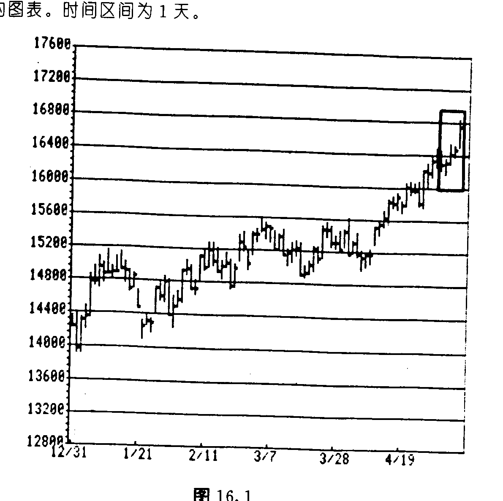

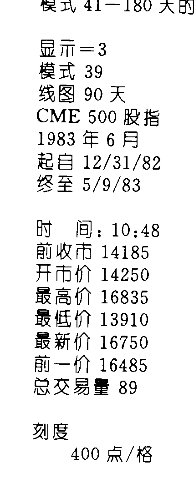

> 图16.1

<!-- pdf p480 / 书页 465 -->

（图16.2 屏幕上方说明文字同图16.1：线图 模式36—41　AP—6　显示=4。）

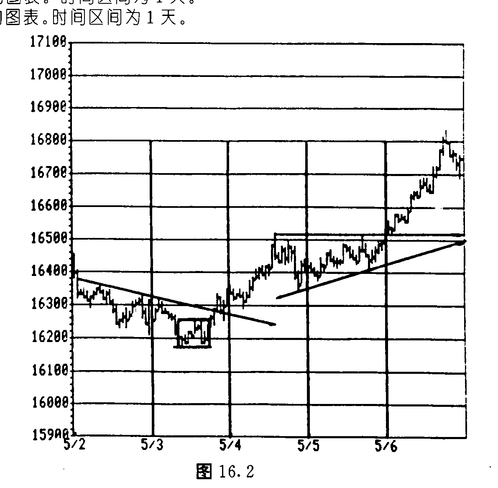

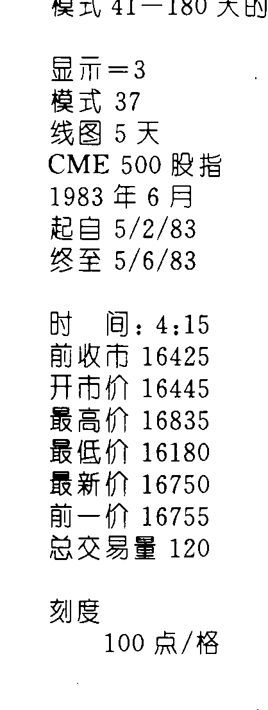

> 图16.2

上，我们可以识别潜在的支撑区域，从而计划买入点位。但是，如果我们希望得到更精确的结论，日线图就不够用了（在日线图上，我们也可以采用“突刺”方法，乘向下反弹的机会买入。我们稍后介绍）。请注意最后5天（一个星期）的价格变化（在图16.1中，我们给它们周围加了一个框子）。从图中可以看出，周一和周二价格稍有回撤，然后在周五涨出新高，不过这还不足以显示其中的变化细节。下面让我们再看看更灵敏的图16.2，它所显示的正是图16.1中框子里的5天的价格变化。在这张较灵敏的图上，每根价格线段各代表15分钟内的价格变化（15分钟线图）。

请注意，这里的情况详细得多了。在本图中，那5天价格变化具备了全新的面目。过去我们看不到的支撑和阻挡水平现在原形毕露，价格形态也像模像样，趋势线也能加得上了。从中我们可以看清周一和周 <!-- pdf p481 / 书页 466 -->

（图16.3 屏幕上方说明文字同图16.1：线图 模式36—41　AP—6　显示=4。）

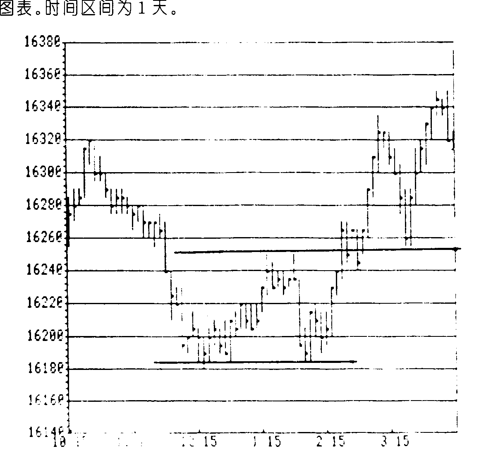

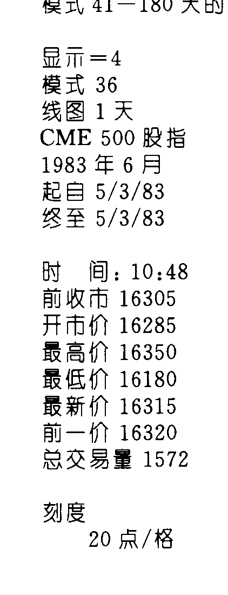

> 图16.3

二的抛售，周二的双重底，周四的看涨上升三角形，以及周五的新高点。由此看来，我们的买入既可以安排在周二向上突破的时候，也可以在周四的巩固形态中，或者在周五的第二个向上突破的时候。我们不妨再细致地探究探究。周二是调整结束的日子，所以它是本周最关键的一天，它本可以构成开立新多头的最好时机。下面我们就来好好看看这一天。

在图16.3中，我们只表示了周二的价格变化。其中每根价格线段均代表5分钟内的价格变化（五分钟线图）。请看图表下面所标出的时间。请朋友们特别注意，在本图上，标准的图表分析原则体现得何等完美。双重底的完成，在下午2:15左右，是以市场向上突破162.50的价 <!-- pdf p482 / 书页 467 --> 位为标志的。请注意，3:15左右的价格回撤大致是先前上冲的50%，而且刚好在突破点162.50上方打住——统统符合规范的图表分析理论。爱好艾略特波浪理论的朋友也可以看到，大约从12:15起到这一天收市为止，图上极清楚地显示出五浪结构的上涨形态。所有这一切信息本来均可以为交易者所用。当突破162.20的时候、当突破162.50时候、或者当市场发生50%回撤再次跌回162.50支撑水平的时候，统统是买入的好机会。在当日交易结束时，我们本可以在162.50下方设置紧凑的止损保护指令的。

头一回见到这些日内图表的朋友，常常感到很惊讶，图表分析在如此短期的图表上竟有这样出色的表现。实际上，如果朋友们事先并不知道图16.2和16.3是日内价格图表的话，单纯从这些价格图线上是不会产生任何疑虑的。它们的外观与6个月的日线图或者6年的月线图比起来，毫无例外之处。而这一点对于我们的时机抉择问题来说，恰恰是个要害。在我们力图使入市点和出市点精确化的过程中，我们所使用的技术工具是完全一致的。其间唯一的特别之处在于，后来我们把这些工具应用于非常短期的价格变化了。

从图16.4到图16.7表示的都是与上图同样的价格内容，但是图线形式不同。图16.4所示的是周二价格变化的“价点图”。图16.5和16.6所示为“趋势线图”，是价点图中的各点的指数平滑曲线。图16.7是周二日内点数图。由于日内点数图长于揭示潜藏的支撑和阻挡水平（见第十一章），在我们进行短期的时机抉择时，它们是极为有用的图表工具。在场内交易商中间，日内点数图备受青睐。

在上述图例中，我们的研究仅限于标准的图表分析理论。实质上，本书中所讨论的每一种技术分析方法，包括移动平均线和各种摆动指数，均可以应用于日内图表。在应用移动平均线时，其时间跨度可以选定为价点数，或者是日内时间单位的倍数。比如，在后一种情况下，我们可选择每个5分钟时段的最后价格进行平均。有些较流行摆动指数，如相对力度指数和随机指数，已经有了在日内图表下的翻版了。在第十五章详细介绍的Compu Trac软件中，也有各种日内形式的研究。这些更灵敏的技术分析程序称为日内分析（IDA）。

### 邓尼根的突刺技术

所谓“突刺”技术，是威廉·邓尼根在50年代早期创立的，这是一种利用日线图来寻求既存趋势发生小幅折返的入市时机的方法。其意图是乘市场发生反趋势方向的小规模反弹的机会买入。它最低要求， <!-- pdf p483 / 书页 468 -->

（图16.4 屏幕上方说明文字：）价点图 模式21—25　AP—5　显示=4。每个价点均表示在给定时间区间内的平均价格。时间区间从1分钟到1天不等。模式21—24刷新图表。模式21—1天的图表，时间区间为1分钟；模式22—5天的图表，时间区间为5分钟；模式23—20天的图表，时间区间为20分钟；模式24—60天的图表，时间区间为1小时；模式25—360天的图表，价点代表每日收市价。

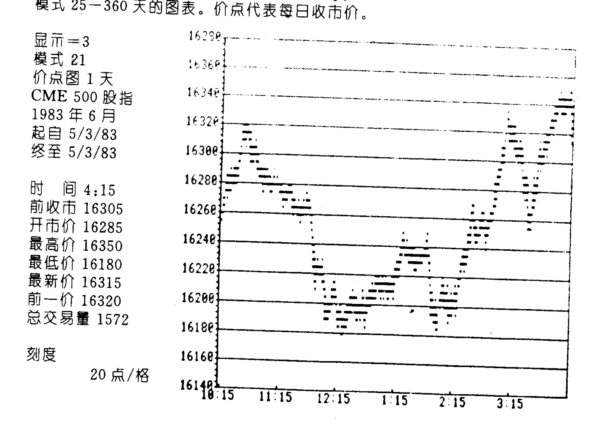

> 图16.4

在上升过程中至少有一个价格下跌的交易日。较理想的情况是有三个下跌日。所谓下跌日，意思是当日的最高价和最低价均分别低于前一天的对应价格。扩张日和收缩日都不算下跌日。假设在上升趋势中至少出现了一个下跌日，那么，如果次日的最高价至少高过下跌日的最高价一个基本价格单位，就构成了“突刺”买入信号。在这个多头头寸开立之后，其止损保护指令可以设置在入市当日最低价的下方。

上述是“突刺”技术最简单的形式。有些交易商对其中构成实际买、卖信号所需要的价格穿越幅度作了修改。在图16.1中，已经出现了一个强劲的上升趋势。最后这个星期的周一和周二均为下跌日（其中各日的最高价和最低价分别都低于前一日的对应价格）。“突刺”买入信号发 <!-- pdf p484 / 书页 469 -->

（图16.5 屏幕上方说明文字：）趋势线图 模式31—35　AP—4　显示=4。趋势线图是在价点图基础上通过对各个价点进行指数加权平滑而得的曲线图。模式31—34刷新图表。模式31—1天的图表，时间区间为1分钟；模式32—5天的图表，时间区间为5分钟；模式33—20天的图表，时间区间为20分钟；模式34—60天的图表，时间区间为1小时；模式35—360天的图表，价点为每天的收市价。

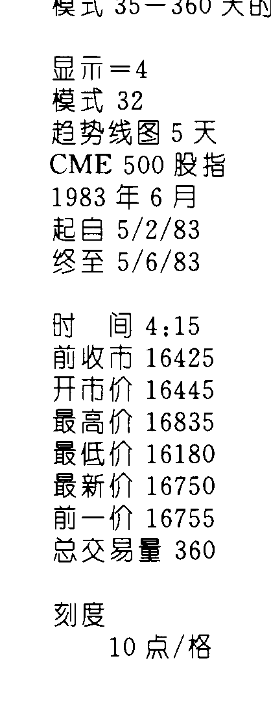

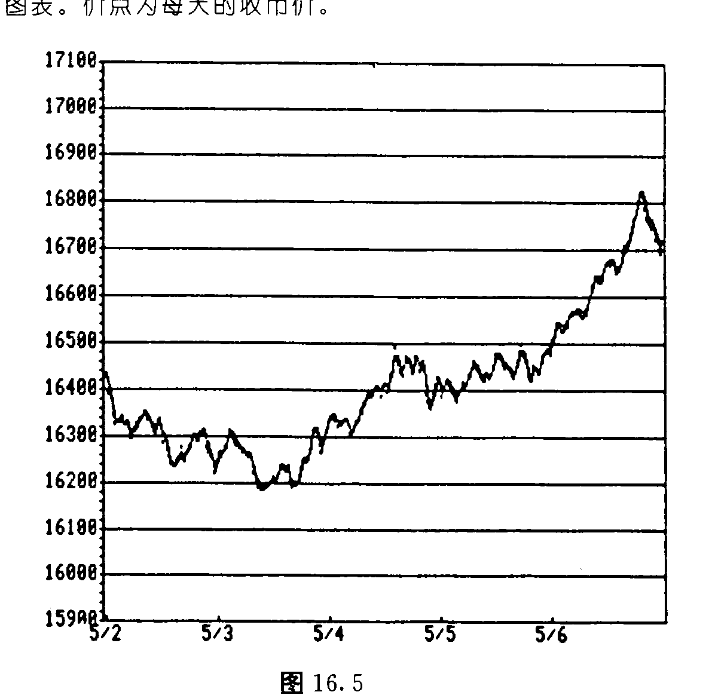

> 图16.5

生在周三，当价格向上穿越周二的最高价的时候。这种技术相对来说是简便的，我们可以依据它来进入具有强烈趋势的市场。在下降趋势中，道理一样，但方向相反。其中上涨日的最高价和最低价都必须分别高于前一日的对应数值。而卖出“突刺”信号发生在当市场向下跌破了前一日的最低价的时候。我们可以把相应的止损保护指令，设置在入市当日最高价的上方。

## 日内轴心价格点的利用

为了更早地入市，并且使止损保护指令的水平与入市水平更紧凑，有些交易商设法通过轴心价格点的方法来预期市场收市价位。在这 <!-- pdf p485 / 书页 470 -->

（图16.6 屏幕上方说明文字同图16.5：趋势线图 模式31—35　AP—4　显示=4。）

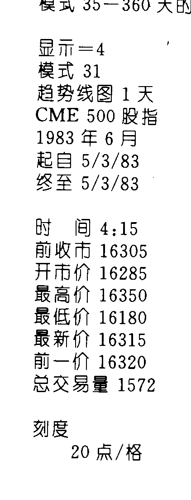

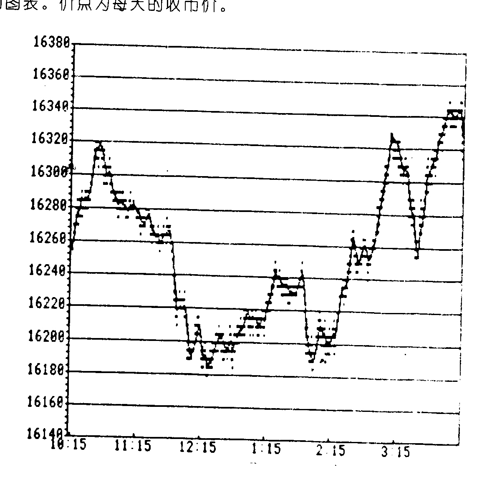

> 图16.6

种技术中，包含了7种关键的价格水平和4个时间参数。这7个价格轴心点分别是，前一日的最高价、最低价和收市价，当日的开市价、最高价、最低价和收市价。4个时间参数都是当前交易日的。它们是，开市，开市后30分钟，正午（纽约时间12:30），以及收市前35分钟。

这些都是平均的时间概念。我们可以针对具体的市场进行调整。这种方法的意图是，当交易者觉得市场已经处于强弩之末或处于摇摇欲坠的顶部或底部状态时，可以采用上述轴心点作为时机抉择的工具。其中的买、卖信号，是以当日价格突破各个轴心点为标志的。当日，信号出现得越迟，则越强。下面举个买入信号的例子。如果当日的开市价高于前一天收市价，但是低于前一天的最高价，则可以把买入止损指令设置在前一天最高价的上方。如果这个买入止损指令得以执行，我 <!-- pdf p486 / 书页 471 -->

（图16.7 屏幕上方说明文字：）点数图 模式42，43，45　AP—5　显示=4。每张点数图均由用户选定每点取值和转向规定。图表显示状态最大允许120次转向，列表显示最大允许200次转向。模式42—自当前日回溯的点数图。数据自后向前描入图表，直至图表已满或没有更多数据为止。模式43—自某日起始的点数图。数据自前向后描入图表，图表填满后显示“填满”字样。模式45—自某日起始的点数图数据列表。列表显示相应的数据。最后的价格即市场价，可能一直有变动，直到达到转向要求为止。如果不能添入新数据，则显示“填满”字样。

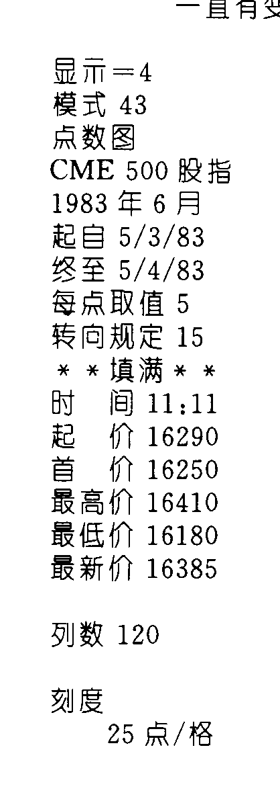

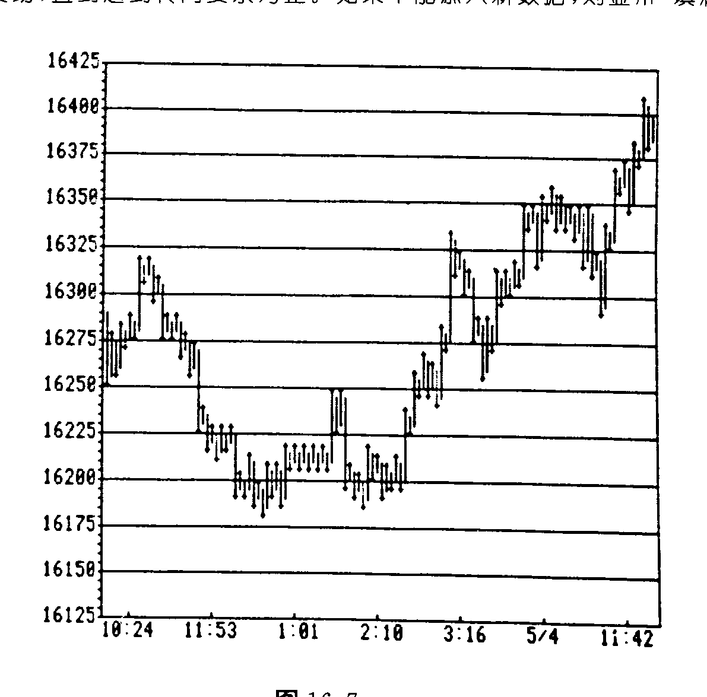

> 图16.7

们就把它的保护性卖出止损指令设立在当日最低价的下方。在收市前35分钟的时候，如果我们当日还未开立任何头寸，则在当日最高价上方设置买入止损指令，其保护性止损指令放在当日开市价下方。一般地，在开市后的头30分钟内，我们不采取行动。随着当日交易活动的进行，轴心价格点之间的距离会逐渐减小，而保护性止损指令的距离也就相应地缩短。作为买入信号，最后还有一个条件：当日的收市价格必须既高于前一日的收市价，又高过当日的开市价格。

关于轴心点方法的进一步的资料，朋友们可以从沃尔特·J·布雷塞特的一本40页的小册子中找到。书名是《入市和出市：如何与职业对手交易》（商品周期版，1976年），在《霍尔周期分析者智囊》中，对此也有简要的介绍（霍尔市场周期版，1984年）。 <!-- pdf p487 / 书页 472 -->

## 资金管理要领和交易策略举要

以下，我们开出了一张清单，其中列举了资金管理的要领和交易策略较重要的方面。

1. 顺应中等趋势的方向交易。
2. 在上升趋势中，乘跌买入；在下降趋势中，逢涨卖出。
3. 让利润充分增长，把亏损限于小额。
4. 始终为头寸设置保护性止损指令，以限制亏损。
5. 不要心血来潮地做交易，打有计划之战。
6. 先制订好计划，然后贯彻到底。
7. 奉行资金管理的各项要领。
8. 分散投资，但须注意，“过犹不及”。
9. 报偿—风险比至少要达到3比1，方可动作。
10. 当采取金字塔法增加头寸时，应遵循以下原则：
    - a. 后来的每一层头寸必须小于前一层。
    - b. 只能在盈利的头寸上加码。
    - c. 不可以在亏损头寸上再增加头寸。
    - d. 把保护性止损指令设置在盈亏平衡点。
11. 绝不要追加保证金，别把活钱扔进死头寸里去。
12. 为了防止出现追加保证金的要求，应确保至少拥有总的保证金要求的75%的净资金。
13. 在平回盈利头寸前，优先平仓了结亏损的头寸。
14. 除非是从事极短线的交易，否则总应当在市场之外，最好是在市场闭市期间，做好决策。
15. 研究工作应由长期逐步过渡到短期。 <!-- pdf p488 / 书页 473 -->
16. 利用日内图表找准入市、出市点。
17. 在从事当日交易之前，先掌握隔日交易的技巧。
18. 尽量别理会常识；不要对传播媒介的任何说法过于信以为真。
19. 学会踏踏实实地当少数派。如果你对市场的判断正确，那么，大多数人的意见会与你相左。
20. 技术分析这门技巧靠日积月累的学习和实践才能提高。永远保持谦逊的态度，不断地学习探索。
21. 力求简明。复杂的并不一定是优越的。
