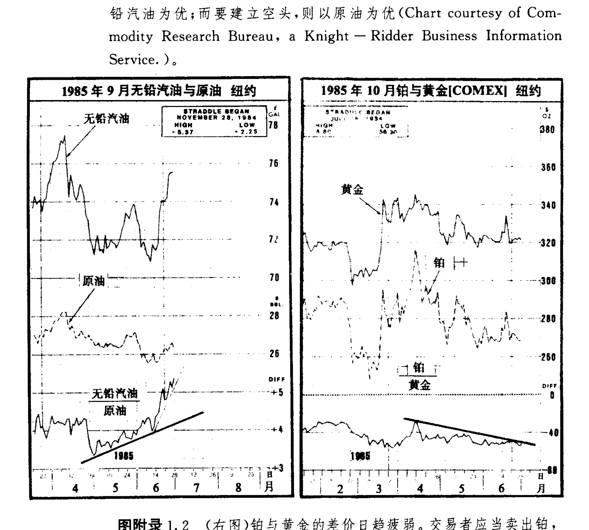
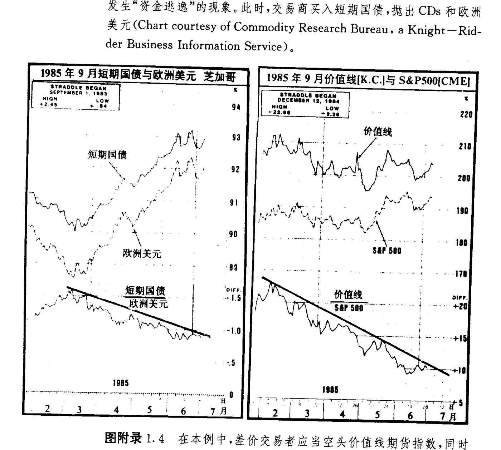
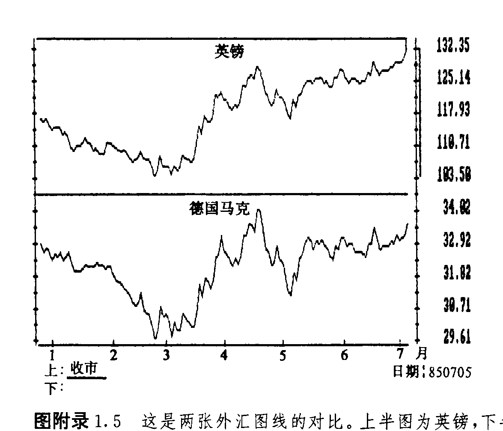
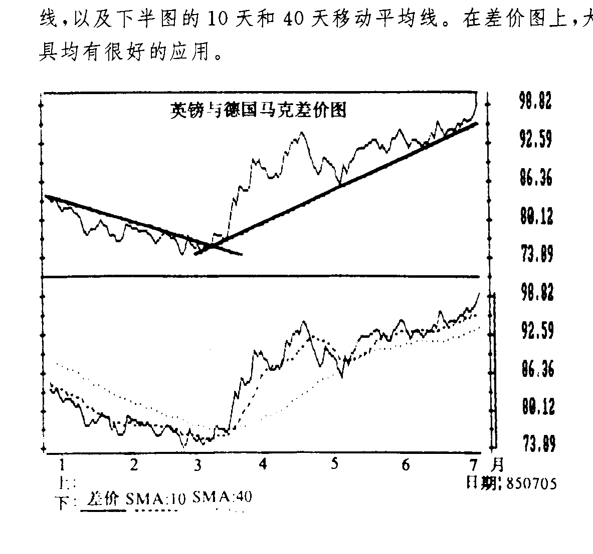
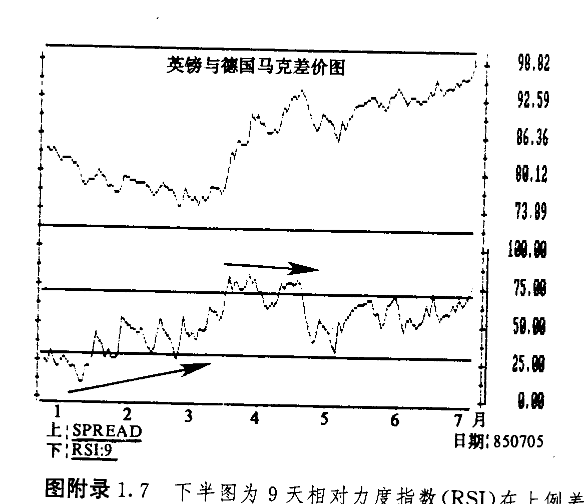
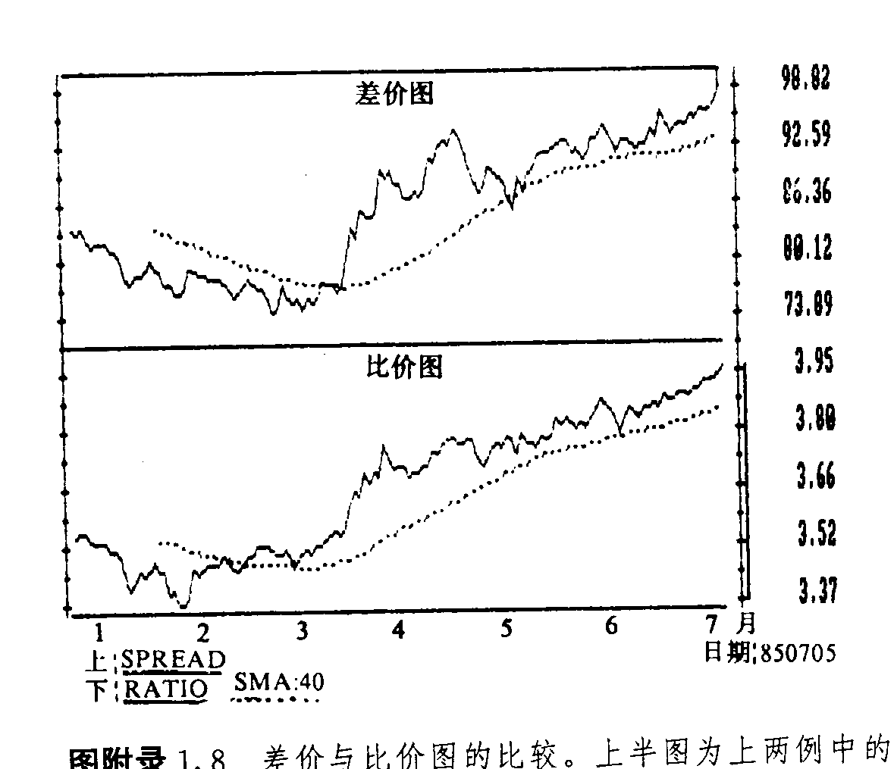

# 附录一 差价交易和相对力度的概念

> 原书 PDF 第 496–504 页。OCR 自扫描件，图表已截取到 `images/A1/`。

<!-- pdf p496 / 书页 481 -->

本书主要是研究商品期货合约的直接交易方法的。不过，差价交易（或称多空套做，或套头交易）也是参与期货市场角逐的另一种盛行的方式。所谓直接交易，指交易商预期市场价格本身即将上涨或下跌，因而相应地持有多头或者空头头寸。交易商的目的是从价格的绝对变化中获益。而所谓差价交易，指同时进行两种不同的期货合约的交易，买入一种，则卖出另一种。这两种合约既可以属于同一商品（品内差价，或称套交割期差价），也可以选自不同的、但相互有关联的商品种类（品间差价，或称套品种差价），或者还可以选自在不同交易所上市的商品（所间差价）。

当交易商进行差价交易（又称多空套做，或套头交易）的时候，他指望从两种合约之间的差价的变化中渔利。交易者所依靠的是上述差价的扩大或缩小。因为差价交易者所关心的是差价的变化（两种合约价格的相对变化），所以两种合约的绝对价格升也罢、跌也罢，他并不十分在意。一般认为，在期货行业中，差价交易方式的风险较小、代价较低。因为我们同时开立了多头和空头头寸，所以 <!-- pdf p497 / 书页 482 --> 风险小些。而正因为风险不大，其获利的潜力也就有限了。

差价交易比直接交易复杂得多，需要更高的熟练程度。关于这种交易，如果朋友们有兴趣深入了解的话，也有其它一些材料可资参考。我们这里主要是想指出技术分析在差价交易中的应用。其次呢，附带地讨论一下如何利用相对力度的概念，通过不同合约（或不同市场）之间的差价或比价关系，来帮助我们预测市场方向。

## 技术分析在差价图上的应用

无论交易商是在跟踪同一商品的两种合约之间的差价关系（如大豆的7月合约与11月合约，或者短期国债的9月合约与12月合约），还是在研究不同的商品合约之间的差价关系（如12月玉米合约与12月小麦合约，或者9月价值线合约与9月S&P500指数合约），都必须把其差价用图表表示出来。我们可以看出，差价通常也呈现出上升趋势或下降趋势的情形。由此可见，许多适用于直接的期货图表的技术工具，也同样可以用来研究差价图上的趋势。在差价图上，我们也可以看到支撑和阻挡水平，也可以作出趋势线。对有效趋势线的突破也可以揭示差价的趋势的变化。我们还能对之进行移动平均线和摆动指数的分析。也可以构造相应的点数图，进行点数图的研究。在我们所附的图表中，展示了部分技术工具应用于差价分析的实例（见图附录1.1到附录1.7）。

## 同一市场两种月份合约的相对力度

我们跟踪研究品内的或品间的两种合约的差价关系，不仅可以进行差价交易，也可以为研究市场本身的方向提供有益的线索。品内的两种合约当然是一个月份近，一个月份远。它们之间的价格关系常常包含着关于这个商品市场的看涨或看跌的一些信息。在一定类型的牛市下，由于供求关系的紧张，月份近的合约通常上涨得比月份远的快速。所谓牛市差价交易，在这种情况下，就是买入月份近的合约，同时卖出月份远的合约。而在熊市中，由于供求关系的相对宽裕，月份近的合约通常比月份远的合约疲软。所谓熊市差价交易，在这种情形中，就 <!-- pdf p498 / 书页 483 --> 是卖出月份近的合约，同时买入月份远的合约（在传统的商品市场中间，上述规律有明显的例外的情况，如贵金属商品群类。在黄金、银、和铂的市场上，无论是牛市还是熊市，都是以月份远的合约打头阵的）。

> 图附录1.1（左图）本图表示，自4月以来，无铅汽油与原油的差价是坚挺的。差价交易者应当买入无铅汽油合约，同时卖出原油合约。从差价图也可看出，如果要以直接方式入市建立多头，则交易对象以无铅汽油为优；而要建立空头，则以原油为优（Chart courtesy of Commodity Research Bureau, a Knight-Ridder Business Information Service.）。
>
> 图附录1.2（右图）铂与黄金的差价日趋疲弱。交易者应当卖出铂，同时买入黄金。如果交易商对贵金属市场看淡，那么在直接交易方式下，铂空头比黄金空头更有利可图。通常，铂市场领先于贵金属群类的动作。本差价也可以用作贵金属群类的一种总体性技术指标，差价疲弱，则是看跌的；差价坚挺，则是看涨的（Chart courtesy of Commodity Research Bureau, a Knight-Ridder Business Information Service.）。

<!-- pdf p499 / 书页 484 -->

> 图附录1.3（左图）在利率期货市场的牛市中，短期国债相对于欧洲美元来说较为疲弱。差价交易者应空头短期国债，同时多头欧洲美元。而只要差价低于下降趋势线，那么直接交易者最好多头欧洲美元，避开短期国债。在信用危机期间，政府债券，如短期国债，比银行的票据，如大额存单（CDs）及欧洲美元存款等，表现要好些。欧洲美元是存放在非美国银行的美元存款。当市场对银行体系的信心发生危机时，往往发生“资金逃逸”的现象。此时，交易商买入短期国债，抛出CDs和欧洲美元（Chart courtesy of Commodity Research Bureau, a Knight-Ridder Business Information Service）。
>
> 图附录1.4 在本例中，差价交易者应当空头价值线期货指数，同时多头S&P500。如果差价图上的下降趋势线被向上突破了，则构成“差价平仓”的信号，甚至可能需要反做。本差价也是其市场群类方向的技术指标，历来为人所重视。差价下跌，则看跌；差价上升，则看涨（Chart courtesy of Commodity Research Bureau, a Knight-Ridder Business Information Service.）。

<!-- pdf p500 / 书页 485 -->

> 图附录1.5 这是两张外汇图线的对比。上半图为英镑，下半图为德国马克。两者的趋势均向上。但是英镑市场比马克市场更坚挺。请注意，英镑已经走出了1985年的新高。

> 图附录1.6 本例表示趋势线和移动平均线应用于英镑与德国马克差价图的情形。差价的趋势向上，表明英镑较坚挺。差价交易者应当多头英镑而同时空头马克。对直接交易者而言，若要建立多头头寸，则由此可以选择英镑而非马克作为买入对象。注意上半图中的趋势线，以及下半图的10天和40天移动平均线。在差价图上，大部分工具均有很好的应用。

<!-- pdf p501 / 书页 486 -->

> 图附录1.7 下半图为9天相对力度指数（RSI）在上例差价图上的应用。这样，摆动指数分析也可应用于差价图。请注意2月的看涨背离，以及4月的看跌背离。RSI刚超过上方界线，显示出一定程度的超买状态。各种摆动指均可应用于差价图。

通过研究月份近的和月份远的合约的价格关系，技术分析者经常能够得到关于该市场即将上涨或下跌的及早的线索。无论分析者是否实际从事差价交易，上述关系都是极有价值的，可以用作显示市场坚挺或疲软程度的一种技术指标。

## 市场之间的相对力度

跟踪不同市场的差价关系，也能够为我们提供关于两个市场的相对的坚挺或疲弱程度的线索。假定交易者对外汇市场看好，那么，通过考察各种外汇市场之间的差价关系，就可以选出最坚挺的市场来开立多头头寸。而在下降趋势中，我们也可以选择最疲软的市场来建立空头头寸。因此，相对力度的概念的内涵比差价交易本身广泛得多。在选择适当的交易市场时，通过差价关系来评测一下各个市场之间的相对力度，对我们是极有帮助的（见图附录1.8）。

<!-- pdf p502 / 书页 487 -->

> 图附录1.8 差价与比价图的比较。上半图为上两例中的英镑与德国马克差价图。下半图为这两种外汇的比价图。比价分析也是确定合约之间的相对力度的一种方法。在本例中，比价图甚至比差价图还坚挺。请注意两图中的40天移动平均线。各种技术工具均可应用于比价分析。

## 比价分析

在我们测算各种相对力度的时候，比价分析也具有其特别的优越之处。差价，是两种合约价格的实际的差。而比价，则是一种价格除以另一种价格所得的商。不管是在我们比较品内两种月份的合约的时候，还是在对照品间同月份的合约的时候，均可以采用比价的概念。在同一个市场的两种月份的合约之间构造比价，可以鉴别出其中最坚挺或最疲弱的月份。在牛市中，自然应该把多头头寸开立在最坚挺的月份的合约上。而在熊市中，空头头寸则应建立在最疲软的月份的合约上。在我们分析各种市场群类的时候，可以利用比价分析鉴别每个群类中最坚挺或最疲软的市场。如果我们想买进，最坚挺的市场当然是最好的对象。而要卖出，则应当选择最疲弱者。

<!-- pdf p503 / 书页 488 -->

## 商品指数之间的相对力度

以上，我们讨论了如何利用相对力度概念在某市场内鉴别其最佳月份的交易合约，或者从给定的商品群类中挑选出最佳的个别市场。现在我们再推广一步，看看如何鉴别最佳的市场群类。我们一直遵循的原则是，最坚挺的合约或市场是开立多头头寸的最好对象，而最疲弱的合约或市场是建立空头头寸的最好对象。交易者也可以利用比价分析，把各个市场群类的指数与广泛性指数（如CRB期货价格指数）比较。由此，我们可以挑出最坚挺的市场群类开立多头头寸，最疲软的市场群类开立空头头寸。

假设交易者认为，CRB期货指数即将上升，那么，研究的结果就是买入方案。通过对CRB指数和各种市场群类的指数进行比价分析，我们可以鉴别出最坚挺的市场群类。那么，在我们的买入计划中，这个市场群类就是最合适的选择对象。然后，我们再在最坚挺的市场群类中的各个具体市场之间，如法炮制，也进行同样的比价分析，得出其中最坚挺的具体市场。最后，我们在这个最坚挺的市场内，比较各个交割月份的合约，以发现其中最坚挺的月份的合约。我们的最终目标就是，在最坚挺的市场群类中找出最坚挺的具体市场，再从这个最坚挺的具体市场中找出最坚挺的月份的合约，把它买进来。而在熊市中，我们的目标就是，在最疲软的市场群类中找出最疲软的具体市场，再从这个最疲软的具体市场中找出最疲软的月份的合约。

## 股票指数期货与实物股票指数：短期市场气氛的标志

所谓套利，指同时买进和卖出两个实质上相同的对象的交易方式。它与差价交易有些类似，但也有一个重要区别。当上述两个对象出现短暂的价格失调的情形时，套利者会敏捷地捕捉这种机会。他立即买入这个对象，同时卖出另一对象，然后等两者的价格恢复到协调一致的状况时（这正是套利者的合理预期），就可以获利。在股票指数期货市场上，此类交易方式正日益流行。这些期货合约比它所对应的实际股票指数更具有波动性，两者之间时常发生失调的情形。在股票市场处于上涨阶 <!-- pdf p504 / 书页 489 --> 段时，其期货合约的上升进程通常明显地超出它所对应的实物对象。在这种情况下，我们可以采用职业化的套利程序来谋取期货升水的好处。我们卖出其期货合约，开立空头头寸，同时搭配买入具有代表性的一揽子股票（股票组合），建立相应的多头头寸。而当股票市场处于下降趋势时，其期货合约经常处于贴水的状态。此时，职业套利者就会买入期货合约，同时卖出一揽子股票。

期货合约与其对应的实物指数的差价关系，构成了市场的看涨气氛或看跌气氛的短期技术标志，为人们所密切关注。当期货合约变化在其实物指数的上方过分超前的时候，表明市场处于短暂的超买状态，可能即将有所回撤。而当期货合约的变化在其实物指数的下方过于偏低时，表明市场处于超卖状态，可能出现技术性的上弹。

## 参考资料

大部分图表服务系统中包含一些差价图和比价图，其中有一家公司专门提供差价图表，这便是差价纵览公司。关于这个主题，我们也有些参考书。其一是考特尼·史密斯著的《商品差价：金融、谷物、金属以及其它商品差价交易技巧和方法》（约翰·威利父子版，1982年）。其二，《如何从商品的季节性差价中获利：一本大全》，作者是雅各布·伯恩斯坦（约翰·威利父子版，1983年），在第十四章我们已经提到过这本书。另外，在大部分关于商品期货的书籍中，都包含有关于差价交易的部分。

如果朋友们想从事差价交易的话，那么技术分析的知识必定是很有价值的。即使无意从事差价本身的交易，如朋友们对品内各月份合约的差价关系有所了解，也能对该市场的力度拥有更深刻的洞察力，所以我们应当对之进行跟踪研究。另外，关于此市场与彼市场之间相对力度的情况，在我们进行商品期货市场的直接交易时，也是极有价值的信息。
