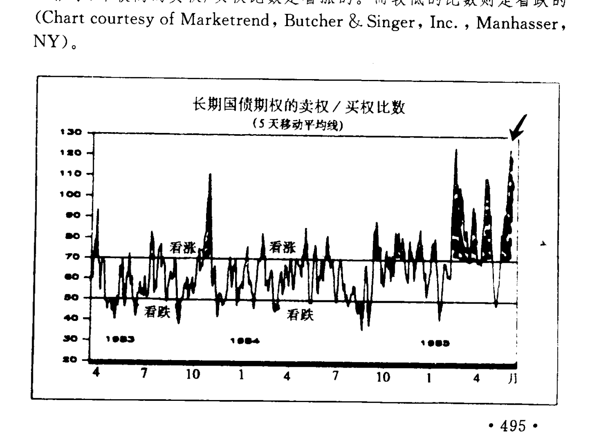

# 附录二 期权交易

> 原书 PDF 第 505–510 页。OCR 自扫描件，图表已截取到 `images/A2/`。

<!-- pdf p505 / 书页 490 -->

## 什么是期权？

期权交易也是我们参与期货市场的一种方式。在最近几年中，这种方式越来越风行于世了。所谓商品期权是一种权力，持有者拥有权力，而没有义务，在指定的时间期限内，以指定的价格买入（购入期权，简称买权）或卖出（售出期权，简称卖权）指定的期货合约。期权有两类，卖权和买权。就期权的最基本的应用的来说，如果交易商看好某商品市场，则可以径直地买进相应的期货合约的买权，而不开立该合约多头头寸。反过来，如果交易商看淡，则可径直地买进相应的期货合约的卖权，而不开立该合约的空头头寸。

<!-- pdf p506 / 书页 491 -->

## 为什么不直接买卖期货合约而是买入期权？

买入期货合约的期权与直接买卖期货合约相比，基本的优势在于其有限风险特点。当交易商在期货市场上持有头寸时，需要注入初始保证金。这项保证金通常是他所交易的期货合约价值的5%，数额相当小。然而，如果后来市场的变化不利于交易商的头寸，那么为了保持这个头寸，他或许需要追加更多的保证金。在市场剧烈运动的情况下，交易商的损失可能超过初始保证金的存款额。但是，在期权交易中，交易商只需要支付期权的价格。期权价格由交易所内的交易现场决定。在市场变化出乎交易者意料的不利情况下，他所蒙受的损失的最大值就是期权的价格。而如果交易者如愿以偿的话，他就拥有获取无限利润的潜力（扣除买入期权的价格成本）。

### 期货合约的头寸与期权头寸的比较

假定交易者看好黄金市场，企图借助期货市场的高杠杆率取得丰厚的利润，那么，他有两种选择——买入其期货合约，或者买入该期货合约的期权。假设他买进了期货合约，在300美元的价格开立了多头头寸。初始保证金需求为2000美元。如果市场涨到400美元，则该交易商有10,000美元的利润（$100×100盎司）。为了便于比较，我们再假定他当初买入的是买入期权（买权），而非合约本身。他在COMEX场内买入了一张12月份黄金期货的买权，敲定价格（执行价格）是300美元，所付的期权价格是3000美元（$30×100盎司）。当市场上涨到400美元的时候，他的利润是10,000美元减去3,000美元（期权成本），净值为7,000美元，而不是前一例中的10,000美元。在这里的情况下，直接的期货交易比期权交易赚取了更多的利润，因为后者必须支付期权的价格。

### 有限风险的益处

但是，如果金价没有上涨，而是跌到了250美元，情况如何呢？在直接的期货交易中，他在300美元买入，那么，亏损为5,000美元（$50×100盎司）。对于大部分交易者来说，或许在亏损达到如此之巨以前已经平仓了结上述多头头寸。不过，这样一来，如果价格后来再度上涨 <!-- pdf p507 / 书页 492 --> 的话，他就没有获利机会了（因为他的多头头寸已经止损平仓了）。从这里可以看出，期权交易具有两大优越性：有限风险和忍峙能力。如果价格确乎下跌，且跌幅持续加深，那么买入期权的持有者可以放弃执行该项买权，他的最大亏损额就是原先的期权价格，3,000美元（$30×100盎司）。对期权的持有者来说，没有追加保证金的问题（正因为买入期权后我们无须顾虑追加保证金，所以以这种方式进行保值交易独具魅力）。

### 忍峙能力的优越性

期权交易的另一个优势是其忍峙能力。如果我们持有期货合约的多头头寸，有可能中途被迫止损平仓。而持有期权就等于购买了时间。一直到期权到期之前，我们都有机会从价格上涨中获利。如果从现在到期权的到期日还有6个月，那么，只要是在这一期限内，我们均能从价格上涨中得益。持有期权者可以安然地度过价格不利于自己的时候。从而，他就无须始终关注其头寸。这就大大减轻了期货交易的紧张程度。综合起来，持有期权者不但具备事先预知风险和较大的忍峙能力这两个优越性，而且同期货交易者一样，也拥有无限地获利的潜力，以及高杠杆率。

## 如何把期权交易与直接的期货交易结合起来

大部分商品期权最终都没有被执行。如果由于期权所对应的期货合约的价格变化使之具有了帐面利润，那么我们一般在交易所内把相应的买权或卖权对冲掉，结算净利润。这样一来，期权交易者甚至无须在期货市场上持有头寸。但是，也有的做法是把期货和期权交易结合起来进行。

1. 可以用期权来限制期货头寸的亏损。如果交易者在期货市场上持有多头头寸，则可以同时买入卖权，作为保护性卖出止损措施。
2. 可以用期权来作为期货头寸的跟踪止损措施。如果市场的变化正如所愿，从而期货合约获得了帐面利润，我们就可以买入与之反向的期权，作为跟踪止损措施。对于盈利的期货多头头寸，可以买入相应的卖权；而对于盈利的期货空头头寸，则可以买入相应的买权。 <!-- pdf p508 / 书页 493 -->
3. 可以在加码时买入期权，作为扩大盈利的期货头寸的手段。假定我们在期货市场上已经持有了多头头寸，并希望以低风险的方法扩大这笔多头头寸，那么，我们不妨买入相应的买权。如果市场继续上涨，那么除了期权的买入成本之外，我们可以充分地享有每一点利润。如果市场转而向下，那么这笔期权交易的最大亏损也就是它的价格。为了扩大期货市场上盈利的空头头寸，我们可以买入相应的卖权。

## 什么因素决定期权价格？

期权交易问题是一个极复杂的课题。朋友们在尝试之前，必须充分地学习和准备。在这里的讨论中，我们仅涉及了它的基本概念。交易者应当了解期权交易策略的各种术语，以及决定期权价格的各项因素。期权价格有两个基本的决定因素，内在价值和时间价值。

所谓内在价值，指期权的已有帐面利润的金额。对买权来说，如果相应的合约的当前价格已经超过了该期权的执行价格，那么它已经含有内生利润了。当然，该期权的买方至少必须支付相当于内生利润的金额。

所谓时间价值与期权的有效期（自买入时起到到期日止）的长短有关。6个月期权的时间价值高于3个月的期权的时间价值。随着到期日的逐渐临近，它的时间价值也相应减少（因此，它又被称为“耗散性资产”）。决定期权价格的，还有其它因素，如市场的波动性、利率、以及对期权本身的需求等。对期权本身的需求取决于市场对价格方向的判断。在期货价格上涨期间，买权的价格较高，而卖权价格较低（因为对买权的需求较多）。而在期货价格下跌的时候，卖权价格较贵，而买权价格较低。

## 技术分析与期权交易

我们这里关心的是技术分析在期货合约的期权交易中的应用这个主题。请朋友们记住，买权或卖权一般被视为期货头寸的替代品。买权与多头头寸相对应，而卖权与空头头寸相当。因此，对于期权交易者来说，也不妨通读本书中的各项技术原理，只要把其中的“多头期货头寸”统统换成“买权”、“空头期货头寸”统统换成“卖权”就大功告成了。在我们稍作上述字句的调整之后，技术分析大抵就能适合期权交易者的口味了。

在我们制定期权交易的策略时，一般也需要对市场有所判断。买入 <!-- pdf p509 / 书页 494 --> 买权的人对市场看涨，买入卖权的人对行情看跌。即使是写期权者（即期权卖方、或期权授予者），其期权策略也是基于他对相应市场的看法之上的。通常，写期权者在横向延伸的或者稍显疲软的市场上卖出买权。而在中性的或者稍显坚挺的市场上卖出卖权。写期权者向购买期权者收取期权价格。作为报偿，写期权者替买方承担了他的有关风险，拿人钱财，与人消灾。当我们判断市场处于没有明显趋势状态时，或者预期尚不会出现趋势的横向延伸阶段时，卖出期权不失为牟利的一个办法。写期权是个危险的行当，最好还是让那些市场老手去干。

## 把技术分析应用于相应的期货市场

期权商在制定期权策略的时候，并不是对期权本身进行各种市场分析。他必须先把技术分析应用于相应的期货市场上。然后，由之形成对市场的判断，并相应地制定和实施看涨的、看跌的或中性的期权交易策略。请记住，期权交易仅仅属于期货市场交易或投资的一种方式。决定期权价值，也即决定对应的期权交易策略的主要因素，还是相应的期货市场的情况。所以，制定期权交易策略的第一个步骤，同时也是最重要的步骤，是对期货市场本身的研究。在这项重大工程中，技术分析是我们首选的武器。而这正是本书的全部内容。

### 推荐读物

如果朋友们有志于期货市场的期权交易的话，应当研读关于这一课题的参考书。我们推荐《商品期权：投机和保值方法指南》（塔里·S·迈耶著，纽约金融学院版，1983年），以及《商品期权市场揭秘》（约翰·W·莱伯兹乌斯基和珍妮·凯恩斯·辛克菲尔德著，约翰·威利父子版，1985年）。

## 卖权/买权比数作为市场气氛的标志

当期权交易商对市场持看涨态度时，买入买权，而当他看淡市场时候，买入卖权。如果绝大多数买期权者都看好市场，那么这种倾向就会反映在较高水平的买权交易上。相应地，市场上较大程度地一致看跌 <!-- pdf p510 / 书页 495 --> 的情况，也会反映在较高水平的卖权交易上。在各家金融报纸上，每天都公布卖权和买权的交易量的数字。因此，通过分别追踪卖权和买权交易量的水平，我们就有可能确定期权的购买者们主要是看涨的还是看跌的，及其相对的倾向性正在加强还是在减弱。

技术分析者们开发出了各种卖权/买权比，用来作为市场气氛的指标。最常见的比数是通过交易量构造的。做法是，把卖权的交易数量除以买权的交易数量。如果比数增长，则意味着市场采取看跌的态度（卖权的购买者比买权的多）。如果比数下降，则表明市场采取看涨态度（买权的买主多于卖权的）。卖权/买权的比数的最有价值之处，是指示市场的极端状态，这与超买/超卖摆动指数的功用类似。因此，它也是一种相反指标。如果其数值极高，则通常构成市场处于底部的信号。而如果其数值极低，则是市场即将出现顶部的警讯。我们也可以从该比数的曲线上揭示它与价格的相互背离现象，用来作为价格趋势即将转折的警示信号（见图附录2.1）。

70年代初以来，股票市场的技术分析者就一直在进行芝加哥期权交易所（CBOE）的期权交易。他们根据期权交易的情况，构造出了许多新的技术指标。目前，各间期货交易所也纷纷推出各类期权新品种，这已经成了80年代的一大景观。期货市场的技术分析者对这一领域拥有丰富的经验，毫无疑问，他们也将发现，在期权交易的各类统计数字这块沃土上，也能够绽放出新一代技术分析指标的奇葩。

> 图附录2.1 长期国债期货市场的卖权/买权比数的例子。通常，较高的读数（5天移动平均线）表明卖权活动多于买权活动。这被看成是看涨信号，即较高的卖权/买权比数是看涨的。而较低的比数则是看跌的（Chart courtesy of Marketrend, Butcher & Singer, Inc., Manhasser, NY）。
