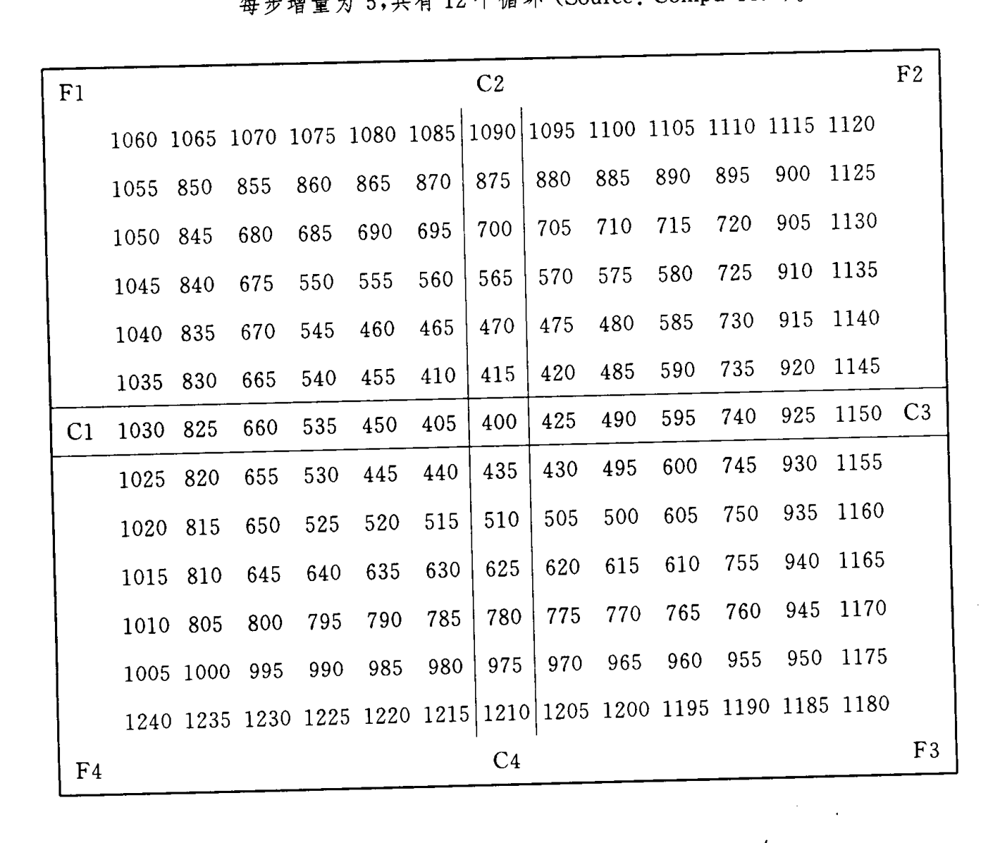
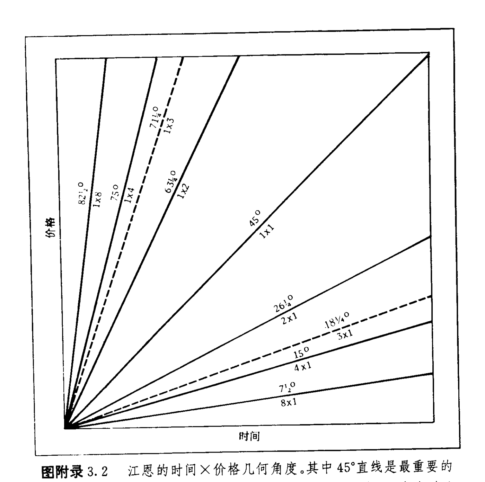
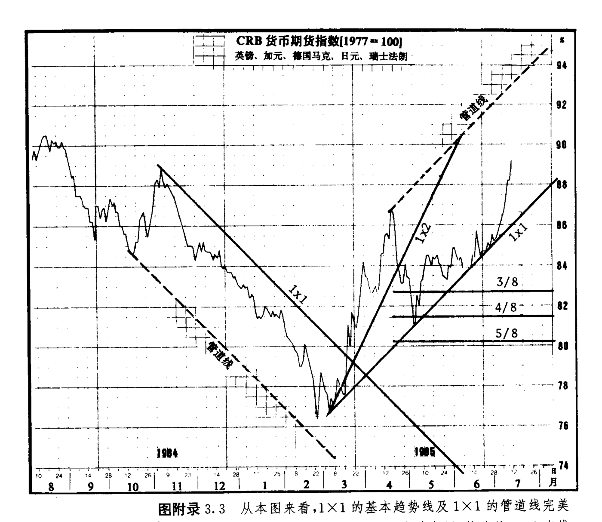
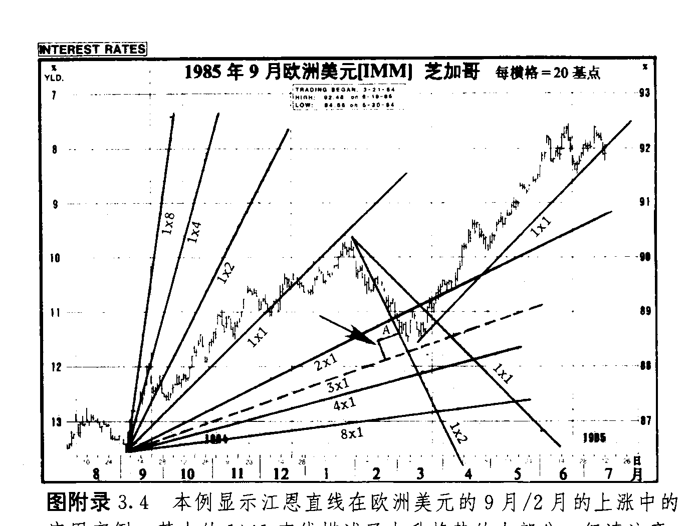
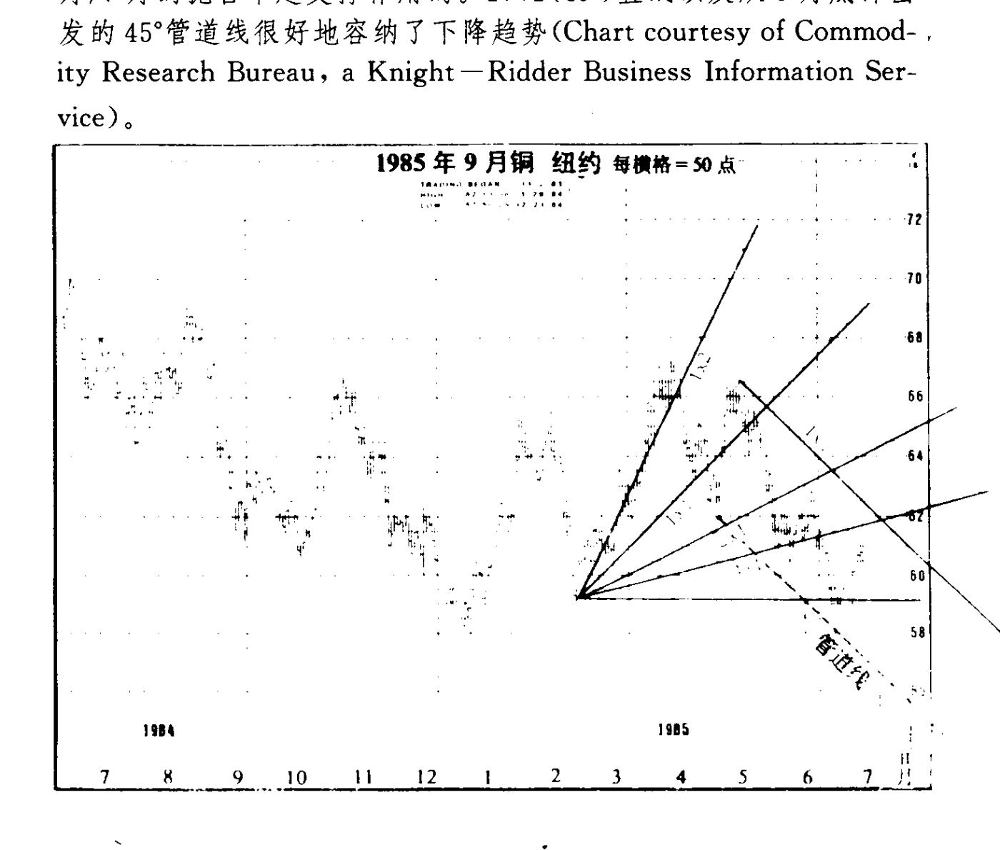
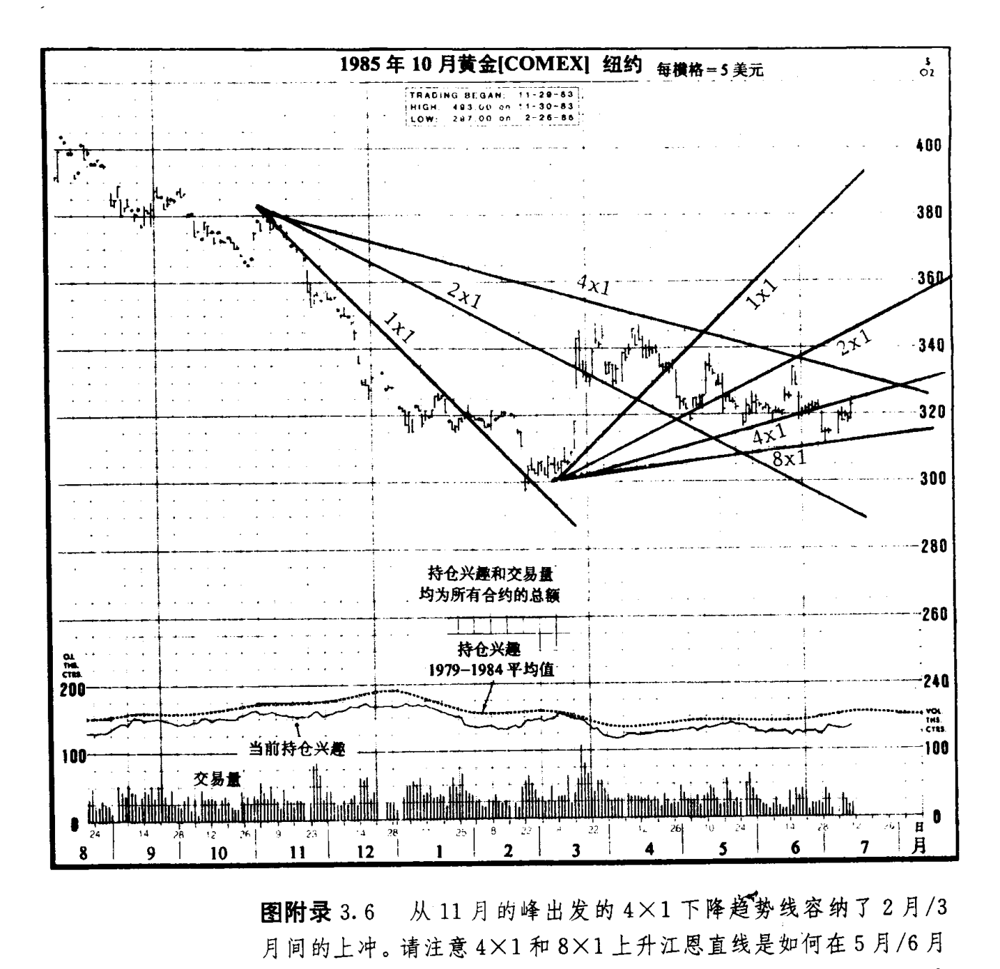
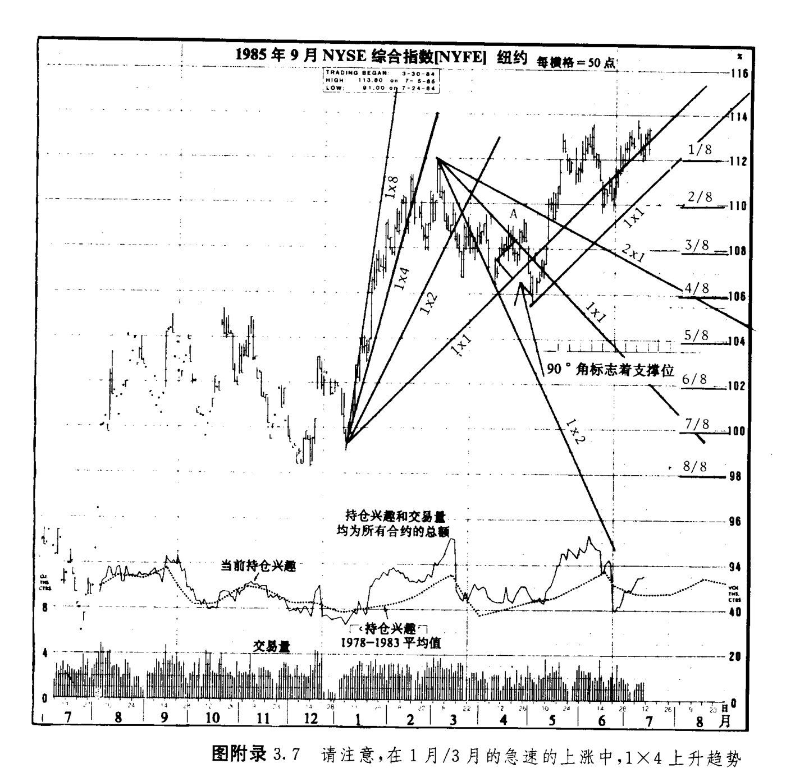

# 附录三 W·D·江恩：几何角度和百分比例

> 原书 PDF 第 511–521 页。OCR 自扫描件，图表已截取到 `images/A3/`。

<!-- pdf p511 / 书页 496 -->

## 引言

在本世纪上半叶，威廉·D·（W·D·）江恩（1878-1955）是位传奇式的股票和商品交易巨匠。在50年的职业生涯中，他创立了一套独特的理论，其中把精确的数学理论和几何原理揉合在一起。他利用这一套方法，在交易中取得了很大的成功。在这50年的后一半时间中，他开始为自己的理论著书立说，并四处宣扬。在50年代和60年代，江恩大部分书均告脱销，而且没有重印，所以当时大家对其理论了解很少。1976年，比利·琼斯，一位小麦农场主和养牛人，从过去江恩的搭挡爱德华·兰伯特手中，买下了兰伯特—江恩出版公司。琼斯重印了江恩大部分原著。在过去的10年中，人们之所以对江恩理论重新燃起了兴趣，在很大程度上应该归功于琼斯。 <!-- pdf p512 / 书页 497 -->

江恩的理论极端复杂，且晦涩难懂。江恩理论的分析者们已经花了数年的时间，来潜心研究他在25年里所使用的图表及各类文字，力图破译他的各种思路。江恩的大部分著作是以传统的图表分析概念写成的。他极力强调把历史的高点和低点作为未来阻挡区和支撑区的重要意义。他强调，阻挡水平被突破后，就演化成支撑水平；反之，支撑水平被突破后就演化为阻挡水平。他也是50%回撤的坚定的信奉者。在他首创的各种概念中，有方阵中心价格和时间均衡法，以及几何角度等。

所谓方阵中心法，是从商品的历史最低价开始，向后数算，推出未来的支撑或阻挡价位的一种方法。起算价格放在方阵的中央，然后依照顺时针方向，在其四周逐步增大。在方阵中，落在中心十字上的数字（通过中心作出的水平直线和垂直线）最有可能成为将来的支撑和阻挡水平（见图附录3.1）。

> 图附录3.1 江恩的矩阵中心十字法的示例。其中中心计算值为400，每步增量为5，共有12个循环（Source: Compu Trac）。

<!-- pdf p513 / 书页 498 -->

所谓几何形态，是由圆形、三角形和正方形所组成的。这些形态对他的影响最显著。360°的圆周是他的研究方法的显著特点。江恩利用360的和谐因子，来推算未来市场转折点的时间目标。他是按照日历来推算未来市场的转折点的，具体的做法是，从明显的峰和谷出发，向后数出30天、90天、120天、180天、以及360天。这些日历日期分别标志着市场未来可能发生转折的时间。显要的顶或底一周年后的日期，构成特别重要的时间目标。江恩对与数字7合拍的时间区间也特别推崇。

把时间和价格相结合，是他的理论的主要基础。江恩认为，两者之间存在一定的比例关系。在他的推测市场顶和底的方法中，有一种是以价格和时间的均衡为基础的——这就是一单位的价格变化，恰巧对应于一单位的时间过程的情况。举例来说，江恩在图上先选择一个显要的高点，再把其价格的美元数值转换成日历时间单位（天数、周数、月数、或年数），最后，以该时间单位向未来投射，得出与此高点距离等于上述时间单位的点。于是在这一点上，时间和价格将处于均衡状态，应当出现市场的转折点。下面我们用数字作一个具体的说明。如果市场显著高点为100美元，那么江恩就从此点开始，向未来数算100天、100星期、100月、或100年。在这些日期上，可能出现市场转折点。江恩时间和价格的比例关系，是他的几何角度理论的基础。而后者是我们这里要讨论的主题。

## 几何角度和百分比例

我们的目的是要介绍江恩理论中较简单的几何角度方法。在一些出色的江恩理论家看来，这是其中最有价值的一种技术。另外，我们还打算谈谈他的另一个相对简单的概念——百分比回撤，而这又可以有效地与几何角度线协同起来使用。

我们先从江恩的百分比例入手。在第四章讲述百分比回撤的时候，曾提到江恩把价格运动划分为八等份：1/8，2/8，3/8，4/8，5/8，6/8，7/8，8/8。他也把价格运动分成三等份：1/3和2/3。在下表中，我们把上述分数换算成百分数。请注意，1/3和2/3已经被安插在八等份数列中的适当位置上了。

- 1/8=12.5%
- 2/8=25%
- 1/3=33%
- 3/8=37.5%
- 4/8=50%
- 5/8=62.5% <!-- pdf p514 / 书页 499 -->
- 2/3=67%
- 6/8=75%
- 7/8=87.5%
- 8/8=100%

朋友们马上会注意到，中间的五个数字——33%、37.5%、50%、62.5%和67%——非常面熟。对江恩来说，其中50%是最重要的。而这个数字在各种百分比回撤中，也是最赫赫有名的。从50%向外扩展，以下的两个数字是37.5%和62.5%，其重要性仅次于50%，这与我们在第十三章中讨论的菲波纳奇回撤如出一辙。由此，我们就把江恩理论与艾略特波浪理论合二而一了。等而下之，是33%和67%，这是我们在第四章所讲的道氏理论的最小和最大回撤的位置。

江恩认为，其它百分比数字在市场变化中也有所体现，但都不太重要。在江恩扇形中，也以75%和87.5%作为市场转折点的警示点。而对于较小幅度的回撤来说，12.5%和25%也许也起到一定的作用。无论如何，虽然后头这四个数字超出了33%和67%的界限，但一般仍为大部分市场技术分析者所用。

江恩的几何角度是从市场的显要的顶或底出发、按照一定的角度引出的一组趋势线。这些角度由价格与时间的相互关系所决定。其中最重要的角度是45°。在上升趋势中，江恩从市场的底部向右上方引出45°倾角的直线。而在下降趋势中，从市场顶部向右下方引出45°倾角的直线（与我们在第十二章中讲过的变通点数图的45°直线类似）。作这条直线的根据是，沿着这条直线，时间变化和价格变化的关系正好处于1比1的均衡状态。换言之，在每个时间单位内（在日线图上通常为一周），价格上涨或下跌的幅度亦为一单位（或者是图上的一格）。其作法是，在日线图上，先找出底点，然后，沿时间轴向右移一格（一周），再沿价格轴向上移一格，得到第二个点，最后把两点联结起来并向右上方延长，就是45°直线了。我们也可以借助量角器来画线。

## 45°线的重要性

45°线代表江恩的主要的上升或下降趋势线。在牛市中，只要价格维持于上升45°线的上侧，则牛市持续有效。而在熊市中，只要价格维持在下降45°线的下侧，则熊市持续有效。市场对45°线的突破，通常构成主要的趋势反转信号。我们可以看出，在45°线上，价格与时间正好处于完美的均衡状态中。在上升趋势中，当价格跌回上升45°线时，时间和价格的关系恢复均衡状态。因此，如果这条趋势线被跌破了，就表明上述关系被打破了，趋势可能发生变故。我们也可以照45°画出其管 <!-- pdf p515 / 书页 500 --> 道线。它从显著高点或低点出发，平行于基本的趋势线。

我们通过因子2来组合时间和价格比例关系，可以作出更陡峭的或更平缓的几何趋势线。1×1线就是45°线。1×2线则是下一个更陡峭的线，居于45°线的上方，表示在每一时间单位内，价格增长2个单位。这就意味着价格上升的速度是时间变化速度的2倍。再下一个更陡峭的直线是1×4线，表示在一个时间单位内，价格上升4个单位。这一组陡峭直线可以依次类推，直到1×8线，不过后面这种陡峭直线已不常用（见图附录3.2）。

在45°线的下方，下一个更平缓的直线是2×1线，表示在两个时间单位内，价格上升一个单位（或者说每周上升1/2价格单位）。再下一个更平缓的直线为4×1线，表示在四个时间单位内，价格上升一个单位（或者说每周上升1/4价格单位）。下表按照由陡而平的顺序，列出了各种几何角度线以及与之对应的角度值。前一个数字代表时间，后一个数字代表价格，念作时间×价格：

- 1×8=82.5°
- 1×4=75°
- 1×3=71.25°
- 1×2=63.75°
- 1×1=45°
- 2×1=26.25°
- 3×1=18.75°
- 4×1=15°
- 8×1=7.5°

请注意，在上表中也包括进了1×3和3×1两条直线。江恩显然已经意识到，这两条特别的直线把价格运动三等分，因此在周线图和月线图上更有用途。江恩的几何直线的使用方式，与速度线和菲波纳奇扇形线颇为相似。在上升趋势中，它们是支撑线；而在下降趋势中，它们是阻挡线。在上升趋势中，价格跌破其中一条直线，就意味着将跌向下一条直线。相应地，在下降趋势中，涨破其中一条直线，就意味着将涨向上一条直线。

## 把几何角度线与百分比回撤结合起来

这两种技术相辅相成、相得益彰。一旦市场发生重要运动后，我们就可以把价格变化的幅度划成八等份，再沿着相应八等份回撤点，标 <!-- pdf p516 / 书页 501 -->

> 图附录3.2 江恩的时间×价格几何角度。其中45°直线是最重要的趋势线，表明时间和价格的进程恰好处于均衡之中。当45°线达到了右上角后，时间和价格“相等”，故称为“均衡”状态。这里常常标志着趋势的变化。这些趋势线是用来显示支撑和阻挡水平的。当一条线被突破后（以全天的价格区间），价格便将走向下一条直线。这些直线都是自市场的底部出发的。也可以自市场的顶部来引出几何角度趋势线。在重要的市场顶部和底部，江恩也以与零线成45°角的方向向右上方引出45°线。

出各条水平直线。在上升趋势中，这些直线在价格回落时起支撑作用。而在下降趋势中，它们起阻挡作用。通过这些标志线，我们预先就可以知道何处为重要的百分比回撤的位置。虽然江恩总共采用了八个数字，但其中最重要的位置仅仅在3/8、4/8、5/8三者上下。它们包含了50%回撤和2个菲波纳奇数字。其余参数的重要性稍为逊色一些，但我们至少也应当了解它们的位置。

下一步，我们从显要的高点、或低点，或者同时从两者出发，作出江恩几何角度线。其中最重要的三条角度线是45°线（1×1），63.75°线（1×2），以及26.25°线（2×1）。这三条线与中间的三条回撤线（37.5%、50%和62.5%）一起，界定了图表上的重点区域。我们也可以作出 <!-- pdf p517 / 书页 502 --> 其它的角度线（更陡的也好，更平的也罢），但其重要性不大。

然后，我们寻找两种技术的相互吻合或验证之处。最好的例子是，上升趋势的50%回撤正好达到了45°线上。这里是绝好的支撑区。另一个例子是，上升趋势37.5%的菲波纳奇回撤正好抵达63.75°线（1×2）。这里的情况是，价格同时达到了显要的几何角度线和重要的百分比回撤点。

江恩的几何角度线必须从显要的峰和谷出发。因此，在一张图上，可能同时出现上升和下降两组直线。这两组直线也可以结合起来使用。当下降的角度线（画自顶点）与上升的角度线（画自底点）成90°相交时，其交点具有更重要的份量。如果这个交点还与水平的百分比回撤线吻合的话，那么其意义甚至更重要。江恩除了自显著的顶点和底点出发作几何角度线外，也热衷于从坐标原点O出发作45°线。换句话说，在他的图表上，不仅从显著的顶点或底点出发作45°线，而且也从对应于原点的价格点出发作45°线。江恩认为，自原点作出的直线在未来也有意义。他还有很多作直线的方式，不过我们的讨论仅限于上述范围。

这里我们附了一些图例，展示了这些几何直线和角度的实际应用的情形。不过，为了简明起见，这些例子都集中在较重要的直线和角度上（见图附录3.3到3.7）。

## 参考资料

我们这里主要介绍了江恩的几种较简单也较有用的技巧。朋友们可以从其它资料中一窥江恩思想的全貌。其中最好的读物来自兰伯特—江恩出版公司。它出版了好几本江恩的著作，其中包括最著名的《如何在商品市场获利》（初稿于1942年，重订于1951年，1976年重印）。它还推出了两门课程“W·D·江恩股票市场教程”，和“W·D·江恩商品市场教程”。另外，兰伯特—江恩出版公司还发表一份市场通讯，《W·D·江恩技术评论》；偶尔举办一些关于江恩技术的讲座；甚至还出售最适合这类分析的图表纸。

有些市场通讯专门从事江恩分析，其中最著名的是《江恩角度》，作者为菲利斯·卡恩。另一份是《精确的时机抉择》，作者是唐纳德·R·沃都皮克。后者以其独到的方式把江恩分析与艾略特波浪理论结合起来加以应用。沃都皮克先生在其《利用精确的时机抉择法获利》（精确时机公司版，1984年）中，介绍了他的这门技术。其主要方法是，把艾略特波浪分析与江恩的角度线，特别是主要的几个江恩角度线——1×1、1×2和2×1，结合起来。 <!-- pdf p518 / 书页 503 -->

> 图附录3.3 从本图来看，1×1的基本趋势线及1×1的管道线完美地界定了趋势的变化过程。在3月/4月上冲期间，较陡的1×2直线效果更好。请注意，4月到5月的回撤达到了45°线（1×1上升趋势线）上，其回撤位置约为2月/4月上涨的50%（4/8）。把几何角度趋势线同百分比回撤结合起来，可以改进其总体效果。在作上述直线时，先向右数格子，再向上数，然后把起点与终点连线。1×1直线是1格向右，再1格向上。2×1直线是2格向右，再1格向上。而较陡的1×2直线，则是1格向右，再2格向上。（Chart courtesy of Commodity Research Bureau, a Knight-Ridder Business Information Service.）

江恩信奉者也有计算机软件作辅助工具。兰伯特—江恩出版公司推出了“江恩交易者1号”（1983年，版权为皮特·皮克所有），是最有雄心的程序，其中包含了江恩的一些较深奥的技术，如“专业时间和价格计算器”。帕多公司推出了“高级图表师”技术分析软件，能够在图表上 <!-- pdf p519 / 书页 504 -->

> 图附录3.4 本例显示江恩直线在欧洲美元的9月/2月的上涨中的应用实例。基本的1×1直线描述了上升趋势的大部分。但请注意，3×1上升趋势线容纳了3月的抛售。在A角处，上升的3×1线与下降的1×2线成90°相交。这里通常意味着重要的支撑区域。在2月/3月的下跌中，以及3月/6月的上涨中，1×1趋势线效果颇佳（Chart courtesy of Commodity Research Bureau, a Knight-Ridder Business Information Service）。

> 图附录3.5 江恩直线在铜市场的应用。请注意各条直线是如何在4月/7月的抛售中起支撑作用的。1×1（45°）直线以及从5月底部出发的45°管道线很好地容纳了下降趋势（Chart courtesy of Commodity Research Bureau, a Knight-Ridder Business Information Service）。

<!-- pdf p520 / 书页 505 -->

> 图附录3.6 从11月的峰出发的4×1下降趋势线容纳了2月/3月间的上冲。请注意4×1和8×1上升江恩直线是如何在5月/6月的下跌中起支撑作用的（Chart courtesy of Commodity Research Bureau, a Knight-Ridder Business Information Service）。

做出江恩角度线和江恩回撤线。Compu Trac提供江恩的方阵中心十字的计算程序（见图附录3.1），并给出了作出几何角度线所需的各种数字。

堪萨斯市期货交易所为喜欢自己动手的朋友提供了一种透明的塑料手工用具，称为“机会角度”，可用来描画江恩角度线。 <!-- pdf p521 / 书页 506 -->

> 图附录3.7 请注意，在1月/3月的急速的上涨中，1×4上升趋势线把这个趋势界定得很好。这类陡峭的趋势一般难以持久。通常价格将回撤到更为可靠的45°的上升速度上。请注意沿着图的右侧，从12月的低点到3月的高点的价格区间被分成了八等份。本图的重心在45°（1×1）线附近的3/8到5/8区域。在本例中，价格大约回撤了一半。由上升的1×1直线与下降的1×1直线所相交成的90°角处也标志着重要的支撑区（点A）（Chart courtesy of Commodity Research Bureau, a Knight-Ridder Business Information Service）。
